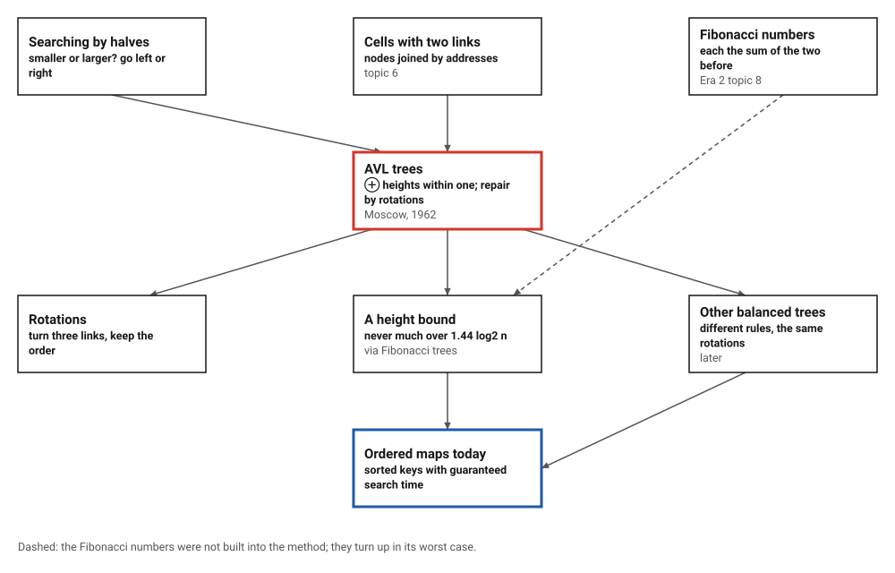
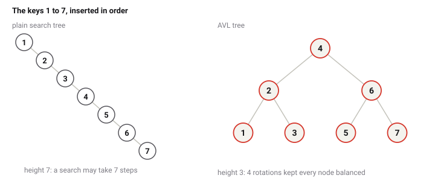
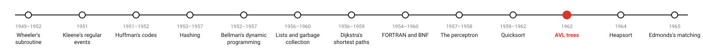
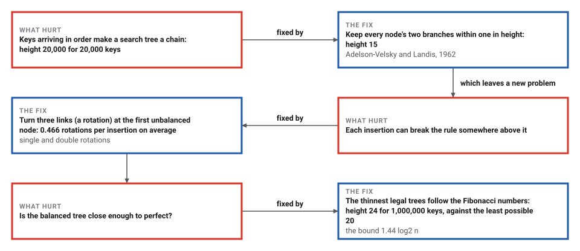

# AVL Trees

*Era 5 · topic 11 · 1962* · [Era 5 index](../README.md) · [← Hoare's Quicksort](../10-quicksort/README.md) · [Heapsort and the Heap →](../12-heapsort/README.md) · [Interactive edition](avl-trees.html) · [Program](../../../code/era-05-the-programmers-craft/11-avl-trees/)

> **Field note from the visiting historian.** The keys 1 to 7 in order: a plain tree becomes a line of 7; this one, after 4 turns of its branches, is a perfect tree of height 3. A million random keys made a tree of height 24, never more than the Fibonacci numbers allow.

| | |
|---|---|
| **When** | Paper received 13 April 1962 |
| **Where** | Moscow |
| **What hurt** | Search trees degenerate into chains |
| **The fix** | Heights within one; single or double rotations |
| **Guarantee** | Height at most about 1.44 log2 n |

## How ideas combined

A new algorithm is usually an older idea combined with a new one. A search tree asks "smaller or larger?" at each node, like searching a sorted list by halves, and its nodes are cells joined by addresses (topic 6). Adelson-Velsky and Landis added a rule that keeps the tree bushy whatever order the keys arrive in, and a cheap repair for when an insertion breaks it. Each box names the idea that was added.

<picture>
  <source media="(prefers-color-scheme: dark)" srcset="assets/family-dark.svg">
  
</picture>
*Red: AVL trees. Blue: ordered maps today.*

## Insert keys and watch the rotations

Insert keys into an AVL tree and, for comparison, into a plain search tree. Insert 1 to 15 in order: the plain tree becomes a chain while the AVL tree stays as short as a tree of 15 keys can be. The list on the right records each rotation.

<picture>
  <source media="(prefers-color-scheme: dark)" srcset="assets/trees-dark.svg">
  
</picture>
*In the interactive edition you can insert your own keys.*

## Era 5, the programmer's craft

<picture>
  <source media="(prefers-color-scheme: dark)" srcset="assets/era-timeline-dark.svg">
  
</picture>

## Each fix leaves a new pain

<picture>
  <source media="(prefers-color-scheme: dark)" srcset="assets/chain-dark.svg">
  
</picture>
*Read it as a snake: each new problem sits directly under the fix that exposed it.*

## Heights within one, repaired by rotations

**The rule.** At every node, "the heights of the two child subtrees ... differ by not more than one". After an insertion, walk back up from the new key; at the first node where the difference has become two, turn its branches round. If the new key went down the outside (left of the left child, or right of the right child), one rotation does it; if it went down the inside, two. A rotation changes three links, keeps the keys in order, and gives the subtree back the height it had before the insertion, so nothing higher up needs repair.

**Keys 1 to 7, in order**, as the program inserted them: 1; 2; 3 (single left rotation at 1); 4; 5 (single left rotation at 3); 6 (single left rotation at 2); 7 (single left rotation at 5). The result is 4(2(1 3) 6(5 7)) (root first, with left and right branches), height 3; a plain search tree would be a chain of height 7.

| Height | Fewest nodes an AVL tree of this height can have |
|---|---|
| 1 | 1 |
| 2 | 2 |
| 3 | 4 |
| 4 | 7 |
| 5 | 12 |
| 6 | 20 |
| 10 | 143 |
| 15 | 1,596 |
| 20 | 17,710 |
| 25 | 196,417 |

**The bound.** The thinnest AVL tree of height h has one branch of height h−1 and one of h−2, so its size is F(h+2) − 1, where F are the Fibonacci numbers. Since the Fibonacci numbers grow like powers of the golden ratio, a tree of n nodes can never be taller than about 1.44 log₂ n. The program built these thinnest trees, checked the rule at every node, and checked the bound against them.

> **Key idea.** Don't insist on a perfect tree, which would be costly to keep. Insist on a looser rule, heights within one, that a three-link rotation can always restore, and that still keeps the height within a constant factor of the best.

## A million insertions

| Keys | Order | Plain tree height | Plain average search | AVL height | AVL average search |
|---|---|---|---|---|---|
| **20,000** | **sorted** | **20,000** | **10000.5** | **15** | **13.4** |
| 1,000,000 | random | 48 | 25.4 | 24 | 19.4 |

1,000,000 random keys inserted, with the order of the keys and the balance rule checked at every node after each 250,000 insertions: 233,081 single and 232,819 double rotations, 0.466 per insertion. The final height, 24, sits between the least possible, 20, and the bound 1.44 log₂(n+2) − 0.33 = 28.4.

## Four pages in the Doklady

G. M. Adel'son-Vel'skii and E. M. Landis, "An algorithm for the organization of information", *Doklady Akademii Nauk SSSR* 146(2): 263–266 (1962), presented by I. G. Petrovskii and received on 13 April 1962 (Math-Net.Ru); English translation by Myron J. Ricci in *Soviet Mathematics – Doklady* 3: 1259–1263 (1962). The AVL tree is "the first self-balancing binary search tree [data structure] to be invented" (Wikipedia).

Adelson-Velsky (1922–2014) led a chess program at ITEP from 1963 that defeated the Kotok–McCarthy program in 1966, "the first chess match between computer programs", and grew into Kaissa, "the first world computer chess champion". That the AVL paper was written for the chess work is often said, but no opened source says so; the catalog marks it as conjecture.

## Order, kept cheaply

A hash table (topic 4) finds a key in a few looks but forgets the order of the keys; a balanced tree keeps them in order and still finds any key in about log₂ n steps, whatever order they arrived in. Many later kinds of balanced tree use different rules, but repair them with the same rotations.

> **Full circle.** 20,000 keys inserted in order: a plain tree needs 10000.5 steps on average to find one, the AVL tree 13.4.

## Before you read on

<details>
<summary><b>1.</b> Insert 3, 2, 1 into an AVL tree. What happens?</summary>

After 1, node 3 has a left branch of height 2 and a right branch of height 0: one right rotation makes 2 the root with children 1 and 3.
</details>

<details>
<summary><b>2.</b> Insert 3, 1, 2. Why is one rotation not enough?</summary>

2 went down the inside (right of the left child). Rotate 1 left first, making 3–2–1 a straight line, then rotate 3 right: a double rotation.
</details>

<details>
<summary><b>3.</b> Can an AVL tree of height 4 have 6 nodes?</summary>

No: the thinnest has F(6) − 1 = 7 nodes.
</details>

<details>
<summary><b>4.</b> Why does a rotation never need repeating higher up after an insertion?</summary>

It restores the subtree to the height it had before the insertion, so the nodes above see no change.
</details>

<details>
<summary><b>5.</b> What is the shortest possible tree for 1,000,000 keys?</summary>

Height 20, since 2²⁰ − 1 = 1,048,575 ≥ 1,000,000. The program's AVL tree had height 24.
</details>


## Where the evidence lives

| | Object | Where to see it | Licence |
|---|---|---|---|
| — | **An algorithm for the organization of information (1962)**. Adelson-Velsky and Landis's four pages in the Doklady of the USSR Academy of Sciences. | [Math-Net.Ru](https://mathnet.ru/eng/dan26964) | Drawn placeholder. |

## Every link was opened before it was listed

| Level | Link | Why |
|---|---|---|
| Start | [AVL tree](https://en.wikipedia.org/wiki/AVL_tree) — Wikipedia | The balance rule, rotations and the Fibonacci bound |
| Deeper | [Georgy Adelson-Velsky](https://en.wikipedia.org/wiki/Georgy_Adelson-Velsky) — Wikipedia | The inventor, and his chess programs |
| Scholar | [An algorithm for organization of information](https://mathnet.ru/eng/dan26964) — G. M. Adel'son-Vel'skii and E. M. Landis, *Dokl. Akad. Nauk SSSR* 146(2): 263–266 (1962), Math-Net.Ru record | The four-page paper, in Russian |

More, with certainty labels and the gaps we could not fill: [Era 5 reference catalog](https://github.com/vij658/AlgorithmEvolutionAtlas/blob/main/book/era-05-the-programmers-craft/reference-catalog.md).

## The program behind every number here

[AvlTrees.java](https://github.com/vij658/AlgorithmEvolutionAtlas/blob/main/code/era-05-the-programmers-craft/11-avl-trees/AvlTrees.java) makes **7,028,459 checks**: the keys 1 to 7 with their rotations, plain against AVL trees on sorted and random keys, 1,000,000 insertions with order and balance checked, and the Fibonacci trees against the height bound. Run it with `java AvlTrees.java` (JDK 17 or newer). The heart of it:

```java
static Node insert(Node n, int key) {
    if (n == null) return new Node(key);
    if (key < n.key) n.left = insert(n.left, key);
    else n.right = insert(n.right, key);
    fix(n);
    int bal = h(n.left) - h(n.right);
    if (bal > 1) {
        if (key < n.left.key) { singles++; note("single right rotation at " + n.key); return rotateRight(n); }
        doubles++;
        note("double rotation (left-right) at " + n.key);
        n.left = rotateLeft(n.left);
        return rotateRight(n);
    }
    if (bal < -1) {
        if (key >= n.right.key) { singles++; note("single left rotation at " + n.key); return rotateLeft(n); }
        doubles++;
        note("double rotation (right-left) at " + n.key);
        n.right = rotateRight(n.right);
        return rotateLeft(n);
    }
    return n;
}
```

