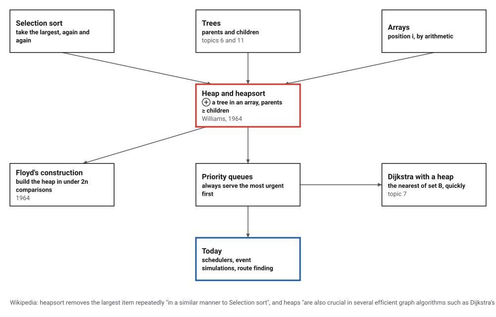
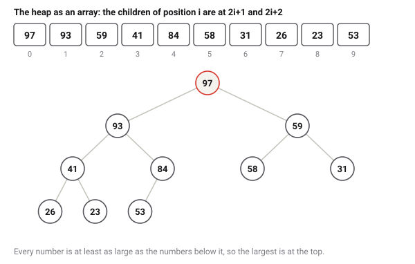
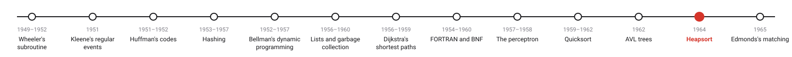
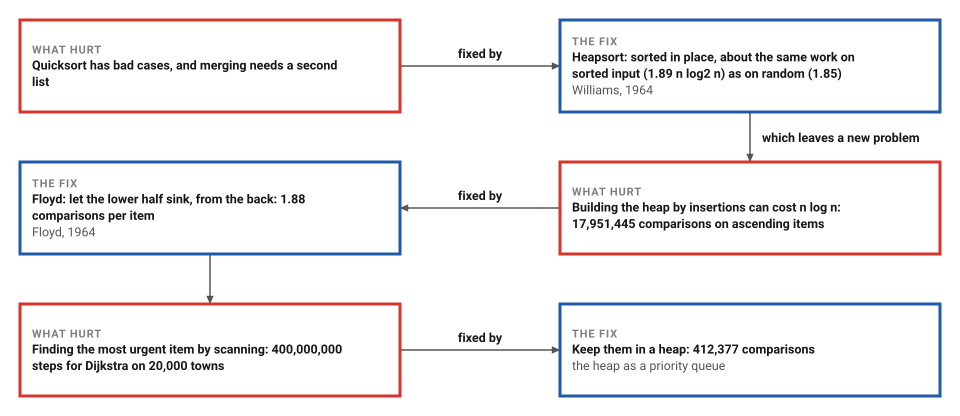

# Heapsort and the Heap

*Era 5 · topic 12 · 1964* · [Era 5 index](../README.md) · [← AVL Trees](../11-avl-trees/README.md) · [Edmonds's Matching →](../13-matching/README.md) · [Interactive edition](heapsort.html) · [Program](../../../code/era-05-the-programmers-craft/12-heapsort/)

> **Field note from the visiting historian.** Floyd built a heap of a million items with 1,880,661 comparisons, fewer than two per item; the formula for his worst case matched every ordering I tried. The sort was the reason for the heap, but the heap outlived the sort: it is how a program keeps the most urgent of many waiting items at hand.

| | |
|---|---|
| **When** | Williams 1964; Floyd 1964 |
| **Where** | Elliott Automation (Williams); CACM |
| **What hurt** | Quicksort's bad case; finding the largest of a changing set |
| **The fix** | A heap in the array; sink and climb |
| **Cost** | About 1.85 n log₂ n here, whatever the input |

## How ideas combined

A new algorithm is usually an older idea combined with a new one. Selection sort takes the largest item again and again, but finding it means searching everything that is left. Williams kept the remaining items in a heap, a tree packed into the array itself, so that the largest is always at the top and the tree can be repaired in a few steps. Each box names the idea that was added.

<picture>
  <source media="(prefers-color-scheme: dark)" srcset="assets/family-dark.svg">
  
</picture>
*Red: the heap and heapsort. Blue: priority queues today.*

## Build a heap, then take it apart

Fifteen numbers in an array, drawn also as a tree (the children of position i are at 2i+1 and 2i+2). Step through Floyd's construction: each parent, from the last one back to the top, sinks below any larger child. Then the sort: swap the top with the last item of the heap, which joins the sorted part (blue), and let the new top sink.

<picture>
  <source media="(prefers-color-scheme: dark)" srcset="assets/heap-dark.svg">
  
</picture>
*In the interactive edition you can step through heapsort on fifteen numbers.*

## Era 5, the programmer's craft

<picture>
  <source media="(prefers-color-scheme: dark)" srcset="assets/era-timeline-dark.svg">
  
</picture>

## Each fix leaves a new pain

<picture>
  <source media="(prefers-color-scheme: dark)" srcset="assets/chain-dark.svg">
  
</picture>
*Read it as a snake: each new problem sits directly under the fix that exposed it.*

## A tree with no pointers

**The heap.** Read an array as a tree: position 0 is the top, and the children of position i sit at 2i+1 and 2i+2, so no addresses need to be stored. In a heap every item is at least as large as its children. The program built the numbers 31 41 59 26 53 58 97 93 23 84 into the heap 97 93 59 41 84 58 31 26 23 53: 97 at the top.

**Two repairs.** To add an item, put it at the end and let it climb past smaller parents (Williams). To remove the largest, move the last item to the top and let it sink below the larger of its children. Each repair walks one path from top to bottom, about log₂ n steps.

**Heapsort.** Build a heap, then repeatedly swap the top with the last item of the heap and let the new top sink. The sorted part grows at the back of the same array, so no second list is needed.

> **Key idea.** Don't keep everything in order; keep just enough order that the largest item is always at the top. That much order costs a few steps per change, and it is all a sort, or a queue of urgent tasks, needs.

## Building, sorting, queueing

| Random items | Williams's insertions | Floyd's construction | Floyd per item | Williams on ascending items |
|---|---|---|---|---|
| 1,000 | 2,265 | 1,886 | 1.89 | 7,987 |
| 100,000 | 226,816 | 187,636 | 1.88 | 1,468,946 |
| 1,000,000 | 2,280,006 | 1,880,661 | 1.88 | 17,951,445 |

Floyd's construction needs fewer than two comparisons per item, because most items sit near the bottom and sink only a level or two. The program found the most comparisons it ever needs by trying every ordering of up to 10 items; each matches the formula 2n − 2s(n) − e(n), where s(n) counts the 1s of n in binary and e(n) its trailing 0s:

| n | Most comparisons (every ordering tried) | 2n − 2s(n) − e(n) |
|---|---|---|
| 2 | 1 | 2·2 − 2·1 − 1 = 1 |
| 3 | 2 | 2·3 − 2·2 − 0 = 2 |
| 4 | 4 | 2·4 − 2·1 − 2 = 4 |
| 5 | 6 | 2·5 − 2·2 − 0 = 6 |
| 6 | 7 | 2·6 − 2·2 − 1 = 7 |
| 7 | 8 | 2·7 − 2·3 − 0 = 8 |
| 8 | 11 | 2·8 − 2·1 − 3 = 11 |
| 9 | 14 | 2·9 − 2·2 − 0 = 14 |
| 10 | 15 | 2·10 − 2·2 − 1 = 15 |

| Items | Input | Comparisons | × n log₂ n |
|---|---|---|---|
| 1,000 | random | 16,820 | 1.69 |
| 100,000 | random | 3,019,242 | 1.82 |
| 100,000 | sorted | 3,112,517 | 1.87 |
| 1,000,000 | random | 36,796,539 | 1.85 |
| 1,000,000 | sorted | 37,692,069 | 1.89 |

Sorted input costs about the same as random input; Quicksort with the first item as its bound needed more than n²/2 comparisons on a sorted list (topic 10). Heapsort is not stable: cards 5a 3a 5b 3b 5c, sorted by number only, come out as 3a 3b 5b 5c 5a, where a stable sort would give 3a 3b 5a 5b 5c.

**The heap as a queue.** Dijkstra's method (topic 7) on 20,000 towns with 79,965 roads: finding the nearest town of set B by scanning every town took 400,000,000 steps; keeping set B in a heap took 34,112 removals and 412,377 comparisons, with the same distance to every town.

## Two algorithms in one volume of CACM

J. W. J. Williams devised heapsort in 1964 ("Algorithm 232 – Heapsort", *Communications of the ACM* 7(6): 347–348); his paper also "introduced the binary heap as a useful data structure in its own right". In the same year Robert W. Floyd "published an improved version that could sort an array in-place" ("Algorithm 245 – Treesort 3", *CACM* 7(12): 701), with a heap construction that "operates in O(n) time". Heapsort is "not a stable sort" and needs "2n log₂ n + O(n) comparisons worst-case and on average"; the worst case of Floyd's construction "is known to be equal to 2n − 2s₂(n) − e₂(n)" (Wikipedia, Heapsort).

Williams (1930–2012) worked as a programmer for Elliot Automation, formerly Elliott Brothers, and later for English Electric and GEC, before moving to Bell-Northern Research in Ottawa in 1974. His biography dates the invention to 1963, the year before publication; the catalog marks the year as disputed.

## The sort that outlived itself

"The heap data structure, specifically the binary heap, was introduced by J. W. J. Williams in 1964, as a data structure for the heapsort sorting algorithm" (Wikipedia). It became more useful than the sort: any program that must keep serving the most urgent of many waiting items, from Dijkstra's frontier to Huffman's "take the two smallest" (topic 3), uses a heap.

> **Full circle.** Dijkstra's frontier, kept in a heap: 412,377 comparisons instead of 400,000,000 scanning steps, and the same distances.

## Before you read on

<details>
<summary><b>1.</b> In an array heap, where are the children of position 4? Its parent?</summary>

Children at 9 and 10; parent at (4 − 1) ÷ 2 = 1 (rounding down).
</details>

<details>
<summary><b>2.</b> Is 9 7 8 3 6 5 a heap?</summary>

Yes: 9 ≥ 7, 8; 7 ≥ 3, 6; 8 ≥ 5.
</details>

<details>
<summary><b>3.</b> Why does Floyd start from the middle of the array?</summary>

Positions after n/2 have no children: they are already heaps of one item.
</details>

<details>
<summary><b>4.</b> Why is heapsort's bad case no worse than its average?</summary>

Every step walks at most one path of length about log₂ n, whatever the input.
</details>

<details>
<summary><b>5.</b> Why is heapsort not stable?</summary>

Swapping the top to the back can jump an item past others with the same key.
</details>


## Where the evidence lives

| | Object | Where to see it | Licence |
|---|---|---|---|
| — | **Algorithm 232 – Heapsort (1964)**. Williams's algorithm in Communications of the ACM 7(6): 347–348. | [Bibliographic record](https://hjemmesider.diku.dk/~henglein/bib/publications/williams1964.html) | Drawn placeholder. |

## Every link was opened before it was listed

| Level | Link | Why |
|---|---|---|
| Start | [Heapsort](https://en.wikipedia.org/wiki/Heapsort) — Wikipedia | Williams's method, Floyd's improvement and the comparison counts |
| Start | [Heap (data structure)](https://en.wikipedia.org/wiki/Heap_(data_structure) — Wikipedia | The heap as a priority queue, and its uses beyond sorting |
| Deeper | [J. W. J. Williams](https://en.wikipedia.org/wiki/J._W._J._Williams) — Wikipedia | The inventor's career in England and Canada |
| Scholar | [Algorithm 232 - Heapsort](https://hjemmesider.diku.dk/~henglein/bib/publications/williams1964.html) — J. W. J. Williams, *CACM* 7(6): 347–348 (1964), bibliographic record | The citation of the original algorithm |

More, with certainty labels and the gaps we could not fill: [Era 5 reference catalog](https://github.com/vij658/AlgorithmEvolutionAtlas/blob/main/book/era-05-the-programmers-craft/reference-catalog.md).

## The program behind every number here

[Heapsort.java](https://github.com/vij658/AlgorithmEvolutionAtlas/blob/main/code/era-05-the-programmers-craft/12-heapsort/Heapsort.java) makes **30 checks**: a small heap, Williams's and Floyd's constructions, Floyd's exact worst case for every ordering of up to 10 items, heapsort on up to a million random and sorted items, stability, and Dijkstra's method with and without a heap. Run it with `java Heapsort.java` (JDK 17 or newer). The heart of it:

```java
/** Let a[i] sink below larger children, within a[0..n-1]. */
static void sink(long[] a, int i, int n) {
    while (2 * i + 1 < n) {
        int c = 2 * i + 1;
        if (c + 1 < n && less(a, c, c + 1)) c++;
        if (less(a, i, c)) { swap(a, i, c); i = c; } else break;
    }
}

static void heapsort(long[] a) {
    buildFloyd(a);
    for (int end = a.length - 1; end > 0; end--) { swap(a, 0, end); sink(a, 0, end); }
}
```

