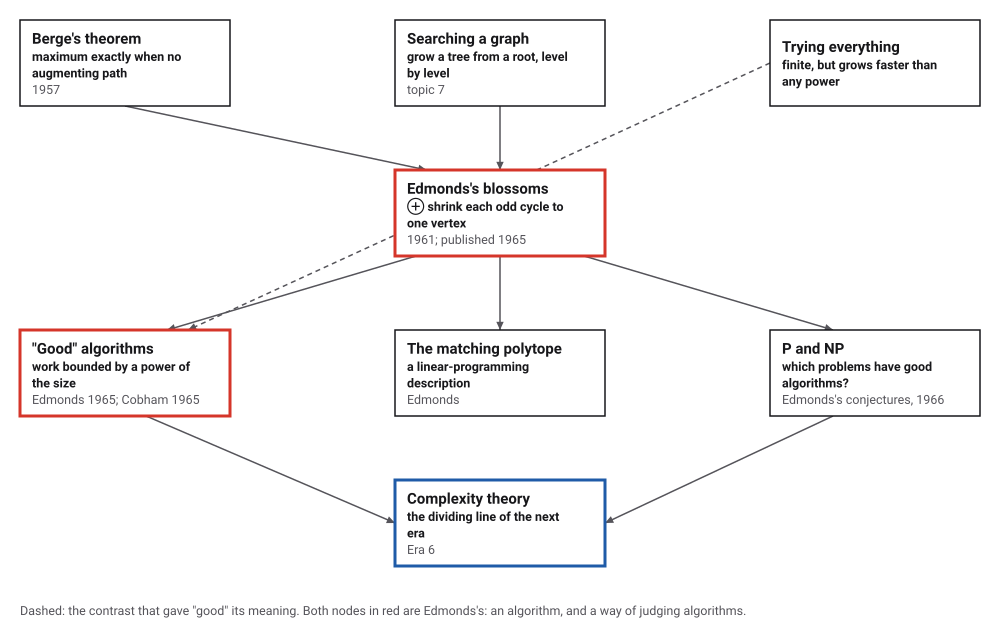
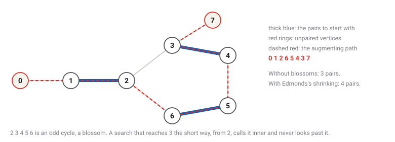
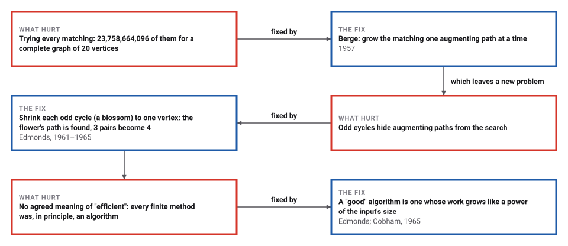

# Edmonds's Matching

*Era 5 · topic 13 · 1965* · [Era 5 index](../README.md) · [← Heapsort and the Heap](../12-heapsort/README.md) · [Interactive edition](matching.html) · [Program](../../../code/era-05-the-programmers-craft/13-matching/)

> **Field note from the visiting historian.** On a graph of 8 vertices the obvious search missed an improvement, and shrinking one pentagon found it. For 400 vertices there are about 9.68 × 10⁴⁴¹ matchings to try; Edmonds's search took 13,714 steps. The species ends this era able to say not only that a problem can be solved, but whether it can be solved well.

| | |
|---|---|
| **When** | Developed 1961; published 1965 |
| **Where** | National Bureau of Standards |
| **What hurt** | Odd cycles; no agreed meaning of "efficient" |
| **The fix** | Shrink blossoms; call polynomial-time algorithms good |
| **Cost** | O(|E||V|²) for the original algorithm |

## How ideas combined

A new algorithm is usually an older idea combined with a new one. Berge had shown in 1957 that a matching is as large as possible exactly when no augmenting path exists. Searching for such paths works on two-sided graphs, but odd cycles fool it. Edmonds added the blossom: shrink the odd cycle and search on. His paper then asked what makes any algorithm good. Each box names the idea that was added.

<picture>
  <source media="(prefers-color-scheme: dark)" srcset="assets/family-dark.svg">
  
</picture>
*Red: Edmonds's algorithm, and his test for a good one. Blue: the question that took over the next era.*

## Find the path that the simple search misses

The graph from the program: pairs 1-2, 3-4 and 5-6 to start (thick blue), vertices 0 and 7 unpaired. An augmenting path from 0 to 7 would add a pair. Search without blossoms, then with Edmonds's shrinking; then try a random graph.

<picture>
  <source media="(prefers-color-scheme: dark)" srcset="assets/flower-dark.svg">
  
</picture>
*In the interactive edition you can run both searches on the flower, and Edmonds's algorithm on random graphs.*

## Era 5, the programmer's craft

<picture>
  <source media="(prefers-color-scheme: dark)" srcset="assets/era-timeline-dark.svg">
  
</picture>

## Each fix leaves a new pain

<picture>
  <source media="(prefers-color-scheme: dark)" srcset="assets/chain-dark.svg">
  
</picture>
*Read it as a snake: each new problem sits directly under the fix that exposed it.*

## Paths, trees, and flowers

**Augmenting paths.** A matching pairs vertices along edges, each vertex in at most one pair. An augmenting path starts and ends at unpaired vertices and alternates between edges outside and inside the matching; swapping the edges along it adds one pair. Berge: no augmenting path, no larger matching.

**The search.** Grow a tree from an unpaired vertex: its neighbours are "inner", their partners "outer", and the search continues only from outer vertices. In a two-sided graph each vertex can only ever be one or the other. In a graph with an odd cycle, the search may reach a vertex the short way round as inner when the long way round would have made it outer, and the path beyond it is never seen.

**The flower.** In the program's graph, 2 3 4 5 6 is a 5-cycle. Searching from 0 without blossoms reaches 3 from 2 as inner, never looks at its neighbour 7, and the matching stays at 3 pairs. Edmonds's search notices that two outer vertices are joined, closing an odd cycle, shrinks the whole cycle to a single outer vertex and carries on; it finds 0 1 2 6 5 4 3 7, and the matching grows to 4 pairs.

> **Key idea.** When an odd cycle confuses the search, shrink it to a point, find the path in the smaller graph, and expand the cycle again afterwards: inside a blossom every vertex can be reached either way round.

## Polynomial against everything

On 20,000 random graphs of 2 to 12 vertices, Edmonds's algorithm found a matching as large as the best of all matchings every time, shrinking 31,309 blossoms along the way. Trying every matching looked at 22,158,208 matchings in all; Edmonds's searches took 313,640 edge-steps.

| Vertices | Matchings of the complete graph | Edmonds on a random graph (steps) | Pairs found |
|---|---|---|---|
| 10 | 9,496 | 18 | 5 |
| 20 | 23,758,664,096 | 35 | 10 |
| 50 | about 2.78 × 10³⁴ | 363 | 25 |
| 100 | about 2.40 × 10⁸² | 821 | 50 |
| 200 | about 3.67 × 10¹⁹² | 3,485 | 100 |
| **400** | **about 9.68 × 10⁴⁴¹** | **13,714** | **200** |

The number of matchings of a complete graph (the telephone numbers, checked against brute force up to 10 vertices) grows faster than any power of n; the steps of Edmonds's search grow like a small power. That is the difference Edmonds named.

## A paper about flowers, and about efficiency

Edmonds (born 5 April 1934) worked at the National Bureau of Standards from 1959 to 1969 (Wikipedia); "In 1959 he joined NBS, became a founding member of Alan Goldman's newly created Operations Research Section in 1961" (NIST). "Paths, trees, and flowers", *Canadian Journal of Mathematics* 17: 449–467 (1965), introduced the blossom algorithm: "This was the first polynomial-time algorithm for maximum matching in graphs"; he "characterizes feasible problems as those solvable in polynomial time" (Wikipedia). The algorithm was developed in 1961 and runs in O(|E||V|²) time; it "gave the first proof that a maximum-size matching could be found using a polynomial amount of computation time" (Wikipedia, Blossom algorithm).

NIST's history calls Edmonds's matching algorithm "the very first instance of a good algorithm for a problem outside that mold", and recalls his phrase "the curse of exponentiality". Cobham's paper of the same year proposed polynomial time as the meaning of "feasibly computable"; Edmonds's paper is credited with "identifying P with tractable problems" (Wikipedia, Cobham's thesis). In 1966 Edmonds "originated the conjectures NP ≠ P and NP ∩ coNP = P"; he received the John von Neumann Theory Prize in 1985.

## Hilbert asked whether; Edmonds asked how fast

Era 4 opened with Hilbert asking for a process that decides, and closed with proofs that some questions have none. This era closes with a sharper question: among problems that can be solved, which can be solved in a time that grows only like a power of their size? Edmonds's word for those algorithms was "good". Whether every problem whose answers can be checked quickly also has a good algorithm, the question of P and NP, is open still.

> **Full circle.** For 400 vertices the complete graph has about 9.68 × 10⁴⁴¹ matchings. Edmonds's algorithm, on a random graph that size, took 13,714 steps.

## Before you read on

<details>
<summary><b>1.</b> A path a–b–c–d with b–c paired. Is there an augmenting path?</summary>

Yes: a, b, c, d (outside, inside, outside). Swapping gives the pairs a–b and c–d: one more.
</details>

<details>
<summary><b>2.</b> Why can't a triangle have more than one pair?</summary>

Three vertices: a second pair would need four.
</details>

<details>
<summary><b>3.</b> In the flower, why is 3 called inner?</summary>

The search reaches it from 2 along an unpaired edge, so it sits an odd number of steps from the root.
</details>

<details>
<summary><b>4.</b> Is an algorithm whose work grows like n³ 'good' in Edmonds's sense? Like 2ⁿ?</summary>

n³: yes, a power of the size. 2ⁿ: no, it grows faster than any power.
</details>

<details>
<summary><b>5.</b> Why is trying every matching hopeless at 50 vertices?</summary>

The complete graph on 50 vertices has about 2.78 × 10³⁴ matchings.
</details>


## Where the evidence lives

| | Object | Where to see it | Licence |
|---|---|---|---|
| — | **Paths, Trees, and Flowers**. NIST's history of Edmonds's work at the National Bureau of Standards. | [NIST SP 958](https://nvlpubs.nist.gov/nistpubs/sp958-lide/html/140-144.html) | Drawn placeholder. |
| — | **Edmonds's Blossom Algorithm**. An interactive applet from the Technische Universität München that runs the algorithm step by step. | [TUM applet](https://algorithms.discrete.ma.tum.de/graph-algorithms/matchings-blossom-algorithm/index_en.html) | Drawn placeholder. |

## Every link was opened before it was listed

| Level | Link | Why |
|---|---|---|
| Start | [Blossom algorithm](https://en.wikipedia.org/wiki/Blossom_algorithm) — Wikipedia | Augmenting paths, blossoms and the running time |
| Start | [Jack Edmonds](https://en.wikipedia.org/wiki/Jack_Edmonds) — Wikipedia | The matching paper, polynomial time and the P versus NP conjectures |
| Start | [Edmonds's Blossom Algorithm](https://algorithms.discrete.ma.tum.de/graph-algorithms/matchings-blossom-algorithm/index_en.html) — Johannes Feil, Technische Universität München (2016) | An interactive applet that runs the algorithm step by step |
| Deeper | [Paths, Trees, and Flowers](https://nvlpubs.nist.gov/nistpubs/sp958-lide/html/140-144.html) — NIST Special Publication 958, essay by Christoph Witzgall and colleagues | Edmonds at the National Bureau of Standards, and why "good" algorithms mattered |
| Deeper | [Cobham's thesis](https://en.wikipedia.org/wiki/Cobham%27s_thesis) — Wikipedia | Polynomial time as the meaning of "feasible" |
| Deeper | [Jack Edmonds](https://www.informs.org/Explore/History-of-O.R.-Excellence/Biographical-Profiles/Edmonds-Jack) — INFORMS biographical profile | His career, matroids and awards |

More, with certainty labels and the gaps we could not fill: [Era 5 reference catalog](https://github.com/vij658/AlgorithmEvolutionAtlas/blob/main/book/era-05-the-programmers-craft/reference-catalog.md).

## The program behind every number here

[Matching.java](https://github.com/vij658/AlgorithmEvolutionAtlas/blob/main/code/era-05-the-programmers-craft/13-matching/Matching.java) makes **134,063 checks**: the flower with and without blossoms, 20,000 random graphs against trying every matching, the telephone numbers, and the growth of the search up to 400 vertices. Run it with `java Matching.java` (JDK 17 or newer). The heart of it:

```java
/** Grow the alternating tree from root; return an unpaired vertex reached as outer's neighbour, or -1. */
static int findPath(int root) {
    Arrays.fill(used, false);
    Arrays.fill(p, -1);
    for (int i = 0; i < n; i++) base[i] = i;
    used[root] = true;
    int head = 0, tail = 0;
    queue[tail++] = root;
    while (head < tail) {
        int v = queue[head++];
        for (int to : g.get(v)) {
            steps++;
            if (base[v] == base[to] || match[v] == to) continue;
            if (to == root || (match[to] != -1 && p[match[to]] != -1)) {
                // v and to are both outer: an odd cycle
                if (!shrinkBlossoms) continue;
                int cur = lca(v, to);
                Arrays.fill(blossom, false);
                markPath(v, cur, to);
                markPath(to, cur, v);
                blossomsShrunk++;
                for (int i = 0; i < n; i++)
                    if (blossom[base[i]]) {
                        base[i] = cur;
                        if (!used[i]) { used[i] = true; queue[tail++] = i; }
                    }
            } else if (p[to] == -1) {
                p[to] = v;
                if (match[to] == -1) return to;
                used[match[to]] = true;
                queue[tail++] = match[to];
            }
        }
    }
    return -1;
}
```

