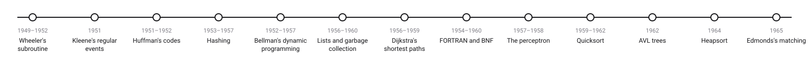
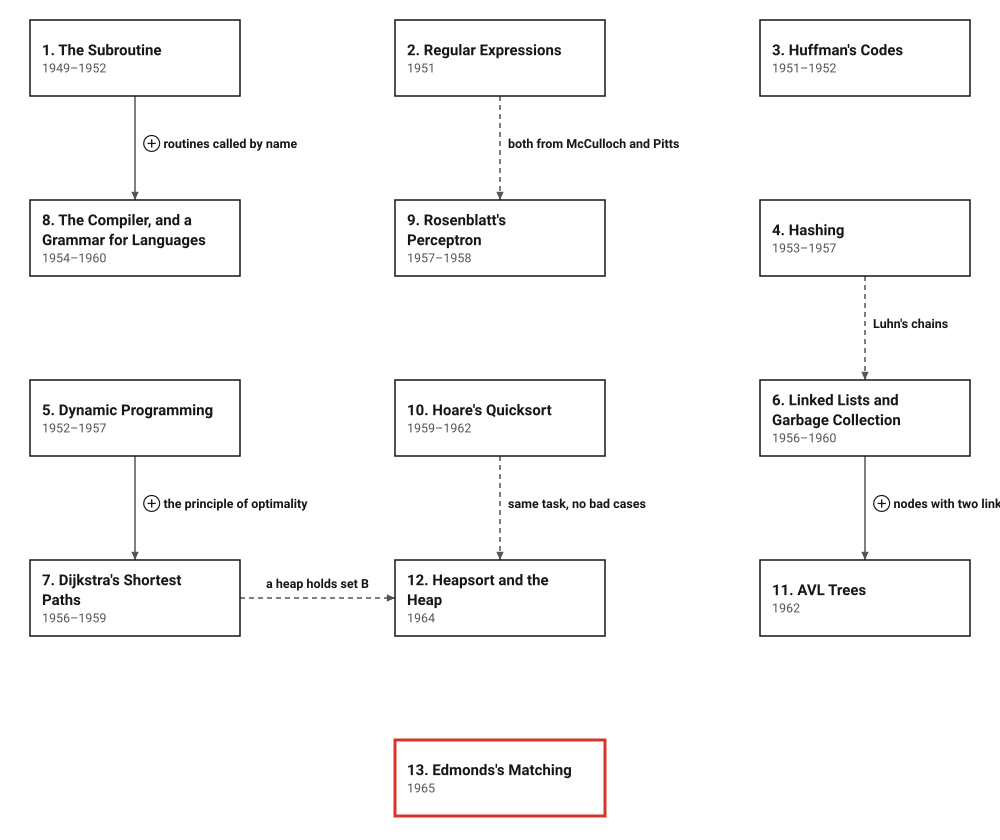

# Era 5 — The Programmer's Craft

*1949 to 1965* · [Book contents](../README.md) · [Interactive edition](index.html) · [Reference catalog](reference-catalog.md) · [Programs](../../code/era-05-the-programmers-craft/README.md)

> **Field note from the visiting historian.** In the fourth era, the species learned what a procedure is and built machines that keep procedures in memory. In this one, they learn how to write procedures well, and invent the tools of a new craft.

## When

<picture>
  <source media="(prefers-color-scheme: dark)" srcset="assets/era-timeline-dark.svg">
  
</picture>

## How the ideas combined

<picture>
  <source media="(prefers-color-scheme: dark)" srcset="assets/era-map-dark.svg">
  
</picture>

*An arrow means the later development reuses the earlier idea; it is not a claim that one inventor learned from the other. Dashed lines join related developments: two that start from the same model of the neuron, Luhn's chained buckets and the lists of cells, two sorting methods for the same task, the heap that later kept Dijkstra's set B, and two searches that grow a tree from a starting point. The box without an arrow, Huffman's codes, builds on an earlier era: Shannon's entropy (Era 4).*

## The topics

| # | Topic | When | What hurt | Read |
|---|---|---|---|---|
| 1 | **The Subroutine** | EDSAC 1949; the library and the book 1951; Wheeler's paper 1952 | Every program wrote the same routines again | [page](01-the-subroutine/README.md) · [interactive](01-the-subroutine/the-subroutine.html) · [program](../../code/era-05-the-programmers-craft/01-the-subroutine/README.md) |
| 2 | **Regular Expressions** | Kleene 1951; Rabin and Scott 1959; Thompson 1968 | No exact description of what a finite machine can recognise | [page](02-regular-expressions/README.md) · [interactive](02-regular-expressions/regular-expressions.html) · [program](../../code/era-05-the-programmers-craft/02-regular-expressions/README.md) |
| 3 | **Huffman's Codes** | MIT 1951; published 1952 | Codes near the entropy, but none provably shortest | [page](03-huffman-codes/README.md) · [interactive](03-huffman-codes/huffman-codes.html) · [program](../../code/era-05-the-programmers-craft/03-huffman-codes/README.md) |
| 4 | **Hashing** | Luhn 1953; Amdahl 1954; Dumey 1956; Peterson 1957 | Finding a record took longer as the file grew | [page](04-hashing/README.md) · [interactive](04-hashing/hashing.html) · [program](../../code/era-05-the-programmers-craft/04-hashing/README.md) |
| 5 | **Dynamic Programming** | Bellman at RAND, 1952–1957 | Plans made in stages multiply beyond listing | [page](05-dynamic-programming/README.md) · [interactive](05-dynamic-programming/dynamic-programming.html) · [program](../../code/era-05-the-programmers-craft/05-dynamic-programming/README.md) |
| 6 | **Linked Lists and Garbage Collection** | IPL about 1956; Lisp 1958–1960 | Fixed blocks of memory could not grow, shrink or be spliced | [page](06-linked-lists/README.md) · [interactive](06-linked-lists/linked-lists.html) · [program](../../code/era-05-the-programmers-craft/06-linked-lists/README.md) |
| 7 | **Dijkstra's Shortest Paths** | Amsterdam 1956; published 1959 | Route-finding kept data for every road at once | [page](07-shortest-paths/README.md) · [interactive](07-shortest-paths/shortest-paths.html) · [program](../../code/era-05-the-programmers-craft/07-shortest-paths/README.md) |
| 8 | **The Compiler, and a Grammar for Languages** | FORTRAN 1954–1957; BNF 1959–1960 | Programs written instruction by instruction | [page](08-the-compiler/README.md) · [interactive](08-the-compiler/the-compiler.html) · [program](../../code/era-05-the-programmers-craft/08-the-compiler/README.md) |
| 9 | **Rosenblatt's Perceptron** | 1957–1958 | Recognising patterns needed a hand-written rule for every case | [page](09-perceptron/README.md) · [interactive](09-perceptron/perceptron.html) · [program](../../code/era-05-the-programmers-craft/09-perceptron/README.md) |
| 10 | **Hoare's Quicksort** | Moscow 1959; published 1961–1962 | Simple sorts take n^2 steps; merging needs a second memory | [page](10-quicksort/README.md) · [interactive](10-quicksort/quicksort.html) · [program](../../code/era-05-the-programmers-craft/10-quicksort/README.md) |
| 11 | **AVL Trees** | Moscow 1962 | Search trees degenerate into lists | [page](11-avl-trees/README.md) · [interactive](11-avl-trees/avl-trees.html) · [program](../../code/era-05-the-programmers-craft/11-avl-trees/README.md) |
| 12 | **Heapsort and the Heap** | Williams 1964; Floyd 1964 | Quicksort's bad cases; finding the largest of a changing set | [page](12-heapsort/README.md) · [interactive](12-heapsort/heapsort.html) · [program](../../code/era-05-the-programmers-craft/12-heapsort/README.md) |
| 13 | **Edmonds's Matching** | 1961; published 1965 | No agreed meaning of "efficient"; odd cycles defeat the matching search | [page](13-matching/README.md) · [interactive](13-matching/matching.html) · [program](../../code/era-05-the-programmers-craft/13-matching/README.md) |

The interactive edition is a single HTML file per topic: download it and open it in a browser, or use the published copy linked from the [book contents](../README.md).
