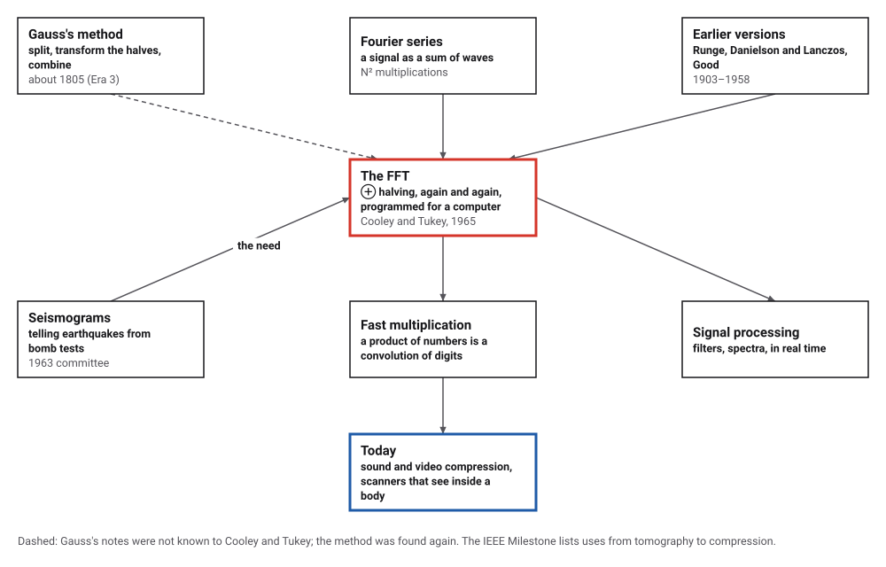
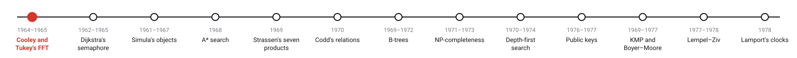
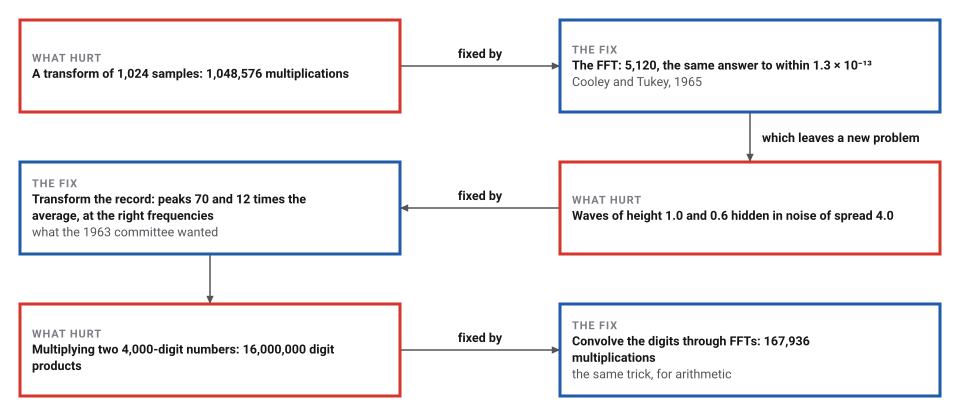
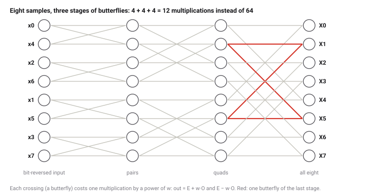

# The Fast Fourier Transform

*Era 6 · topic 1 · 1964–1965* · [Era 6 index](../README.md) · [Mutual Exclusion and the Semaphore →](../02-semaphores/README.md) · [Interactive edition](fast-fourier-transform.html) · [Program](../../../code/era-06-hard-problems-and-public-keys/01-fast-fourier-transform/)

> **Field note from the visiting historian.** A transform of 1,048,576 samples needs 1,099,511,627,776 multiplications done directly; the program did it with 10,485,760. The trick was Gauss's, found again because a committee needed to hear bombs in the shaking of the ground.

| | |
|---|---|
| **When** | Demonstrated 1964; published 1965 |
| **Where** | Princeton and IBM Research |
| **What hurt** | N² multiplications for N samples |
| **The fix** | Split into even and odd samples, recursively |
| **Cost** | (N/2) log₂ N: 5,120 instead of 1,048,576 for 1,024 samples |

## How ideas combined

A new algorithm is usually an older idea combined with a new one. The Fourier transform breaks a signal into waves, at a cost of N² multiplications for N samples. Splitting the samples into halves and combining the halves' transforms had been found before, by Gauss among others; in 1965 it was found again, written down for computers, and applied at every level. Each box names the idea that was added.

<picture>
  <source media="(prefers-color-scheme: dark)" srcset="assets/family-dark.svg">
  
</picture>
*Red: the FFT. Blue: where it is used today.*

## Find two waves in the noise

A signal of 256 samples: two waves (choose their frequencies) and random noise (choose how much). The upper picture is what a seismometer or a microphone records; the lower one is its transform, computed by the FFT in your browser. The two tallest bars (red) are where the transform finds waves.

| Samples N | Direct sum (N²) | FFT ((N/2) log₂ N) | Times fewer |
|---|---|---|---|
| 16 | 256 | 32 | 8 |
| 256 | 65,536 | 1,024 | 64 |
| 4,096 | 16,777,216 | 24,576 | 683 |
| 65,536 | 4,294,967,296 | 524,288 | 8,192 |
| 1,048,576 | 1,099,511,627,776 | 10,485,760 | 104,858 |
*In the interactive edition you can hide two waves in noise and watch the FFT find them.*

## Era 6, hard problems and public keys

<picture>
  <source media="(prefers-color-scheme: dark)" srcset="assets/era-timeline-dark.svg">
  
</picture>

## Each fix leaves a new pain

<picture>
  <source media="(prefers-color-scheme: dark)" srcset="assets/chain-dark.svg">
  
</picture>
*Read it as a snake: each new problem sits directly under the fix that exposed it.*

## Split, transform the halves, combine

**The sum.** The transform of N samples x₀ … x_{N−1} is N numbers X_k = Σ xₙ wⁿᵏ, where w = e^(−2πi/N) is a turn of one N-th of a circle. Each X_k needs N multiplications, so all of them need N².

**The split.** If N is even, the sum falls into the even-numbered samples and the odd-numbered ones: X_k = E_k + wᵏ O_k and X_{k+N/2} = E_k − wᵏ O_k, where E and O are transforms of half the length. One multiplication (by wᵏ) gives two outputs: that pair is a *butterfly*. Repeating the split down to single samples gives log₂ N stages of N/2 butterflies.

<picture>
  <source media="(prefers-color-scheme: dark)" srcset="assets/butterfly-dark.svg">
  
</picture>
*Done in place, the samples must first be put in bit-reversed order: position 6 (110 in binary) holds sample 3 (011). The program's order for eight samples: 0 4 2 6 1 5 3 7.*

> **Key idea.** A problem of size N becomes two problems of size N/2 plus N/2 cheap steps. Done once, that halves the work; done at every level, it turns N² into (N/2) log₂ N.

## Counting the multiplications

The program transformed 1,024 random complex samples both ways: the direct sum took 1,048,576 complex multiplications, the FFT 5,120 (205 times fewer), and the two answers differ by at most 1.3 × 10⁻¹³, the size of rounding error. It also ran a 1,048,576-point FFT and counted 10,485,760 multiplications, exactly (N/2) log₂ N.

| Samples N | Direct sum (N²) | FFT ((N/2) log₂ N) | Times fewer |
|---|---|---|---|
| 16 | 256 | 32 | 8 |
| 256 | 65,536 | 1,024 | 64 |
| 4,096 | 16,777,216 | 24,576 | 683 |
| 65,536 | 4,294,967,296 | 524,288 | 8,192 |
| **1,048,576** | **1,099,511,627,776** | **10,485,760** | **104,858** |

**A seismogram.** 4,096 samples holding waves of 237 and 1001 cycles, of heights 1.0 and 0.6, buried in random noise of spread 4.0. The two tallest peaks of the transform are at 237 and 1001 cycles, 70 and 12 times the average height of the others.

**Long multiplication.** Multiplying numbers is a convolution of their digits, and the transform turns convolution into simple products. Two random 4,000-digit numbers, multiplied through three FFTs of 8,192 points: 167,936 complex multiplications, against 16,000,000 digit products by the schoolbook method. The 8,000-digit product (starting 694252897823…, ending …625059464728) equals Java's own BigInteger result; the largest rounding error before rounding to whole numbers was 0.000.

**And back.** Transforming 256 random samples and transforming the result back (with the opposite sign of the turn, and a division by 256) returned the samples to within 4.7 × 10⁻¹⁶.

## A committee, a physicist and a programmer

Cooley and Tukey's paper, "An Algorithm for the Machine Calculation of Complex Fourier Series", was received on 17 August 1964 and printed in *Mathematics of Computation* 19: 297–301 (1965). Its abstract promises "a number of operations proportional to N log N rather than N²", and it ends: "The authors wish to thank Richard Garwin for his essential role in communication and encouragement."

The IEEE Milestone dedicated in 2025 tells the rest: at a 1963 meeting of President Kennedy's Science Advisory Committee on detecting underground nuclear tests, Garwin heard that Tukey had "a scheme to do a complete discrete Fourier transform with a vastly reduced number of mathematical calculations", and asked IBM for a mathematician to program it; that was Cooley. The 1964 demonstration on an IBM 7094 was, for large problems of the time, about 100 times faster than existing codes. IEEE Spectrum reports that sensors using the algorithm could detect nuclear explosions within 15 kilometres; that figure is not in the paper.

## Found again after 160 years

Gauss used the same splitting about 1805, to fit the orbits of asteroids, and left it in Latin among his papers (Era 3, topic 9); Runge (1903), Danielson and Lanczos (1942) and Good (1958) had versions too. What changed in 1965 was not the idea but the machine: a computer could apply the split at every level, to transforms of thousands and then millions of samples.

> **Full circle.** Era 3's page showed Gauss's splitting by hand. Here the same splitting, applied twenty times, transforms 1,048,576 samples with 10,485,760 multiplications.

## Before you read on

<details>
<summary><b>1.</b> How many butterflies does a 16-point FFT need, and in how many stages?</summary>

4 stages of 8 butterflies: 32 multiplications, against 256 for the direct sum.
</details>

<details>
<summary><b>2.</b> In an 8-point FFT done in place, which sample sits in position 1?</summary>

Position 1 is 001 in binary; reversed, 100 = 4. Sample 4.
</details>

<details>
<summary><b>3.</b> Why must N be a power of two in this version?</summary>

Each stage halves the samples; if a half had odd length the split into even and odd would not divide evenly. (Other versions split into threes, fives, and so on.)
</details>

<details>
<summary><b>4.</b> Why does multiplying long numbers become cheap?</summary>

The digits of a product are a convolution of the digits of the factors, and the transform turns a convolution into one product per frequency.
</details>

<details>
<summary><b>5.</b> A transform shows a tall peak at 50 cycles in a 1-second record. What does it mean?</summary>

The record contains a wave that repeats 50 times a second, such as the hum of mains electricity in many countries.
</details>


## Where the evidence lives

| | Object | Where to see it | Licence |
|---|---|---|---|
| — | **An Algorithm for the Machine Calculation of Complex Fourier Series (1965)**. Cooley and Tukey's five-page paper, *Mathematics of Computation* 19: 297–301. | [The paper (PDF, on a UC Davis course page)](https://www.ece.ucdavis.edu/~bbaas/281/papers/CooleyTukey.1965.pdf) | Drawn placeholder. |

## Every link was opened before it was listed

| Level | Link | Why |
|---|---|---|
| Start | [The 60-Year Old Algorithm Underlying Today's Tech](https://spectrum.ieee.org/fft-algorithm-ieee-milestone) — Kathy Pretz, IEEE Spectrum (2025) | The nuclear-test story and the IEEE Milestone |
| Start | [First Demonstration of the Fast Fourier Transform, 1964](https://ethw.org/Milestones:First_Demonstration_of_the_Fast_Fourier_Transform_(FFT) — Engineering and Technology History Wiki | The milestone citation and its history |
| Deeper | [James Cooley](https://en.wikipedia.org/wiki/James_Cooley) — Wikipedia | The IBM mathematician who wrote the program |
| Scholar | [An Algorithm for the Machine Calculation of Complex Fourier Series](https://www.ece.ucdavis.edu/~bbaas/281/papers/CooleyTukey.1965.pdf) — J. W. Cooley and J. W. Tukey, *Mathematics of Computation* 19: 297–301 (1965), on a UC Davis course page | The five-page paper |

More, with certainty labels and the gaps we could not fill: [Era 6 reference catalog](https://github.com/vij658/AlgorithmEvolutionAtlas/blob/main/book/era-06-hard-problems-and-public-keys/reference-catalog.md).

## The program behind every number here

[FastFourier.java](https://github.com/vij658/AlgorithmEvolutionAtlas/blob/main/code/era-06-hard-problems-and-public-keys/01-fast-fourier-transform/FastFourier.java) makes **1,288 checks**: bit reversal, the FFT against the direct sum on every one of 1,024 frequencies, the multiplication count for N up to 1,048,576, two waves found in noise, a 4,000-digit multiplication against Java's BigInteger, and the inverse transform. Run it with `java FastFourier.java` (JDK 17 or newer). The heart of it:

```java
/** In-place radix-2 FFT of (re, im); inverse if sign = +1. */
static void fft(double[] re, double[] im, int sign) {
    int n = re.length, bits = Integer.numberOfTrailingZeros(n);
    for (int i = 0; i < n; i++) {
        int j = reverse(i, bits);
        if (j > i) { double t = re[i]; re[i] = re[j]; re[j] = t; t = im[i]; im[i] = im[j]; im[j] = t; }
    }
    for (int len = 2; len <= n; len <<= 1) {
        double ang = sign * 2 * Math.PI / len;
        for (int start = 0; start < n; start += len)
            for (int k = 0; k < len / 2; k++) {
                double wr = Math.cos(ang * k), wi = Math.sin(ang * k);
                int a = start + k, b = a + len / 2;
                double tr = re[b] * wr - im[b] * wi, ti = re[b] * wi + im[b] * wr;   // one complex multiplication
                mults++;
                re[b] = re[a] - tr; im[b] = im[a] - ti;
                re[a] += tr; im[a] += ti;
            }
    }
    if (sign > 0) for (int i = 0; i < n; i++) { re[i] /= n; im[i] /= n; }
}
```

