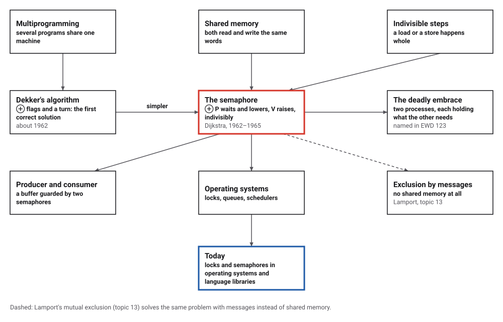
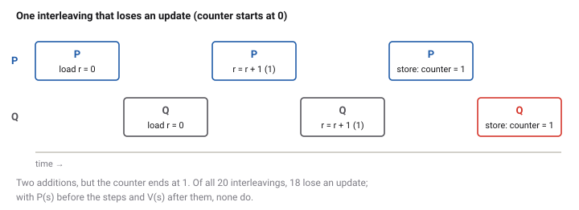
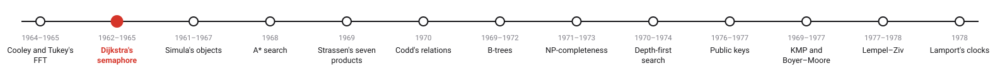
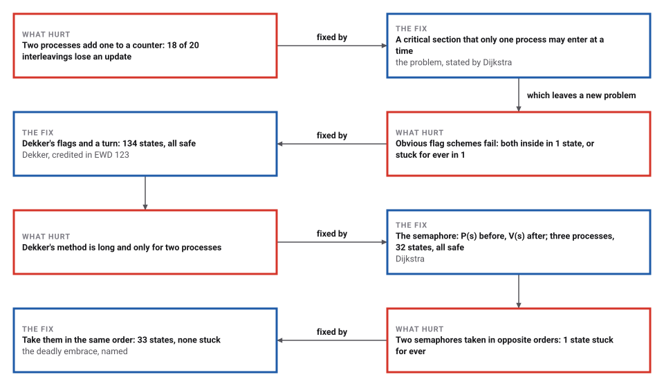

# Mutual Exclusion and the Semaphore

*Era 6 · topic 2 · 1962–1965* · [Era 6 index](../README.md) · [← The Fast Fourier Transform](../01-fast-fourier-transform/README.md) · [Objects, Classes and Subclasses →](../03-objects/README.md) · [Interactive edition](semaphores.html) · [Program](../../../code/era-06-hard-problems-and-public-keys/02-semaphores/)

> **Field note from the visiting historian.** Two processes adding one to a counter can interleave in 20 ways; 18 of them lose an addition. No test run would show me which, so the program tried them all, and then tried every state of every remedy.

| | |
|---|---|
| **When** | Dekker about 1962; semaphore 1962; EWD 123, 1965 |
| **Where** | Amsterdam and Eindhoven |
| **What hurt** | Lost updates and processes waiting for ever |
| **The fix** | Critical sections guarded by P and V |
| **Checked** | 32 states for three processes, none unsafe |

## How ideas combined

A new algorithm is usually an older idea combined with a new one. Machines of the 1960s ran several programs at once, and programs that share memory can trip over each other. Dekker found a correct way for two processes to take turns using nothing but shared variables; Dijkstra replaced it with a new kind of variable whose two operations cannot be interrupted. Each box names the idea that was added.

<picture>
  <source media="(prefers-color-scheme: dark)" srcset="assets/family-dark.svg">
  
</picture>
*Red: the semaphore. Blue: where it is used today.*

## You are the scheduler

Two processes, P and Q, run the same little program. You decide which one takes the next step, as an operating system would, and you are allowed to be unlucky. Can you make the counter lose an update? Can you get both processes into the critical section (red) at once, or make both wait for ever? Then try the semaphore.

<picture>
  <source media="(prefers-color-scheme: dark)" srcset="assets/race-dark.svg">
  
</picture>
*In the interactive edition you choose which process moves next, and try to break each algorithm.*

## Era 6, hard problems and public keys

<picture>
  <source media="(prefers-color-scheme: dark)" srcset="assets/era-timeline-dark.svg">
  
</picture>

## Each fix leaves a new pain

<picture>
  <source media="(prefers-color-scheme: dark)" srcset="assets/chain-dark.svg">
  
</picture>
*Read it as a snake: each new problem sits directly under the fix that exposed it.*

## Try every interleaving

**The trouble.** A process that adds one to a shared counter does three steps: load the counter into a register, add one, store it back. If two processes interleave those steps, both may load the same old value, and one addition vanishes. The error appears only for some orders of the steps, which is why it is so hard to find by testing.

**The critical section.** Mark the steps that must not overlap. The task is a protocol before and after the critical section that guarantees, for every possible order of steps, that at most one process is inside, and that neither waits for ever while the other is not even interested.

**The semaphore.** A shared non-negative integer s with two operations that happen indivisibly. P(s) waits until s is positive, then lowers it by one; V(s) raises it by one. Start s at 1, put P(s) before the critical section and V(s) after it: the first process to arrive lowers s to 0, and every other waits in P until the V.

**How the program checks it.** Rather than run the processes and hope for a bad order, the program explores every state the processes can reach, taking every possible next step from every state, and checks each state.

> **Key idea.** Programs that share memory must be correct for every order in which their steps can interleave, not just the orders seen in testing. A small set of indivisible operations, used by a fixed protocol, makes that checkable.

## Every state searched

**The lost update.** Two processes, three steps each: all 20 interleavings tried. The counter ends at 2 in 2 of them and at 1 in 18. With P(s) before and V(s) after, only 2 orders are possible, and both end at 2.

| Attempt at mutual exclusion (two processes) | Reachable states | States with both inside | States where both wait for ever | Verdict |
|---|---|---|---|---|
| Take turns (a turn variable) | 16 | 0 | 0 | a process waits for the other's turn even when the other is not interested |
| Look at the other's flag, then raise yours | 25 | 1 | 0 | both look, both see 0, both go in |
| Raise your flag, then wait for the other's to fall | 21 | 0 | 1 | both raise, both wait for ever |
| **Dekker: flags and a turn** | **134** | **0** | **0** | **correct; every process can always still get in** |

**One semaphore, three processes.** P(s), critical section, V(s), with s = 1 at the start: 32 reachable states, never two inside, never stuck, and every process can always still get in. Four instructions instead of Dekker's ten, and for any number of processes.

**The deadly embrace.** Process 1 takes semaphore A then B; process 2 takes B then A. Of 36 reachable states, 1 is stuck for ever: each holds one and waits for the other. If both take A first: 33 states, none stuck.

**Producer and consumer.** A producer makes items 1 to 5, a consumer takes them, through 2 places, with two semaphores counting the empty and the full places. All 148 reachable states were checked: the producer never gets more than 2 ahead, the consumer never takes from an empty place, and every item arrives in order.

## Cooperating sequential processes

Dijkstra's essay "Cooperating sequential processes" (manuscript EWD 123, Technological University, Eindhoven, finalized in September 1965 and published in 1968) states the problem: in each cycle "a so-called 'critical section' occurs", and "at any moment at most one of the two is engaged in its critical section". It credits a colleague: "To the Dutch mathematician Th.J.Dekker the credit is due for the first correct solution". It defines semaphores as "essentially non-negative integers", with the V-operation "to increase the value of its argument semaphore by 1" and the P-operation "to decrease the value of its argument semaphore by 1 as soon as the resulting value would be non-negative". Its section 6 is "The Problem of the Deadly Embrace".

Krzysztof Apt's portrait of Dijkstra dates the semaphore to 1962 (EWD 51) and says the essay "originated the field of concurrent programming". What the letters P and V stand for is disputed: Apt gives the invented word "Prolaag", for lowering; a note at New York University, quoting Gert Vegter, gives *Probeer* (try) and *Verhoog* (increase). EWD 123 itself does not say.

## Correct on paper, wrong on a chip

Dekker's algorithm assumes that every load and store happens whole and in program order. Modern processors reorder memory operations for speed, and Wikipedia notes that the algorithm "won't work on SMP machines equipped with these CPUs without the use of memory barriers". The semaphore survived because it puts the indivisibility where it belongs: in one operation that the hardware and the operating system promise to perform whole.

> **Full circle.** Thirteen years later Lamport solved the same problem for computers that share no memory at all, only messages (topic 13).

## Before you read on

<details>
<summary><b>1.</b> Two processes each add one to a counter that starts at 5. What values can it end with?</summary>

7 if the additions do not overlap; 6 if both load 5 before either stores.
</details>

<details>
<summary><b>2.</b> A semaphore starts at 3. What does P, P, P, P do?</summary>

The first three lower it to 2, 1, 0; the fourth waits until some process does V.
</details>

<details>
<summary><b>3.</b> Why is "take turns" not good enough, though it never lets both in?</summary>

A process that wants to enter must wait for the other's turn, even if the other never wants to enter again.
</details>

<details>
<summary><b>4.</b> How do you avoid the deadly embrace with two semaphores?</summary>

Make every process take them in the same order.
</details>

<details>
<summary><b>5.</b> In the producer and consumer, what do the two semaphores count?</summary>

One counts empty places (the producer does P on it), the other full places (the consumer does P on it).
</details>


## Where the evidence lives

| | Object | Where to see it | Licence |
|---|---|---|---|
| — | **EWD 123, Cooperating sequential processes (1965)**. Dijkstra's handwritten-and-typed essay, numbered in his own series of manuscripts. | [Transcription, E. W. Dijkstra Archive](https://www.cs.utexas.edu/~EWD/transcriptions/EWD01xx/EWD123.html) | Drawn placeholder. |

## Every link was opened before it was listed

| Level | Link | Why |
|---|---|---|
| Start | [Dekker's algorithm](https://en.wikipedia.org/wiki/Dekker%27s_algorithm) — Wikipedia | Flags and a turn: the first correct solution, and why modern processors need more |
| Deeper | [Edsger Wybe Dijkstra (1930–2002): A Portrait of a Genius](https://arxiv.org/pdf/cs/0210001) — Krzysztof R. Apt (2002), arXiv | Semaphores, THE, the deadly embrace and the dining philosophers, in context |
| Deeper | [Origin of P and V](https://cs.nyu.edu/~yap/classes/os/resources/origin_of_PV.html) — New York University course page | One account of the Dutch words behind P and V |
| Scholar | [Cooperating sequential processes (EWD 123)](https://www.cs.utexas.edu/~EWD/transcriptions/EWD01xx/EWD123.html) — E. W. Dijkstra (1965), transcription at the E. W. Dijkstra Archive | The essay that stated the problem and introduced P and V to a wide audience |

More, with certainty labels and the gaps we could not fill: [Era 6 reference catalog](https://github.com/vij658/AlgorithmEvolutionAtlas/blob/main/book/era-06-hard-problems-and-public-keys/reference-catalog.md).

## The program behind every number here

[Semaphores.java](https://github.com/vij658/AlgorithmEvolutionAtlas/blob/main/code/era-06-hard-problems-and-public-keys/02-semaphores/Semaphores.java) makes **13 checks**: every interleaving of two processes adding to a counter, every reachable state of four attempts at mutual exclusion (Dekker's among them), a semaphore with three processes, the deadly embrace, and a producer and consumer. Run it with `java Semaphores.java` (JDK 17 or newer). The heart of it:

```java
static Instr P(int s) { return (sh, loc, me) -> { if (sh[s] == 0) return BLOCKED; sh[s]--; return -99; }; }

static Instr V(int s) { return (sh, loc, me) -> { sh[s]++; return -99; }; }

    long bothInCS() {
        long c = 0;
        for (State s : seen.values()) { int k = 0; for (int p = 0; p < procs.size(); p++) if (inCS(s, p)) k++; if (k > 1) c++; }
        return c;
    }
```

