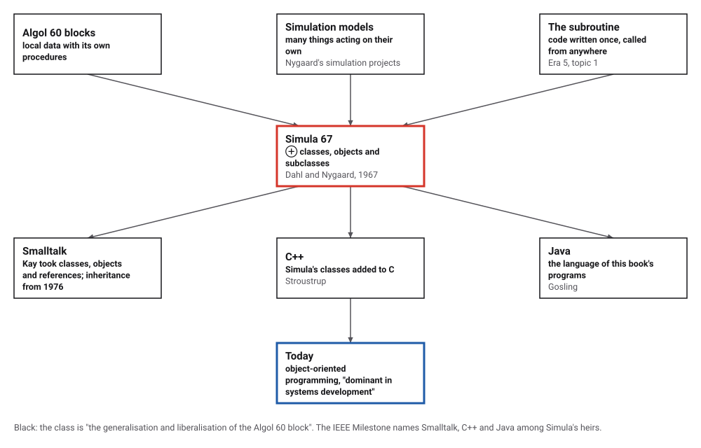
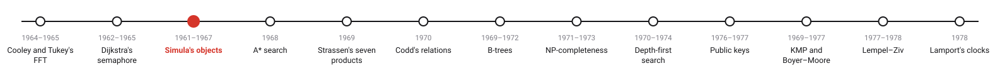
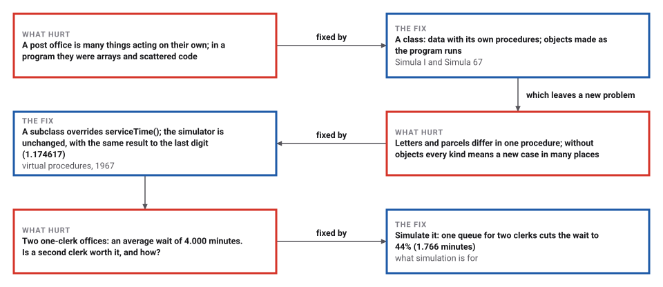
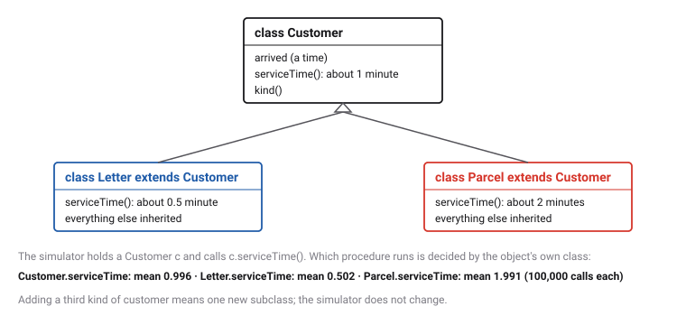

# Objects, Classes and Subclasses

*Era 6 · topic 3 · 1961–1967* · [Era 6 index](../README.md) · [← Mutual Exclusion and the Semaphore](../02-semaphores/README.md) · [A*: Search Guided by an Estimate →](../04-a-star/README.md) · [Interactive edition](objects.html) · [Program](../../../code/era-06-hard-problems-and-public-keys/03-objects/)

> **Field note from the visiting historian.** I simulated 1,000,000 customers in a post office written the way Dahl and Nygaard proposed, and again without objects. The answers agreed to six decimal places; the difference was in how much of the program a new kind of customer would disturb.

| | |
|---|---|
| **When** | 1961–1967 (Simula 67) |
| **Where** | Norwegian Computing Center, Oslo |
| **What hurt** | Models of many interacting things were hard to write and to change |
| **The fix** | Classes, objects, subclasses, virtual procedures |
| **Heirs** | Smalltalk, C++, Java |

## How ideas combined

A new algorithm is usually an older idea combined with a new one. An Algol 60 block already kept local data next to the procedures that use it; Dahl and Nygaard let a block outlive the call that made it, gave it a name, let the program make as many copies as it needed, and let one kind of block extend another. Each box names the idea that was added.

<picture>
  <source media="(prefers-color-scheme: dark)" srcset="assets/family-dark.svg">
  
</picture>
*Red: Simula 67. Blue: where its ideas are today.*

## Run a post office

Simula was made for simulation, so here is one: customers arrive at random, letters take about half a minute, parcels about two, and the clerks serve them in turn. Each customer is an object of class Letter or Parcel; the simulator only ever calls serviceTime(), and each object answers by its own class. Change the arrivals, the share of parcels and the number of clerks.

| Post office | Customers per minute | Average wait, simulated (minutes) | Formula | Which formula |
|---|---|---|---|---|
| One clerk, all customers alike | 0.8 | 3.993 | 4.000 | M/M/1 queue: ρ / (1 − ρ) |
| Two clerks, one queue, twice the customers | 1.6 | 1.766 | 1.778 | Erlang's formula |
| One clerk, 80% letters and 20% parcels | 0.6 | 1.175 | 1.154 | Pollaczek and Khinchine's formula |
*In the interactive edition you can run the post office with your own numbers.*

## Era 6, hard problems and public keys

<picture>
  <source media="(prefers-color-scheme: dark)" srcset="assets/era-timeline-dark.svg">
  
</picture>

## Each fix leaves a new pain

<picture>
  <source media="(prefers-color-scheme: dark)" srcset="assets/chain-dark.svg">
  
</picture>
*Read it as a snake: each new problem sits directly under the fix that exposed it.*

## A class, its objects, and a subclass

**A class** describes one kind of thing: the data it holds and the procedures that act on it. **Objects** of the class are made while the program runs, as many as needed, each with its own data, and each lives as long as anything refers to it.

**A subclass** is declared by naming its class as a prefix: it inherits everything and adds or changes what differs. A procedure declared **virtual** is looked up in the object's own class at the moment it is called, so code written for the general class works unchanged for every subclass. Java, the language of this book's programs, works the same way.

<picture>
  <source media="(prefers-color-scheme: dark)" srcset="assets/classes-dark.svg">
  
</picture>
*The program's own classes. Every call measured here went to the subclass's procedure.*

**The simulation.** A list of future events, ordered by time: take the earliest, let the object concerned act (a customer arrives and queues, or a clerk finishes and calls the next), which may schedule new events, and repeat.

> **Key idea.** Put the data and the procedures of each kind of thing together, and let the program ask each thing to act for itself. A new kind of thing is then one new class, not a change in every place that handles things.

## A million customers

The program simulated 1,000,000 customers in each post office and compared the average wait in the queue with the formulas of queueing theory.

| Post office | Customers per minute | Average wait, simulated (minutes) | Formula | Which formula |
|---|---|---|---|---|
| One clerk, all customers alike | 0.8 | 3.993 | 4.000 | M/M/1 queue: ρ / (1 − ρ) |
| Two clerks, one queue, twice the customers | 1.6 | 1.766 | 1.778 | Erlang's formula |
| One clerk, 80% letters and 20% parcels | 0.6 | 1.175 | 1.154 | Pollaczek and Khinchine's formula |

With one clerk the average time in the office was 4.994 minutes (formula 5.000). One queue shared by two clerks cuts the wait to 44% of what two separate one-clerk offices give (4.000 minutes). With parcels mixed in, the clerk is busy only 48% of the time, yet the parcels' long and variable service makes the wait 3.1 times what it would be if every service took exactly 0.8 minutes.

**The same thing without objects.** The program also simulates the mixed post office with arrays and a switch statement, fed the same random numbers: the average waits are 1.174617 and 1.174617, identical. The difference is in the code: to add a third kind of customer, the object version needs one new subclass; the plain version needs a new number, a new case in the switch, and a new branch where customers are made.

## Oslo, 1961 to 1967

The IEEE Milestone dedicated at the University of Oslo in 2017 reads: "Ole-Johan Dahl and Kristen Nygaard created the Simula programming languages in the 1960s at the Norwegian Computer Center. They introduced a new way of modeling and simulating complex tasks." Work began in 1961 to "develop a description language for computer simulations"; SIMULA introduced "the class concept for encapsulation of data structure and code", "subclasses for reuse of code" and "late binding for flexible inheritance".

The University of Oslo recalls that "Kristen persuaded Ole-Johan to join him at the Norwegian Computing Center to help developing a simulation language". Andrew Black quotes the 1967 paper "Class and subclass declarations": by "using C as a prefix to another class, the latter would be taken to be a subclass of C inheriting all properties of C"; Dahl called virtual procedures "a last minute extension". Dahl and Nygaard received the Turing Award "for ideas fundamental to the emergence of object oriented programming"; the ACM and the IEEE Milestone say 2001, the University of Oslo says 2002, and the catalog marks the year as disputed.

## From a simulation language to everything

Alan Kay "took from Simula the ideas of classes, objects and object references" for Smalltalk, whose first version, Smalltalk-72, "did not include inheritance"; Smalltalk-76 added "a Simula-like inheritance scheme" (Black). Through Smalltalk, C++ and Java, the Milestone says, object-oriented programming became "dominant in systems development". Every program in this book is written in classes, because Java is one of Simula's descendants.

> **Full circle.** A language invented to simulate post offices and harbours, used here for what it was made for: 1,000,000 customers, letters and parcels, each an object.

## Before you read on

<details>
<summary><b>1.</b> A variable is declared as Customer but holds a Parcel. Which serviceTime() runs?</summary>

Parcel's: a virtual procedure is chosen by the object's own class when it is called.
</details>

<details>
<summary><b>2.</b> Why does the plain version need a change "where customers are made" for a new kind?</summary>

It must store a new kind number for each new customer, and every switch on that number must learn it too.
</details>

<details>
<summary><b>3.</b> With one clerk and customers arriving 0.8 a minute, service 1 minute, how busy is the clerk?</summary>

80% of the time: 0.8 customers a minute × 1 minute each.
</details>

<details>
<summary><b>4.</b> Why does a second clerk sharing one queue help more than splitting customers into two queues?</summary>

With one queue no clerk sits idle while someone waits in the other line.
</details>

<details>
<summary><b>5.</b> What does "subclass by prefixing" mean?</summary>

Writing the class's name in front of a new class declaration: the new class inherits all the old one's data and procedures.
</details>


## Where the evidence lives

| | Object | Where to see it | Licence |
|---|---|---|---|
| — | **IEEE Milestone: Object-Oriented Programming, 1961–1967**. Plaque dedicated on 27 September 2017 at the University of Oslo, Gaustadalléen 23B. | [Engineering and Technology History Wiki](https://ethw.org/Milestones:Object-Oriented_Programming,_1961-1967) | Drawn placeholder. |

## Every link was opened before it was listed

| Level | Link | Why |
|---|---|---|
| Start | [50 years anniversary of Simula](https://www.uio.no/om/aktuelt/rektorbloggen/2017/50-years-anniversary-of-simula-the-first-object-or.html) — University of Oslo, rector's blog (2017) | How Nygaard and Dahl came together, in a page |
| Start | [Object-Oriented Programming, 1961-1967](https://ethw.org/Milestones:Object-Oriented_Programming,_1961-1967) — Engineering and Technology History Wiki | The IEEE Milestone citation and what Simula introduced |
| Deeper | [Object-oriented programming: some history, and challenges for the next fifty years](https://arxiv.org/pdf/1303.0427) — Andrew P. Black (2013), arXiv | Classes, prefixing and virtual procedures in Simula's own words, and what Smalltalk took from it |
| Deeper | [Kristen Nygaard](https://awards.acm.org/award_winners/nygaard_5916220) — ACM Awards | The Turing Award citation for Simula I and Simula 67 |

More, with certainty labels and the gaps we could not fill: [Era 6 reference catalog](https://github.com/vij658/AlgorithmEvolutionAtlas/blob/main/book/era-06-hard-problems-and-public-keys/reference-catalog.md).

## The program behind every number here

[Objects.java](https://github.com/vij658/AlgorithmEvolutionAtlas/blob/main/code/era-06-hard-problems-and-public-keys/03-objects/Objects.java) makes **9 checks**: that each call reaches its subclass's procedure, the simulated waits for one clerk, two clerks and a mix of letters and parcels against the formulas of queueing theory (within 5%), and that the version without objects gives identical results. Run it with `java Objects.java` (JDK 17 or newer). The heart of it:

```java
// ---- 1. the classes --------------------------------------------------------------------------------------------
/** A customer of the post office. serviceTime() is virtual: each subclass may give its own. */
static class Customer {
    final double arrived;
    Customer(double arrived) { this.arrived = arrived; }
    double serviceTime() { return exponential(1.0); }
    String kind() { return "customer"; }
}

static class Parcel extends Customer {
    Parcel(double t) { super(t); }
    @Override double serviceTime() { return exponential(2.0); }
    @Override String kind() { return "parcel"; }
}
```

