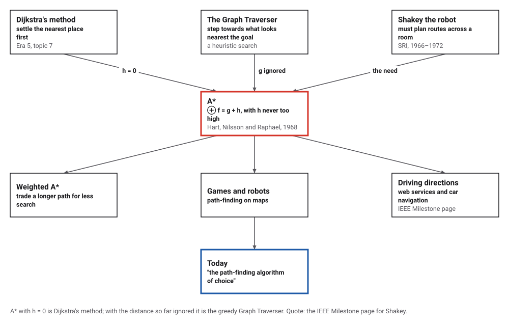
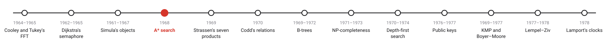
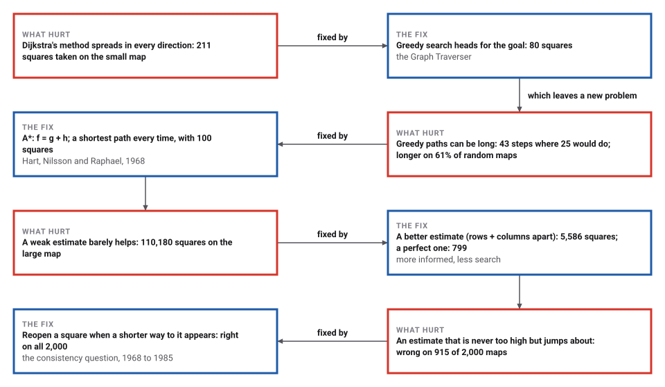
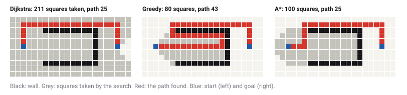

# A*: Search Guided by an Estimate

*Era 6 · topic 4 · 1968* · [Era 6 index](../README.md) · [← Objects, Classes and Subclasses](../03-objects/README.md) · [Fast Matrix Multiplication →](../05-strassen/README.md) · [Interactive edition](a-star.html) · [Program](../../../code/era-06-hard-problems-and-public-keys/04-a-star/)

> **Field note from the visiting historian.** On a map of 400 × 400 squares the blind search took 119,131 squares to find the way; guided by a simple estimate it took 5,586. The robot that needed it was Shakey; the method outlived the robot, and the IEEE now calls it the path-finding algorithm of choice.

| | |
|---|---|
| **When** | Received 1967; published 1968 |
| **Where** | Stanford Research Institute |
| **What hurt** | Blind search wastes work; greedy search returns long paths |
| **The fix** | f = g + h, with h never too high |
| **Measured** | 5,586 squares instead of 119,131, same path |

## How ideas combined

A new algorithm is usually an older idea combined with a new one. Dijkstra's method counts only the distance already travelled; the Graph Traverser looked only at an estimate of the distance still to go. A* adds the two. Each box names the idea that was added.

<picture>
  <source media="(prefers-color-scheme: dark)" srcset="assets/family-dark.svg">
  
</picture>
*Red: A*. Blue: where it is used today.*

## Three searches, one map

The program's small map: start on the left (blue), goal on the right, a cup-shaped wall between. Run each search and compare the squares it takes (grey) and the path it returns (red). Then draw your own walls by clicking or dragging on the grid. The estimate h is the number of rows apart plus columns apart, ignoring walls.

| Search on the small map | Squares taken | Path (steps) |
|---|---|---|
| Dijkstra (h not used) | 211 | 25 |
| Greedy (h only) | 80 | 43 |
| **A* (g + h)** | **100** | **25** |
*In the interactive edition you can draw walls and run the three searches yourself.*

## Era 6, hard problems and public keys

<picture>
  <source media="(prefers-color-scheme: dark)" srcset="assets/era-timeline-dark.svg">
  
</picture>

## Each fix leaves a new pain

<picture>
  <source media="(prefers-color-scheme: dark)" srcset="assets/chain-dark.svg">
  
</picture>
*Read it as a snake: each new problem sits directly under the fix that exposed it.*

## Cost so far, plus an estimate of the rest

**The rule.** Keep a set of places reached but not yet taken. Take next the place n with the smallest f(n) = g(n) + h(n): g(n) is the length of the best path found so far from the start to n, and h(n) an estimate of the distance from n to the goal. Taking a place means looking at its neighbours and recording any shorter way to them.

**Admissible.** If h never overestimates the true remaining distance, the first time the goal is taken its path is a shortest one: any place on a shorter path would have had a smaller f, and been taken first. With h = 0 the rule is Dijkstra's method; with a perfect h it walks straight along a shortest path and takes nothing else.

**Consistent.** If also h never drops by more than the length of a step (h(m) ≤ cost(m, n) + h(n)), no place ever needs to be taken twice. Without that, A* must be allowed to reopen a place when a shorter way to it appears.

<picture>
  <source media="(prefers-color-scheme: dark)" srcset="assets/maps-dark.svg">
  
</picture>
*The program's three searches on the small map, as it printed them.*

> **Key idea.** Knowledge about where the goal lies can cut the search, as long as it never promises the goal is nearer than it is. A guess that is too optimistic costs time; a guess that is too pessimistic can cost the right answer.

## Squares taken, paths returned

**A large map.** 400 × 400 squares, 25% walled at random (119,903 open), from one corner to the other. All four searches found the shortest path, 798 steps; the better the estimate, the fewer squares taken.

| Estimate h | Squares taken |
|---|---|
| 0 (Dijkstra) | 119,131 |
| straight-line distance | 110,180 |
| rows apart + columns apart | 5,586 |
| **the true remaining distance** | **799** |

**Random maps.** On 2,000 random 40 × 40 maps with 30% walls, A* found a shortest path every time; the greedy method returned a longer path on 1,226 of them (61%), at worst 2.4 times too long. Squares taken on average: Dijkstra 542, A* 111, greedy 57.

**Weighted A*.** Multiplying the estimate by w > 1 makes the search greedier: fewer squares, and a path never more than w times the shortest.

| w | Squares taken | Path | × shortest |
|---|---|---|---|
| 1 | 5,586 | 798 | 1.000 |
| 1.5 | 1,662 | 872 | 1.093 |
| 2 | 1,617 | 902 | 1.130 |
| 3 | 1,262 | 934 | 1.170 |
| 5 | 1,218 | 940 | 1.178 |

**An estimate that is never too high but jumps about.** The true distance times a random number between 0 and 1, fixed for each square: admissible, but not consistent. On the same 2,000 maps, A* that never takes a square twice returned a longer path on 915, at worst 1.44 times too long; A* that reopens a square when a shorter way to it appears was right on all 2,000, reopening 80,159 squares on 1,724 maps.

## A robot that needed a route

Hart, Nilsson and Raphael's paper, "A Formal Basis for the Heuristic Determination of Minimum Cost Paths" (manuscript received 24 November 1967; *IEEE Transactions on Systems Science and Cybernetics* SSC-4(2): 100–107, July 1968), begins with a complaint: "there has been no underlying theory to guide the development of efficient search procedures." It defines f(n) = g(n) + h(n), proves that A* is admissible when the estimate is a lower bound, introduces what it calls "the consistency assumption", and shows that A* "expands the fewest possible nodes necessary to guarantee finding an optimal path".

The method was made for Shakey, Stanford Research Institute's mobile robot. In Raphael's recollection, Nilsson presented a route-planning method he called Algorithm A "For lack of anything better"; Raphael proposed a change, Hart suggested the new version might be optimal, they proved under what conditions, and called it A* (Communications of the ACM). Wikipedia notes that a later correction claimed consistency was not needed, and that Dechter and Pearl showed in 1985 that this was false: the program's last experiment shows the same effect.

## Dijkstra's method, with a sense of direction

Set h to zero and A* is exactly Dijkstra's method of 1956 (Era 5, topic 7); Wikipedia calls Dijkstra's algorithm "a special case of A*". The IEEE Milestone page for Shakey calls A* "the path-finding algorithm of choice for a wide variety of applications", including "computing driving directions (whether by a web service or a car navigation system)".

> **Full circle.** On the large map, Dijkstra's method took 119,131 squares; the same search with an estimate of the distance to go took 5,586.

## Before you read on

<details>
<summary><b>1.</b> On a grid with moves up, down, left and right, why is "rows apart + columns apart" never too high?</summary>

Every path must cover at least that many rows and columns, one step each; walls can only make it longer.
</details>

<details>
<summary><b>2.</b> Why is the straight-line distance a weaker estimate on such a grid?</summary>

It is smaller than rows + columns (the diagonal is shorter), so it tells the search less, and more squares look promising.
</details>

<details>
<summary><b>3.</b> What does A* become if h is the true remaining distance?</summary>

It walks straight along a shortest path, taking only the squares on it.
</details>

<details>
<summary><b>4.</b> Why can the greedy method return a long path?</summary>

It ignores the distance already travelled, so it keeps the first way it found to each square, however roundabout.
</details>

<details>
<summary><b>5.</b> With w = 2, how long can weighted A*'s path be?</summary>

At most twice the shortest, if h is admissible.
</details>


## Where the evidence lives

| | Object | Where to see it | Licence |
|---|---|---|---|
| — | **A Formal Basis for the Heuristic Determination of Minimum Cost Paths (1968)**. Hart, Nilsson and Raphael, *IEEE Transactions on Systems Science and Cybernetics* SSC-4(2): 100–107. | [The paper (PDF scan, on a course page)](https://people.stfx.ca/jdelamer/courses/csci-564/_downloads/b2220c66675ddde471ca1795147b8e86/A_Formal_Basis_for_the_Heuristic_Determination_of_Minimum_Cost_Paths.pdf) | Drawn placeholder. |

## Every link was opened before it was listed

| Level | Link | Why |
|---|---|---|
| Start | [A* Search](https://cacm.acm.org/opinion/a-search) — Communications of the ACM | How the name came about, as Raphael told it |
| Start | [A* search algorithm](https://en.wikipedia.org/wiki/A*_search_algorithm) — Wikipedia | Admissibility, consistency, and the 1972 correction that was wrong |
| Deeper | [Shakey: The World's First Mobile, Intelligent Robot, 1972](https://ieeemilestones.ethw.org/Milestones:Shakey:_The_World%E2%80%99s_First_Mobile,_Intelligent_Robot,_1972) — Engineering and Technology History Wiki | The robot that needed A*, and what else came out of it |
| Scholar | [A Formal Basis for the Heuristic Determination of Minimum Cost Paths](https://people.stfx.ca/jdelamer/courses/csci-564/_downloads/b2220c66675ddde471ca1795147b8e86/A_Formal_Basis_for_the_Heuristic_Determination_of_Minimum_Cost_Paths.pdf) — P. E. Hart, N. J. Nilsson and B. Raphael, *IEEE Trans. Systems Science and Cybernetics* (1968), scan on a course page | The eight-page paper with the theorems |

More, with certainty labels and the gaps we could not fill: [Era 6 reference catalog](https://github.com/vij658/AlgorithmEvolutionAtlas/blob/main/book/era-06-hard-problems-and-public-keys/reference-catalog.md).

## The program behind every number here

[AStar.java](https://github.com/vij658/AlgorithmEvolutionAtlas/blob/main/code/era-06-hard-problems-and-public-keys/04-a-star/AStar.java) makes **4,015 checks**: three searches on a small map, four estimates on a 400 × 400 map, A* against breadth-first distances on 2,000 random maps, weighted A* within its bound, and an inconsistent estimate with and without reopening. Run it with `java AStar.java` (JDK 17 or newer). The heart of it:

```java
/**
 * Best-first search on a grid of squares (moves up, down, left, right, each of length 1).
 * The next square is the one with the smallest  gw * g + hw * h ; ties go to the larger g, then to the earlier.
 *   Dijkstra: gw = 1, hw = 0.   Greedy: gw = 0, hw = 1.   A*: gw = 1, hw = 1.   Weighted A*: gw = 1, hw = w.
 */
static Result search(boolean[][] wall, int sr, int sc, int tr, int tc, Estimate est, double gw, double hw, boolean reopen) {
    int rows = wall.length, cols = wall[0].length, n = rows * cols;
    int[] g = new int[n];
    Arrays.fill(g, Integer.MAX_VALUE);
    boolean[] closed = new boolean[n];
    Result res = new Result();
    res.taken = new boolean[n];
    res.parent = new int[n];
    Arrays.fill(res.parent, -1);
    PriorityQueue<double[]> open = new PriorityQueue<>((a, b) -> a[0] != b[0] ? Double.compare(a[0], b[0])
            : a[1] != b[1] ? Double.compare(b[1], a[1]) : Double.compare(a[3], b[3]));
    long order = 0;
    int s = sr * cols + sc, t = tr * cols + tc;
    g[s] = 0;
    open.add(new double[]{hw * est.h(sr, sc), 0, s, order++});
    while (!open.isEmpty()) {
        double[] top = open.poll();
        int u = (int) top[2];
        if (top[1] != g[u] || closed[u]) continue;            // an out-of-date entry
        closed[u] = true;
        res.taken[u] = true;
        res.expanded++;
        if (u == t) { res.cost = g[u]; return res; }
        int ur = u / cols, uc = u % cols;
        for (int d = 0; d < 4; d++) {
            int vr = ur + DR[d], vc = uc + DC[d];
            if (vr < 0 || vc < 0 || vr >= rows || vc >= cols || wall[vr][vc]) continue;
            int v = vr * cols + vc, ng = g[u] + 1;
            if (ng >= g[v]) continue;
            if (gw == 0 && g[v] != Integer.MAX_VALUE) continue;   // the greedy method keeps the first way it found
            if (closed[v]) {
                if (!reopen) continue;
                closed[v] = false;
                res.reopened++;
            }
            g[v] = ng;
            res.parent[v] = u;
            open.add(new double[]{gw * ng + hw * est.h(vr, vc), ng, v, order++});
        }
    }
    return res;
}
```

