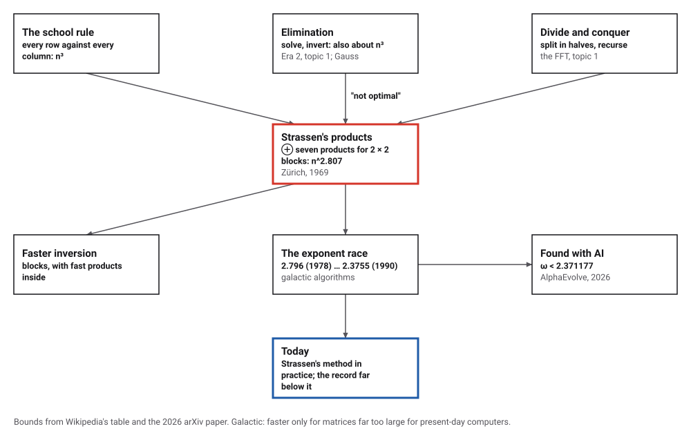
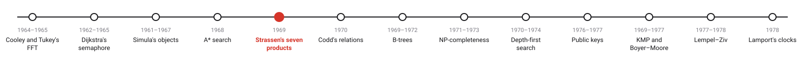
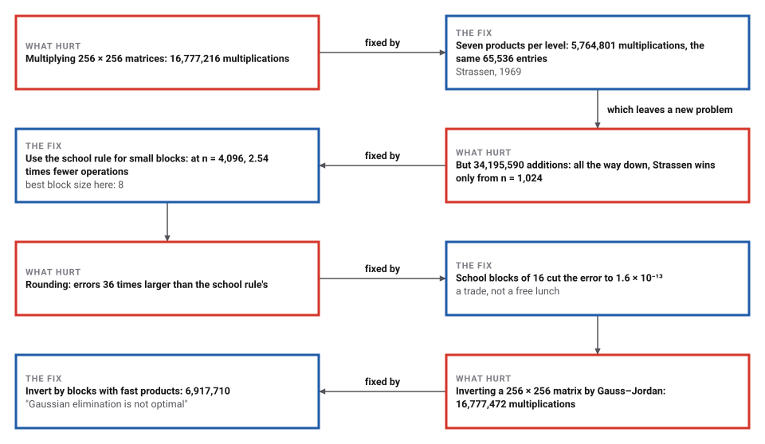
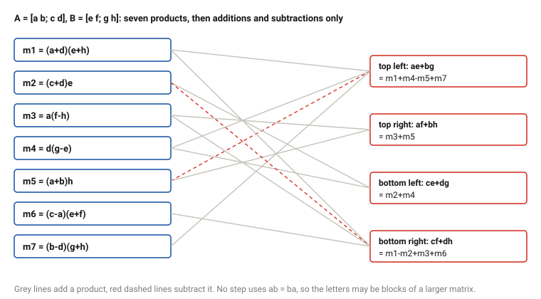

# Fast Matrix Multiplication

*Era 6 · topic 5 · 1969* · [Era 6 index](../README.md) · [← A*: Search Guided by an Estimate](../04-a-star/README.md) · [The Relational Model of Data →](../06-relational-model/README.md) · [Interactive edition](strassen.html) · [Program](../../../code/era-06-hard-problems-and-public-keys/05-strassen/)

> **Field note from the visiting historian.** I multiplied two 256 × 256 matrices with 5,764,801 multiplications instead of 16,777,216, and every entry matched. The saving has a price, in additions and in rounding, and the program counted that too.

| | |
|---|---|
| **When** | 1969 |
| **Where** | University of Zürich |
| **What hurt** | n³ operations to multiply or invert |
| **The fix** | Seven block products, recursively |
| **Cost** | n^2.807; 2.54 times fewer operations at n = 4,096 |

## How ideas combined

A new algorithm is usually an older idea combined with a new one. Splitting a problem in halves had made the Fourier transform fast (topic 1). Split two matrices into four blocks each, and the school rule needs eight products of blocks; Strassen found seven that are enough, and the split can be repeated inside every block. Each box names the idea that was added.

<picture>
  <source media="(prefers-color-scheme: dark)" srcset="assets/family-dark.svg">
  
</picture>
*Red: Strassen's seven products. Blue: where matters stand today.*

## Seven products instead of eight

Left: two 2 × 2 matrices of small random numbers, their product, and Strassen's seven products that make it. Right: the counts for matrices of size n = 2^k, split again and again, with the option of switching to the school rule when the blocks become small.

| n | School: multiplications | Strassen: multiplications | School: additions | Strassen: additions |
|---|---|---|---|---|
| 2 | 8 | 7 | 4 | 18 |
| 4 | 64 | 49 | 48 | 198 |
| 16 | 4,096 | 2,401 | 3,840 | 12,870 |
| 64 | 262,144 | 117,649 | 258,048 | 681,318 |
| 256 | 16,777,216 | 5,764,801 | 16,711,680 | 34,195,590 |
| 1,024 | 1,073,741,824 | 282,475,249 | 1,072,693,248 | 1,688,560,038 |
| 4,096 | 68,719,476,736 | 13,841,287,201 | 68,702,699,520 | 82,947,059,910 |
*In the interactive edition you can multiply matrices with seven products and watch the counts grow with the size.*

## Era 6, hard problems and public keys

<picture>
  <source media="(prefers-color-scheme: dark)" srcset="assets/era-timeline-dark.svg">
  
</picture>

## Each fix leaves a new pain

<picture>
  <source media="(prefers-color-scheme: dark)" srcset="assets/chain-dark.svg">
  
</picture>
*Read it as a snake: each new problem sits directly under the fix that exposed it.*

## One saved product, at every level

**Seven products.** For [a b; c d] × [e f; g h] the school rule makes eight products (ae, bg, af, …). Strassen's seven products, each of one sum by another, give all four entries by additions and subtractions alone. The program checked the formulas exactly, coefficient by coefficient, and on 1,000 random pairs.

<picture>
  <source media="(prefers-color-scheme: dark)" srcset="assets/seven-dark.svg">
  
</picture>

**Blocks.** None of the formulas uses ab = ba, which fails for matrices. So a, b, … h may be blocks: cut each n × n matrix into four blocks of n/2 × n/2, make seven products of blocks, and make each of those the same way. For n = 2^k that is 7^k multiplications instead of 8^k, which is n^(log₂ 7) = n^2.807 instead of n³.

**The price.** Each level adds 18 additions of blocks. They cost little for large blocks and a lot for small ones, so a practical version switches to the school rule below some block size.

> **Key idea.** Saving one multiplication in eight looks like nothing. Saved again inside every one of the seven, at every level of the split, it changes the exponent, and with large enough matrices any change in the exponent wins.

## Counting operations

| n | School: multiplications | Strassen: multiplications | School: additions | Strassen: additions |
|---|---|---|---|---|
| 2 | 8 | 7 | 4 | 18 |
| 4 | 64 | 49 | 48 | 198 |
| 16 | 4,096 | 2,401 | 3,840 | 12,870 |
| 64 | 262,144 | 117,649 | 258,048 | 681,318 |
| 256 | 16,777,216 | 5,764,801 | 16,711,680 | 34,195,590 |
| 1,024 | 1,073,741,824 | 282,475,249 | 1,072,693,248 | 1,688,560,038 |
| **4,096** | **68,719,476,736** | **13,841,287,201** | **68,702,699,520** | **82,947,059,910** |

Counting multiplications and additions together, Strassen all the way down to single numbers first beats the school rule at n = 1,024. Switching to the school rule for small blocks does better: for n = 4,096 the program tried block sizes from 8 to 256, and the best, 8, needs 54,134,584,512 operations against 137,422,176,256 (2.54 times fewer).

| Switch below block size | Operations for n = 4,096 |
|---|---|
| **8** | **54,134,584,512,** |
| 16 | 54,503,531,776, |
| 32 | 58,087,590,912, |
| 64 | 63,990,747,136, |
| 128 | 71,769,833,472, |
| 256 | 81,250,287,616 |

**Real products.** Two random 256 × 256 matrices of whole numbers between −1000 and 1000, multiplied both ways: all 65,536 entries identical. School: 16,777,216 multiplications and 16,711,680 additions; Strassen to 1 × 1: 5,764,801 and 34,195,590; Strassen with school blocks of 32: 11,239,424 and 12,602,368.

**Rounding.** With decimals, the extra additions and subtractions cost accuracy. Two random 128 × 128 matrices of decimals, against the exact product: largest error 4.9 × 10⁻¹⁴ for the school rule, 1.8 × 10⁻¹² for Strassen all the way down (36 times larger), 1.6 × 10⁻¹³ with school blocks of 16.

**Inversion.** A 256 × 256 matrix inverted by Gauss–Jordan elimination took 16,777,472 multiplications and divisions; inverted by 2 × 2 blocks (two half-size inverses and six half-size Strassen products) it took 6,917,710. Both inverses times the matrix give the identity to within 3.0 × 10⁻¹⁴. At n = 4,096 the counts would be 68,719,480,832 against 16,609,543,822.

## Three pages with a claim for a title

Volker Strassen, "Gaussian elimination is not optimal", *Numerische Mathematik* 13: 354–356 (1969). MacTutor: in 1969 he "discovered a novel way to multiply two matrices", with exponent log₂ 7 = 2.808, showing that Gaussian elimination "is not an optimal solution"; he had joined the Institute of Applied Mathematics at the University of Zürich in 1968. Peter Bürgisser's lecture notes add that 2 × 2 matrices cannot be multiplied with fewer than seven multiplications, and that nine years passed before Pan first improved the exponent.

The exponent has been lowered many times since: 2.796 (Pan, 1978), 2.3755 (Coppersmith and Winograd, 1990), 2.3728639 (Le Gall, 2014), 2.371339 (Alman, Duan, Vassilevska Williams, Xu, Xu and Zhou, 2024), and, in August 2026, 2.371177, by a team using the AI system AlphaEvolve (arXiv 2608.16884). Wikipedia: "Unlike algorithms with faster asymptotic complexity, Strassen's algorithm is used in practice"; the later ones "are not used in practice, because they are galactic algorithms". Why Strassen looked for the method is not in any source the catalog opened.

## Elimination, not optimal

The elimination that Strassen's title names was done with rods on Chinese counting boards two thousand years ago (Era 2, topic 1) and later named after Gauss. For most of that time nobody asked whether it was the fastest possible. Strassen's three pages turned the question into a race that, in 2026, is still being run, partly by machines.

> **Full circle.** Gauss–Jordan on a 256 × 256 matrix: 16,777,472 multiplications and divisions. The same inverse by blocks with seven-product multiplication: 6,917,710.

## Before you read on

<details>
<summary><b>1.</b> How many multiplications does Strassen's method use for 8 × 8 matrices, all the way down?</summary>

7³ = 343, against 8³ = 512.
</details>

<details>
<summary><b>2.</b> Why must the formulas not use ab = ba?</summary>

Because the letters stand for blocks, and matrix products do not commute.
</details>

<details>
<summary><b>3.</b> Why is Strassen all the way down slower for small n?</summary>

Each level adds 18 block additions; for small blocks they cost more than the multiplication saved.
</details>

<details>
<summary><b>4.</b> What does log₂ 7 ≈ 2.807 measure?</summary>

How fast the work grows: doubling n multiplies the work by 7, not 8.
</details>

<details>
<summary><b>5.</b> Why do the later, faster methods go unused?</summary>

Their hidden constants are so large that they win only for matrices far too large for present-day computers.
</details>


## Where the evidence lives

| | Object | Where to see it | Licence |
|---|---|---|---|
| — | **Gaussian elimination is not optimal (1969)**. Strassen's paper, *Numerische Mathematik* 13: 354–356. | [Bibliographic entry](https://cr.yp.to/bib/1969/strassen.bibtex) | Drawn placeholder. |
| — | **Improving the matrix multiplication exponent with modern optimization and AlphaEvolve (2026)**. The latest bound, 2.371177. | [arXiv 2608.16884](https://arxiv.org/pdf/2608.16884) | Drawn placeholder. |

## Every link was opened before it was listed

| Level | Link | Why |
|---|---|---|
| Start | [How fast can you multiply matrices?](https://www.johndcook.com/blog/2018/08/31/how-fast-can-you-multiply-matrices/) — John D. Cook (2018) | Eight products, then seven, in a short post |
| Start | [Volker Strassen](https://mathshistory.st-andrews.ac.uk/Biographies/Strassen.html) — MacTutor History of Mathematics | The mathematician, and his other fast algorithms |
| Deeper | [Computational complexity of matrix multiplication](https://en.wikipedia.org/wiki/Computational_complexity_of_matrix_multiplication) — Wikipedia | Every lowering of the exponent since 1969, with references |
| Deeper | [Schnelle Matrixmultiplikation und Kombinatorik](https://www.mat.univie.ac.at/~slc/wpapers/s36buerg.pdf) — Peter Bürgisser, Séminaire Lotharingien de Combinatoire (in German) | How the exponent came down, from someone in Strassen's school |
| Scholar | [Gaussian elimination is not optimal (bibliographic entry)](https://cr.yp.to/bib/1969/strassen.bibtex) — V. Strassen, *Numerische Mathematik* 13: 354–356 (1969) | The three-page paper; no openable copy of the text was found |
| Scholar | [Improving the matrix multiplication exponent with modern optimization and AlphaEvolve](https://arxiv.org/pdf/2608.16884) — E. Dupont et al. (2026), arXiv | The latest bound, found with the help of an AI system |

More, with certainty labels and the gaps we could not fill: [Era 6 reference catalog](https://github.com/vij658/AlgorithmEvolutionAtlas/blob/main/book/era-06-hard-problems-and-public-keys/reference-catalog.md).

## The program behind every number here

[Strassen.java](https://github.com/vij658/AlgorithmEvolutionAtlas/blob/main/code/era-06-hard-problems-and-public-keys/05-strassen/Strassen.java) makes **66,620 checks**: the seven-product formulas exactly and on 1,000 random pairs, operation counts for n up to 4,096, all 65,536 entries of a 256 × 256 product against the school rule, rounding against exact arithmetic, and inversion by blocks against Gauss–Jordan elimination. Run it with `java Strassen.java` (JDK 17 or newer). The heart of it:

```java
/** Strassen's product; blocks of size <= cutoff are multiplied the school way. */
static double[][] fast(double[][] A, double[][] B, int cutoff) {
    int n = A.length;
    if (n <= cutoff) return school(A, B);
    int h = n / 2;
    double[][] a = block(A, 0, 0, h), b = block(A, 0, h, h), c = block(A, h, 0, h), d = block(A, h, h, h);
    double[][] e = block(B, 0, 0, h), f = block(B, 0, h, h), g = block(B, h, 0, h), hh = block(B, h, h, h);
    double[][] m1 = fast(add(a, d, 1), add(e, hh, 1), cutoff);
    double[][] m2 = fast(add(c, d, 1), e, cutoff);
    double[][] m3 = fast(a, add(f, hh, -1), cutoff);
    double[][] m4 = fast(d, add(g, e, -1), cutoff);
    double[][] m5 = fast(add(a, b, 1), hh, cutoff);
    double[][] m6 = fast(add(c, a, -1), add(e, f, 1), cutoff);
    double[][] m7 = fast(add(b, d, -1), add(g, hh, 1), cutoff);
    double[][] C11 = add(add(add(m1, m4, 1), m5, -1), m7, 1);
    double[][] C12 = add(m3, m5, 1);
    double[][] C21 = add(m2, m4, 1);
    double[][] C22 = add(add(add(m1, m2, -1), m3, 1), m6, 1);
    return join(C11, C12, C21, C22);
}
```

