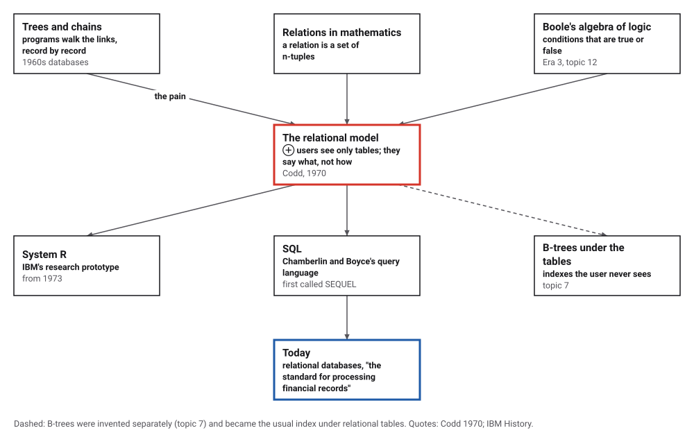
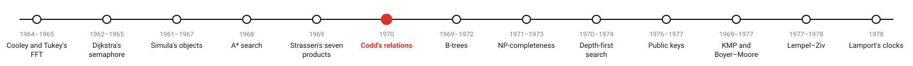
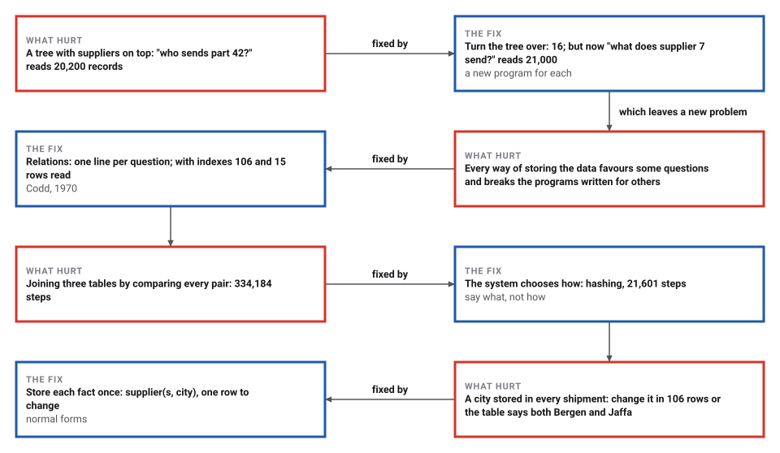
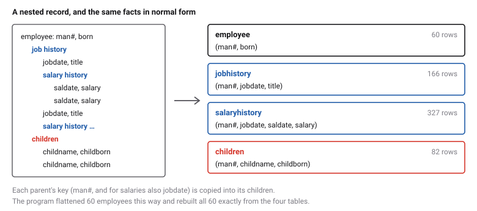

# The Relational Model of Data

*Era 6 · topic 6 · 1970* · [Era 6 index](../README.md) · [← Fast Matrix Multiplication](../05-strassen/README.md) · [B-Trees →](../07-b-trees/README.md) · [Interactive edition](relational-model.html) · [Program](../../../code/era-06-hard-problems-and-public-keys/06-relational-model/)

> **Field note from the visiting historian.** Asked of a tree against its grain, "who sends part 42?" cost 20,200 reads. Asked of tables with an index, the same question, written once, cost 15. The storage changed; the question did not.

| | |
|---|---|
| **When** | 1970 |
| **Where** | IBM Research Laboratory, San Jose |
| **What hurt** | Programs depended on how the data were stored |
| **The fix** | Relations, and operations on whole tables |
| **Measured** | 15 rows read instead of 20,200, same answer |

## How ideas combined

A new algorithm is usually an older idea combined with a new one. The databases of the 1960s were trees and chains of records that programs walked link by link. Mathematics already had relations, sets of tuples, and logic already had conditions that are true or false. Codd proposed that users should see nothing but relations, and ask for what they want, never how to find it. Each box names the idea that was added.

<picture>
  <source media="(prefers-color-scheme: dark)" srcset="assets/family-dark.svg">
  
</picture>
*Red: the relational model. Blue: where it is today.*

## Same question, different storage

A tiny supplier-and-part database, five suppliers, six parts, twelve shipments. Choose a question and a way of storing the data. Grey rows are read; blue rows are the answer. In a tree, a question against the grain reads everything; in tables, the question is the same whatever the storage, and an index only changes how much is read.

| Storage | "What does supplier 7 send?": records read | "Who sends part 42?": records read | Programs |
|---|---|---|---|
| Tree, suppliers on top | 107 | 20,200 | two programs |
| Tree, parts on top | 21,000 | 16 | two more programs |
| Relations, no index | 20,000 | 20,000 | two one-line questions |
| **Relations, with indexes** | **106** | **15** | **the same two lines** |
*In the interactive edition you can ask three questions of a small database stored four ways.*

## Era 6, hard problems and public keys

<picture>
  <source media="(prefers-color-scheme: dark)" srcset="assets/era-timeline-dark.svg">
  
</picture>

## Each fix leaves a new pain

<picture>
  <source media="(prefers-color-scheme: dark)" srcset="assets/chain-dark.svg">
  
</picture>
*Read it as a snake: each new problem sits directly under the fix that exposed it.*

## Tables, and three operations on them

**Relations.** A relation is a table: each row a tuple of values, the rows in no particular order, with no pointers from one row to another. The supplier-and-part data become supplier(s, city), part(p, color) and supply(s, p, qty).

**Operations on whole tables.** *Restriction* keeps the rows that satisfy a condition. *Projection* keeps some columns and drops duplicate rows. *Join* combines the rows of two tables that agree on a column. "Which parts does supplier 7 send?" is the projection on p of the restriction of supply to s = 7.

**Normal form.** Records with lists inside them (an employee with a job history, each job with a salary history) are flattened by copying each parent's key into its children.

<picture>
  <source media="(prefers-color-scheme: dark)" srcset="assets/normal-dark.svg">
  
</picture>

**Independence.** Because a question names only tables and columns, the system may store the rows in any order, add or drop indexes, and choose how to compute a join, without changing a single question.

> **Key idea.** Separate what is wanted from how to find it. A program that says only what it wants survives every reorganization of the data underneath it.

## Records read, steps taken

The program's database: 200 suppliers, 1,000 parts, 20,000 shipments. Supplier 7 sends 106 parts; part 42 comes from 15 suppliers. Every way of storing gave the same answers.

| Storage | "What does supplier 7 send?": records read | "Who sends part 42?": records read | Programs |
|---|---|---|---|
| Tree, suppliers on top | 107 | 20,200 | two programs |
| Tree, parts on top | 21,000 | 16 | two more programs |
| Relations, no index | 20,000 | 20,000 | two one-line questions |
| **Relations, with indexes** | **106** | **15** | **the same two lines** |

**A join.** "Which suppliers in Genoa send a gold part?": restrict supplier to Genoa (16 rows) and part to gold (9 rows), and join both with supply (20,000 rows). Three methods, the same 9 suppliers, checked against every shipment:

| Join method | Steps |
|---|---|
| Nested loops (compare every pair) | 334,184 |
| Sort both tables and merge | 263,223 |
| **Hashing (put one table in buckets by key)** | **21,601** |

**Normal form.** 60 nested employee records became employee (60 rows), jobhistory (166), salaryhistory (327) and children (82), and all 60 employees were rebuilt exactly from the flat tables.

**One fact, one place.** In a single wide table, supplier 7's city is repeated in 106 rows. An update that changes only one of them leaves the table saying both Bergen and Jaffa. Stored once, in supplier(s, city), the city has one row to change.

## San Jose, 1970

E. F. Codd, "A Relational Model of Data for Large Shared Data Banks" (IBM Research Laboratory, San Jose; *Communications of the ACM* 13(6): 377–387, June 1970), opens: "Future users of large data banks must be protected from having to know how the data is organized in the machine." It names the dependences it wants to remove, "ordering dependence, indexing dependence, and access path dependence"; defines a relation as "a set of ntuples" [sic]; describes normalization from the top of a tree, taking "its primary key" and expanding "each of the immediately subordinate relations"; and offers the model as a basis for "treating derivability, redundancy, and consistency of relations".

IBM's history pages: Codd was "an Oxford-educated mathematician working at the IBM San Jose Research Lab"; "The early databases used rigid hierarchical structures and convoluted navigational plans"; "A group of programmers in 1973 undertook an industrial-strength implementation: the System R project"; Chamberlin and Boyce "developed SQL" (first named SEQUEL, renamed "because of a trademark issue", according to LearnSQL); Codd received the Turing Award in 1981. Born on the Isle of Portland in 1923, he had flown in the Royal Air Force in the Second World War and joined IBM in 1949 as a mathematical programmer.

## Boole's conditions, on whole tables

A restriction keeps the rows for which a condition is true: city = Genoa and color = gold. Such conditions are Boole's algebra of logic (Era 3, topic 12), now applied to millions of rows at once. And the index under the table, which the user never sees, is usually the next topic's B-tree.

> **Full circle.** The same one-line question read 20,000 rows without an index and 15 with one. Nothing in the question changed.

## Before you read on

<details>
<summary><b>1.</b> Write "which cities have a supplier?" with the operations above.</summary>

The projection of supplier on city (duplicates dropped).
</details>

<details>
<summary><b>2.</b> Why does a tree with suppliers on top make "who sends part 42?" expensive?</summary>

Shipments are reached only through their supplier, so every supplier and every shipment must be read.
</details>

<details>
<summary><b>3.</b> What does adding an index change, and what does it not?</summary>

It changes how many rows are read; it does not change any question or any answer.
</details>

<details>
<summary><b>4.</b> In normal form, which key is copied into salaryhistory?</summary>

The employee's man# and the job's jobdate: together they say which job the salary belongs to.
</details>

<details>
<summary><b>5.</b> Why can repeating a fact in many rows lead to a contradiction?</summary>

An update may change some copies and miss others.
</details>


## Where the evidence lives

| | Object | Where to see it | Licence |
|---|---|---|---|
| — | **A Relational Model of Data for Large Shared Data Banks (1970)**. Codd's paper, *Communications of the ACM* 13(6): 377–387. | [The paper (PDF, on a Boston University page)](https://cs-people.bu.edu/mathan/reading-groups/papers-classics/codd.pdf) | Drawn placeholder. |

## Every link was opened before it was listed

| Level | Link | Why |
|---|---|---|
| Start | [The relational database](https://www.ibm.com/history/relational-database) — IBM History | The idea, System R, SQL and DB2, from the company where it began |
| Start | [The History of SQL](https://learnsql.com/blog/history-of-sql/) — Agnieszka Kozubek-Krycuń, LearnSQL (2020) | From SEQUEL to SQL |
| Deeper | [Edgar F. Codd](https://www.ibm.com/es-es/history/edgar-codd) — IBM History | The life of the man behind the model |
| Scholar | [A Relational Model of Data for Large Shared Data Banks](https://cs-people.bu.edu/mathan/reading-groups/papers-classics/codd.pdf) — E. F. Codd, *Communications of the ACM* 13(6): 377–387 (1970), on a Boston University page | The eleven-page paper |

More, with certainty labels and the gaps we could not fill: [Era 6 reference catalog](https://github.com/vij658/AlgorithmEvolutionAtlas/blob/main/book/era-06-hard-problems-and-public-keys/reference-catalog.md).

## The program behind every number here

[Relational.java](https://github.com/vij658/AlgorithmEvolutionAtlas/blob/main/code/era-06-hard-problems-and-public-keys/06-relational-model/Relational.java) makes **71 checks**: the same two questions on two trees and on tables with and without indexes, a three-table join by three methods against a check of every shipment, nested records flattened and rebuilt exactly, and a contradiction made by a careless update. Run it with `java Relational.java` (JDK 17 or newer). The heart of it:

```java
    /** Restriction: the rows whose column c equals v. Uses an index if one exists; the caller cannot tell. */
    Relation where(String c, int v) {
        int k = col(c);
        Relation out = new Relation(cols);
        if (index.containsKey(k)) {
            for (int[] r : index.get(k).getOrDefault(v, List.of())) { reads++; out.rows.add(r); }
        } else {
            for (int[] r : rows) { reads++; if (r[k] == v) out.rows.add(r); }
        }
        return out;
    }

/** Join of R and S on R.a = S.b, by one of three methods; returns rows of R's columns followed by S's. */
static List<int[]> join(List<int[]> R, int a, List<int[]> S, int b, String method) {
    List<int[]> out = new ArrayList<>();
    switch (method) {
        case "nested" -> {
            for (int[] r : R) for (int[] s : S) { work++; if (r[a] == s[b]) out.add(concat(r, s)); }
        }
        case "hash" -> {
            Map<Integer, List<int[]>> h = new HashMap<>();
            for (int[] r : R) { work++; h.computeIfAbsent(r[a], x -> new ArrayList<>()).add(r); }
            for (int[] s : S) { work++; for (int[] r : h.getOrDefault(s[b], List.of())) out.add(concat(r, s)); }
        }
        case "merge" -> {
            List<int[]> r2 = new ArrayList<>(R), s2 = new ArrayList<>(S);
            r2.sort((x, y) -> { work++; return Integer.compare(x[a], y[a]); });
            s2.sort((x, y) -> { work++; return Integer.compare(x[b], y[b]); });
            int i = 0, j = 0;
            while (i < r2.size() && j < s2.size()) {
                work++;
                int c = Integer.compare(r2.get(i)[a], s2.get(j)[b]);
                if (c < 0) i++;
                else if (c > 0) j++;
                else {
                    int v = r2.get(i)[a], j0 = j;
                    while (i < r2.size() && r2.get(i)[a] == v) {
                        for (j = j0; j < s2.size() && s2.get(j)[b] == v; j++) { work++; out.add(concat(r2.get(i), s2.get(j))); }
                        i++;
                    }
                }
            }
        }
    }
    return out;
}
```

