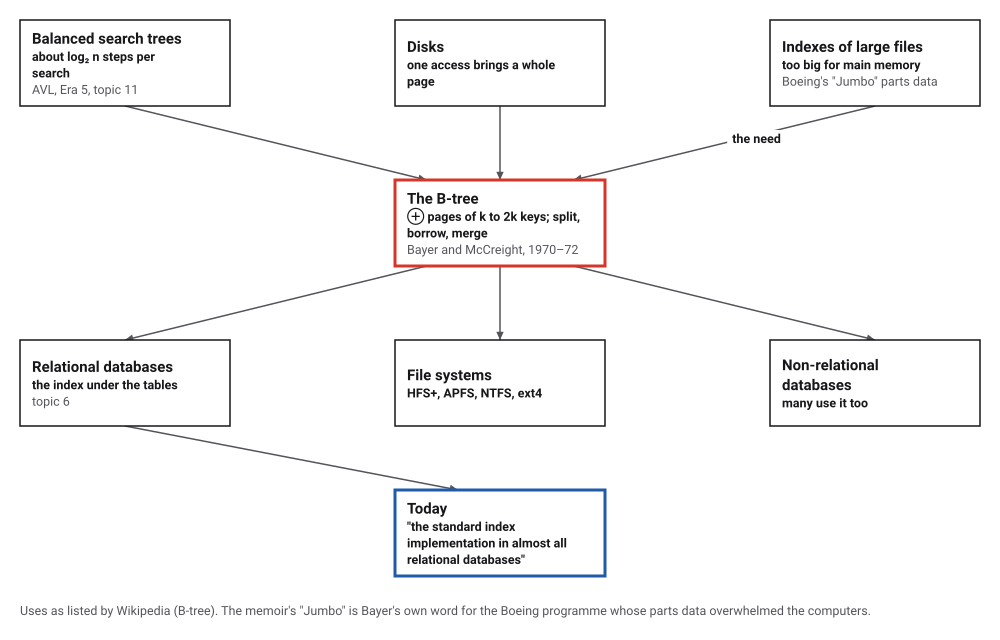
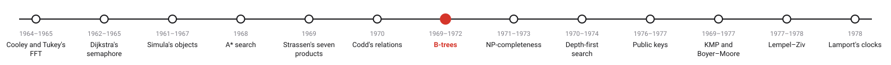
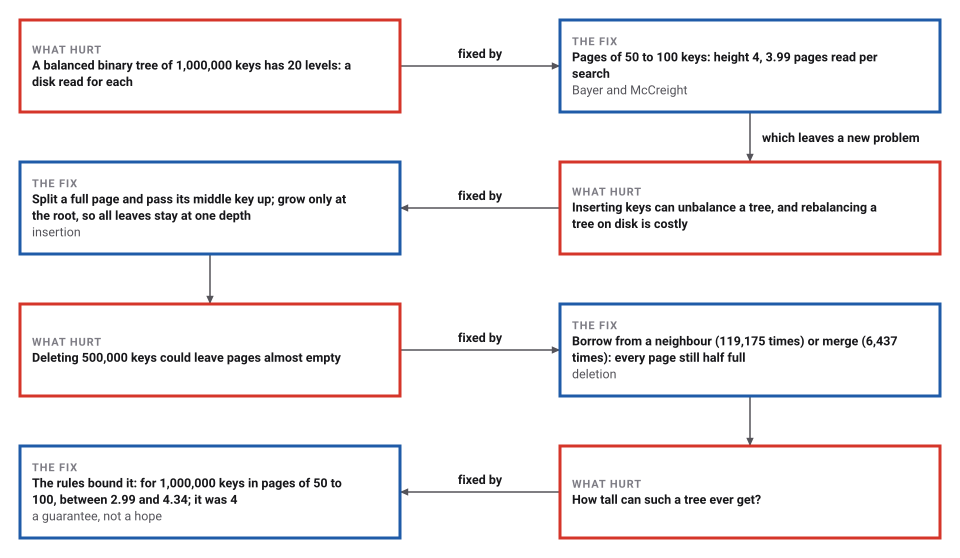
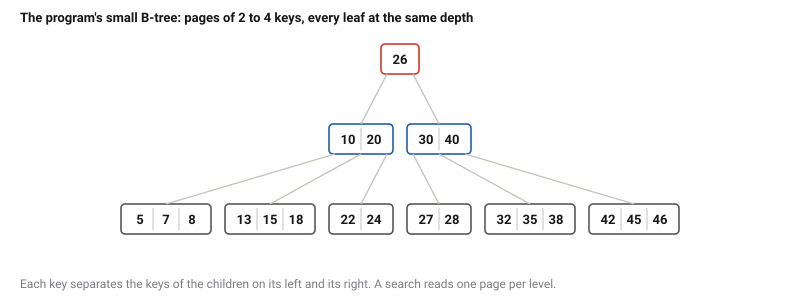

# B-Trees

*Era 6 · topic 7 · 1969–1972* · [Era 6 index](../README.md) · [← The Relational Model of Data](../06-relational-model/README.md) · [NP-Completeness →](../08-np-completeness/README.md) · [Interactive edition](b-trees.html) · [Program](../../../code/era-06-hard-problems-and-public-keys/07-b-trees/)

> **Field note from the visiting historian.** I built trees of 1,000,000 keys with pages of four sizes, then deleted half the keys. With a hundred keys to a page, a search read 3.99 pages on average, and through all the splits and merges every leaf stayed at the same depth.

| | |
|---|---|
| **When** | Idea 1969; report 1970; paper 1972 |
| **Where** | Boeing Scientific Research Laboratories |
| **What hurt** | Indexes on disk: one slow access per tree step |
| **The fix** | Pages of k to 2k keys; split, borrow, merge |
| **Measured** | 3.99 pages per search, not 20 levels |

## How ideas combined

A new algorithm is usually an older idea combined with a new one. A balanced binary tree finds a key in about log₂ n steps; a disk delivers a whole page at a time, and each delivery is slow. Bayer and McCreight made each node of the tree a whole page, holding many keys, so that each slow read does as much work as possible. Each box names the idea that was added.

<picture>
  <source media="(prefers-color-scheme: dark)" srcset="assets/family-dark.svg">
  
</picture>
*Red: the B-tree. Blue: where it is today.*

## Grow and shrink a B-tree

The program's small tree, with pages of 2 to 4 keys, built from its 21 keys. Insert keys and watch full pages split and pass their middle key up, until the root itself splits and the tree grows a level. Delete keys and watch pages borrow from a neighbour or merge.

| Keys per page | Height | Pages read per search | Pages | Full |
|---|---|---|---|---|
| 2 to 4 | 11 | 10.81 | 369,174 | 68% |
| 10 to 20 | 6 | 5.96 | 72,550 | 69% |
| **50 to 100** | **4** | **3.99** | **14,445** | **69%** |
| 200 to 400 | 3 | 3.00 | 3,901 | 64% |
*In the interactive edition you can insert and delete keys in a small B-tree. The table: 1,000,000 random keys in trees with pages of four sizes.*

## Era 6, hard problems and public keys

<picture>
  <source media="(prefers-color-scheme: dark)" srcset="assets/era-timeline-dark.svg">
  
</picture>

## Each fix leaves a new pain

<picture>
  <source media="(prefers-color-scheme: dark)" srcset="assets/chain-dark.svg">
  
</picture>
*Read it as a snake: each new problem sits directly under the fix that exposed it.*

## Pages that split and merge

**Pages.** Every page holds between k and 2k keys in order (the root may hold fewer), and a page that is not a leaf has one more child than keys: the keys of the i-th child lie between the page's keys i − 1 and i. A search reads the root, finds where the key would go, reads that child, and so on down.

**Insertion.** Put the key in its leaf. If the leaf now holds 2k + 1 keys, split it: the middle key moves up into the parent, and the two halves of k keys each become pages. The parent may overflow in turn; when the root splits, a new root is made above it. The tree grows at the top, so every leaf is always at the same depth.

<picture>
  <source media="(prefers-color-scheme: dark)" srcset="assets/small-dark.svg">
  
</picture>
*Built by inserting 20 40 10 30 15 35 7 26 18 22 5 42 13 46 27 8 32 38 24 45 28: 6 splits, height 3.*

**Deletion.** Remove the key (from a leaf, or by replacing it with the largest key to its left). A page left with k − 1 keys borrows one from a neighbour, through the parent, if the neighbour can spare it; otherwise the two merge, pulling down the key that separated them.

> **Key idea.** When each step is slow but brings a lot, make each step decide among many choices. With a hundred keys per page, a million keys are four pages deep.

## A million keys

1,000,000 random keys, and 100,000 searches, half of them for keys present. A perfectly balanced binary tree of that many keys has 20 levels.

| Keys per page | Height | Pages read per search | Pages | Full |
|---|---|---|---|---|
| 2 to 4 | 11 | 10.81 | 369,174 | 68% |
| 10 to 20 | 6 | 5.96 | 72,550 | 69% |
| **50 to 100** | **4** | **3.99** | **14,445** | **69%** |
| 200 to 400 | 3 | 3.00 | 3,901 | 64% |

**How full.** With pages of 50 to 100 keys, keys inserted in random order filled the pages 69.2% on average (14,445 pages); the same keys inserted in sorted order filled them only 50.0% (19,999 pages), because every split leaves a half-full page behind that never receives another key.

**Deletion.** 500,000 keys deleted in random order: 119,175 borrows from a neighbour and 6,437 merges. Afterwards every page still held 50 to 100 keys, every leaf was at depth 4, and all 1,000,000 searches, for deleted and kept keys, answered correctly.

**Bounds.** The rules alone limit the height h of a tree of n keys: log(n + 1) / log(2k + 1) ≤ h ≤ 1 + log((n + 1)/2) / log(k + 1). Every tree the program built kept within them:

| k | Keys n | Lower bound | Height | Upper bound |
|---|---|---|---|---|
| 2 | 1,000,000 | 8.58 | 11 | 12.94 |
| 10 | 1,000,000 | 4.54 | 6 | 6.47 |
| 50 | 1,000,000 | 2.99 | 4 | 4.34 |
| 200 | 1,000,000 | 2.30 | 3 | 3.47 |
| 50 | 1,000,000 | 2.99 | 4 | 4.34 |
| 50 | 500,000 | 2.84 | 4 | 4.16 |
| 2 | 21 | 1.92 | 3 | 3.18 |

## An idea at Boeing

Rudolf Bayer's memoir (in German) remembers it: "Am weitaus wichtigsten war die Arbeit über B-Bäume im Herbst 1969" (by far the most important was the work on B-trees in autumn 1969), and "Ich erinnere mich noch genau, wie ich in das Büro meines Kollegen Ed McCreight spaziert bin" (I remember exactly how I walked into my colleague Ed McCreight's office). The data processing of the time, he writes, had reached its limits in managing the many individual parts of Boeing's "Jumbo" programme. The work appeared as a Boeing technical report, at the 1970 ACM SIGFIDET Workshop on Data Description and Access, and, refereed, in *Acta Informatica* 1(3): 173–189 (1972).

Wikipedia: they wanted to "efficiently manage index pages for large random-access files", and "Organization and maintenance of large ordered indices" was first circulated in July 1970. They never said what the B stands for; suggestions include "Boeing, balanced, between, broad, bushy, and Bayer". McCreight said in 2013 that "It has to do with Balance", and reported Bayer's view: "the more you think about what the B in B-Tree means, the better you understand B-Trees!"

## Under every table

The relational model (topic 6) lets a question say what it wants and leaves the how to the system; the B-tree is very often the how. Wikipedia calls it "the standard index implementation in almost all relational databases", and it also organizes the files on many disks (HFS+, APFS, NTFS, ext4).

> **Full circle.** The AVL tree of Era 5 balanced a binary tree by rotations. The B-tree balances by splitting and merging pages, and reads 3.99 pages per search where a binary tree would need about 20 levels.

## Before you read on

<details>
<summary><b>1.</b> With pages of 2 to 4 keys, insert 1, 2, 3, 4, 5 into an empty tree. What happens at 5?</summary>

The leaf holds 1 2 3 4 5: it splits, 3 moves up to a new root, and the leaves are [1 2] and [4 5].
</details>

<details>
<summary><b>2.</b> Why does the tree grow at the root and not at the leaves?</summary>

Splits push keys upward; only a split of the root adds a level, and it adds it above every leaf at once.
</details>

<details>
<summary><b>3.</b> Why do sorted insertions leave pages half full?</summary>

Each split leaves the left half behind, and later keys are all larger, so it never receives another key.
</details>

<details>
<summary><b>4.</b> A page of 50 to 100 keys: how many pages must be read to find one of a million keys?</summary>

About 4: each level divides the possibilities by 50 to 100.
</details>

<details>
<summary><b>5.</b> When does deletion merge rather than borrow?</summary>

When the neighbouring page has only k keys and cannot spare one.
</details>


## Where the evidence lives

| | Object | Where to see it | Licence |
|---|---|---|---|
| — | **Rudolf Bayer, Memoiren**. The inventor's memoir, in German, at the Technical University of Munich. | [Memoir (PDF)](https://db.cit.tum.de/~bayer/Memoiren-Bayer.pdf) | Drawn placeholder. |

## Every link was opened before it was listed

| Level | Link | Why |
|---|---|---|
| Start | [B-tree](https://en.wikipedia.org/wiki/B-tree) — Wikipedia | The structure, its variants, and the mystery of the B |
| Deeper | [Memoiren](https://db.cit.tum.de/~bayer/Memoiren-Bayer.pdf) — Rudolf Bayer, Technical University of Munich (in German) | The inventor's own account of Boeing and the B-tree |
| Deeper | [Edward M. McCreight](https://en.wikipedia.org/wiki/Edward_M._McCreight) — Wikipedia | The co-inventor, who went on to the Xerox Alto |
| Scholar | [Organization and Maintenance of Large Ordered Indexes (bibliographic entry)](https://glossar.hs-augsburg.de/Bayer,_McCreight_(1972) — R. Bayer and E. McCreight, *Acta Informatica* 1(3): 173–189 (1972) | The paper; no openable copy of the text was found |

More, with certainty labels and the gaps we could not fill: [Era 6 reference catalog](https://github.com/vij658/AlgorithmEvolutionAtlas/blob/main/book/era-06-hard-problems-and-public-keys/reference-catalog.md).

## The program behind every number here

[BTrees.java](https://github.com/vij658/AlgorithmEvolutionAtlas/blob/main/code/era-06-hard-problems-and-public-keys/07-b-trees/BTrees.java) makes **11,900,288 checks**: every rule (page sizes, key order, equal leaf depths) after every build and after half a million deletions, a million searches against the set of kept keys, and the height bounds for every tree. Run it with `java BTrees.java` (JDK 17 or newer). The heart of it:

```java
    /** Returns null if x was present, an empty array if nothing moved up, else {middle key, new right page}. */
    Object[] insert(Page p, long x) {
        int i = find(p, x);
        if (i < p.n && p.keys[i] == x) return null;
        if (!p.leaf()) {
            Object[] up = insert(p.kids[i], x);
            if (up == null || up.length == 0) return up;
            System.arraycopy(p.keys, i, p.keys, i + 1, p.n - i);
            System.arraycopy(p.kids, i + 1, p.kids, i + 2, p.n - i);
            p.keys[i] = (long) up[0];
            p.kids[i + 1] = (Page) up[1];
        } else {
            System.arraycopy(p.keys, i, p.keys, i + 1, p.n - i);
            p.keys[i] = x;
        }
        p.n++;
        if (p.n <= 2 * k) return new Object[0];
        // the page holds 2k + 1 keys: split it around the middle key
        Page right = new Page(k, p.leaf());
        System.arraycopy(p.keys, k + 1, right.keys, 0, k);
        if (!p.leaf()) System.arraycopy(p.kids, k + 1, right.kids, 0, k + 1);
        right.n = k;
        p.n = k;
        if (!p.leaf()) for (int j = k + 1; j <= 2 * k + 1; j++) p.kids[j] = null;
        splits++;
        if (logging) log.add("split around " + p.keys[k]);
        return new Object[]{p.keys[k], right};
    }
```

