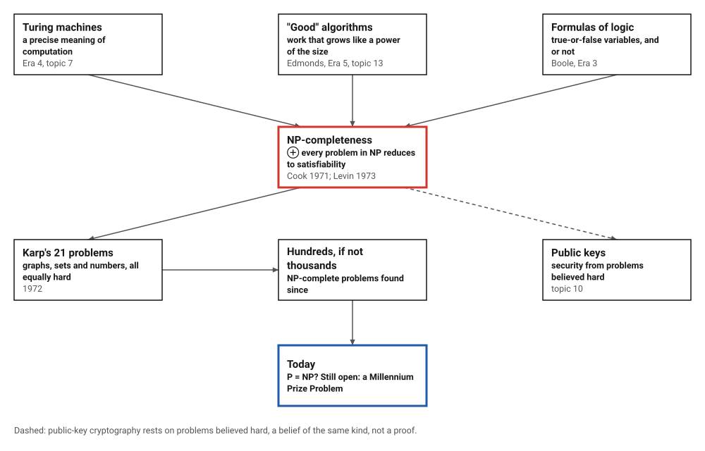
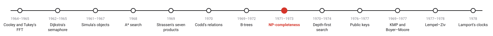
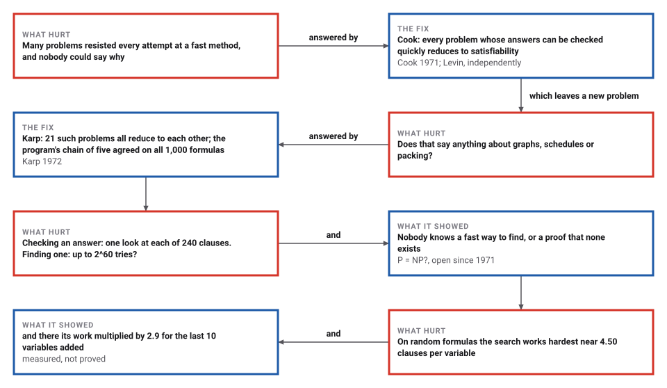
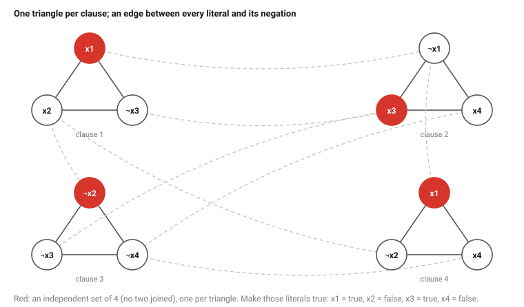

# NP-Completeness

*Era 6 · topic 8 · 1971–1973* · [Era 6 index](../README.md) · [← B-Trees](../07-b-trees/README.md) · [Depth-First Search →](../09-depth-first-search/README.md) · [Interactive edition](np-completeness.html) · [Program](../../../code/era-06-hard-problems-and-public-keys/08-np-completeness/)

> **Field note from the visiting historian.** I translated 1,000 small formulas into graphs four different ways and solved every version by brute force; the answers never disagreed. Checking a solution took one look at each clause. Whether finding one can ever be as easy, nobody here knows.

| | |
|---|---|
| **When** | Cook 1971; Karp 1972; Levin 1973 |
| **Where** | Toronto, Berkeley, Moscow |
| **What hurt** | Many problems resisted every fast method |
| **The step** | Reductions; satisfiability is NP-complete |
| **Still open** | P = NP? |

## How ideas combined

A new algorithm is usually an older idea combined with a new one; this time the new idea is about problems rather than methods. Turing had made computation precise, Edmonds had proposed that a good algorithm is one whose work grows like a power of the input's size, and logic had its formulas of true-or-false variables. Cook joined them: one formula problem carries all the problems of a large class inside it. Each box names the idea that was added.

<picture>
  <source media="(prefers-color-scheme: dark)" srcset="assets/family-dark.svg">
  
</picture>
*Red: NP-completeness. Blue: where the question stands today.*

## Checking is easy; finding is not

A random formula: 16 true-or-false variables and 68 clauses, each of three literals (¬ means not). Click the variables to set them; every clause turns blue as soon as it is true. Checking an assignment is instant. Finding one that makes all 68 true is the hard part; when you give up, let the search find one.

| Clauses per variable | Satisfiable | Median steps of the search |
|---|---|---|
| 2.00 | 100% | 29 |
| 3.00 | 100% | 22 |
| 3.50 | 100% | 26 |
| 4.00 | 88% | 59 |
| 4.25 | 63% | 146 |
| **4.50** | **34%** | **163** |
| 5.00 | 6% | 135 |
| 6.00 | 0% | 71 |
| 8.00 | 0% | 35 |
*In the interactive edition you can try to satisfy a random formula yourself. The table: 200 random formulas of 50 variables for each number of clauses.*

## Era 6, hard problems and public keys

<picture>
  <source media="(prefers-color-scheme: dark)" srcset="assets/era-timeline-dark.svg">
  
</picture>

## Each answer leaves a new question

<picture>
  <source media="(prefers-color-scheme: dark)" srcset="assets/chain-dark.svg">
  
</picture>
*Read it as a snake: each new question sits directly under the answer that raised it.*

## Translations that keep the answer

**P and NP.** A problem is in P if some method answers it in a number of steps bounded by a polynomial in the size of the input. It is in NP if a proposed answer can be *checked* in polynomial time. Satisfiability (can these clauses all be made true?) is in NP: given an assignment, check each clause.

**Reductions.** A reduction is a quick translation of every instance of one problem into an instance of another, with the same answer. If B has a fast method and A reduces to B, then A has one too. Cook showed that every problem in NP reduces to satisfiability; Karp then reduced satisfiability to 21 other problems, so all of them are NP-complete: a fast method for any one would give a fast method for all.

**One reduction, drawn.** A formula with m clauses of three literals becomes a graph: one triangle per clause, and an edge between every literal and its negation. The graph has m vertices with no edge between any two exactly when the formula can be satisfied: pick one true literal from each clause. The program's formula, 4 clauses, gives 12 vertices and 20 edges (12 in triangles, 8 between negations):

<picture>
  <source media="(prefers-color-scheme: dark)" srcset="assets/graph-dark.svg">
  
</picture>

> **Key idea.** Instead of solving a hard problem, show that it is as hard as a problem everyone has failed to solve. Then a whole family of problems stands or falls together.

## Five problems, one answer

**The chain.** 1,000 random formulas in 4 variables (4 to 10 clauses of 1 to 4 literals) were each turned into 3-satisfiability, then a graph (an independent set of size m?), then vertex cover, then clique in the complementary graph. Each of the five questions was answered by its own exhaustive method. All five answers agreed on every formula: 849 satisfiable, 151 not, with graphs of up to 63 vertices.

**Checking against finding.** A random formula of 60 variables and 240 clauses: a search with unit propagation found a satisfying assignment after 27 steps of its tree, and checking it took one look at each of the 240 clauses. Trying every assignment could take up to 2^60 = 1,152,921,504,606,846,976.

**Where it is hard.** Random formulas of 50 variables, 200 for each number of clauses. With few clauses almost every formula can be satisfied, with many almost none; the search works hardest where the share falls, at 4.50 clauses per variable here:

| Clauses per variable | Satisfiable | Median steps of the search |
|---|---|---|
| 2.00 | 100% | 29 |
| 3.00 | 100% | 22 |
| 3.50 | 100% | 26 |
| 4.00 | 88% | 59 |
| 4.25 | 63% | 146 |
| **4.50** | **34%** | **163** |
| 5.00 | 6% | 135 |
| 6.00 | 0% | 71 |
| 8.00 | 0% | 35 |

**Growth.** Near that ratio (4.26 clauses per variable), the median work grows with the number of variables: 20 variables 17, 30 variables 30, 40 variables 75, 50 variables 145, 60 variables 311, 70 variables 472, 80 variables 1,389 steps. The last 10 variables multiplied it by 2.9. That is a measurement of one method on random formulas, not a proof about all methods.

## Toronto, Berkeley and Moscow

Stephen Cook, "The Complexity of Theorem-Proving Procedures" (University of Toronto; ACM Symposium on the Theory of Computing, 1971): "any recognition problem solved by a polynomial time-bounded nondeterministic Turing machine" can be reduced to deciding whether a formula is a tautology; "it is fruitless to search for a polynomial decision procedure for the subgraph problem" unless tautologies have one. He added: "I feel it is worth spending considerable effort trying to prove this conjecture. Such a proof would be a major breakthrough in complexity theory." Berkeley's mathematics department had not reappointed him; Karp later said: "It is to our everlasting shame that we were unable to persuade the math department to give him tenure."

Leonid Levin found the same result independently in the Soviet Union ("Universal search problems", 1973); it is "often called the Cook–Levin theorem". Richard Karp's "Reducibility Among Combinatorial Problems" (1972) reduced satisfiability to 21 problems. Lance Fortnow: "If Cook made the P versus NP question interesting to logicians, Karp made the question important to everyone else." Cook received the Turing Award in 1982; the question "remains open and is among the seven famous Millennium Prize Problems" (Wikipedia).

## From "good" algorithms to hard problems

Edmonds asked in 1965 for algorithms whose work grows like a power of the size (Era 5, topic 13); his matching method was one. Cook and Karp found a family of problems for which nobody has such an algorithm, and showed they all stand or fall together. Four years later, cryptographers turned the same kind of hardness into a resource (topic 10).

> **Full circle.** Checking the program's satisfying assignment took 240 looks. Whether finding one can always be made nearly as easy is the question P = NP.

## Before you read on

<details>
<summary><b>1.</b> Is (x1 ∨ x2) ∧ (¬x1 ∨ x2) ∧ (¬x2 ∨ x1) ∧ (¬x1 ∨ ¬x2) satisfiable?</summary>

No: the first and second need x2, the third then needs x1, and the fourth forbids both.
</details>

<details>
<summary><b>2.</b> If someone found a fast method for clique, what would follow?</summary>

A fast method for every problem in NP, satisfiability included, since they all reduce to clique.
</details>

<details>
<summary><b>3.</b> Why is checking easy for satisfiability?</summary>

An assignment is a short certificate: one pass over the clauses checks it.
</details>

<details>
<summary><b>4.</b> In the graph reduction, why must the independent set use exactly one vertex per triangle?</summary>

A triangle's three vertices are all joined, so at most one can be chosen; to reach m, every triangle must give one.
</details>

<details>
<summary><b>5.</b> Does a slow search on random formulas prove that satisfiability is hard?</summary>

No. It measures one method on one kind of input; hardness for every method is exactly the open question.
</details>


## Where the evidence lives

| | Object | Where to see it | Licence |
|---|---|---|---|
| — | **The Complexity of Theorem-Proving Procedures (1971)**. Cook's paper for the third ACM Symposium on the Theory of Computing. | [The paper (PDF, on a course page)](https://www.cs.umd.edu/~gasarch/COURSES/452/F14/cookpaper.pdf) | Drawn placeholder. |

## Every link was opened before it was listed

| Level | Link | Why |
|---|---|---|
| Start | [Favorite Theorems: NP-Completeness](https://blog.computationalcomplexity.org/2005/04/favorite-theorems-np-completeness.html) — Lance Fortnow, Computational Complexity blog (2005) | Cook and Levin in a few paragraphs |
| Start | [Favorite Theorems: Combinatorial NP-Complete Problems](https://blog.computationalcomplexity.org/2005/05/favorite-theorems-combinatorial-np.html) — Lance Fortnow (2005) | Why Karp's 21 problems changed the field |
| Start | [Karp's 21 NP-complete problems](https://en.wikipedia.org/wiki/Karp%27s_21_NP-complete_problems) — Wikipedia | The tree of reductions |
| Deeper | [Stephen Cook](https://en.wikipedia.org/wiki/Stephen_Cook) — Wikipedia | Berkeley, Toronto, and the 1971 paper |
| Deeper | [Leonid Levin](https://en.wikipedia.org/wiki/Leonid_Levin) — Wikipedia | The same discovery, made independently in the Soviet Union |
| Scholar | [The Complexity of Theorem-Proving Procedures](https://www.cs.umd.edu/~gasarch/COURSES/452/F14/cookpaper.pdf) — S. A. Cook, STOC 1971, on a University of Maryland course page | The paper that defined the question |

More, with certainty labels and the gaps we could not fill: [Era 6 reference catalog](https://github.com/vij658/AlgorithmEvolutionAtlas/blob/main/book/era-06-hard-problems-and-public-keys/reference-catalog.md).

## The program behind every number here

[NpComplete.java](https://github.com/vij658/AlgorithmEvolutionAtlas/blob/main/code/era-06-hard-problems-and-public-keys/08-np-completeness/NpComplete.java) makes **2,231 checks**: the graph reduction on a small formula, a chain of five reductions on 1,000 formulas with every problem solved exhaustively, every satisfying assignment found by the search, and the threshold and growth of the search's work. Run it with `java NpComplete.java` (JDK 17 or newer). The heart of it:

```java
/** 3-SAT to a graph on 3m vertices (bitmask adjacency): triangles per clause, edges between opposite literals. */
static long[] toGraph(List<int[]> g) {
    int V = 3 * g.size();
    long[] adj = new long[V];
    for (int i = 0; i < V; i++)
        for (int j = i + 1; j < V; j++) {
            boolean sameClause = i / 3 == j / 3;
            boolean opposite = g.get(i / 3)[i % 3] == -g.get(j / 3)[j % 3];
            if (sameClause || opposite) { adj[i] |= 1L << j; adj[j] |= 1L << i; }
        }
    return adj;
}

// ---- reductions ----------------------------------------------------------------------------------------------------
/** Any CNF formula to one with exactly three literals per clause, adding new variables; returns {formula, n'}. */
static Object[] toThreeSat(List<int[]> f, int n) {
    List<int[]> g = new ArrayList<>();
    int next = n;
    for (int[] c : f) {
        if (c.length == 1) {
            int a = ++next, b = ++next;
            g.add(new int[]{c[0], a, b}); g.add(new int[]{c[0], a, -b}); g.add(new int[]{c[0], -a, b}); g.add(new int[]{c[0], -a, -b});
        } else if (c.length == 2) {
            int a = ++next;
            g.add(new int[]{c[0], c[1], a}); g.add(new int[]{c[0], c[1], -a});
        } else if (c.length == 3) g.add(c.clone());
        else {
            int y = ++next;
            g.add(new int[]{c[0], c[1], y});
            for (int i = 2; i < c.length - 2; i++) { int z = ++next; g.add(new int[]{-y, c[i], z}); y = z; }
            g.add(new int[]{-y, c[c.length - 2], c[c.length - 1]});
        }
    }
    return new Object[]{g, next};
}
```

