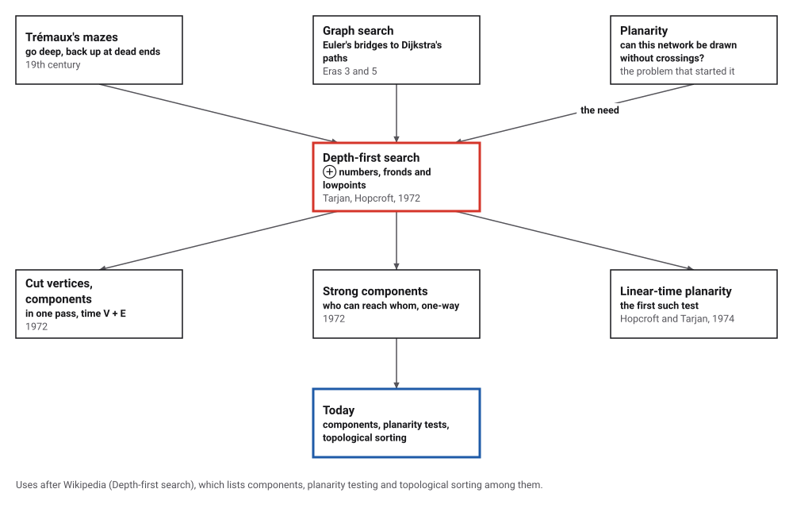
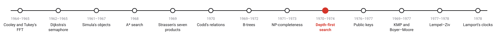
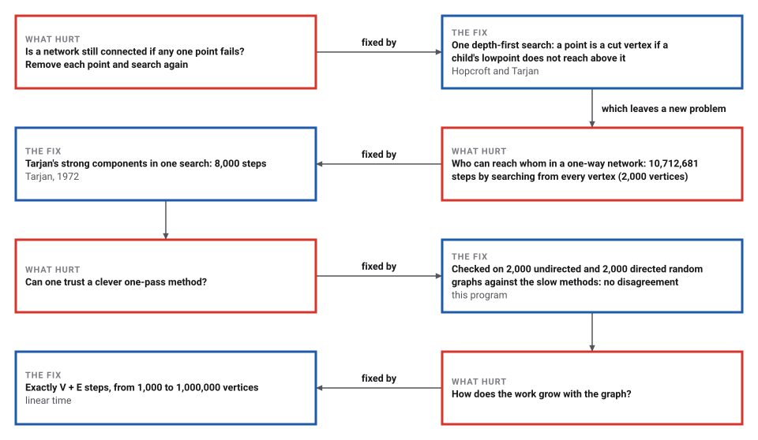
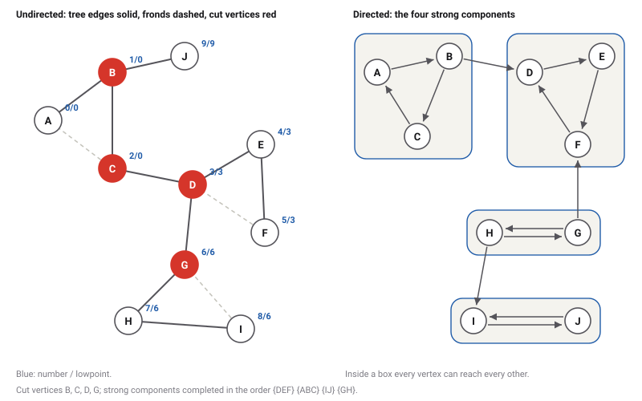

# Depth-First Search

*Era 6 · topic 9 · 1970–1974* · [Era 6 index](../README.md) · [← NP-Completeness](../08-np-completeness/README.md) · [Public-Key Cryptography →](../10-public-key-cryptography/README.md) · [Interactive edition](depth-first-search.html) · [Program](../../../code/era-06-hard-problems-and-public-keys/09-depth-first-search/)

> **Field note from the visiting historian.** Finding who can reach whom on a graph of 2,000 vertices took 10,712,681 steps by searching from every vertex, and 8,000 by Tarjan's single search. On a million vertices the count was exactly V + E, as the paper promised.

| | |
|---|---|
| **When** | Planarity work from 1970; paper 1972; planarity test 1974 |
| **Where** | Stanford and Cornell |
| **What hurt** | Graph structure took repeated searches |
| **The fix** | Search order, fronds and lowpoints |
| **Cost** | V + E steps |

## How ideas combined

A new algorithm is usually an older idea combined with a new one. Exploring a maze by going as deep as possible and backing up only at dead ends is old. Hopcroft and Tarjan, looking for a fast test of whether a network can be drawn without crossings, studied what such a search leaves behind: the order of arrival, and the few edges that lead back up. Each box names the idea that was added.

<picture>
  <source media="(prefers-color-scheme: dark)" srcset="assets/family-dark.svg">
  
</picture>
*Red: depth-first search as a tool. Blue: where it is used today.*

## Watch the lowpoints find the weak points

The program's small graph. Step through the search from A: each new vertex gets the next number; an edge to a vertex not yet reached is a tree edge (blue), an edge back to an earlier vertex is a frond (dashed). When a vertex is finished, its lowpoint passes to its parent, and if nothing below a vertex reaches above it, that vertex is a cut vertex (red).

| Vertex (in the order reached) | Number | Lowpoint |  |
|---|---|---|---|
| A | 0 | 0 |  |
| B | 1 | 0 | cut vertex |
| C | 2 | 0 | cut vertex |
| D | 3 | 3 | cut vertex |
| E | 4 | 3 |  |
| F | 5 | 3 |  |
| G | 6 | 6 | cut vertex |
| H | 7 | 6 |  |
| I | 8 | 6 |  |
| J | 9 | 9 |  |
*In the interactive edition you can step through the search and watch the lowpoints.*

## Era 6, hard problems and public keys

<picture>
  <source media="(prefers-color-scheme: dark)" srcset="assets/era-timeline-dark.svg">
  
</picture>

## Each fix leaves a new pain

<picture>
  <source media="(prefers-color-scheme: dark)" srcset="assets/chain-dark.svg">
  
</picture>
*Read it as a snake: each new problem sits directly under the fix that exposed it.*

## One pass, and one extra number

**The search.** Number the vertices in the order the search reaches them. The edges used to arrive form a tree; in an undirected graph every other edge (a *frond*) leads from a vertex back to one of its ancestors, never sideways. Each edge is examined from each end once, so the search takes time proportional to V + E.

**Lowpoints.** The lowpoint of v is the smallest number that can be reached from v by going down the tree and then along at most one frond. It is computed as the search backs up: a vertex's lowpoint is the least of its own number, the numbers its fronds reach, and its children's lowpoints. A vertex u other than the root is a cut vertex exactly when some child v has lowpoint(v) ≥ number(u): nothing below v can get round u.

**Strong components.** In a directed graph the same bookkeeping (Tarjan's LOWLINK) finds the strongly connected components: the search completes a component when it backs out of the first vertex it reached in it.

<picture>
  <source media="(prefers-color-scheme: dark)" srcset="assets/graphs-dark.svg">
  
</picture>

> **Key idea.** Don't search again for each question. One search, with a number or two recorded at each vertex, already holds the answers to questions that seemed to need many searches.

## Exactly V + E

**The small graph.** Edges AB BC CA CD DE EF FD DG GH HI IG BJ; the search from A reached A B C D E F G H I J. Tree edges AB BC CD DE EF DG GH HI BJ; fronds CA FD IG. Cut vertices B, C, D, G; biconnected components DEF, GHI, DG, CD, BJ, ABC.

| Vertex (in the order reached) | Number | Lowpoint |  |
|---|---|---|---|
| A | 0 | 0 |  |
| B | 1 | 0 | cut vertex |
| C | 2 | 0 | cut vertex |
| D | 3 | 3 | cut vertex |
| E | 4 | 3 |  |
| F | 5 | 3 |  |
| G | 6 | 6 | cut vertex |
| H | 7 | 6 |  |
| I | 8 | 6 |  |
| J | 9 | 9 |  |

**The directed graph.** Edges AB BC CA BD DE EF FD GF GH HG HI IJ JI: strong components {DEF}, {ABC}, {IJ}, {GH}, in the order Tarjan's method completes them.

**Checked.** 2,000 random undirected graphs and 2,000 random directed graphs of 4 to 30 vertices: every cut vertex found by lowpoints was one whose removal splits the graph, and no other (5,806 in all); every pair of vertices was in the same strong component exactly when each can reach the other (28,070 components in all).

| Vertices V | Edges E | Steps (numbering a vertex or examining an edge) |
|---|---|---|
| 1,000 | 3,000 | 4,000 |
| 10,000 | 30,000 | 40,000 |
| 100,000 | 300,000 | 400,000 |
| 1,000,000 | 3,000,000 | 4,000,000 |

On the graph of 2,000 vertices, finding everything each vertex can reach, one search per vertex, took 10,712,681 steps against 8,000 (1,339 times more).

## A sabbatical at Stanford

Tarjan's Turing Award lecture, "Algorithm Design" (*Communications of the ACM*, March 1987), tells it: he entered Stanford after Caltech in 1969, and in June 1970 "John Hopcroft arrived from Cornell to begin a sabbatical year at Stanford". "The focus of our activities became the problem of testing the planarity of a graph." "After carefully studying the properties of depth-first search, we developed a way to generate paths in O(n) time using depth-first search."

Tarjan's paper "Depth-First Search and Linear Graph Algorithms" (Cornell University; *SIAM Journal on Computing* 1(2), June 1972; received 30 August 1971) bounds the time and space of its two algorithms by k₁V + k₂E + k₃, and defines LOWLINK(v) as "the smallest vertex which is in the same component as v and is reachable by traversing zero or more tree arcs followed by at most one frond or cross-link". Hopcroft and Tarjan's planarity test followed in the *Journal of the ACM* in 1974, "the first linear-time algorithm for planarity testing" (Wikipedia). They shared the 1986 Turing Award "For fundamental achievements in the design and analysis of algorithms and data structures".

## Back to the maze

"A version of depth-first search was investigated in the 19th century by French mathematician Charles Pierre Trémaux as a strategy for solving mazes" (Wikipedia), and every depth-first search tree is what graph theorists now call a Trémaux tree. What Hopcroft and Tarjan added was not the walk but the bookkeeping, and the insistence that the whole job be done in one pass.

> **Full circle.** Euler asked of seven bridges whether a walk could cross each once (Era 3, topic 7). Here a walk that crosses each of 3,000,000 one-way roads once finds who can reach whom, in 4,000,000 steps.

## Before you read on

<details>
<summary><b>1.</b> In an undirected graph, why can a non-tree edge never join two different branches of the search tree?</summary>

When the search first reached the earlier of the two vertices, it would have followed that edge before backing out, making it a tree edge.
</details>

<details>
<summary><b>2.</b> Vertex D has number 3; its child E has lowpoint 3. What does that tell you?</summary>

Nothing below E reaches above D, so removing D cuts E's part off: D is a cut vertex.
</details>

<details>
<summary><b>3.</b> Why is the root a special case?</summary>

It has nothing above it; it is a cut vertex exactly when it has two or more children in the search tree.
</details>

<details>
<summary><b>4.</b> How many steps does the search take on a graph with 100 vertices and 300 edges?</summary>

About V + E = 400 for a directed graph (each edge examined once).
</details>

<details>
<summary><b>5.</b> What are the strong components of a one-way cycle A → B → C → A plus an edge C → D?</summary>

{A, B, C} and {D}: D cannot get back.
</details>


## Where the evidence lives

| | Object | Where to see it | Licence |
|---|---|---|---|
| — | **Depth-First Search and Linear Graph Algorithms (1972)**. Tarjan's paper, *SIAM Journal on Computing* 1(2). | [The paper (PDF, on a Carnegie Mellon page)](https://www.cs.cmu.edu/~cdm/resources/Tarjan1972-sccs.pdf) | Drawn placeholder. |

## Every link was opened before it was listed

| Level | Link | Why |
|---|---|---|
| Start | [Depth-first search](https://en.wikipedia.org/wiki/Depth-first_search) — Wikipedia | The search, its orders, and its uses |
| Start | [Robert Tarjan](https://en.wikipedia.org/wiki/Robert_Tarjan) — Wikipedia | The many algorithms of one designer |
| Deeper | [Algorithm Design (Turing Award lecture)](https://www.cs.williams.edu/~heeringa/classes/cs256/s07/tarjan-turing.pdf) — R. E. Tarjan, *Communications of the ACM* (1987) | How planarity led him and Hopcroft to depth-first search, in his own words |
| Deeper | [Trémaux tree](https://en.wikipedia.org/wiki/Tr%C3%A9maux_tree) — Wikipedia | The maze-solver's tree, and why every depth-first search builds one |
| Scholar | [Depth-First Search and Linear Graph Algorithms](https://www.cs.cmu.edu/~cdm/resources/Tarjan1972-sccs.pdf) — R. Tarjan, *SIAM Journal on Computing* 1(2) (1972), on a Carnegie Mellon page | Strong components and biconnected components in linear time |
| Scholar | [Efficient planarity testing (bibliographic entry)](https://projects.csail.mit.edu/jacm/References/hopcroftt1974:549.html) — J. Hopcroft and R. Tarjan, *Journal of the ACM* 21(4): 549–568 (1974) | The first linear-time planarity test; the text was not opened |

More, with certainty labels and the gaps we could not fill: [Era 6 reference catalog](https://github.com/vij658/AlgorithmEvolutionAtlas/blob/main/book/era-06-hard-problems-and-public-keys/reference-catalog.md).

## The program behind every number here

[DepthFirst.java](https://github.com/vij658/AlgorithmEvolutionAtlas/blob/main/code/era-06-hard-problems-and-public-keys/09-depth-first-search/DepthFirst.java) makes **728,520 checks**: cut vertices and biconnected components of a small graph, strong components of a directed one, both against slow methods on 4,000 random graphs, and the exact step count V + E up to a million vertices. Run it with `java DepthFirst.java` (JDK 17 or newer). The heart of it:

```java
// ---- directed: Tarjan's strongly connected components (iterative) -------------------------------------------------
static int[] strongComponents(int[][] adj) {
    int n = adj.length, counter = 0, compCount = 0;
    int[] num = new int[n], low = new int[n], comp = new int[n], edgeIdx = new int[n], callStack = new int[n];
    boolean[] onStack = new boolean[n];
    int[] stack = new int[n];
    int top = 0;
    Arrays.fill(num, -1);
    for (int r = 0; r < n; r++) {
        if (num[r] >= 0) continue;
        int sp = 0;
        callStack[sp++] = r;
        num[r] = low[r] = counter++;
        stack[top++] = r; onStack[r] = true;
        steps++;
        while (sp > 0) {
            int u = callStack[sp - 1];
            if (edgeIdx[u] < adj[u].length) {
                int v = adj[u][edgeIdx[u]++];
                steps++;
                if (num[v] < 0) {
                    num[v] = low[v] = counter++;
                    stack[top++] = v; onStack[v] = true;
                    callStack[sp++] = v;
                    steps++;
                } else if (onStack[v]) low[u] = Math.min(low[u], num[v]);
            } else {
                sp--;
                if (low[u] == num[u]) {                                    // u is the root of a component
                    int w;
                    do { w = stack[--top]; onStack[w] = false; comp[w] = compCount; } while (w != u);
                    compCount++;
                }
                if (sp > 0) { int p = callStack[sp - 1]; low[p] = Math.min(low[p], low[u]); }
            }
        }
    }
    return comp;
}
```

