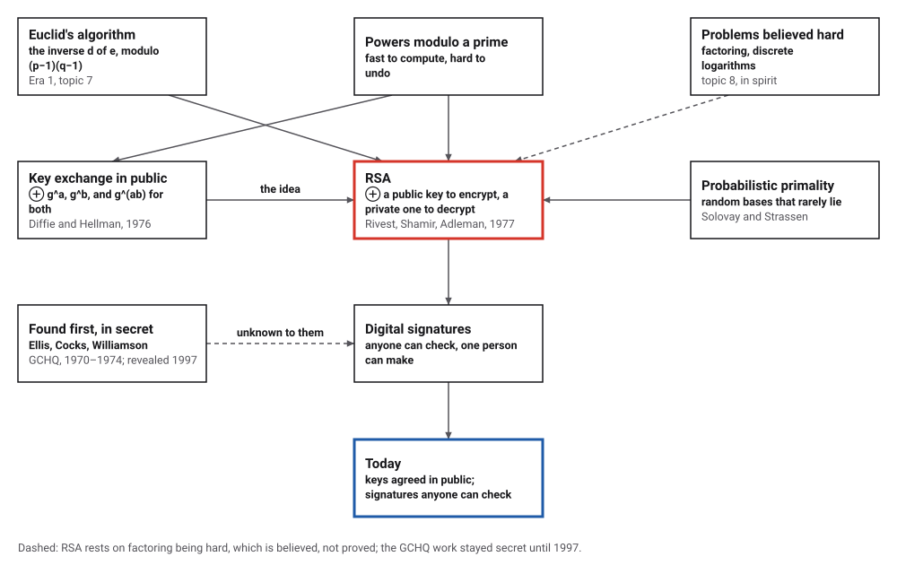
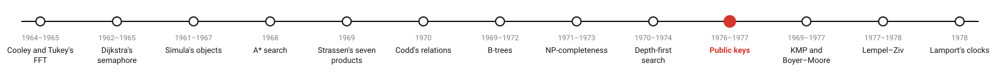
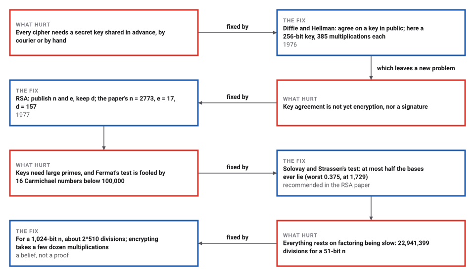
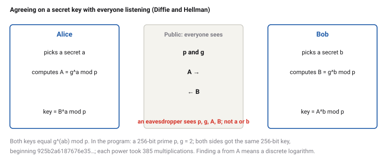

# Public-Key Cryptography

*Era 6 · topic 10 · 1976–1977* · [Era 6 index](../README.md) · [← Depth-First Search](../09-depth-first-search/README.md) · [Fast String Searching →](../11-string-search/README.md) · [Interactive edition](public-key-cryptography.html) · [Program](../../../code/era-06-hard-problems-and-public-keys/10-public-key-cryptography/)

> **Field note from the visiting historian.** I ran the RSA paper's own example and got its message back. Then I made a key of 309 digits from two random primes: encrypting took 19 multiplications, and picking the lock by trial division would take about 2^510. The secret is safe for exactly as long as nobody finds a fast way to factor.

| | |
|---|---|
| **When** | Diffie and Hellman 1976; RSA 1977 (GCHQ in secret, 1970–1974) |
| **Where** | Stanford; MIT |
| **What hurt** | Every cipher needed a key shared in advance |
| **The fix** | A public key to encrypt, a private key to decrypt |
| **Rests on** | Factoring and discrete logarithms being slow |

## How ideas combined

A new algorithm is usually an older idea combined with a new one. Raising numbers to powers modulo a prime is fast; undoing it seems not to be. Diffie and Hellman used that to let two strangers agree on a key in public, and asked for a way to encrypt with a public key. Rivest, Shamir and Adleman found one in the arithmetic of two large primes, with Euclid's algorithm to make the private key and a new probabilistic test to find the primes. Each box names the idea that was added.

<picture>
  <source media="(prefers-color-scheme: dark)" srcset="assets/family-dark.svg">
  
</picture>
*Red: RSA. Blue: what public keys made possible.*

## The RSA paper's own example

The paper worked a small example: p = 47, q = 59, n = 2773, e = 17, d = 157, encoding "ITS ALL GREEK TO ME" two digits per letter. Change the primes or the message; the public key (n, e) encrypts, the private key d decrypts. Then break it: with numbers this small, factoring n takes a few divisions.

| Block M | M^17 mod 2773 |
|---|---|
| 0920 | 0948 |
| 1900 | 2342 |
| 0112 | 1084 |
| 1200 | 1444 |
| 0718 | 2663 |
| 0505 | 2390 |
| 1100 | 0778 |
| 2015 | 0774 |
| 0013 | 0219 |
| 0500 | 1655 |
*In the interactive edition you can encrypt your own message. The table: the program's encryption of "ITS ALL GREEK TO ME", block by block.*

## Era 6, hard problems and public keys

<picture>
  <source media="(prefers-color-scheme: dark)" srcset="assets/era-timeline-dark.svg">
  
</picture>

## Each fix leaves a new pain

<picture>
  <source media="(prefers-color-scheme: dark)" srcset="assets/chain-dark.svg">
  
</picture>
*Read it as a snake: each new problem sits directly under the fix that exposed it.*

## Easy one way, hard the other

**Powers are fast.** To compute x^e mod n, square and multiply, one bit of e at a time: at most two multiplications per bit, so a few hundred multiplications even for numbers hundreds of digits long. Undoing it, finding e from x^e mod p (a *discrete logarithm*), has no known fast method.

<picture>
  <source media="(prefers-color-scheme: dark)" srcset="assets/dh-dark.svg">
  
</picture>

**RSA.** Pick two large primes p and q and publish n = pq and a number e. Keep d, the inverse of e modulo (p − 1)(q − 1), found by Euclid's algorithm. Anyone encrypts a block M as C = M^e mod n; the holder of d decrypts M = C^d mod n. Run the other way, the holder of d *signs* (S = M^d mod n) and anyone checks with e. Finding d from n and e seems to require factoring n.

**Finding the primes.** Pick random odd numbers and test them. Fermat's test (a^(n−1) = 1 mod n for every prime) is fooled by Carmichael numbers. Solovay and Strassen's test compares a^((n−1)/2) with the Jacobi symbol (a/n): every base passes for a prime, and for a composite at most half do, so 100 random bases mistake a composite for a prime with chance at most 2^−100.

> **Key idea.** Use a calculation that is easy to do and, as far as anyone knows, hard to undo, with a secret that makes it easy to undo for one person. Then the key that locks can be published, and only the key that unlocks kept secret.

## Fast to lock, slow to pick

**Key exchange.** A 256-bit prime p = 2q + 1 (found after testing 6,700 candidates for q) and g = 2: Alice and Bob got the same 256-bit key, beginning 925b2a6187676e35…, with 385 multiplications for each power.

| Prime of | Power by squaring: multiplications | Logarithm by trying exponents: tries |
|---|---|---|
| 16 bits | 23 | 19,404 |
| 20 bits | 29 | 604,246 |
| 24 bits | 35 | 2,730,745 |
| 28 bits | 37 | 142,914,065 |
| 32 bits | 50 | 1,818,175,979 |

**The paper's example.** "ITS ALL GREEK TO ME" as blocks 0920 1900 0112 1200 0718 0505 1100 2015 0013 0500; sent as 0948 2342 1084 1444 2663 2390 0778 0774 0219 1655; turned back by C^157 mod 2773: "ITS ALL GREEK TO ME".

**Primality.** Fermat's test is passed, for every base sharing no factor with n, by the 16 Carmichael numbers below 100,000 (561, 1,105, 1,729, 2,465, 2,821, 6,601, 8,911, 10,585, …). Solovay and Strassen's test was checked for every base and every odd number below 3,000: every prime passes; of the 1,070 odd composites, at most half the bases ever pass, the largest share being 0.375 for n = 1,729. It catches all 16 Carmichael numbers.

**A real-sized key.** Two random 512-bit primes (found after testing 367 and 209 odd candidates) give an n of 1024 bits, 309 decimal digits. 100 random messages were encrypted and decrypted, signed and verified, and a signature changed by 1 was always rejected. Average multiplications: encrypting 19 (with e = 65537), decrypting 1532.

| n (p and q of equal size) | Trial divisions to factor it |
|---|---|
| 19-bit 341,741 | 281 |
| 27-bit 109,151,993 | 4,520 |
| 36-bit 43,678,660,733 | 93,830 |
| 44-bit 10,843,852,218,131 | 1,546,505 |
| 51-bit 2,213,357,638,776,223 | 22,941,399 |

Each 8 more bits multiplied the work by 16.9 on average. For the 1024-bit n, trial division would need about 2^510 divisions. Faster factoring methods than trial division exist; this one only shows how the work grows with the size.

## Stanford, MIT, and a secret kept by GCHQ

Diffie and Hellman, "New Directions in Cryptography" (Stanford University; *IEEE Transactions on Information Theory* IT-22(6): 644–654, November 1976), opens: "We stand today on the brink of a revolution in cryptography." It proposes public key cryptosystems, key exchange by exponentiation modulo a prime, and a digital equivalent of a signature, "a digital phenomenon with the same properties as a written signature"; it notes that "Merkle [1] has independently studied the problem" of distributing keys over an insecure channel.

Rivest, Shamir and Adleman (MIT; received 4 April 1977; *Communications of the ACM* 21: 120–126, 1978) give C ≡ M^e (mod n) and M ≡ C^d (mod n), recommend "100-digit (decimal) prime numbers p and q", recommend "the elegant 'probabilistic' algorithm due to Solovay and Strassen" for finding them, work the example with p = 47 and q = 59, credit public keys to "an elegant concept invented by Diffie and Hellman", and end with a dare: "The reader is challenged to find a way to 'break' our method."

On 1 December 1997 GCHQ, the British signals agency, released a document claiming the invention years earlier (Bruce Schneier, 1998): James Ellis's idea of "non-secret encryption" (a report of January 1970; the sources give 1960, 1969 and 1970 for the idea itself, and the catalog marks the date as disputed), Clifford Cocks's 1973 note describing "what was essentially RSA", and Malcolm Williamson's 1974 method "remarkably similar to Diffie-Hellman". Ellis died on 25 November 1997, a month before the announcement. Schneier's verdict: "while they may have discovered the mathematics, it is clear that they never understood its significance."

## Euclid holds the key

The private key d is the inverse of e modulo (p − 1)(q − 1), and it is found by extending Euclid's algorithm (Era 1, topic 7), two thousand years old. The ciphers that frequency analysis broke (Era 2, topic 7) and the Enigma that the Bombe broke (Era 4, topic 8) both needed a key shared in advance; public keys do not. And the hardness they rely on is of the kind topic 8 describes, believed but not proved.

> **Full circle.** In the paper's example, Euclid's algorithm turns e = 17 into d = 157, because 17 × 157 is 1 more than a multiple of 2668.

## Before you read on

<details>
<summary><b>1.</b> With p = 5, q = 11, e = 3: what are n, (p − 1)(q − 1) and d?</summary>

n = 55, (p − 1)(q − 1) = 40, d = 27, since 3 × 27 = 81 = 2 × 40 + 1.
</details>

<details>
<summary><b>2.</b> Encrypt M = 2 with n = 55, e = 3, then decrypt.</summary>

C = 2³ mod 55 = 8; 8²⁷ mod 55 = 2.
</details>

<details>
<summary><b>3.</b> Why may e be public but not d?</summary>

From e and n alone, finding d seems to need p and q, that is, factoring n; with d, anyone could decrypt.
</details>

<details>
<summary><b>4.</b> Why does a signature made with d prove who made it?</summary>

Only the holder of d could produce S with S^e mod n = M; anyone can check that with the public e.
</details>

<details>
<summary><b>5.</b> Why is 561 dangerous for Fermat's test?</summary>

It is composite (3 × 11 × 17), yet a^560 = 1 mod 561 for every a sharing no factor with it.
</details>


## Where the evidence lives

| | Object | Where to see it | Licence |
|---|---|---|---|
| — | **New Directions in Cryptography (1976)**. Diffie and Hellman's paper, on Hellman's Stanford page. | [The paper (PDF)](https://ee.stanford.edu/~hellman/publications/24.pdf) | Drawn placeholder. |
| — | **A Method for Obtaining Digital Signatures and Public-Key Cryptosystems (1978)**. The RSA paper, with its worked example and its challenge. | [The paper (PDF, on an MIT course page)](https://people.csail.mit.edu/vinodv/COURSES/MAT302-S13/RSApaper.pdf) | Drawn placeholder. |

## Every link was opened before it was listed

| Level | Link | Why |
|---|---|---|
| Start | [The Secret Story of Nonsecret Encryption](https://www.schneier.com/essays/archives/1998/04/the_secret_story_of.html) — Bruce Schneier (1998) | The public inventions and the secret ones, and how to credit them |
| Start | [Clifford Cocks](https://en.wikipedia.org/wiki/Clifford_Cocks) — Wikipedia | RSA, found first and kept secret |
| Deeper | [James H. Ellis](https://en.wikipedia.org/wiki/James_H._Ellis) — Wikipedia | The idea of non-secret encryption, inside GCHQ |
| Scholar | [New Directions in Cryptography](https://ee.stanford.edu/~hellman/publications/24.pdf) — W. Diffie and M. E. Hellman, *IEEE Trans. Information Theory* (1976) | Key exchange, public keys and signatures, proposed |
| Scholar | [A Method for Obtaining Digital Signatures and Public-Key Cryptosystems](https://people.csail.mit.edu/vinodv/COURSES/MAT302-S13/RSApaper.pdf) — R. L. Rivest, A. Shamir and L. Adleman, *Communications of the ACM* (1978) | The first practical public-key system, with its small worked example |

More, with certainty labels and the gaps we could not fill: [Era 6 reference catalog](https://github.com/vij658/AlgorithmEvolutionAtlas/blob/main/book/era-06-hard-problems-and-public-keys/reference-catalog.md).

## The program behind every number here

[PublicKey.java](https://github.com/vij658/AlgorithmEvolutionAtlas/blob/main/code/era-06-hard-problems-and-public-keys/10-public-key-cryptography/PublicKey.java) makes **594,590 checks**: a Diffie-Hellman exchange, discrete logarithms by search for growing primes, the RSA paper's example, Solovay and Strassen's test against every base for every odd number below 3,000, Carmichael numbers below 100,000, a 1,024-bit key with 100 round trips and signatures, and factoring by trial division. Run it with `java PublicKey.java` (JDK 17 or newer). The heart of it:

```java
/** x^e mod m by squaring and multiplying, counting multiplications. */
static BigInteger power(BigInteger x, BigInteger e, BigInteger m) {
    BigInteger r = BigInteger.ONE;
    x = x.mod(m);
    for (int i = e.bitLength() - 1; i >= 0; i--) {
        r = r.multiply(r).mod(m); mults++;
        if (e.testBit(i)) { r = r.multiply(x).mod(m); mults++; }
    }
    return r;
}

/** One round of Solovay and Strassen's test with base a: a prime always passes. */
static boolean solovayStrassen(long n, long a) {
    int j = jacobi(a, n);
    if (j == 0) return false;
    return power(a, (n - 1) / 2, n) == (j == 1 ? 1 : n - 1);
}
```

