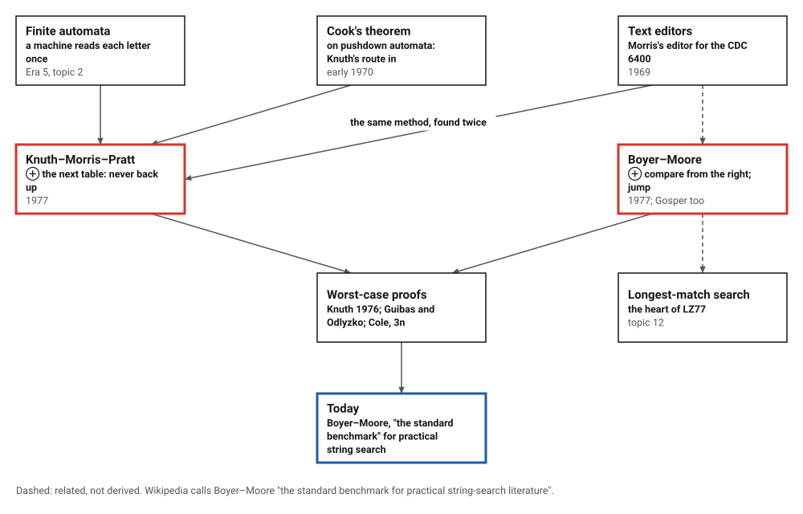
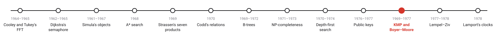
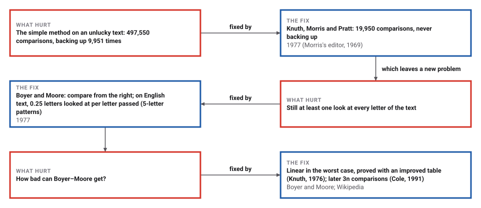
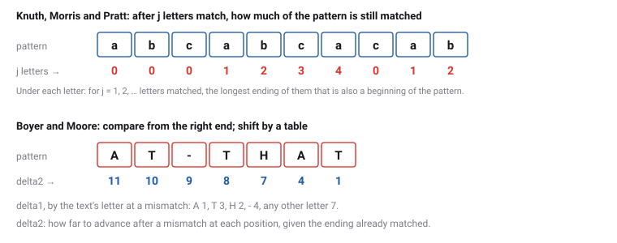

# Fast String Searching

*Era 6 · topic 11 · 1969–1977* · [Era 6 index](../README.md) · [← Public-Key Cryptography](../10-public-key-cryptography/README.md) · [Universal Compression →](../12-lempel-ziv/README.md) · [Interactive edition](string-search.html) · [Program](../../../code/era-06-hard-problems-and-public-keys/11-string-search/)

> **Field note from the visiting historian.** Boyer and Moore reported that their search looked at about a quarter of an English text for five-letter patterns. On my own field notes the program measured 0.25, and 0.12 for fourteen-letter patterns: the longer the word sought, the less of the text is read.

| | |
|---|---|
| **When** | Morris 1969; both papers 1977 |
| **Where** | Berkeley and Stanford; SRI and Xerox PARC |
| **What hurt** | Rereading text; m × n comparisons at worst |
| **The fix** | A table from the pattern; compare from the right |
| **Measured** | 0.25 letters examined per letter, English, m = 5 |

## How ideas combined

A new algorithm is usually an older idea combined with a new one. A finite automaton reads each letter once and never goes back (Era 5, topic 2); Morris, writing a text editor, wanted a search that behaved the same way, and Knuth reached the same method from a theorem of Cook's. Boyer and Moore asked a different question: why read every letter at all? Each box names the idea that was added.

<picture>
  <source media="(prefers-color-scheme: dark)" srcset="assets/family-dark.svg">
  
</picture>
*Red: the two 1977 methods. Blue: where they stand today.*

## Three ways to find a word

A text and a pattern (the program's Boyer–Moore example is loaded). Choose a method and step through it: yellow letters have been compared, red is a mismatch, blue a match. Count how many letters of the text each method looks at. Then try an unlucky text such as aaaaaaaaab with the pattern aaab.

| Pattern length m | English | Binary | 100 symbols |
|---|---|---|---|
| 1 | 1.00 | 1.00 | 1.00 |
| 2 | 0.54 | 0.95 | 0.51 |
| **5** | **0.25** | **0.80** | **0.21** |
| 10 | 0.15 | 0.61 | 0.11 |
| 14 | 0.12 | 0.53 | 0.08 |
*In the interactive edition you can step through the three searches. The table: letters Boyer–Moore examined per letter of text passed.*

## Era 6, hard problems and public keys

<picture>
  <source media="(prefers-color-scheme: dark)" srcset="assets/era-timeline-dark.svg">
  
</picture>

## Each fix leaves a new pain

<picture>
  <source media="(prefers-color-scheme: dark)" srcset="assets/chain-dark.svg">
  
</picture>
*Read it as a snake: each new problem sits directly under the fix that exposed it.*

## Remember what has been matched

**Knuth, Morris and Pratt.** When a mismatch comes after j letters have matched, those j letters are known: they are the first j letters of the pattern. So the pattern can slide forward to the longest ending of those j letters that is also a beginning of the pattern, and the search continues with the same letter of the text. A table computed once from the pattern gives that length for every j. The text pointer never moves back; each letter is read once, and the work is proportional to m + n.

**Boyer and Moore.** Line the pattern up and compare from its *right* end. If the text's letter there does not occur in the pattern at all, no alignment covering it can match, and the pattern jumps its whole length. Two tables say how far to shift: delta1 by the mismatched letter of the text, delta2 by the ending already matched. The longer the pattern, the longer the jumps.

<picture>
  <source media="(prefers-color-scheme: dark)" srcset="assets/tables-dark.svg">
  
</picture>

> **Key idea.** A failed comparison is information. Knuth, Morris and Pratt use what has matched to avoid looking back; Boyer and Moore use what did not match to avoid looking at most of the text.

## Comparisons counted

**An unlucky text.** 9,999 a's then b, with a pattern of 49 a's then b: the simple method made 497,550 comparisons and backed up in the text 9,951 times; Knuth–Morris–Pratt made 19,950, never backing up; Boyer–Moore 10,000.

**The tables.** For the pattern abcabcacab, the program's next table is 0 0 0 1 2 3 4 0 1 2; searching babcbabcabcaabcabcabcacabc it found the pattern at position 15 with 31 comparisons for 26 letters of text. For AT-THAT in WHICH-FINALLY-HALTS.--AT-THAT-POINT, Boyer–Moore found it at position 22 after looking at 15 of the 35 letters.

**Agreement.** On 20,000 random searches all three methods reported the same 899,269 matches.

**Skipping.** For each pattern length, 300 patterns taken at random from each text, the work counted up to the first match. In English (this book's own field notes, 18,566 letters), Boyer–Moore looked at 0.25 letters per letter passed with 5-letter patterns and 0.12 with 14-letter ones; Knuth–Morris–Pratt always looks at least once at each.

| Pattern length m | English | Binary | 100 symbols |
|---|---|---|---|
| 1 | 1.00 | 1.00 | 1.00 |
| 2 | 0.54 | 0.95 | 0.51 |
| **5** | **0.25** | **0.80** | **0.21** |
| 10 | 0.15 | 0.61 | 0.11 |
| 14 | 0.12 | 0.53 | 0.08 |

## Found three times

Knuth, Morris and Pratt, "Fast Pattern Matching in Strings" (*SIAM Journal on Computing* 6(2): 323–350, June 1977; received 29 August 1974): the algorithm "finds all occurrences of one given string within another, in running time proportional to the sum of the lengths of the strings", and it "was discovered in a rather interesting way". "One of the authors (J. H. Morris) was implementing a text-editor for the CDC 6400 computer during the summer of 1969"; "Another author (D. E. Knuth) learned early in 1970 of S. A. Cook's surprising theorem" about two-way pushdown automata and derived the method from it; "Pratt modified Knuth's data structure so that the running-time was independent of the alphabet size", and when Pratt described it, Morris recognized his own algorithm.

Boyer (Stanford Research Institute) and Moore (Xerox PARC), "A Fast String Searching Algorithm" (*Communications of the ACM* 20(10): 762–772, October 1977): the algorithm is "usually sublinear"; for English patterns of length 5 it inspected about 0.24 characters per character passed, where Knuth–Morris–Pratt inspects 1 and the simple algorithm about 1.1. R. W. Gosper found the delta1-only version independently, and Knuth proved in January 1976 that an improved delta2 makes the worst case linear.

## A measurement repeated

Boyer and Moore measured about 0.24 letters examined per letter passed for 5-letter English patterns in 1977. On a different English text, this book's field notes, the program measured 0.25. And the next topic's compressor spends most of its time on exactly this job: searching what it has already sent for the longest match.

> **Full circle.** Kleene's finite automata (Era 5) read every letter once. Knuth, Morris and Pratt built such a reader for one pattern; Boyer and Moore found it could skip most of them.

## Before you read on

<details>
<summary><b>1.</b> What is the next table of the pattern aaab?</summary>

After 1, 2, 3, 4 letters matched: 0, 1, 2, 0.
</details>

<details>
<summary><b>2.</b> Why does Knuth–Morris–Pratt never need to back up in the text?</summary>

The letters already matched are the pattern's own first letters, so the table says how much of them still counts.
</details>

<details>
<summary><b>3.</b> Searching for HALT, Boyer–Moore compares the text's letter Q with the pattern's T. How far can it jump?</summary>

Four places: Q is not in HALT, so no alignment that covers it can match.
</details>

<details>
<summary><b>4.</b> Why does Boyer–Moore do worse on binary text?</summary>

With two letters, almost every letter occurs in the pattern, so the jumps are short.
</details>

<details>
<summary><b>5.</b> Which method would you choose for text arriving one letter at a time over a wire?</summary>

Knuth–Morris–Pratt: it never needs a letter it has already passed.
</details>


## Where the evidence lives

| | Object | Where to see it | Licence |
|---|---|---|---|
| — | **Fast Pattern Matching in Strings (1977)**. Knuth, Morris and Pratt, with its section on how the method was found. | [The paper (PDF, on a Brown course page)](https://cs.brown.edu/courses/csci1810/fall-2023/resources/ch2_readings/kmp_strings.pdf) | Drawn placeholder. |
| — | **A Fast String Searching Algorithm (1977)**. Boyer and Moore, with their measurements on English and random text. | [The paper (PDF, on Moore's page)](https://www.cs.utexas.edu/%7Emoore/publications/fstrpos.pdf) | Drawn placeholder. |

## Every link was opened before it was listed

| Level | Link | Why |
|---|---|---|
| Start | [Boyer–Moore string-search algorithm](https://en.wikipedia.org/wiki/Boyer%E2%80%93Moore_string-search_algorithm) — Wikipedia | The two tables, and the long road to its worst-case bound |
| Scholar | [Fast Pattern Matching in Strings](https://cs.brown.edu/courses/csci1810/fall-2023/resources/ch2_readings/kmp_strings.pdf) — D. E. Knuth, J. H. Morris and V. R. Pratt, *SIAM Journal on Computing* (1977), on a Brown course page | The algorithm, its theory, and a section on how it was found three times |
| Scholar | [A Fast String Searching Algorithm](https://www.cs.utexas.edu/%7Emoore/publications/fstrpos.pdf) — R. S. Boyer and J S. Moore, *Communications of the ACM* (1977), on Moore's page | Searching from the right, with measurements on English and random text |

More, with certainty labels and the gaps we could not fill: [Era 6 reference catalog](https://github.com/vij658/AlgorithmEvolutionAtlas/blob/main/book/era-06-hard-problems-and-public-keys/reference-catalog.md).

## The program behind every number here

[StringSearch.java](https://github.com/vij658/AlgorithmEvolutionAtlas/blob/main/code/era-06-hard-problems-and-public-keys/11-string-search/StringSearch.java) makes **20,009 checks**: the three methods on an unlucky text, the two worked tables, 20,000 random searches with identical results, and the letters examined on English, binary and 100-symbol text. Run it with `java StringSearch.java` (JDK 17 or newer). The heart of it:

```java
/** next[j]: after j letters matched and a mismatch, how many letters of the pattern are still matched. */
static int[] failure(String p) {
    int m = p.length();
    int[] f = new int[m + 1];
    f[0] = -1;
    int k = -1;
    for (int j = 0; j < m; j++) {
        while (k >= 0 && p.charAt(k) != p.charAt(j)) k = f[k];
        k++;
        f[j + 1] = k;
    }
    return f;
}

static List<Integer> kmp(String t, String p) {
    List<Integer> found = new ArrayList<>();
    int[] f = failure(p);
    int m = p.length(), j = 0;
    for (int i = 0; i < t.length(); i++) {             // i only moves forward
        char c = t.charAt(i);
        while (true) {
            looks++;
            if (p.charAt(j) == c) { j++; break; }
            j = f[j];
            if (j < 0) { j = 0; break; }
        }
        if (j == m) { found.add(i - m + 1); j = f[m]; }
    }
    return found;
}
```

