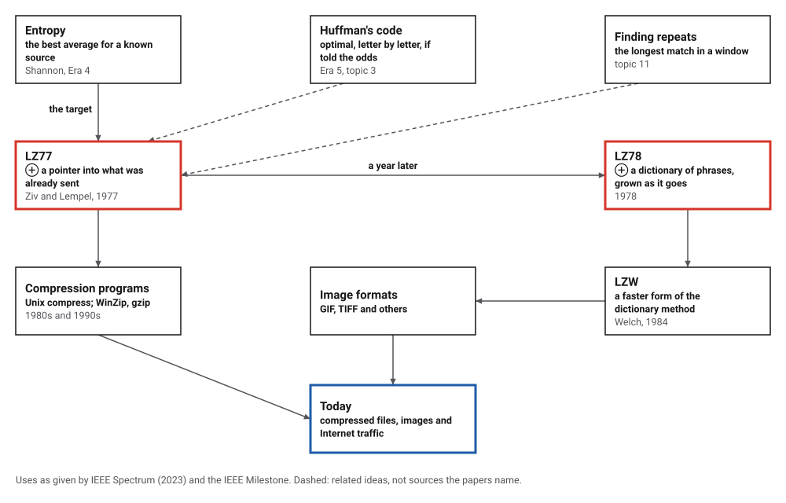
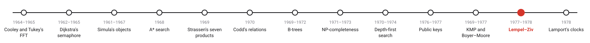
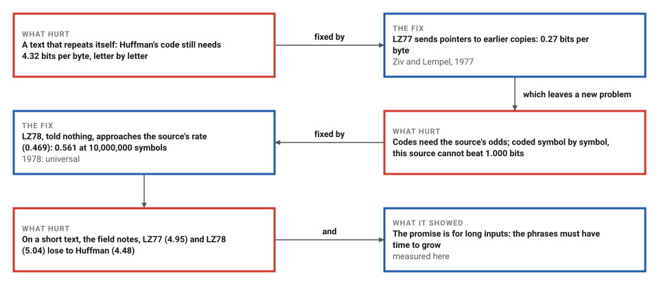
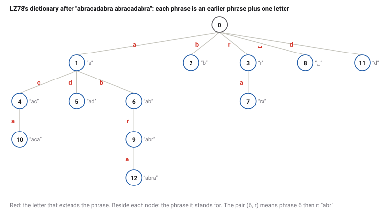

# Universal Compression

*Era 6 · topic 12 · 1977–1978* · [Era 6 index](../README.md) · [← Fast String Searching](../11-string-search/README.md) · [Logical Clocks →](../13-logical-clocks/README.md) · [Interactive edition](lempel-ziv.html) · [Program](../../../code/era-06-hard-problems-and-public-keys/12-lempel-ziv/)

> **Field note from the visiting historian.** Fifty copies of the same thousand bytes: Huffman's code needed 4.32 bits a byte, exactly as for one copy, while LZ77 needed 0.27. On a source with memory LZ78 crept down towards its entropy rate, 0.469, never having been told what it was.

| | |
|---|---|
| **When** | 1977 and 1978 |
| **Where** | Technion, Haifa (and Bell Labs, on sabbatical) |
| **What hurt** | Good codes needed the source's statistics |
| **The fix** | Pointers to the past; a growing dictionary |
| **Measured** | 0.27 bits per byte on repeated text, against 4.32 |

## How ideas combined

A new algorithm is usually an older idea combined with a new one. Shannon had said how few bits a source needs on average (Era 4); Huffman had built the best code for single letters, if told how often each occurs (Era 5). Ziv and Lempel asked for a code that is told nothing, and found one that refers back to what it has already sent. Each box names the idea that was added.

<picture>
  <source media="(prefers-color-scheme: dark)" srcset="assets/family-dark.svg">
  
</picture>
*Red: the two methods of 1977 and 1978. Blue: where they went.*

## Copy from what was sent

LZ77 on a text of your choice (the program's example is loaded). Each step sends a triple: how far back to look, how many letters to copy, and the next letter. Blue is the earlier copy, yellow the letters it stands for, red the new letter. Try a text that repeats itself many times.

| How far back | How long | Next letter |
|---|---|---|
| 0 | 0 | a |
| 0 | 0 | b |
| 0 | 0 | r |
| 3 | 1 | c |
| 5 | 1 | d |
| 7 | 4 | (space) |
| 12 | 10 | a |
*In the interactive edition you can step through LZ77 on your own text. The table: the program's 7 triples for "abracadabra abracadabra".*

## Era 6, hard problems and public keys

<picture>
  <source media="(prefers-color-scheme: dark)" srcset="assets/era-timeline-dark.svg">
  
</picture>

## Each fix leaves a new pain

<picture>
  <source media="(prefers-color-scheme: dark)" srcset="assets/chain-dark.svg">
  
</picture>
*Read it as a snake: each new problem sits directly under the fix that exposed it.*

## Refer to the past

**LZ77.** Keep the last W letters already sent (the window). At each step find the longest string, starting at the current letter, that also starts somewhere in the window, and send three things: how far back it starts, how long it is, and the letter after it. The receiver copies from what it already has. The copy may overlap itself, so a run of one letter repeated a hundred times costs one triple.

**LZ78.** Build a dictionary of phrases. At each step find the longest phrase in the dictionary that matches what comes next, send its number and the next letter, and add that phrase plus the letter as a new entry. On "abracadabra abracadabra" the program sent 12 pairs:

<picture>
  <source media="(prefers-color-scheme: dark)" srcset="assets/trie-dark.svg">
  
</picture>

**Why it is universal.** Neither method knows anything about the source. But anything that recurs, at any distance, is sent as a reference, and the longer the input runs, the longer the phrases grow and the fewer bits each letter costs. Ziv and Lempel proved that for long inputs the rate approaches the best any code designed for the source could achieve.

> **Key idea.** Don't model the data; let the data be its own dictionary. Whatever has been seen before can be named instead of spelled out.

## Bits per letter

**Round trips.** 2,000 random strings and this book's field notes (18,616 bytes) were encoded and decoded by both methods; every one came back exactly.

| Input | Huffman, single bytes | LZ77 | LZ78 |
|---|---|---|---|
| The field notes (18,616 bytes) | 4.48 | 4.95 | 5.04 |
| **The first 1,000 bytes, repeated 50 times** | **4.32** | **0.27** | **2.88** |

Bits per byte. On the field notes, LZ77 sent 3,842 triples of 24 bits and LZ78 4,856 pairs whose phrase numbers grew to 13 bits; on a text this short, Huffman's code for single bytes still wins. On the repeated text, Huffman's rate is exactly what it is for one copy, since the bytes' frequencies do not change; LZ77 sent 490 triples, and LZ78's phrases grew longer with every copy (7,243 pairs).

**Universality.** A source of 0s and 1s that repeats its last symbol with probability 0.9: 0s and 1s are equally common, so coding symbols one at a time cannot beat 1.000 bits per symbol, but the source's entropy rate (Shannon, Era 4) is 0.469. LZ78, told nothing about the source:

| Symbols coded | LZ78 bits per symbol |
|---|---|
| 1,000 | 0.762 |
| 10,000 | 0.680 |
| 100,000 | 0.617 |
| 1,000,000 | 0.582 |
| **10,000,000** | **0.561** |

Still falling towards 0.469: universality is a promise about long inputs, and here it is kept slowly.

## Two colleagues in Haifa

Ziv and Lempel, "A Universal Algorithm for Sequential Data Compression" (*IEEE Transactions on Information Theory* IT-23(3), May 1977; received 23 June 1975), both of the Technion, Haifa: "A universal algorithm for sequential data compression is presented"; its compression ratio "uniformly approaches the lower bounds on the compression ratios attainable by block-to-variable codes and variable-to-block codes designed to match a completely specified source". The encoder sends "the pointer of the reproduction", a length, and the last symbol. The dictionary method followed in "Compression of Individual Sequences via Variable-Rate Coding" (IT-24(5), September 1978).

IEEE Spectrum (Amanda Davis, 2023): Ziv, who "died on 26 March at the age of 91", published the first method with Lempel in 1977 while on sabbatical at Bell Labs; it led to Unix compression programs in the early 1980s and to WinZip and Gzip in the early 1990s, and the methods "are used today in GIF, TIFF and other image formats". The IEEE Milestone in Haifa (2004) says the algorithm "contributed significantly in making the internet a global communications medium". Lempel taught at the Technion from 1963 to 2004 and died in 2023.

## Shannon's limit, reached without the odds

Shannon showed in 1948 how few bits a source needs, given its statistics (Era 4, topic 12); Huffman built the best code for single letters, given their frequencies (Era 5, topic 3). Lempel and Ziv reached towards Shannon's limit without being given anything, by letting the data describe themselves. And at its core LZ77 is a string search (topic 11): for every position, the longest match in the window.

> **Full circle.** On a source whose entropy rate is 0.469 bits per symbol, LZ78 reached 0.561 after 10,000,000 symbols, without ever being told the source's rule.

## Before you read on

<details>
<summary><b>1.</b> Encode aaaaaaaa (8 letters) with LZ77.</summary>

(0,0,a), then (1,6,a): copy 6 letters from 1 back, overlapping itself, then one more a.
</details>

<details>
<summary><b>2.</b> Encode abab with LZ78.</summary>

(0,a)=a, (0,b)=b, (1,b)=ab: three pairs.
</details>

<details>
<summary><b>3.</b> Why can't Huffman's code see that a text repeats itself?</summary>

It codes each letter by its frequency alone; a repeated block has the same frequencies as a single copy.
</details>

<details>
<summary><b>4.</b> Why does LZ78 do badly on short texts?</summary>

Its phrases are still short, and every pair carries a phrase number as well as a letter.
</details>

<details>
<summary><b>5.</b> What does "universal" promise, and what does it not?</summary>

That for long enough inputs the rate approaches the best possible for the source; not that it wins on any particular short text.
</details>


## Where the evidence lives

| | Object | Where to see it | Licence |
|---|---|---|---|
| — | **A Universal Algorithm for Sequential Data Compression (1977)**. Ziv and Lempel's paper, *IEEE Transactions on Information Theory* IT-23(3). | [The paper (PDF, on a Peking University page)](https://www.icst.pku.edu.cn/mipl/docs/ziv1977.pdf) | Drawn placeholder. |
| — | **IEEE Milestone: Lempel-Ziv Data Compression Algorithm, 1977**. Dedicated in Haifa on 6 September 2004. | [Engineering and Technology History Wiki](https://ethw.org/Milestones:Lempel-Ziv_Data_Compression_Algorithm,_1977) | Drawn placeholder. |

## Every link was opened before it was listed

| Level | Link | Why |
|---|---|---|
| Start | [Remembering Jacob Ziv](https://spectrum.ieee.org/remembering-jacob-ziv) — Amanda Davis, IEEE Spectrum (2023) | The man, the sabbatical, and where the algorithms went |
| Start | [Lempel-Ziv Data Compression Algorithm, 1977](https://ethw.org/Milestones:Lempel-Ziv_Data_Compression_Algorithm,_1977) — Engineering and Technology History Wiki | The IEEE Milestone, with the 1978 and 1984 papers |
| Scholar | [A Universal Algorithm for Sequential Data Compression](https://www.icst.pku.edu.cn/mipl/docs/ziv1977.pdf) — J. Ziv and A. Lempel, *IEEE Trans. Information Theory* (1977), on a Peking University page | The sliding-window method and its proof of universality |

More, with certainty labels and the gaps we could not fill: [Era 6 reference catalog](https://github.com/vij658/AlgorithmEvolutionAtlas/blob/main/book/era-06-hard-problems-and-public-keys/reference-catalog.md).

## The program behind every number here

[LempelZiv.java](https://github.com/vij658/AlgorithmEvolutionAtlas/blob/main/code/era-06-hard-problems-and-public-keys/12-lempel-ziv/LempelZiv.java) makes **4,014 checks**: both methods on a short string, round trips on 2,000 random strings and on the field notes, bits per byte against Huffman's code, a repeated text, and LZ78's rate on a source with memory from 1,000 to 10,000,000 symbols. Run it with `java LempelZiv.java` (JDK 17 or newer). The heart of it:

```java
static List<Triple> lz77(String s, int window, int maxLen) {
    List<Triple> out = new ArrayList<>();
    int i = 0, n = s.length();
    while (i < n) {
        int bestLen = 0, bestBack = 0;
        for (int j = Math.max(0, i - window); j < i; j++) {
            int k = 0;
            while (k < maxLen && i + k < n - 1 && s.charAt(j + k) == s.charAt(i + k)) k++;   // may run past i: overlaps allowed
            if (k > bestLen) { bestLen = k; bestBack = i - j; }
        }
        out.add(new Triple(bestBack, bestLen, s.charAt(i + bestLen)));
        i += bestLen + 1;
    }
    return out;
}

static List<Pair> lz78(String s) {
    List<Pair> out = new ArrayList<>();
    HashMap<Long, Integer> dict = new HashMap<>();
    int node = 0, entries = 1;                                   // entry 0 is the empty phrase
    for (int i = 0; i < s.length(); i++) {
        char c = s.charAt(i);
        Integer child = dict.get(((long) node << 16) | c);
        if (child != null && i < s.length() - 1) { node = child; continue; }
        if (child != null) { out.add(new Pair(node, c)); break; }   // input ends inside a known phrase
        out.add(new Pair(node, c));
        dict.put(((long) node << 16) | c, entries++);
        node = 0;
    }
    return out;
}
```

