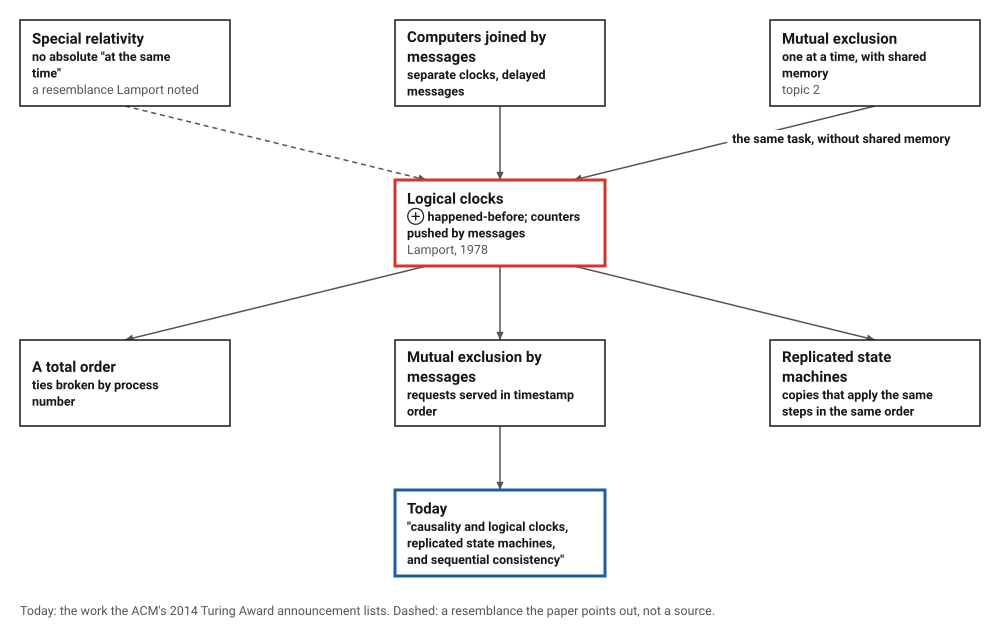
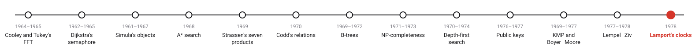
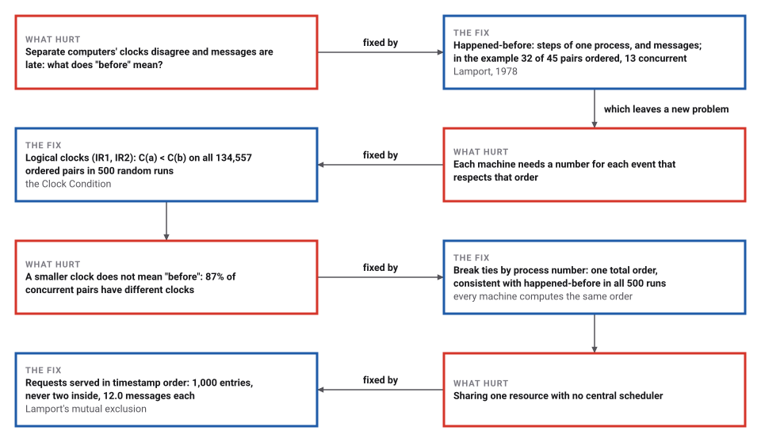
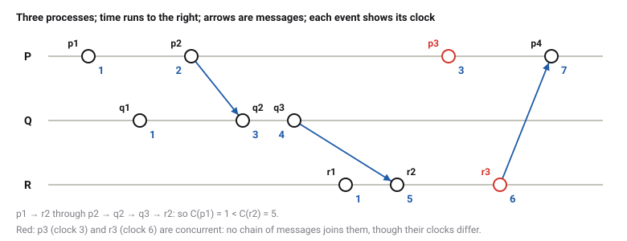

# Logical Clocks

*Era 6 · topic 13 · 1978* · [Era 6 index](../README.md) · [← Universal Compression](../12-lempel-ziv/README.md) · [Interactive edition](logical-clocks.html) · [Program](../../../code/era-06-hard-problems-and-public-keys/13-logical-clocks/)

> **Field note from the visiting historian.** In 500 random runs I checked 240,220 pairs of events: whenever one could have influenced the other, its clock was smaller. The converse failed for 87% of the pairs that could not have influenced each other. Before, in this species' networks, means only what a message could have carried.

| | |
|---|---|
| **When** | 1978 |
| **Where** | Massachusetts Computer Associates |
| **What hurt** | No common clock; no meaning for "before" |
| **The fix** | Happened-before; clocks pushed forward by messages |
| **Checked** | 134,557 ordered pairs, no exception |

## How ideas combined

A new algorithm is usually an older idea combined with a new one. Mutual exclusion had been solved for processes that share memory (topic 2); computers joined by messages share nothing, not even a clock. Lamport defined "before" by what information could have flowed, as relativity defines it by what light could reach, and gave each machine a counter that respects it. Each box names the idea that was added.

<picture>
  <source media="(prefers-color-scheme: dark)" srcset="assets/family-dark.svg">
  
</picture>
*Red: logical clocks. Blue: what the ACM credited them with.*

## Before, after, or neither

The program's run: three processes, time running to the right, arrows for messages, and each event's logical clock in blue. Click two events: if a chain of steps and messages leads from one to the other, it happened before, and its clock is smaller; if not, they are concurrent, whatever their clocks say. Then try a random run.

| Event | Process | Message | Logical clock |
|---|---|---|---|
| p1 | P |  | 1 |
| q1 | Q |  | 1 |
| p2 | P | sends to Q | 2 |
| q2 | Q | receives from p2 | 3 |
| q3 | Q | sends to R | 4 |
| r1 | R |  | 1 |
| r2 | R | receives from q3 | 5 |
| p3 | P |  | 3 |
| r3 | R | sends to P | 6 |
| p4 | P | receives from r3 | 7 |
*In the interactive edition you can compare any two events of the program's run, or of a random one.*

## Era 6, hard problems and public keys

<picture>
  <source media="(prefers-color-scheme: dark)" srcset="assets/era-timeline-dark.svg">
  
</picture>

## Each fix leaves a new pain

<picture>
  <source media="(prefers-color-scheme: dark)" srcset="assets/chain-dark.svg">
  
</picture>
*Read it as a snake: each new problem sits directly under the fix that exposed it.*

## Two rules for a counter

**Happened before.** Event a happened before event b (a → b) if they are in the same process and a came first, or a is the sending of a message and b its receipt, or a chain of such steps leads from a to b. If neither a → b nor b → a, the two are *concurrent*: nothing inside the system can tell which came first.

**The clock rules.** Each process keeps a counter. IR1: add one between any two of its events. IR2: stamp each message with the sender's counter; on receipt, set the counter above both its own value and the stamp. Then a → b always gives C(a) < C(b), the Clock Condition. The converse fails: a smaller clock does not mean happened-before.

<picture>
  <source media="(prefers-color-scheme: dark)" srcset="assets/spacetime-dark.svg">
  
</picture>

**One order for all.** Order all events by clock, breaking ties by process number. Every machine can compute this order from the timestamps alone, and it never contradicts happened-before. Lamport's mutual exclusion uses it: a process asks every other for the resource, with a timestamp, and enters when its request is the earliest in that order and it has heard from everyone with a later timestamp.

> **Key idea.** When there is no common clock, don't pretend there is one. Order events only as far as information could have travelled, and agree on an arbitrary but common way to order the rest.

## Checked on every pair

| Event | Process | Message | Logical clock |
|---|---|---|---|
| p1 | P |  | 1 |
| q1 | Q |  | 1 |
| p2 | P | sends to Q | 2 |
| q2 | Q | receives from p2 | 3 |
| q3 | Q | sends to R | 4 |
| r1 | R |  | 1 |
| r2 | R | receives from q3 | 5 |
| p3 | P |  | 3 |
| r3 | R | sends to P | 6 |
| p4 | P | receives from r3 | 7 |

**The example.** Of the 45 pairs of events, 32 are ordered by happened-before and 13 are concurrent. p1 → r2 through p1 → r2 through p2 → q2 → q3 → r2, so C(p1) = 1 < C(r2) = 5; p3 (clock 3) and r3 (clock 6) are concurrent, though their clocks differ.

**Random runs.** 500 random runs of 2 to 6 processes and 10 to 50 steps: 240,220 pairs of events, 134,557 ordered by happened-before, and for every one of them C(a) < C(b). Of the 105,663 concurrent pairs, 92,203 (87%) still had different clocks. The order by clock, ties broken by process number, respected happened-before in every run.

**Mutual exclusion.** 5 processes sharing one resource with no central scheduler, messages delayed at random (each channel delivering in order): 1,000 entries, never two inside at once, requests granted in the order of their timestamps, and 12,000 messages, 12.0 per entry (3 x 4 = 12).

**The anomaly.** A user issues request a at machine A, then telephones a colleague at B, who issues request b. The call is outside the system, so to it a and b are concurrent; if A's clock had reached 9 and B's only 2, the system orders b (clock 3) before a (clock 10), the reverse of what happened. Lamport's remedies: carry the timestamp through the call, or keep physical clocks close enough.

## Eight pages in 1978

Leslie Lamport, "Time, Clocks, and the Ordering of Events in a Distributed System" (Massachusetts Computer Associates; *Communications of the ACM* 21(7): 558–565, July 1978), defines happened-before as "the smallest relation satisfying the following three conditions", states the Clock Condition and the rules IR1 ("Each process P_i increments C_i between any two successive events") and IR2, builds a total order by breaking ties with an ordering of the processes, and solves mutual exclusion with it, noting that "a central scheduler" granting requests in arrival order fails. It discusses the anomaly of events outside the system, and remarks on the resemblance to the space-time formulation of special relativity.

The ACM's announcement of the 2013 Turing Award (18 March 2014) recognized Lamport "for imposing clear, well-defined coherence on the seemingly chaotic behavior of distributed computing systems", naming "causality and logical clocks, replicated state machines, and sequential consistency"; it also notes that he developed LaTeX. Wikipedia gives the citation as "fundamental contributions to the theory and practice of distributed and concurrent systems"; the catalog records both wordings.

## Mutual exclusion, again

Dijkstra's semaphore (topic 2) made processes take turns through a shared variable. Lamport's processes share nothing, yet the same safety holds: never two inside at once, every request served, in the order the timestamps give. The price is messages: a request, an acknowledgement and a release to every other process.

> **Full circle.** In topic 2, three processes and one semaphore: four instructions each. Here, 5 processes and no shared memory at all: 12.0 messages per entry, and the same guarantee.

## Before you read on

<details>
<summary><b>1.</b> Process P's clock is 4 when it receives a message stamped 9. What is its clock after the receipt?</summary>

10: above both its own value and the stamp.
</details>

<details>
<summary><b>2.</b> If C(a) = 3 and C(b) = 7, did a happen before b?</summary>

Not necessarily: they may be concurrent. Only the other direction holds: if a → b then C(a) < C(b).
</details>

<details>
<summary><b>3.</b> Why are ties broken by process number?</summary>

Two concurrent events can have the same clock; any fixed rule that every machine knows gives them all the same order.
</details>

<details>
<summary><b>4.</b> In the telephone example, how could the system get the order right?</summary>

Have the first user pass a's timestamp along in the call, so b's clock is set above it.
</details>

<details>
<summary><b>5.</b> How many messages does one entry cost with 10 processes?</summary>

3 × 9 = 27: a request, an acknowledgement and a release to each of the 9 others.
</details>


## Where the evidence lives

| | Object | Where to see it | Licence |
|---|---|---|---|
| — | **Time, Clocks, and the Ordering of Events in a Distributed System (1978)**. Lamport's paper, *Communications of the ACM* 21(7): 558–565. | [The paper (PDF, on the ACM Turing Award site)](https://amturing.acm.org/p558-lamport.pdf) | Drawn placeholder. |

## Every link was opened before it was listed

| Level | Link | Why |
|---|---|---|
| Start | [ACM Turing Award Goes to Pioneer Who Advanced Reliability and Consistency of Computing Systems](https://www.acm.org/media-center/2014/march/acm-turing-award-goes-to-pioneer-who-advanced-reliability-and-consistency-of-computing-systems) — ACM (2014) | What logical clocks led to, in the award announcement |
| Start | [Leslie Lamport](https://en.wikipedia.org/wiki/Leslie_Lamport) — Wikipedia | A career in concurrency, from the bakery algorithm to LaTeX |
| Scholar | [Time, Clocks, and the Ordering of Events in a Distributed System](https://amturing.acm.org/p558-lamport.pdf) — L. Lamport, *Communications of the ACM* 21(7): 558–565 (1978) | Eight pages that defined "before" for distributed systems |

More, with certainty labels and the gaps we could not fill: [Era 6 reference catalog](https://github.com/vij658/AlgorithmEvolutionAtlas/blob/main/book/era-06-hard-problems-and-public-keys/reference-catalog.md).

## The program behind every number here

[LogicalClocks.java](https://github.com/vij658/AlgorithmEvolutionAtlas/blob/main/code/era-06-hard-problems-and-public-keys/13-logical-clocks/LogicalClocks.java) makes **146,700 checks**: every pair of events of a small run and of 500 random runs against the Clock Condition and the total order, Lamport's mutual exclusion with 1,000 entries (safety checked after every event), and the telephone anomaly. Run it with `java LogicalClocks.java` (JDK 17 or newer). The heart of it:

```java
    Event receive(int p, Event send) {
        Event e = new Event(p, byProc.get(p).size(), all.size());
        clock[p] = Math.max(clock[p], send.clock) + 1;        // IR2 (and IR1)
        e.clock = clock[p];
        e.from = send.id;
        byProc.get(p).add(e); all.add(e);
        return e;
    }

    /** happened-before for every pair, by following process order and messages (transitive closure). */
    boolean[][] happenedBefore() {
        int n = all.size();
        boolean[][] hb = new boolean[n][n];
        // events were created in an order consistent with ->, so one pass in creation order suffices
        for (Event e : all) {
            List<Event> mine = byProc.get(e.proc);
            if (e.index > 0) { Event prev = mine.get(e.index - 1); hb[prev.id][e.id] = true; for (int x = 0; x < n; x++) if (hb[x][prev.id]) hb[x][e.id] = true; }
            if (e.from >= 0) { hb[e.from][e.id] = true; for (int x = 0; x < n; x++) if (hb[x][e.from]) hb[x][e.id] = true; }
        }
        return hb;
    }
```

