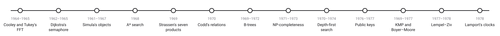
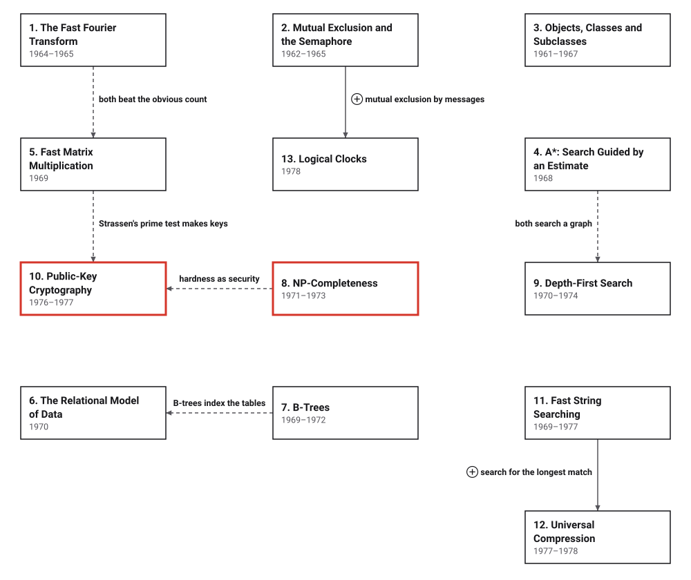

# Era 6 — Hard Problems and Public Keys

*1965 to 1978* · [Book contents](../README.md) · [Interactive edition](index.html) · [Reference catalog](reference-catalog.md) · [Programs](../../code/era-06-hard-problems-and-public-keys/README.md)

> **Field note from the visiting historian.** In the fifth era, the species learned to write programs well. In this one, programs run side by side, talk across networks and keep secrets, and the species learns that some problems may have no fast method at all.

## When

<picture>
  <source media="(prefers-color-scheme: dark)" srcset="assets/era-timeline-dark.svg">
  
</picture>

## How the ideas combined

<picture>
  <source media="(prefers-color-scheme: dark)" srcset="assets/era-map-dark.svg">
  
</picture>

*An arrow means the later development reuses the earlier idea; it is not a claim that one inventor learned from the other. Dashed lines join related developments: two ways of beating the obvious operation count, two graph searches, the RSA paper's use of Solovay and Strassen's primality test, public keys that rely on problems believed hard, and the B-tree as the index under relational tables. Several boxes build on earlier eras: the FFT on Gauss (Era 3), objects on the subroutine (Era 5), A* on Dijkstra's shortest paths (Era 5), NP-completeness on Turing machines (Era 4) and Edmonds's "good" algorithms (Era 5), and Lempel and Ziv on Shannon (Era 4) and Huffman (Era 5).*

## The topics

| # | Topic | When | What hurt | Read |
|---|---|---|---|---|
| 1 | **The Fast Fourier Transform** | 1963 meeting; demonstrated 1964; published 1965 | A transform of N samples took about N² operations | [page](01-fast-fourier-transform/README.md) · [interactive](01-fast-fourier-transform/fast-fourier-transform.html) · [program](../../code/era-06-hard-problems-and-public-keys/01-fast-fourier-transform/README.md) |
| 2 | **Mutual Exclusion and the Semaphore** | Dekker about 1962; semaphore 1962; EWD 123, 1965 | Processes sharing memory corrupt data or wait for ever | [page](02-semaphores/README.md) · [interactive](02-semaphores/semaphores.html) · [program](../../code/era-06-hard-problems-and-public-keys/02-semaphores/README.md) |
| 3 | **Objects, Classes and Subclasses** | Simula begun 1961; Simula 67, 1967 | A model of many interacting things was a heap of arrays and scattered code | [page](03-objects/README.md) · [interactive](03-objects/objects.html) · [program](../../code/era-06-hard-problems-and-public-keys/03-objects/README.md) |
| 4 | **A*: Search Guided by an Estimate** | Shakey project; received 1967; published 1968 | Dijkstra's method explores every direction; greedy search returns long paths | [page](04-a-star/README.md) · [interactive](04-a-star/a-star.html) · [program](../../code/era-06-hard-problems-and-public-keys/04-a-star/README.md) |
| 5 | **Fast Matrix Multiplication** | 1969 | Multiplying and inverting matrices took n³ operations | [page](05-strassen/README.md) · [interactive](05-strassen/strassen.html) · [program](../../code/era-06-hard-problems-and-public-keys/05-strassen/README.md) |
| 6 | **The Relational Model of Data** | 1970 | Programs depended on how the data was stored | [page](06-relational-model/README.md) · [interactive](06-relational-model/relational-model.html) · [program](../../code/era-06-hard-problems-and-public-keys/06-relational-model/README.md) |
| 7 | **B-Trees** | Idea 1969; report 1970; published 1972 | Indexes too big for memory, one disk access per step | [page](07-b-trees/README.md) · [interactive](07-b-trees/b-trees.html) · [program](../../code/era-06-hard-problems-and-public-keys/07-b-trees/README.md) |
| 8 | **NP-Completeness** | Cook 1971; Karp 1972; Levin 1973 | Many problems resisted every fast method, and nobody knew why | [page](08-np-completeness/README.md) · [interactive](08-np-completeness/np-completeness.html) · [program](../../code/era-06-hard-problems-and-public-keys/08-np-completeness/README.md) |
| 9 | **Depth-First Search** | Planarity work from 1970; paper 1972; planarity 1974 | Graph structure took repeated searches | planned · [references](reference-catalog.md#9-depth-first-search-and-linear-time-graph-algorithms) |
| 10 | **Public-Key Cryptography** | Diffie and Hellman 1976; RSA 1977; GCHQ in secret 1970–1974 | Every cipher needed a key shared in advance | planned · [references](reference-catalog.md#10-public-key-cryptography) |
| 11 | **Fast String Searching** | Morris 1969; KMP and Boyer–Moore 1977 | Searching reread the text, m × n comparisons at worst | planned · [references](reference-catalog.md#11-fast-string-searching) |
| 12 | **Universal Compression** | 1977 and 1978 | Good codes needed the source's probabilities | planned · [references](reference-catalog.md#12-universal-compression-lempel-and-ziv) |
| 13 | **Logical Clocks** | 1978 | No meaning for "before" between separate computers | planned · [references](reference-catalog.md#13-logical-clocks-and-the-order-of-events) |

The interactive edition is a single HTML file per topic: download it and open it in a browser, or use the published copy linked from the [book contents](../README.md).
