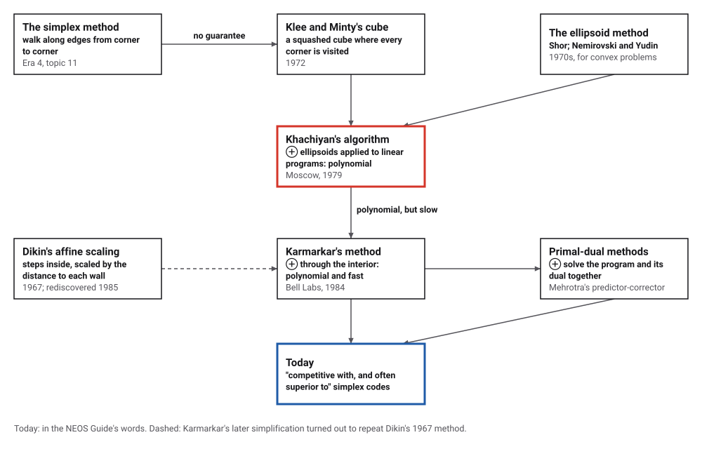
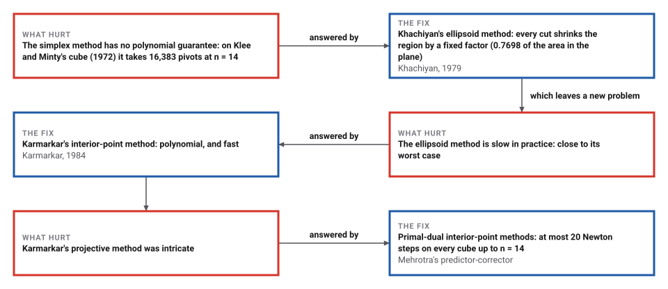
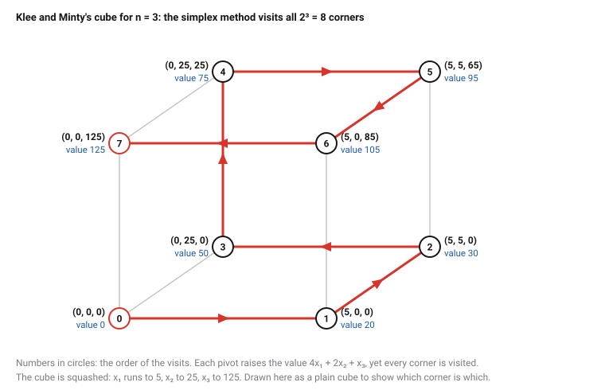

# Linear Programming in Polynomial Time

*Era 7 · topic 1 · 1979–1984* · [Era 7 index](../README.md) · [Merkle's Hash Trees →](../02-merkle-trees/README.md) · [Interactive edition](linear-programming.html) · [Program](../../../code/era-07-randomness-networks-and-learning/01-linear-programming/)

> **Field note from the visiting historian.** I watched the old method walk all 16,383 edges of a cube of 14 dimensions, one corner at a time, while the new one went through the middle in 20 steps. Then I gave both a random problem, and the old method won. This species keeps both.

| | |
|---|---|
| **When** | Khachiyan 1979; Karmarkar 1984 |
| **Where** | Moscow; AT&T Bell Laboratories |
| **What hurt** | No polynomial guarantee for linear programming |
| **The fix** | Ellipsoids, then interior points |
| **Checked** | Cubes to n = 14: 16,383 pivots against 20 Newton steps |

## How ideas combined

A new algorithm is usually an older idea combined with a new one. The simplex method (Era 4) was fast in practice, but Klee and Minty's cube showed it had no polynomial guarantee. Khachiyan took the ellipsoid method, built for other convex problems, and applied it to linear programs: the first polynomial bound. Karmarkar then went through the inside of the region instead of round its edges. Each box names the idea that was added.

<picture>
  <source media="(prefers-color-scheme: dark)" srcset="assets/family-dark.svg">
  
</picture>
*Red: Khachiyan's step. Blue: where it led.*

## Cut the ellipse in half, again and again

The ellipsoid method in two dimensions, exactly as the program runs it. The target is a small triangle near (37, −21); we start from a disc of radius 100 round the origin. If the centre of the current ellipse breaks one of the triangle's three constraints, that constraint's line through the centre cuts the ellipse in half, and the method draws the smallest ellipse round the good half. Pick a smaller triangle and count the cuts: the area shrinks by the same factor every time, so a target a hundred times smaller costs only a fixed number of extra cuts.

| Triangle's side | Cuts needed | Bound from the area |
|---|---|---|
| 10 | 14 | 25 |
| 3.16 | 14 | 34 |
| 1 | 26 | 43 |
| 0.3162 | 41 | 52 |
| 0.1 | 42 | 60 |
| 0.0316 | 51 | 69 |
| 0.01 | 51 | 78 |
*In the interactive edition you can make the cuts one at a time and watch the ellipse close in on the triangle.*

## Era 7, randomness, networks and learning

<picture>
  <source media="(prefers-color-scheme: dark)" srcset="assets/era-timeline-dark.svg">
  
</picture>

## Each fix leaves a new pain

<picture>
  <source media="(prefers-color-scheme: dark)" srcset="assets/chain-dark.svg">
  
</picture>
*Read it as a snake: each new problem sits directly under the fix that exposed it.*

## Round the edges, or through the middle

**The problem.** Find the largest value of c·x over the points x that satisfy linear inequalities. The allowed points form a polytope, and the best value is at a corner. The simplex method walks from corner to better corner along the edges.

**Klee and Minty's cube.** A cube squashed so that, with the usual rule for choosing the next edge (the variable with the largest coefficient), the walk visits every one of the 2ⁿ corners. In three dimensions:

<picture>
  <source media="(prefers-color-scheme: dark)" srcset="assets/cube-dark.svg">
  
</picture>

**The ellipsoid method.** Keep an ellipsoid that surely contains a solution. If its centre breaks a constraint, the constraint cuts the ellipsoid in half; draw the smallest ellipsoid round the good half. Its volume shrinks by a fixed factor each time (0.7698 of the area in the plane), so after a number of cuts that grows like a polynomial in the size of the input, the centre lands in the region or the region is shown empty. Optimizing reduces to repeated feasibility tests.

**Interior points.** Karmarkar's method moves through the inside of the polytope, taking long steps that keep well away from the walls. The kind in this topic's program, primal-dual path-following, solves the program and its dual together: at the optimum each variable times its matching dual slack is zero, so each Newton step aims at points where all those products are equal and a little smaller, stopping just short of the walls.

> **Key idea.** A guarantee and a fast program are different things. The ellipsoid method settled that linear programming can be solved in polynomial time and was too slow to use; interior-point methods were the first to be both.

## Pivots against Newton steps

**On Klee and Minty's cube.** The simplex method with Dantzig's rule took exactly 2ⁿ − 1 pivots every time; the interior-point method never more than 20 iterations. Both reached the optimum 5ⁿ.

| n | Simplex pivots | Interior-point iterations |
|---|---|---|
| 1 | 1 | 6 |
| 2 | 3 | 7 |
| 3 | 7 | 7 |
| 4 | 15 | 8 |
| 6 | 63 | 10 |
| 8 | 255 | 12 |
| 10 | 1,023 | 16 |
| 12 | 4,095 | 17 |
| 14 | 16,383 | 20 |

**On random programs.** With positive random coefficients, 5 programs of each size, the simplex method is fast too: 13.8 pivots on average at 160 variables and 160 constraints, against 12.8 interior-point iterations (each much more expensive). The cube is a worst case, not the usual case.

| Variables × constraints | Simplex pivots (mean) | Interior-point iterations (mean) |
|---|---|---|
| 10 × 10 | 5.0 | 8.0 |
| 20 × 20 | 5.8 | 8.6 |
| 40 × 40 | 8.0 | 10.0 |
| 80 × 80 | 9.6 | 10.8 |
| 160 × 160 | 13.8 | 12.8 |

**The ellipsoid method in the plane.** Each cut shrank the area by the factor 0.7698, checked on every cut. Smaller targets took more cuts, never more than the number of shrinkings that would take the starting disc's area below the triangle's:

| Triangle's side | Cuts | Bound from the area |
|---|---|---|
| 10 | 14 | 25 |
| 3.16 | 14 | 34 |
| 1 | 26 | 43 |
| 0.3162 | 41 | 52 |
| 0.1 | 42 | 60 |
| 0.0316 | 51 | 69 |
| 0.01 | 51 | 78 |

## Four pages that made headlines

Leonid Khachiyan's result "was first published in a four-page note, without proofs, in Soviet Mathematics Doklady in February 1979", and presented in the West at the Montreal Mathematical Programming Symposium that August, with proofs in 1980 (SIAM News, 2005). The press reaction, which Eugene Lawler called "The Great Mathematical Sputnik of 1979", explained it "with very spotty results"; the Guardian's headline read "Soviet Answer to the 'Traveling Salesmen'", which it was not. The same appreciation notes that the method "seems to require in practice a number of iterations close to its worst-case bound", while the simplex method remains "highly competitive with the more recent interior-point methods".

Narendra Karmarkar, at AT&T Bell Laboratories, published "A New Polynomial-Time Algorithm for Linear Programming" in *Combinatorica* in 1984, with a bound of O(n³·⁵L²) against O(n⁶L²) for the ellipsoid algorithm. It was patented in 1988. A 1985 simplification, affine scaling, turned out to be "an algorithm published by Soviet mathematician I. I. Dikin in 1967" (Wikipedia). Today "The class of primal-dual path-following interior-point methods is considered the most successful", and "Mehrotra's predictor–corrector algorithm provides the basis for most implementations" (Wikipedia); the NEOS Guide says interior-point codes "have proven to be competitive with, and often superior to, the best simplex packages".

Klee and Minty's paper, "How good is the simplex algorithm?", is dated 1972 in Wikipedia's citation and 1973 in its text; the catalog marks the year **Disputed**.

## The simplex method, still standing

Era 4 ended with Dantzig's simplex method solving linear programs that had been out of reach. Era 7 shows it can be made to take 16,383 pivots on a cube of 14 dimensions, and finds methods with guarantees. Yet on the random programs above it needed only 13.8 pivots for 160 variables, and the sources agree it stayed in use beside the interior-point methods.

> **Full circle.** The fastest method in the worst case and the fastest method on the problems people bring are not always the same method. Solvers today offer both.

## Before you read on

<details>
<summary><b>1.</b> How many corners does Klee and Minty's cube have in 20 dimensions, and how many pivots would Dantzig's rule take?</summary>

2²⁰ = 1,048,576 corners; 2²⁰ − 1 = 1,048,575 pivots.
</details>

<details>
<summary><b>2.</b> Each cut keeps the same fraction of the ellipse's area. Why does that make the number of cuts grow only slowly as the target shrinks?</summary>

Making the target a hundred times smaller in area costs only the number of cuts needed to shrink the area another hundredfold: log(100) / log(1/0.7698), about 18 cuts in the plane.
</details>

<details>
<summary><b>3.</b> Why did the ellipsoid method's polynomial bound not make it the method of choice?</summary>

It needs close to its worst-case number of iterations in practice, and each is costly; the simplex method was usually much faster.
</details>

<details>
<summary><b>4.</b> What does an interior-point method do at each step?</summary>

It solves one linear system (a Newton step) and moves through the inside of the region, stopping short of the walls.
</details>

<details>
<summary><b>5.</b> On which kind of problem would you expect the simplex method to beat an interior-point method?</summary>

On many ordinary problems, such as the random ones here, where it needs few pivots, each far cheaper than an interior-point iteration.
</details>


## Where the evidence lives

| | Object | Where to see it | Licence |
|---|---|---|---|
| — | **Khachiyan's note in Doklady (1979)**. Four pages, without proofs, in *Doklady Akademii Nauk SSSR*; the note itself was not opened for this book. | [Khachiyan's life and the note (Wikipedia)](https://en.wikipedia.org/wiki/Leonid_Khachiyan) | Drawn placeholder. |
| — | **Karmarkar's paper (1984)**. "A New Polynomial-Time Algorithm for Linear Programming", *Combinatorica* 4(4). | [The paper (PDF, on a University of Utah page)](https://users.cs.utah.edu/~tch/notes/PSSAT/EAGER/Ishaan/A_New_Polynomial-Time_Algorithm_for_Linear_Program.pdf) | Drawn placeholder. |

## Every link was opened before it was listed

| Level | Link | Why |
|---|---|---|
| Start | [Leonid Khachiyan, 1952–2005: An Appreciation](https://sites.oxy.edu/lengyel/M372/papers/SIAM%20Leonid%20Khachiyan,%201952%962005%20An%20Appreciation.htm) — SIAM News (2005) | The four-page note, the headlines, and what the method did and did not change |
| Start | [Klee–Minty cube](https://en.wikipedia.org/wiki/Klee%E2%80%93Minty_cube) — Wikipedia | The cube on which the simplex method visits every corner |
| Deeper | [Ellipsoid method](https://en.wikipedia.org/wiki/Ellipsoid_method) — Wikipedia | How cutting ellipsoids in half finds a feasible point |
| Deeper | [Karmarkar's algorithm](https://en.wikipedia.org/wiki/Karmarkar%27s_algorithm) — Wikipedia | Interior points, the patent, and affine scaling |
| Deeper | [Interior-Point Methods](https://neos-guide.org/guide/algorithms/ipm) — NEOS Guide | Primal-dual path-following and Mehrotra's predictor-corrector, as in this topic's program |
| Deeper | [Interior-point method](https://en.wikipedia.org/wiki/Interior-point_method) — Wikipedia | Dikin, Karmarkar, and why primal-dual methods won |
| Scholar | [A New Polynomial-Time Algorithm for Linear Programming](https://users.cs.utah.edu/~tch/notes/PSSAT/EAGER/Ishaan/A_New_Polynomial-Time_Algorithm_for_Linear_Program.pdf) — N. Karmarkar, *Combinatorica* (1984), on a University of Utah page | The projective method and its bound |

More, with certainty labels and the gaps we could not fill: [Era 7 reference catalog](https://github.com/vij658/AlgorithmEvolutionAtlas/blob/main/book/era-07-randomness-networks-and-learning/reference-catalog.md).

## The program behind every number here

[LinearProgramming.java](https://github.com/vij658/AlgorithmEvolutionAtlas/blob/main/code/era-07-randomness-networks-and-learning/01-linear-programming/LinearProgramming.java) makes **978 checks**: Klee and Minty's cube for n = 1 to 14 (2ⁿ − 1 pivots, and the interior-point method reaching the same optimum), the path round the 3-dimensional cube, 25 random programs solved both ways, and the ellipsoid method's area factor on every cut. Run it with `java LinearProgramming.java` (JDK 17 or newer). The heart of it:

```java
static double simplex(double[][] A, double[] b, double[] c) {
    int m = A.length, n = c.length;
    double[][] T = new double[m + 1][n + m + 1];
    for (int i = 0; i < m; i++) {
        System.arraycopy(A[i], 0, T[i], 0, n);
        T[i][n + i] = 1;
        T[i][n + m] = b[i];
    }
    for (int j = 0; j < n; j++) T[m][j] = -c[j];               // objective row: reduced costs, negated
    int[] basis = new int[m];
    for (int i = 0; i < m; i++) basis[i] = n + i;              // start at the corner x = 0, the slacks basic
    pivots = 0;
    if (path != null) path.add(corner(T, basis, n, m));
    while (true) {
        int e = -1;
        double most = -1e-12;
        for (int j = 0; j < n + m; j++) if (T[m][j] < most) { most = T[m][j]; e = j; }   // Dantzig: largest coefficient
        if (e < 0) return T[m][n + m];
        int l = -1;
        double best = Double.MAX_VALUE;
        for (int i = 0; i < m; i++) if (T[i][e] > 1e-12) { double r = T[i][n + m] / T[i][e]; if (r < best - 1e-12) { best = r; l = i; } }
        if (l < 0) throw new IllegalStateException("unbounded");
        double p = T[l][e];
        for (int j = 0; j <= n + m; j++) T[l][j] /= p;
        for (int i = 0; i <= m; i++) {
            if (i == l || T[i][e] == 0) continue;
            double f = T[i][e];
            for (int j = 0; j <= n + m; j++) T[i][j] -= f * T[l][j];
        }
        basis[l] = e;
        pivots++;
        if (path != null) path.add(corner(T, basis, n, m));
    }
}

/** One Newton step for [A I] dv = rp, [A I]^T dy + dz = rd, Z dv + V dz = r3; returns {dv, dz, dy}. */
static double[][] newton(double[][] F, double[] d, double[] v, double[] z, double[] rp, double[] rd, double[] r3) {
    int N = v.length;
    double[] t = new double[N];
    for (int j = 0; j < N; j++) t[j] = d[j] * (r3[j] / v[j] - rd[j]);
    double[] at = times(t), rhs = new double[mRows];
    for (int i = 0; i < mRows; i++) rhs[i] = rp[i] - at[i];
    double[] dy = cholSolve(F, rhs);
    double[] atdy = timesT(dy), dv = new double[N], dz = new double[N];
    for (int j = 0; j < N; j++) { dv[j] = d[j] * atdy[j] + t[j]; dz[j] = (r3[j] - z[j] * dv[j]) / v[j]; }
    return new double[][]{dv, dz, dy};
}
```

