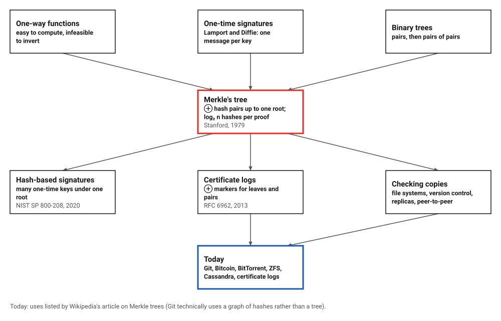
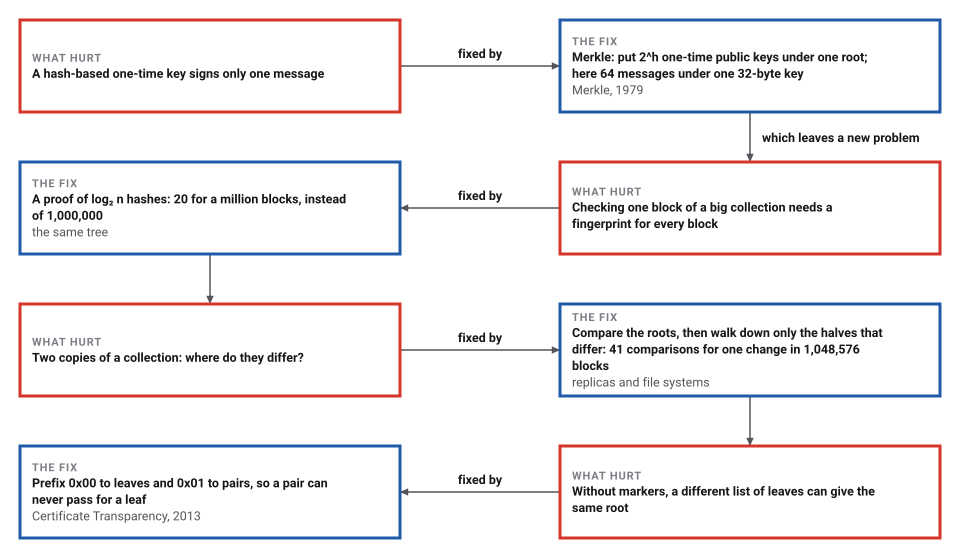
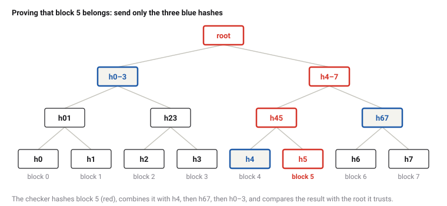

# Merkle's Hash Trees

*Era 7 · topic 2 · 1979* · [Era 7 index](../README.md) · [← Linear Programming in Polynomial Time](../01-linear-programming/README.md) · [The Byzantine Generals →](../03-byzantine-generals/README.md) · [Interactive edition](merkle-trees.html) · [Program](../../../code/era-07-randomness-networks-and-learning/02-merkle-trees/)

> **Field note from the visiting historian.** Two copies of 1,048,576 blocks disagreed in one place. They found it by comparing 41 hashes. This species now builds its file systems, its version control and its money on the same trick.

| | |
|---|---|
| **When** | Thesis and patent filing, 1979 |
| **Where** | Stanford University |
| **What hurt** | One-time signatures; checking a block meant checking everything |
| **The fix** | Hash pairs up to one root |
| **Checked** | 20,100 proofs accepted, 60,299 forgeries rejected |

## How ideas combined

A new algorithm is usually an older idea combined with a new one. Lamport and Diffie had shown how to sign a message with nothing but a one-way function, but each key could sign only once. Merkle hashed many such keys together in pairs, and pairs of pairs, up to a single root: one short public key for many signatures. The same tree turned out to vouch for any piece of any large collection of data. Each box names the idea that was added.

<picture>
  <source media="(prefers-color-scheme: dark)" srcset="assets/family-dark.svg">
  
</picture>
*Red: Merkle's tree. Blue: where it is used today.*

## Change one letter, watch the root change

Eight blocks of data, hashed with SHA-256 the way Certificate Transparency does it: 0x00 before a block, 0x01 before a pair. Each box shows the first 8 hex digits of a hash; the root at the top is the one the program printed (772c91eba0d1534a…). Click a block to see its proof, the three blue hashes a checker needs. Then edit a block: every hash on the way up changes, so the root does too, while the proofs of blocks on untouched paths still check.

| Level | Hashes (first 8 hex digits) |
|---|---|
| level 0 | 273150a0 fd153059 1109e33e 996898cb 8099d659 b13522f8 89204881 8018b217 |
| level 1 | 6847c5fe 2956351c 9f3c77f3 64152ef5 |
| level 2 | 67954dd5 bc4cd375 |
| root | 772c91eb |
*In the interactive edition you can edit the blocks and watch the hashes change.*

## Era 7, randomness, networks and learning

<picture>
  <source media="(prefers-color-scheme: dark)" srcset="assets/era-timeline-dark.svg">
  
</picture>

## Each fix leaves a new pain

<picture>
  <source media="(prefers-color-scheme: dark)" srcset="assets/chain-dark.svg">
  
</picture>
*Read it as a snake: each new problem sits directly under the fix that exposed it.*

## A hash of hashes of hashes

**A hash.** SHA-256 turns any data into 32 bytes. Nobody knows how to find two different inputs with the same output, so the 32 bytes can stand for the data.

**The tree.** Hash each block. Hash the hashes in pairs, then the pairs of those, up to one root. Whoever trusts the root can check any block from that block plus one hash per level: the siblings along the path to the root.

<picture>
  <source media="(prefers-color-scheme: dark)" srcset="assets/proof-dark.svg">
  
</picture>

**Finding differences.** Two copies of 1,048,576 blocks compare their roots. If the roots agree, so does everything. If not, compare the two children and go down only where they differ. One changed block is found with 41 comparisons; block by block would take 1,048,576.

**Signatures.** A Lamport one-time key is 512 secrets; the public key is their hashes (16,384 bytes). To sign, hash the message and, for each of its 256 bits, reveal the secret for that bit's value (8,192 bytes). A second signature with the same key revealed 380 of the 512 secrets, both secrets at 124 positions, enough to forge. Merkle's scheme hashes 64 one-time public keys into a tree; the root is the public key, and each signature carries its one-time key and 6 path hashes.

> **Key idea.** A hash makes data short; a tree of hashes makes the proof short. Trust one root, and any piece of anything under it can be checked in log₂ n steps.

## Every proof, every forgery

**Proofs.** For every tree of 1 to 200 leaves and every leaf: 20,100 proofs checked and accepted, and 60,299 forged ones (a changed leaf, a wrong position, a wrong root) rejected. The longest proof in a tree of n leaves always had ⌈log₂ n⌉ hashes.

| Blocks | Hashes in a proof | Hashes in a plain list |
|---|---|---|
| 8 | 3 | 8 |
| 1,000 | 10 | 1,000 |
| 1,000,000 | 20 | 1,000,000 |
| 1,000,000,000 | 30 | 1,000,000,000 |

**Finding changed blocks** in two copies of 1,048,576 blocks:

| Blocks changed | Hashes compared |
|---|---|
| 0 | 1 |
| 1 | 41 |
| 10 | 339 |
| 100 | 2,725 |
| 1,000 | 20,415 |

**Why the 0x00 and 0x01.** Without them, four blocks gave the root df08497811e9…, and a forger's list of two 64-byte "blocks" (each two leaf hashes glued together) gave df08497811e9…: the same. With the markers the roots were c36c53ede099… and 46a0dca377f2…: different.

**Signatures.** Merkle's scheme with 64 one-time keys: public key 77b2739f902e…, 32,895 hashes to make the keys, 64 signatures verified, 128 forgeries rejected, 24,772 bytes per signature.

## A thesis and a patent

Ralph Merkle's Stanford thesis, *Secrecy, Authentication, and Public Key Systems* (technical report 1979-1, June 1979), introduces "tree authentication" in chapter V: "This method lets us selectively authenticate any 'leaf'", and "only log2 n transmissions are required, each of about 200 bits". It builds on the one-time signatures of Lamport and Diffie, which on their own are "not practical for most applications without further refinements".

The patent, "Method of providing digital signatures" (US 4,309,569, assigned to Stanford), was filed on 5 September 1979 and granted on 5 January 1982; it names "the root of the authentication tree". The cryptographers' version appeared as "A Digital Signature Based on a Conventional Encryption Function" in *CRYPTO '87*.

Certificate Transparency (RFC 6962, Google, 2013) fixed the tree's exact form, 0x00 before leaves and 0x01 before pairs, splitting at "the largest power of two smaller than n". Wikipedia lists the tree's uses, from Git and BitTorrent to Bitcoin and Cassandra, and notes that without such markers the root "does not indicate the tree depth, enabling a second-preimage attack".

## Public keys without number theory

Era 6's public keys rest on factoring and discrete logarithms. Merkle's signatures rest only on a hash function, and Wikipedia's article on them notes that they are "believed to be resistant against attacks by quantum computers", the machines of this era's topic 11. In 2020 NIST approved hash-based signature schemes descended from them.

> **Full circle.** In 1979 the tree was a way to make one-time signatures practical. Forty years later its descendants are a hedge against the quantum computers that would break the number-theory signatures it was competing with.

## Before you read on

<details>
<summary><b>1.</b> How many hashes are in a proof for one block among 4,000,000,000?</summary>

32, since 2³² is about 4.3 billion.
</details>

<details>
<summary><b>2.</b> You change one block. Which hashes in the tree change?</summary>

The block's own hash and every hash on the path up to the root: log₂ n + 1 of them.
</details>

<details>
<summary><b>3.</b> Why can a Lamport key not sign two messages?</summary>

The two signatures together reveal both secrets at every position where the messages' hashes differ, so an attacker can mix them to sign other messages.
</details>

<details>
<summary><b>4.</b> Two replicas differ in one block out of 1,048,576. About how many hashes must they compare?</summary>

About 2 per level, 2 × 20 + 1 = 41, which is exactly what the program counted (41).
</details>

<details>
<summary><b>5.</b> What do the bytes 0x00 and 0x01 prevent?</summary>

Passing off an inner node's two children, glued together, as a leaf: a different list of leaves with the same root.
</details>


## Where the evidence lives

| | Object | Where to see it | Licence |
|---|---|---|---|
| — | **Merkle's thesis (1979)**. *Secrecy, Authentication, and Public Key Systems*, Stanford, June 1979; chapter V, section 4, "tree authentication". | [The thesis (PDF, Merkle's site)](https://www.ralphmerkle.com/papers/Thesis1979.pdf) | Drawn placeholder. |
| — | **US patent 4,309,569 (1982)**. "Method of providing digital signatures", filed 5 September 1979. | [The patent (Google Patents)](https://patents.google.com/patent/US4309569) | Drawn placeholder. |

## Every link was opened before it was listed

| Level | Link | Why |
|---|---|---|
| Start | [Merkle tree](https://en.wikipedia.org/wiki/Merkle_tree) — Wikipedia | The structure, its uses, and the second-preimage attack |
| Start | [Merkle tree](https://xlinux.nist.gov/dads/HTML/MerkleTree.html) — NIST, *Dictionary of Algorithms and Data Structures* | A one-paragraph definition with the original references |
| Deeper | [Session 3: Blockchain Basics & Cryptography](https://ocw.mit.edu/courses/15-s12-blockchain-and-money-fall-2018/resources/session-3-blockchain-basics-cryptography/) — MIT OpenCourseWare, Gary Gensler, *Blockchain and Money* (Fall 2018) | A lecture covering hash functions and Merkle trees in block headers, with video and transcript |
| Deeper | [Merkle signature scheme](https://en.wikipedia.org/wiki/Merkle_signature_scheme) — Wikipedia | One-time keys under one root, and why it matters after quantum computers |
| Scholar | [Secrecy, Authentication, and Public Key Systems](https://www.ralphmerkle.com/papers/Thesis1979.pdf) — R. Merkle, PhD thesis, Stanford (1979) | Chapter V introduces tree authentication |
| Scholar | [Method of providing digital signatures](https://patents.google.com/patent/US4309569) — R. Merkle, US patent 4,309,569 (filed 1979) | The authentication tree as patented |
| Scholar | [RFC 6962: Certificate Transparency](https://www.rfc-editor.org/rfc/rfc6962) — B. Laurie, A. Langley, E. Kasper, IETF (2013) | The exact tree hash and audit paths this topic's program follows |

More, with certainty labels and the gaps we could not fill: [Era 7 reference catalog](https://github.com/vij658/AlgorithmEvolutionAtlas/blob/main/book/era-07-randomness-networks-and-learning/reference-catalog.md).

## The program behind every number here

[MerkleTrees.java](https://github.com/vij658/AlgorithmEvolutionAtlas/blob/main/code/era-07-randomness-networks-and-learning/02-merkle-trees/MerkleTrees.java) makes **80,806 checks**: every inclusion proof in every tree of 1 to 200 leaves, three kinds of forgery, change-finding in two copies of a million blocks, the second-preimage forgery with and without markers, and Merkle's signature scheme with 64 one-time keys. Run it with `java MerkleTrees.java` (JDK 17 or newer). The heart of it:

```java
/** The inclusion proof (audit path) for leaf m among leaves lo..hi-1, bottom first. */
static List<byte[]> proof(byte[][] leaf, int m, int lo, int hi) {
    if (hi - lo == 1) return new ArrayList<>();
    int k = split(hi - lo);
    List<byte[]> p;
    if (m < lo + k) { p = proof(leaf, m, lo, lo + k); p.add(root(leaf, lo + k, hi)); }
    else { p = proof(leaf, m, lo + k, hi); p.add(root(leaf, lo, lo + k)); }
    return p;
}

/** Recomputes the root from one leaf hash and its proof; the verifier needs only m and n. */
static byte[] rootFromProof(byte[] h, int m, int n, List<byte[]> path, int top) {
    if (n == 1) return top == 0 ? h : null;               // proof too long
    if (top == 0) return null;                            // proof too short
    int k = split(n);
    byte[] sib = path.get(top - 1);
    if (m < k) { byte[] l = rootFromProof(h, m, k, path, top - 1); return l == null ? null : nodeHash(l, sib); }
    byte[] r = rootFromProof(h, m - k, n - k, path, top - 1);
    return r == null ? null : nodeHash(sib, r);
}
```

