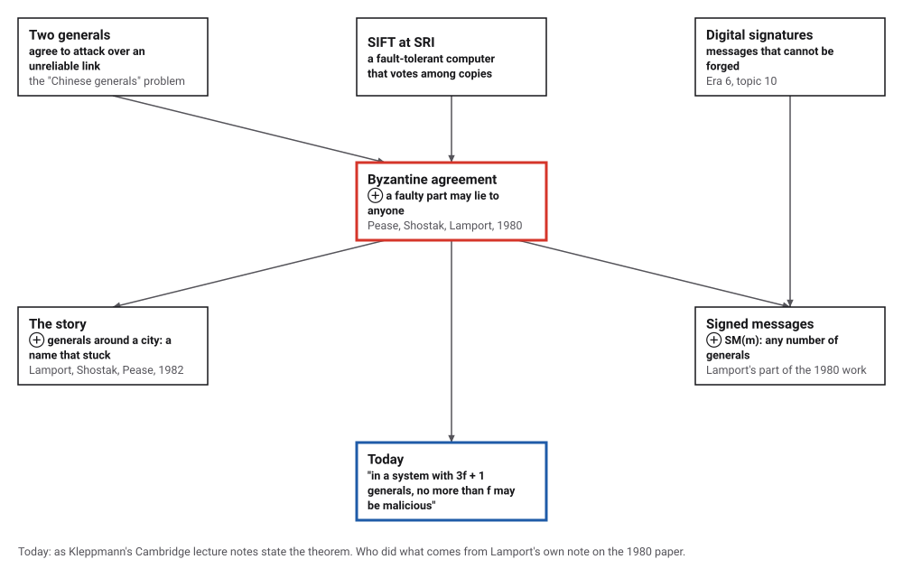
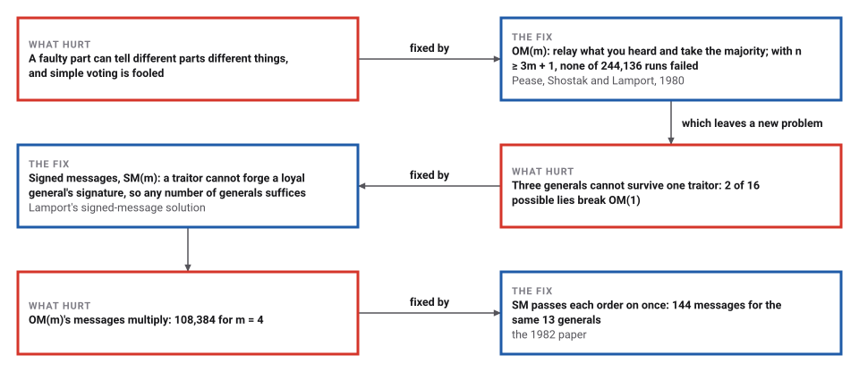
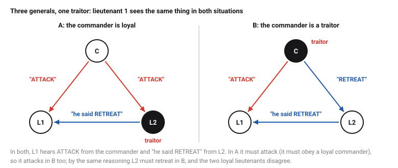

# The Byzantine Generals

*Era 7 · topic 3 · 1980–1982* · [Era 7 index](../README.md) · [← Merkle's Hash Trees](../02-merkle-trees/README.md) · [Simulated Annealing →](../04-simulated-annealing/README.md) · [Interactive edition](byzantine-generals.html) · [Program](../../../code/era-07-randomness-networks-and-learning/03-byzantine-generals/)

> **Field note from the visiting historian.** I played the traitor among three generals, and 2 of my 16 possible lies split the loyal ones. Among four, none of my lies worked. With signatures, even three were enough. This species named the problem after an empire known for its intrigues, and the name stuck.

| | |
|---|---|
| **When** | 1980 (the proof); 1982 (the story) |
| **Where** | SRI International |
| **What hurt** | Parts that send conflicting information |
| **The fix** | n ≥ 3m + 1 with OM(m); any n with signatures |
| **Checked** | 2 of 16 lies break 3 generals; 0 of 40 break 4 |

## How ideas combined

A new algorithm is usually an older idea combined with a new one. Fault-tolerant computers voted among copies of a computation, assuming a broken copy would simply give a wrong answer. Engineers at SRI saw that a broken part might give different answers to different voters. Pease, Shostak and Lamport worked out exactly how many parts are needed to survive that, and Lamport later told it as a story about generals. Each box names the idea that was added.

<picture>
  <source media="(prefers-color-scheme: dark)" srcset="assets/family-dark.svg">
  
</picture>
*Red: Byzantine agreement. Blue: how it is taught today.*

## Be the traitor

OM(1), exactly as the program runs it. The commander C sends an order to each lieutenant; each lieutenant then tells the others what it heard; each loyal lieutenant takes the majority (RETREAT on a tie). Choose a traitor and make it lie by clicking its messages. With four generals the loyal lieutenants always agree, and obey a loyal commander. With three, find the lies that split them. Then press "Try every lie": the widget runs every traitor, both orders and every combination of lies, and counts the failures, as the program does.

| Generals | Traitors | Condition | Lies tried | Runs | Broke IC1 or IC2 |
|---|---|---|---|---|---|
| 3 | 1 | n = 3m | every behaviour | 16 | 2 |
| 4 | 1 | n ≥ 3m + 1 | every behaviour | 40 | 0 |
| 5 | 1 | n ≥ 3m + 1 | every behaviour | 96 | 0 |
| 6 | 2 | n = 3m | random behaviours | 60,000 | 10,100 |
| 7 | 2 | n ≥ 3m + 1 | random behaviours | 84,000 | 0 |
| 8 | 2 | n ≥ 3m + 1 | random behaviours | 112,000 | 0 |
| 9 | 3 | n = 3m | random behaviours | 33,600 | 3,799 |
| 10 | 3 | n ≥ 3m + 1 | random behaviours | 48,000 | 0 |
*In the interactive edition you can play the traitor and try every lie.*

## Era 7, randomness, networks and learning

<picture>
  <source media="(prefers-color-scheme: dark)" srcset="assets/era-timeline-dark.svg">
  
</picture>

## Each fix leaves a new pain

<picture>
  <source media="(prefers-color-scheme: dark)" srcset="assets/chain-dark.svg">
  
</picture>
*Read it as a snake: each new problem sits directly under the fix that exposed it.*

## Relay, then vote

**The problem.** A commander sends ATTACK or RETREAT to n − 1 lieutenants. Up to m of the n generals, possibly the commander, are traitors who may say anything to anyone. IC1: all loyal lieutenants decide the same. IC2: if the commander is loyal, they decide what he ordered.

**Why three are not enough.** Lieutenant 1 cannot tell these two situations apart:

<picture>
  <source media="(prefers-color-scheme: dark)" srcset="assets/three-dark.svg">
  
</picture>

**OM(m).** The commander sends his order. Each lieutenant then acts as commander in OM(m − 1), passing on what it heard to the others, and finally takes the majority of the value it heard directly and the values the others report. With n ≥ 3m + 1 the loyal majority always outweighs the lies; the price is messages: (n − 1) + (n − 1)(n − 2) + … + (n − 1)(n − 2)…(n − m − 1).

**SM(m), with signatures.** The commander signs his order. A lieutenant who receives an order with a valid chain of signatures adds it to its set and, if fewer than m lieutenants have signed, signs it and passes it on. At the end it obeys if it received exactly one order, and retreats otherwise. A traitor can sign anything with its own key, but cannot forge a loyal general's signature, so a traitorous commander who sends two orders is exposed: every loyal lieutenant ends with the same set.

> **Key idea.** When a part can lie, two out of three is not a majority you can trust: you need more than two thirds honest. Unforgeable signatures change the arithmetic, because a lie about what someone else said can be caught.

## Every lie a traitor can tell

**OM(m).** Traitors placed in every possible way, both orders, and the traitors' messages chosen by an adversary: every combination when there are few enough, otherwise many random ones. Failures appear exactly when n = 3m:

| Generals n | Traitors m | Condition | Lies tried | Runs | Broke IC1 or IC2 |
|---|---|---|---|---|---|
| 3 | 1 | n = 3m | every behaviour | 16 | 2 |
| 4 | 1 | n ≥ 3m + 1 | every behaviour | 40 | 0 |
| 5 | 1 | n ≥ 3m + 1 | every behaviour | 96 | 0 |
| 6 | 2 | n = 3m | random behaviours | 60,000 | 10,100 |
| 7 | 2 | n ≥ 3m + 1 | random behaviours | 84,000 | 0 |
| 8 | 2 | n ≥ 3m + 1 | random behaviours | 112,000 | 0 |
| 9 | 3 | n = 3m | random behaviours | 33,600 | 3,799 |
| 10 | 3 | n ≥ 3m + 1 | random behaviours | 48,000 | 0 |

**Messages,** with no traitors present, when n = 3m + 1. OM's count grows like n to the power m; SM sends each order on once, (n − 1)² in all:

| m | n | OM messages | SM messages |
|---|---|---|---|
| 1 | 4 | 9 | 9 |
| 2 | 7 | 156 | 36 |
| 3 | 10 | 3,609 | 81 |
| 4 | 13 | 108,384 | 144 |

**SM(m).** Traitors may sign anything with their own keys and send it to anyone in any round, or not at all, but cannot forge a loyal signature. No failures, even with three generals and one traitor. As a control, the same traitors against lieutenants who never pass orders on: 238 failures in 1,800 runs, so the adversary is strong enough to break a weaker rule.

| Generals n | Traitors m | Runs | Failures |
|---|---|---|---|
| 3 | 1 | 1,800 | 0 |
| 4 | 2 | 3,600 | 0 |
| 5 | 3 | 6,000 | 0 |
| 6 | 2 | 9,000 | 0 |
| 7 | 5 | 12,600 | 0 |

## A problem renamed on purpose

Lamport, Shostak and Pease, "The Byzantine Generals Problem" (SRI International; *ACM Transactions on Programming Languages and Systems* 4(3): 382–401, July 1982): "Reliable computer systems must handle malfunctioning components that give conflicting information"; "no solution with fewer than 3m + 1 generals can cope with m traitors"; OM(m) and SM(m) "involve sending up to (n - 1)(n - 2) ... (n - m - 1) messages". The abstract states that with oral messages the problem "is solvable if and only if more than two-thirds of the generals are loyal", and that "With unforgeable written messages, the problem is solvable for any number of generals and possible traitors".

Lamport's own note explains the name: "the best way to attract attention to a problem is to present it in terms of a story"; "the original title of this paper was The Albanian Generals Problem", until Jack Goldberg pointed out "that there were Albanians in the world outside Albania"; "The obviously more appropriate Byzantine generals then occurred to me." "The main reason for writing this paper was to assign the new name to the problem."

On the 1980 paper, "Reaching Agreement in the Presence of Faults" (*Journal of the ACM*), which won the 2005 Dijkstra Prize, Lamport writes that the problem was posed by people working on SIFT at SRI before he arrived; Shostak found the 4-processor solution and the impossibility result, Pease the general 3n + 1 solution, and Lamport the signed-message solution. He adds that a former Boeing engineer told him in 1997 that Boeing's commercial-aircraft designers knew of the work by 1986.

## Logical clocks, then lying clocks

Era 6 ended with Lamport's logical clocks: separate computers agreeing on an order of events, assuming each one follows the rules. Here the same author asks what happens when some of them do not. The answer has the same flavour: agreement is possible, but only within limits that can be proved, and only by sending more messages.

> **Full circle.** Three generals and one traitor: impossible with spoken messages (2 of 16 possible lies succeed), possible with signatures. A tool from Era 6's public-key cryptography rescues a problem from distributed computing.

## Before you read on

<details>
<summary><b>1.</b> How many generals are needed to survive 2 traitors with spoken messages?</summary>

7, since n ≥ 3m + 1 = 7.
</details>

<details>
<summary><b>2.</b> In OM(1) with 4 generals, a traitorous lieutenant lies to everyone. Why do the loyal lieutenants still obey a loyal commander?</summary>

Each hears the true order from the commander and from the other loyal lieutenant: two votes against one lie.
</details>

<details>
<summary><b>3.</b> Why does a tie go to RETREAT?</summary>

Any fixed default works, as long as every loyal lieutenant uses the same one; RETREAT is the safe choice for an army.
</details>

<details>
<summary><b>4.</b> How many messages does OM(2) send with 7 generals?</summary>

6 + 6 × 5 + 6 × 5 × 4 = 156, as the program counted (156).
</details>

<details>
<summary><b>5.</b> What can a traitorous commander do in SM(m), and what happens?</summary>

Sign two different orders and send them to different lieutenants; the loyal ones pass both on, all end with both, and all retreat.
</details>


## Where the evidence lives

| | Object | Where to see it | Licence |
|---|---|---|---|
| — | **The Byzantine Generals Problem (1982)**. *ACM TOPLAS* 4(3): 382–401, by Lamport, Shostak and Pease of SRI International. | [The paper (PDF, on a UMass course page)](https://people.cs.umass.edu/~arun/cs677/reading/LSP.pdf) | Drawn placeholder. |

## Every link was opened before it was listed

| Level | Link | Why |
|---|---|---|
| Start | [The Byzantine Generals Problem](https://www.microsoft.com/en-us/research/publication/byzantine-generals-problem/) — Microsoft Research, with Leslie Lamport's note | How the story and the name were chosen |
| Deeper | [Distributed Systems lecture notes](https://www.cl.cam.ac.uk/teaching/2122/ConcDisSys/dist-sys-notes.pdf) — M. Kleppmann, University of Cambridge (2021/22) | Section 2.2 puts the generals beside the two generals problem and modern systems |
| Deeper | [Reaching Agreement in the Presence of Faults](https://www.microsoft.com/en-us/research/?p=338426) — Microsoft Research, with Lamport's note | Who proved what, and the Boeing story |
| Scholar | [The Byzantine Generals Problem](https://people.cs.umass.edu/~arun/cs677/reading/LSP.pdf) — L. Lamport, R. Shostak, M. Pease, *ACM TOPLAS* (1982), on a UMass course page | OM(m), SM(m) and the 3m + 1 bound |
| Scholar | [The Byzantine Generals Problem (abstract)](https://sri.com/?p=12386) — SRI International | The abstract as SRI publishes it |

More, with certainty labels and the gaps we could not fill: [Era 7 reference catalog](https://github.com/vij658/AlgorithmEvolutionAtlas/blob/main/book/era-07-randomness-networks-and-learning/reference-catalog.md).

## The program behind every number here

[ByzantineGenerals.java](https://github.com/vij658/AlgorithmEvolutionAtlas/blob/main/code/era-07-randomness-networks-and-learning/03-byzantine-generals/ByzantineGenerals.java) makes **277,153 checks**: OM(m) against every possible traitor placement and adversarial lies (every combination for small cases, random ones for larger), the message counts against the formula, SM(m) against traitors who sign anything they can, and a control showing those traitors break a weaker rule. Run it with `java ByzantineGenerals.java` (JDK 17 or newer). The heart of it:

```java
/**
 * OM(m): the commander sends v (if loyal) to the lieutenants; returns, for each lieutenant, the value he decides
 * on for this commander's order.
 */
static int[] om(int m, int commander, int[] lieutenants, int v, int n) {
    int[] received = new int[n];
    for (int l : lieutenants) {
        received[l] = traitor[commander] ? traitorSays() : v;
        messages++;
    }
    int[] decided = new int[n];
    if (m == 0) {
        for (int l : lieutenants) decided[l] = received[l];
        return decided;
    }
    // relayed[j][i]: what lieutenant j concludes lieutenant i was told
    int[][] relayed = new int[n][n];
    for (int i : lieutenants) {
        int[] others = Arrays.stream(lieutenants).filter(x -> x != i).toArray();
        int[] sub = om(m - 1, i, others, received[i], n);
        for (int j : others) relayed[j][i] = sub[j];
    }
    for (int j : lieutenants) {
        int attack = received[j] == ATTACK ? 1 : 0, total = 1;
        for (int i : lieutenants) if (i != j) { attack += relayed[j][i]; total++; }
        decided[j] = 2 * attack > total ? ATTACK : RETREAT;      // majority, RETREAT on a tie
    }
    return decided;
}
```

