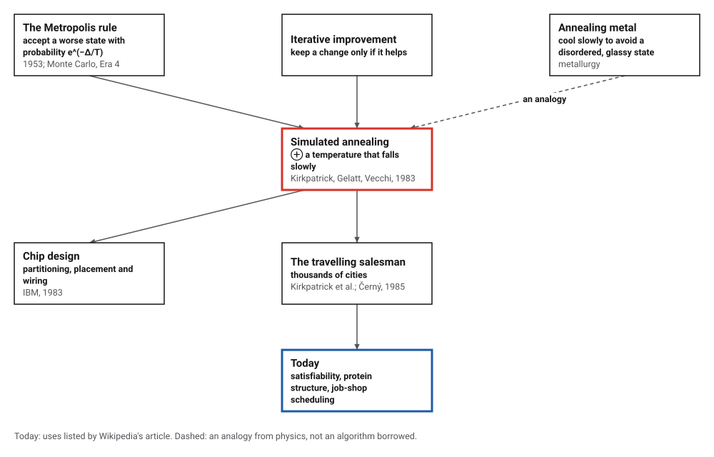
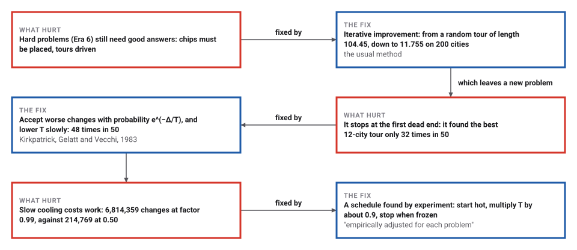
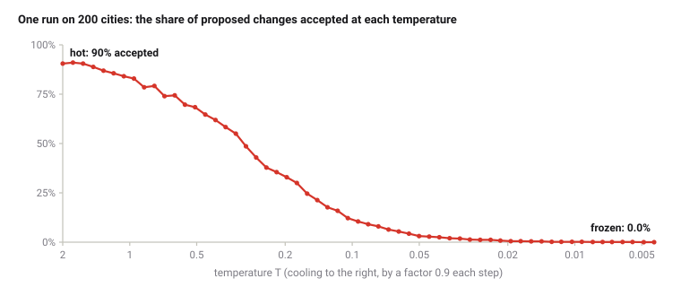

# Simulated Annealing

*Era 7 · topic 4 · 1983–1985* · [Era 7 index](../README.md) · [← The Byzantine Generals](../03-byzantine-generals/README.md) · [Splay Trees and Amortized Analysis →](../05-splay-trees/README.md) · [Interactive edition](simulated-annealing.html) · [Program](../../../code/era-07-randomness-networks-and-learning/04-simulated-annealing/)

> **Field note from the visiting historian.** On 12 cities, where the best tour can be found exactly, the careful improver found it 32 times in 50; the annealer, which sometimes made things worse on purpose, found it 48 times. I recorded that this species learned to search by imitating the cooling of metal.

| | |
|---|---|
| **When** | 1983 (Černý independently, 1985) |
| **Where** | IBM Yorktown Heights; Bratislava |
| **What hurt** | Small improving steps stop at the first dead end |
| **The fix** | Accept worse steps with probability e^(−Δ/T); cool slowly |
| **Checked** | Best 12-city tour found 48 of 50 times (improving only: 32) |

## How ideas combined

A new algorithm is usually an older idea combined with a new one. Physicists had simulated atoms at a temperature since 1953 with the Metropolis rule, which sometimes accepts a worse state. Engineers improved designs by small changes that help. Kirkpatrick, Gelatt and Vecchi joined the two and added a temperature that falls slowly, as in annealing metal. Each box names the idea that was added.

<picture>
  <source media="(prefers-color-scheme: dark)" srcset="assets/family-dark.svg">
  
</picture>
*Red: simulated annealing. Blue: where it is used.*

## Cool it slowly

Sixty cities and a random tour. Only improve tries reversing every stretch of the tour and keeps any reversal that shortens it, until none does. Anneal tries random reversals and also accepts some that lengthen the tour, with probability e^(−Δ/T); the temperature T starts at 2 and is multiplied by the cooling factor each round, with the same rules as the program. Compare the two lengths, then try faster and slower cooling. This is a live run on the widget's own cities, so its numbers are not the program's.

| Cooling factor | Mean tour length (200 cities) | Changes tried |
|---|---|---|
| 0.50 | 11.531 | 214,769 |
| 0.80 | 11.428 | 426,291 |
| 0.90 | 11.107 | 800,372 |
| 0.95 | 11.133 | 1,503,948 |
| 0.99 | 10.844 | 6,814,359 |
*In the interactive edition you can anneal a tour of 60 cities and watch it settle.*

## Era 7, randomness, networks and learning

<picture>
  <source media="(prefers-color-scheme: dark)" srcset="assets/era-timeline-dark.svg">
  
</picture>

## Each fix leaves a new pain

<picture>
  <source media="(prefers-color-scheme: dark)" srcset="assets/chain-dark.svg">
  
</picture>
*Read it as a snake: each new problem sits directly under the fix that exposed it.*

## Sometimes go uphill

**A change.** Pick two places in the tour and reverse the stretch between them. That removes two roads and adds two; the change in length, Δ, takes four distances to compute.

**The rule.** If Δ ≤ 0, accept. If Δ > 0, accept with probability e^(−Δ/T). At a high temperature T nearly everything is accepted and the tour wanders; at a low one almost only improvements are, and the method becomes iterative improvement.

**The schedule.** Start hot enough that most changes are accepted. At each temperature try up to 100 changes per city, moving on after 10 acceptances per city; then multiply T by a factor such as 0.9. Stop when three temperatures in a row accept fewer than 1 change in 1,000, and finish with a pass of iterative improvement.

<picture>
  <source media="(prefers-color-scheme: dark)" srcset="assets/accept-dark.svg">
  
</picture>

> **Key idea.** To escape a dead end you must sometimes accept a worse position. Doing so freely at first, and more and more rarely, lets the search find a deep valley rather than the first hollow.

## Against the exact answer

**Twelve cities,** where the best tour can be found exactly by Held and Karp's dynamic programme. In 50 random sets, iterative improvement from a random tour found the best tour 32 times and was 1.3% too long on average; annealing found it 48 times, 0.03% too long on average.

**Two hundred cities,** 10 random sets in a unit square. Mean lengths: a random tour 104.45; iterative improvement 11.755 (113,430 changes tried); annealing 11.100 (789,176 changes tried), shorter in 10 of 10 sets.

| Method | Mean tour length | Changes tried |
|---|---|---|
| Random tour | 104.45 | 0 |
| Iterative improvement | 11.755 | 113,430 |
| Annealing, factor 0.9 | 11.100 | 789,176 |

**The cooling rate,** the same 5 sets of 200 cities each time. Slower cooling usually gives shorter tours and always costs more work; the ordering is not perfect (0.95 did slightly worse than 0.9 on these 5 sets), which is one reason schedules are tuned by experiment:

| Cooling factor | Mean tour length | Changes tried |
|---|---|---|
| 0.50 | 11.531 | 214,769 |
| 0.80 | 11.428 | 426,291 |
| 0.90 | 11.107 | 800,372 |
| 0.95 | 11.133 | 1,503,948 |
| 0.99 | 10.844 | 6,814,359 |

## Two discoveries, one name

S. Kirkpatrick, C. D. Gelatt Jr. and M. P. Vecchi, "Optimization by Simulated Annealing" (IBM Thomas J. Watson Research Center; *Science* 220, 13 May 1983): "There is a deep and useful connection between statistical mechanics ... and multivariate or combinatorial optimization." They describe "partitioning, component placement, and wiring of electronic systems" and travelling salesman problems "with as many as several thousand cities". Annealing "differs from iterative improvement in that the procedure need not get stuck"; accepting only improvements is like rapid quenching, whose results "are usually metastable". Their schedule multiplies the temperature by 0.9 each step; in one partitioning example quenching gave about 700 pins, slow annealing 353 and 321.

V. Černý of Comenius University, Bratislava, published "Thermodynamical Approach to the Traveling Salesman Problem: An Efficient Simulation Algorithm" in the *Journal of Optimization Theory and Applications* in January 1985: on 100 points on a circle, "After a total of 25,000 Monte Carlo trials a value 6.28 was reached, which means that the true optimum was found." Wikipedia lists earlier independent versions (Pincus 1970; Khachaturyan and others 1979, 1981) and credits Kirkpatrick and colleagues with the name. It also warns that the time for a good chance of the global optimum "will usually exceed the time required for a complete search", and that the cooling rate "should be empirically adjusted for each problem".

## Monte Carlo, put to work

Era 4's Monte Carlo methods used random numbers to estimate what could not be computed exactly. Annealing uses them to search: the same Metropolis rule that sampled the states of atoms now samples tours and chip layouts, and the temperature turns sampling into optimizing.

> **Full circle.** Era 6 proved the travelling salesman problem is NP-complete. Era 7 answered with a method that guarantees nothing useful and, on 12 cities, found the best tour 48 times in 50.

## Before you read on

<details>
<summary><b>1.</b> A change lengthens the tour by 0.1. What is the chance of accepting it at T = 0.1? At T = 0.01?</summary>

e^(−1) ≈ 37%; e^(−10) ≈ 0.005%.
</details>

<details>
<summary><b>2.</b> What does annealing become when T is close to 0?</summary>

Iterative improvement: only changes that do not lengthen the tour are accepted.
</details>

<details>
<summary><b>3.</b> Why reverse a stretch of the tour rather than swap two cities?</summary>

A reversal changes only two roads, so Δ takes four distances to compute; swapping two cities changes four roads.
</details>

<details>
<summary><b>4.</b> Slower cooling took more work in the program. Why not always cool as slowly as possible?</summary>

The work grows quickly and the gains shrink; for a guarantee the time can exceed trying every tour.
</details>

<details>
<summary><b>5.</b> Why finish with a pass of iterative improvement?</summary>

So the result cannot be shortened by any single reversal, whatever the last random choices were.
</details>


## Where the evidence lives

| | Object | Where to see it | Licence |
|---|---|---|---|
| — | **Optimization by Simulated Annealing (1983)**. *Science* 220 (4598), 13 May 1983, by Kirkpatrick, Gelatt and Vecchi of IBM. | [The paper (PDF, on a research group's teaching page)](https://zhanggroup.org/teaching/literature/Kirkpatrick_Annealing_Science_1983.pdf) | Drawn placeholder. |
| — | **Černý's paper (1985)**. *Journal of Optimization Theory and Applications* 45 (1), January 1985. | [The paper (PDF)](https://mk.bcgsc.ca/papers/cerny-travelingsalesman.pdf) | Drawn placeholder. |

## Every link was opened before it was listed

| Level | Link | Why |
|---|---|---|
| Start | [Simulated Annealing: The Most Metal Algorithm Ever](https://rubyevents.org/talks/simulated-annealing-the-most-metal-algorithm-ever) — Chris Bloom, RubyConf 2022 (28 minutes) | The metallurgy analogy, a travelling-salesperson example and a real scheduling use |
| Start | [Simulated annealing](https://en.wikipedia.org/wiki/Simulated_annealing) — Wikipedia | The acceptance rule, the schedule, and who invented it when |
| Deeper | [Lecture 10: simulated annealing](https://ocw.mit.edu/courses/ids-338j-multidisciplinary-system-design-optimization-spring-2010/resources/mitesd_77s10_lec10/) — MIT OpenCourseWare, O. de Weck and K. Willcox (2010) | Lecture notes on annealing as an engineering design tool |
| Scholar | [Optimization by Simulated Annealing](https://zhanggroup.org/teaching/literature/Kirkpatrick_Annealing_Science_1983.pdf) — S. Kirkpatrick, C. D. Gelatt, M. P. Vecchi, *Science* (1983), on a research group's teaching page | The analogy, the schedule and the chip-design results |
| Scholar | [Thermodynamical Approach to the Traveling Salesman Problem](https://mk.bcgsc.ca/papers/cerny-travelingsalesman.pdf) — V. Černý, *JOTA* (1985), on a BC Cancer Genome Sciences Centre page | The independent discovery, with worked examples |

More, with certainty labels and the gaps we could not fill: [Era 7 reference catalog](https://github.com/vij658/AlgorithmEvolutionAtlas/blob/main/book/era-07-randomness-networks-and-learning/reference-catalog.md).

## The program behind every number here

[SimulatedAnnealing.java](https://github.com/vij658/AlgorithmEvolutionAtlas/blob/main/code/era-07-randomness-networks-and-learning/04-simulated-annealing/SimulatedAnnealing.java) makes **115 checks**: 50 sets of 12 cities against Held and Karp's exact optimum, 10 sets of 200 cities, five cooling rates, and one run's acceptance at every temperature; every result is checked to be a tour, and nothing beats the exact optimum. Run it with `java SimulatedAnnealing.java` (JDK 17 or newer). The heart of it:

```java
/**
 * Annealing with Kirkpatrick, Gelatt and Vecchi's schedule: start hot enough that nearly every change is accepted,
 * multiply the temperature by `cool` each time, and at each temperature try up to 100 n changes, moving on early
 * after 10 n acceptances; frozen after three successive temperatures that accept fewer than 1 change in 1,000.
 * A final pass of iterative improvement makes sure the result cannot be improved by one reversal.
 */
static int[] anneal(double[][] c, int[] t, double cool) {
    int n = t.length;
    double T = 2.0;
    int cold = 0;
    while (cold < 3) {
        int accepted = 0, tried = 0;
        while (tried < 100 * n && accepted < 10 * n) {
            int i = below(n), j = below(n);
            if (i == j) continue;
            if (i > j) { int x = i; i = j; j = x; }
            if (j - i >= n - 2) continue;                     // the same cycle, only reversed: not a change
            double d = delta(c, t, i, j);
            tried++;
            tries++;
            if (d <= 0 || uniform() < Math.exp(-d / T)) { reverse(t, i, j); accepted++; }
        }
        if (acceptLog != null) acceptLog.add(String.format("%.4f:%.3f", T, accepted / (double) tried));
        cold = accepted * 1000 < tried ? cold + 1 : 0;
        T *= cool;
    }
    return descend(c, t);
}
```

