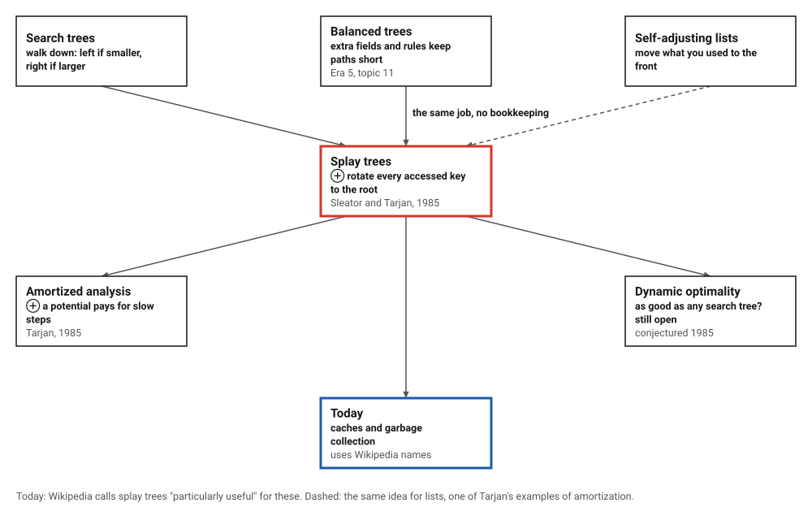
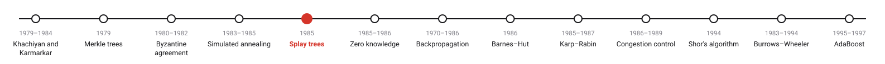
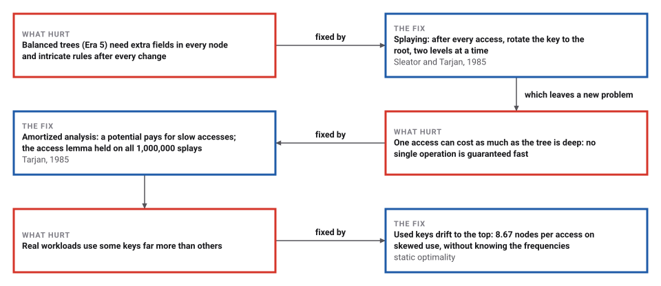
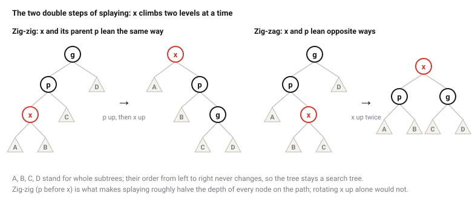

# Splay Trees and Amortized Analysis

*Era 7 · topic 5 · 1985* · [Era 7 index](../README.md) · [← Simulated Annealing](../04-simulated-annealing/README.md) · [Zero-Knowledge Proofs →](../06-zero-knowledge/README.md) · [Interactive edition](splay-trees.html) · [Program](../../../code/era-07-randomness-networks-and-learning/05-splay-trees/)

> **Field note from the visiting historian.** I inserted a thousand keys in order and the tree became a single long path. Then I read them in order: the first read walked a thousand nodes, and all thousand reads together walked 5,374. This species learned to judge its structures by the whole journey, not the worst step.

| | |
|---|---|
| **When** | 1985 |
| **Where** | AT&T Bell Laboratories |
| **What hurt** | Balanced trees' bookkeeping; judging each step alone |
| **The fix** | Splay every accessed key to the root; amortize |
| **Checked** | The access lemma on 1,000,000 splays, no exception |

## How ideas combined

A new algorithm is usually an older idea combined with a new one. Balanced search trees (Era 5) kept every path short by bookkeeping. Self-adjusting lists simply moved whatever was used to the front. Sleator and Tarjan did the same for trees: rotate whatever was used to the root. To prove it works they judged whole sequences of operations rather than single ones, which Tarjan called amortized analysis. Each box names the idea that was added.

<picture>
  <source media="(prefers-color-scheme: dark)" srcset="assets/family-dark.svg">
  
</picture>
*Red: splay trees. Blue: where they are used.*

## Splay a key to the root

Fifteen keys inserted in order 1, 2, 3, …: each insertion splays the new key to the root, so the tree ends as a long path. Click a key to access it: it is rotated to the root (red), two levels at a time, and the path it came from is folded roughly in half. Each access also checks the access lemma, the inequality at the heart of the proof. Then read every key in order, and try the program's own test with 1,000 keys, done the same way in your browser.

| Keys | Plain tree, inserting | Plain tree, reading | Splay tree, inserting | Splay tree, reading | Balanced tree, reading |
|---|---|---|---|---|---|
| 1,000 | 499,500 | 500,500 | 999 | 5,374 | 8,987 |
| 10,000 | 49,995,000 | 50,005,000 | 9,999 | 54,112 | 123,631 |
*In the interactive edition you can click keys and watch the tree reshape itself.*

## Era 7, randomness, networks and learning

<picture>
  <source media="(prefers-color-scheme: dark)" srcset="assets/era-timeline-dark.svg">
  
</picture>

## Each fix leaves a new pain

<picture>
  <source media="(prefers-color-scheme: dark)" srcset="assets/chain-dark.svg">
  
</picture>
*Read it as a snake: each new problem sits directly under the fix that exposed it.*

## Rotate it to the top, and pay later

**A rotation** lifts a node above its parent while keeping the left-to-right order of everything, so the tree is still a search tree. Splaying a node x repeats rotations until x is the root, looking two levels up each time:

<picture>
  <source media="(prefers-color-scheme: dark)" srcset="assets/rotations-dark.svg">
  
</picture>

When x's parent is the root, one rotation (zig) finishes the job.

**Amortized cost.** Give the tree a potential Φ, the sum over all nodes of log₂ of the size of the subtree below them. Define an operation's amortized cost as its actual cost plus the change in Φ. A splay that takes many rotations flattens a long path and lowers Φ a lot, so its amortized cost stays small. Sleator and Tarjan's access lemma: splaying x in a tree with root t costs, amortized, at most 3(log₂ size(t) − log₂ size(x)) + 1. Over any sequence, the total actual cost is the total amortized cost plus the drop in Φ, so m accesses take O(m log n) in all.

**The simplest example,** from Tarjan's paper: a stack where each operation pops any number of items and then pushes one. A single operation can be slow (the program saw one with 728 pushes and pops), but every item is popped at most once after it is pushed, so 1,000,000 operations do at most 2m = 2,000,000 pushes and pops; the program counted 1,999,416.

> **Key idea.** Judge a data structure by what a whole sequence of operations costs, not by its worst single step. Then a structure that does something cheap and silly-looking every time (move what you just used to the top) can be proved as good as one that keeps careful books.

## A million accesses

**The access lemma,** checked on every one of 1,000,000 random accesses in a splay tree of 10,000 keys: rotations plus the change in potential never exceeded the bound (closest margin 0.000). In all, 16,227,843 rotations, 16.2 per access on average, against an average bound of 35.5. The potential ended at 17,819, of at most n log₂ n = 132,877.

**Sorted insertions, then reading in order.** A plain search tree becomes a path and visits 1 + 2 + … + n nodes; the splay tree's reading pass costs only a few nodes per key (the scanning theorem):

| Keys | Plain tree, inserting | Plain tree, reading | Splay tree, inserting | Splay tree, reading | Balanced tree, reading |
|---|---|---|---|---|---|
| 1,000 | 499,500 | 500,500 | 999 | 5,374 | 8,987 |
| 10,000 | 49,995,000 | 50,005,000 | 9,999 | 54,112 | 123,631 |

**Skewed use.** 1,000 keys, the k-th most popular used with probability proportional to 1/k, 1,000,000 accesses. Average nodes visited per access: a perfectly balanced tree 8.91; the best fixed tree for the true frequencies (Knuth's dynamic programme) 5.89; the splay tree, which knows nothing about the frequencies, 8.67. Static optimality promises the splay tree is within a constant factor of the best fixed tree; here the factor is about 1.5.

**Working sets.** A splay tree of 100,000 keys, but only a few keys are used, at random. The cost depends on how many are in use, not on the size of the tree; a balanced tree would visit about 17 nodes every time:

| Keys in use | Nodes per access | log₂ of keys in use |
|---|---|---|
| 1 | 1.00 | 0.0 |
| 10 | 3.50 | 3.3 |
| 100 | 7.70 | 6.6 |
| 1,000 | 12.42 | 10.0 |
| 10,000 | 17.22 | 13.3 |

## Two papers in 1985

Daniel Sleator and Robert Tarjan, "Self-Adjusting Binary Search Trees" (AT&T Bell Laboratories; *Journal of the ACM* 32(3): 652–686, July 1985): "The splay tree, a self-adjusting form of binary search tree, is developed and analyzed." Its operations have an amortized bound of O(log n), "where by 'amortized time' is meant the time per operation averaged over a worst-case sequence of operations", and "for sufficiently long access sequences, splay trees are as efficient, to within a constant factor, as static optimum search trees." The efficiency comes "from applying a simple restructuring heuristic, called splaying, whenever the tree is accessed." The access lemma (p. 658) and the dynamic optimality conjecture (p. 684) are in the paper; the conjecture is still open.

Robert Tarjan, "Amortized Computational Complexity" (*SIAM Journal on Algebraic and Discrete Methods* 6(2), April 1985): "A powerful technique in the complexity analysis of data structures is amortization, or averaging over time." It gives the banker's view ("To each operation we allocate a certain number of credits") and the physicist's view (a potential function), starting from the multipop stack, and argues that amortization leads to "self-adjusting" data structures.

Wikipedia notes the trade-offs: "recently accessed elements are quick to access again" and "Splay trees do not need to store any bookkeeping data", but "the height of a splay tree can be linear", and because reads reshape the tree, concurrent use needs extra care.

## Balanced trees, without the balance

Era 5's AVL trees guaranteed every search a short path by storing a balance in every node. Splay trees store nothing, let single searches be slow, and still match balanced trees over any sequence, and beat them when some keys are used more than others.

> **Full circle.** Reading 1,000 keys in sorted order: a plain search tree visited 500,500 nodes; a balanced tree 8,987; the splay tree, which started as a path, 5,374.

## Before you read on

<details>
<summary><b>1.</b> After inserting 1, 2, …, 15 in order into a splay tree, where is key 1?</summary>

At the bottom of a path of 15 nodes: each insertion splayed the newest (largest) key to the root.
</details>

<details>
<summary><b>2.</b> Why is one access allowed to be slow?</summary>

Because it lowers the potential by about as much as it costs, paying for itself; only the total over a sequence is promised.
</details>

<details>
<summary><b>3.</b> A splay tree of a million keys is used for only 10 of them. About how many nodes per access?</summary>

A few, about log₂ 10 plus a constant; the program measured 3.50 in a tree of 100,000.
</details>

<details>
<summary><b>4.</b> In the multipop stack, why can m operations do at most 2m pushes and pops?</summary>

Each operation pushes once (m pushes), and each item can be popped at most once after its push (at most m pops).
</details>

<details>
<summary><b>5.</b> What does the dynamic optimality conjecture claim?</summary>

That splay trees are, up to a constant factor, as good as any binary search tree algorithm on every sequence of accesses. It has not been proved.
</details>


## Where the evidence lives

| | Object | Where to see it | Licence |
|---|---|---|---|
| — | **Self-Adjusting Binary Search Trees (1985)**. *Journal of the ACM* 32(3): 652–686, by Sleator and Tarjan of AT&T Bell Laboratories. | [The paper (PDF, on a Princeton course page)](https://www.cs.princeton.edu/courses/archive/fall07/cos521/handouts/self-adjusting.pdf) | Drawn placeholder. |
| — | **Amortized Computational Complexity (1985)**. *SIAM J. Alg. Disc. Meth.* 6(2), by Tarjan. | [The paper (PDF, on a Duke course page)](https://courses.cs.duke.edu/fall11/cps234/reading/Tarjan85_AmortizedComplexity.pdf) | Drawn placeholder. |

## Every link was opened before it was listed

| Level | Link | Why |
|---|---|---|
| Start | [Splay tree](https://en.wikipedia.org/wiki/Splay_tree) — Wikipedia | The zig, zig-zig and zig-zag steps with pictures, and the trade-offs |
| Deeper | [Lecture 3: Splay Trees](https://courses.csail.mit.edu/6.854/21/Notes/n03-splay.html) — D. Karger, MIT 6.854 *Advanced Algorithms* | The potential-function proof, step by step |
| Scholar | [Self-Adjusting Binary Search Trees](https://www.cs.princeton.edu/courses/archive/fall07/cos521/handouts/self-adjusting.pdf) — D. Sleator, R. Tarjan, *JACM* (1985), on a Princeton course page | Splaying, the access lemma and the conjectures |
| Scholar | [Amortized Computational Complexity](https://courses.cs.duke.edu/fall11/cps234/reading/Tarjan85_AmortizedComplexity.pdf) — R. Tarjan, *SIAM J. Alg. Disc. Meth.* (1985), on a Duke course page | The banker's and physicist's views of amortization |

More, with certainty labels and the gaps we could not fill: [Era 7 reference catalog](https://github.com/vij658/AlgorithmEvolutionAtlas/blob/main/book/era-07-randomness-networks-and-learning/reference-catalog.md).

## The program behind every number here

[SplayTrees.java](https://github.com/vij658/AlgorithmEvolutionAtlas/blob/main/code/era-07-randomness-networks-and-learning/05-splay-trees/SplayTrees.java) makes **1,000,014 checks**: the access lemma on every one of 1,000,000 splays (with the potential kept up to date and recounted at the end), sorted insertions against a plain tree, skewed use against Knuth's optimal fixed tree, working sets, and the multipop stack. Run it with `java SplayTrees.java` (JDK 17 or newer). The heart of it:

```java
    /** Rotates x above its parent, keeping sizes (and the potential) up to date. */
    void rotate(int x) {
        int p = parent[x], g = parent[p];
        if (trackPotential) potential -= lg(size[x]) + lg(size[p]);
        if (left[p] == x) {
            left[p] = right[x]; if (right[x] >= 0) parent[right[x]] = p;
            right[x] = p;
        } else {
            right[p] = left[x]; if (left[x] >= 0) parent[left[x]] = p;
            left[x] = p;
        }
        parent[p] = x;
        parent[x] = g;
        if (g >= 0) { if (left[g] == p) left[g] = x; else right[g] = x; } else root = x;
        size[p] = 1 + sz(left[p]) + sz(right[p]);
        size[x] = 1 + sz(left[x]) + sz(right[x]);
        if (trackPotential) potential += lg(size[x]) + lg(size[p]);
        rotations++;
    }

    void splay(int x) {
        while (parent[x] >= 0) {
            int p = parent[x], g = parent[p];
            if (g < 0) rotate(x);                                                 // zig
            else if ((left[g] == p) == (left[p] == x)) { rotate(p); rotate(x); }  // zig-zig
            else { rotate(x); rotate(x); }                                        // zig-zag
        }
    }
```

