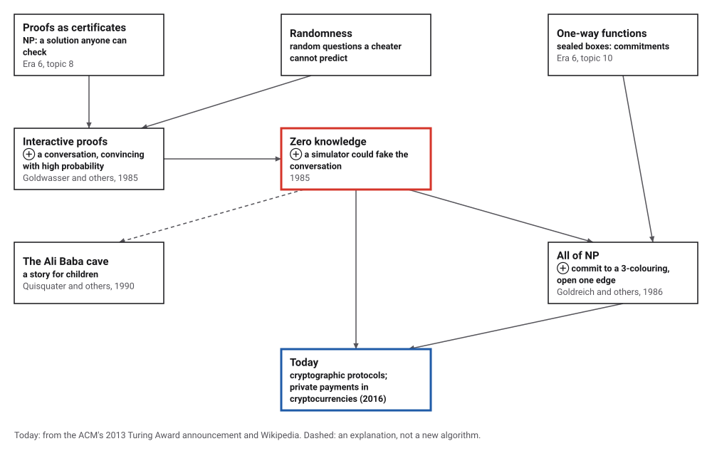
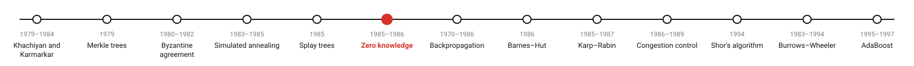
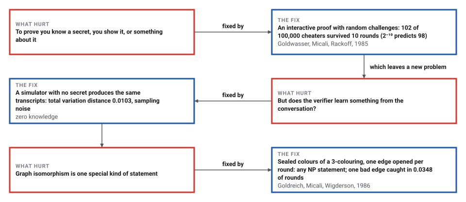
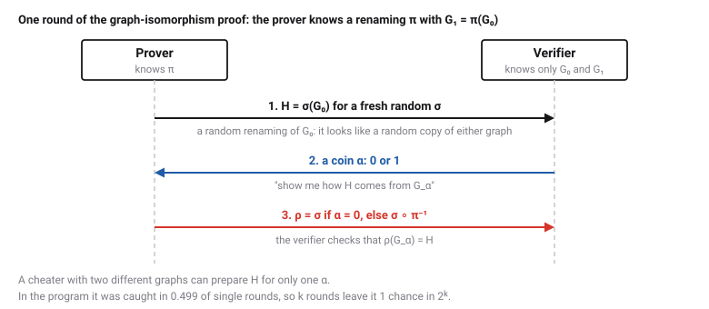

# Zero-Knowledge Proofs

*Era 7 · topic 6 · 1985–1986* · [Era 7 index](../README.md) · [← Splay Trees and Amortized Analysis](../05-splay-trees/README.md) · [Backpropagation →](../07-backpropagation/README.md) · [Interactive edition](zero-knowledge.html) · [Program](../../../code/era-07-randomness-networks-and-learning/06-zero-knowledge/)

> **Field note from the visiting historian.** I played the verifier: 60,000 rounds, and every time I opened two boxes I saw two different colours, each pair as often as any other. I was convinced, and I learned nothing. A cheater with one bad edge among 29 lasted about 29 rounds.

| | |
|---|---|
| **When** | 1985; for all of NP, 1986 |
| **Where** | MIT and Toronto; Technion, MIT, Hebrew University |
| **What hurt** | Proving you know a secret meant revealing it |
| **The fix** | Random challenges, and a simulator that could fake the conversation |
| **Checked** | Cheaters caught in 0.499 of rounds; transcripts indistinguishable |

## How ideas combined

A new algorithm is usually an older idea combined with a new one. A proof in the NP sense (Era 6) is a certificate anyone can check, and checking it teaches you the certificate. Goldwasser, Micali and Rackoff replaced the certificate with a conversation, using random questions the prover cannot predict, and asked how much knowledge the conversation gives away. Goldreich, Micali and Wigderson then used sealed boxes, built from one-way functions, to make such proofs for every NP statement. Each box names the idea that was added.

<picture>
  <source media="(prefers-color-scheme: dark)" srcset="assets/family-dark.svg">
  
</picture>
*Red: zero knowledge. Blue: where it is used.*

## Be the verifier

The prover claims this graph can be coloured with three colours so that no edge joins two vertices of the same colour. Each round it renames the three colours at random and seals every vertex's colour in a box: SHA-256 of a random nonce and the colour (the hex shows the start of each seal). You pick one edge; only its two boxes are opened, and you check the seals and that the colours differ. You never see more than two colours of one shuffled colouring. Then let the prover cheat: one extra edge joins two vertices of the same colour, and you catch it only when you happen to pick that edge. The widget uses your browser's random numbers, so its counts are its own; the program's are below.

| Opened pair of colours | Share of 60,000 honest rounds |
|---|---|
| ((1,2)) | 0.167 |
| ((1,3)) | 0.165 |
| ((2,1)) | 0.166 |
| ((2,3)) | 0.168 |
| ((3,1)) | 0.164 |
| ((3,2)) | 0.169 |
*In the interactive edition you can play the verifier against an honest or a cheating prover.*

## Era 7, randomness, networks and learning

<picture>
  <source media="(prefers-color-scheme: dark)" srcset="assets/era-timeline-dark.svg">
  
</picture>

## Each fix leaves a new pain

<picture>
  <source media="(prefers-color-scheme: dark)" srcset="assets/chain-dark.svg">
  
</picture>
*Read it as a snake: each new problem sits directly under the fix that exposed it.*

## Convincing without telling

**Graph isomorphism.** Two graphs G₀ and G₁ are the same graph with the vertices renamed, and the prover knows the renaming π. Revealing π would prove it, and give π away. Instead, each round:

<picture>
  <source media="(prefers-color-scheme: dark)" srcset="assets/protocol-dark.svg">
  
</picture>

**Three properties.** *Completeness:* an honest prover always passes. *Soundness:* if the graphs differ, H can be a renaming of at most one of them, so each round catches a cheater with probability ½, and k rounds leave 2⁻ᵏ. *Zero knowledge:* whatever the verifier sees, a *simulator* who knows no secret could have produced with the same probabilities: pick α first, rename G_α at random to get H, and if the verifier's coin differs from the guess, start again. Since the conversation could be faked without π, it cannot reveal π.

**All of NP.** Goldreich, Micali and Wigderson used 3-colouring, to which every NP statement can be reduced. The prover shuffles the three colours, seals each vertex's colour in a commitment, and the verifier opens one edge. A proper colouring always passes; a colouring with a bad edge among E is caught with probability at least 1/E per round, so about E rounds per factor of e.

> **Key idea.** If a conversation could have been produced by someone who does not know the secret, then the conversation cannot reveal the secret. Randomness makes a cheater's success unlikely; the simulator shows the honest prover's answers teach nothing.

## Cheaters, simulators and sealed boxes

**Graph isomorphism,** two graphs of 8 vertices and 14 edges. The honest prover passed all 20 rounds in 1,000 of 1,000 runs. A cheater whose graphs are not isomorphic (checked over all 8! renamings) was caught in 99,853 of 200,000 single rounds (0.499). Cheaters surviving k rounds in a row:

| Rounds k | Cheaters who passed | Out of | 2⁻ᵏ predicts |
|---|---|---|---|
| 1 | 50,004 | 100,000 | 50,000 |
| 2 | 25,089 | 100,000 | 25,000 |
| 5 | 3,105 | 100,000 | 3,125 |
| 10 | 102 | 100,000 | 98 |

**The simulator,** graphs of 5 vertices: 600,000 real conversations and 600,000 simulated ones contain the same 240 different transcripts (2 coins × 5! renamings), with frequencies differing by a total variation distance of 0.0103, which is sampling noise. The simulator needed 2.00 attempts per transcript.

**3-colouring with SHA-256 seals,** 12 vertices and 28 edges: the honest prover passed all 60,000 rounds, and the opened pairs of colours were spread evenly over the 6 possibilities:

| Opened pair of colours | Share of rounds |
|---|---|
| ((1,2)) | 0.167 |
| ((1,3)) | 0.165 |
| ((2,1)) | 0.166 |
| ((2,3)) | 0.168 |
| ((3,1)) | 0.164 |
| ((3,2)) | 0.169 |

With one extra edge between two vertices of the same colour (29 edges), the prover was caught in 0.0348 of rounds, about 1 in 29:

| Rounds | Cheaters who passed | Out of | Predicted |
|---|---|---|---|
| 29 | 689 | 2,000 | 723 |
| 87 | 103 | 2,000 | 94 |
| 145 | 11 | 2,000 | 12 |

## Knowledge as something to measure

Shafi Goldwasser and Silvio Micali (MIT) and Charles Rackoff (Toronto), "The Knowledge Complexity of Interactive Proof-Systems" (© 1985 ACM): "we introduce a new theorem-proving procedure, that is a new efficient method of communicating a proof"; "Our 'proofs' are probabilistic in nature"; "Our proofs are interactive." Knowledge is defined through a probabilistic polynomial-time machine whose output cannot be told apart from the real conversation, and the first example, quadratic non-residuosity, has knowledge complexity 0. Wikipedia records that this paper and Babai and Moran's work invented interactive proof systems, and that all five authors shared the first Gödel Prize in 1993.

Oded Goldreich, Silvio Micali and Avi Wigderson, "Proofs that Yield Nothing But Their Validity or All Languages in NP Have Zero-Knowledge Proof Systems" (IEEE FOCS 1986; *Journal of the ACM*, July 1991): proofs that "efficiently demonstrate membership in the language without conveying any additional knowledge"; the graph isomorphism protocol, in which the prover "generates a graph H, which is a random isomorphic copy", repeated "m times, each time using independent random coin tosses"; and 3-colouring for all of NP, assuming "secure encryption functions", where each round shows the verifier only "a pair of different randomly selected elements" of the three colours.

The ACM's announcement of the 2012 Turing Award to Goldwasser and Micali (13 March 2013) says the 1985 paper "initiated the idea of 'zero-knowledge' proofs", now "the essential language for speaking about security of cryptographic protocols". In 1990 Quisquater, Guillou and Berson's "How to Explain Zero-Knowledge Protocols to Your Children" told it as a story of Ali Baba and a magic door, to show "that it is possible to convince without revealing".

## NP, from both sides

Era 6 used NP-completeness to say that some problems are probably hard, and public keys to turn hardness into secrecy. Zero knowledge uses both: an NP statement as the thing to prove, and a one-way function to seal the boxes. The same reductions that showed 3-colouring is as hard as anything in NP now carry a zero-knowledge proof from 3-colouring to everything in NP.

> **Full circle.** In the program the honest prover answered 60,000 challenges and the verifier saw only shuffled pairs of different colours, each about 1/6 of the time. It ends convinced that a colouring exists, and knows nothing about what it is.

## Before you read on

<details>
<summary><b>1.</b> How many rounds of the isomorphism protocol leave a cheater less than one chance in a million?</summary>

20, since 2²⁰ is just over a million.
</details>

<details>
<summary><b>2.</b> Why must the prover use a fresh random renaming σ every round?</summary>

Reusing σ would let the verifier ask α = 0 one round and α = 1 the next and combine the answers into π.
</details>

<details>
<summary><b>3.</b> Why does the prover shuffle the three colours every round in the 3-colouring proof?</summary>

Otherwise the opened colours, collected over many rounds, would reveal the colouring itself.
</details>

<details>
<summary><b>4.</b> A graph has 100 edges and the cheater has one bad edge. About how many rounds give a 1-in-e chance of escape? A 1-in-a-million chance?</summary>

About 100 rounds for 1/e; about 100 × ln(10⁶) ≈ 1,380 rounds for one in a million.
</details>

<details>
<summary><b>5.</b> Why does the simulator need about 2 attempts per transcript?</summary>

It guesses the verifier's coin before choosing H, and is right half the time.
</details>


## Where the evidence lives

| | Object | Where to see it | Licence |
|---|---|---|---|
| — | **The Knowledge Complexity of Interactive Proof-Systems (1985)**. Goldwasser, Micali and Rackoff, extended abstract, © 1985 ACM. | [The paper (PDF, on a Max Planck Institute page)](https://resources.mpi-inf.mpg.de/departments/d1/teaching/ss13/gitcs/GMR85.pdf) | Drawn placeholder. |
| — | **Proofs that Yield Nothing But Their Validity (1986, 1991)**. Goldreich, Micali and Wigderson, *Journal of the ACM*, July 1991. | [The paper (PDF, on Silvio Micali's MIT page)](https://people.csail.mit.edu/silvio/Selected%20Scientific%20Papers/Zero%20Knowledge/Proofs_That_Yield_Nothing_But_Their_Validity_or_All_Languages_in_NP_Have_Zero-Knowledge_Proof_Systems.pdf) | Drawn placeholder. |

## Every link was opened before it was listed

| Level | Link | Why |
|---|---|---|
| Start | [How to Explain Zero-Knowledge Protocols to Your Children](https://www.fermatslibrary.com/s/how-to-explain-zero-knowledge-protocols-to-your-children) — J.-J. Quisquater, L. Guillou, T. Berson (1990), annotated by Fermat's Library | The Ali Baba cave, the story everyone uses |
| Start | [Zero-knowledge proof](https://en.wikipedia.org/wiki/Zero-knowledge_proof) — Wikipedia | Completeness, soundness and zero knowledge, with the cave and a graph example |
| Deeper | [Goldwasser, Micali receive ACM Turing Award](https://www.acm.org/media-center/2013/march/goldwasser-micali-receive-acm-turing-award-for-advances-in-cryptography) — ACM (2013) | Why the idea mattered to cryptography |
| Scholar | [The Knowledge Complexity of Interactive Proof-Systems](https://resources.mpi-inf.mpg.de/departments/d1/teaching/ss13/gitcs/GMR85.pdf) — S. Goldwasser, S. Micali, C. Rackoff (1985), on a Max Planck Institute page | Interactive proofs and knowledge complexity |
| Scholar | [Proofs that Yield Nothing But Their Validity](https://people.csail.mit.edu/silvio/Selected%20Scientific%20Papers/Zero%20Knowledge/Proofs_That_Yield_Nothing_But_Their_Validity_or_All_Languages_in_NP_Have_Zero-Knowledge_Proof_Systems.pdf) — O. Goldreich, S. Micali, A. Wigderson, *JACM* (1991) | Graph isomorphism and 3-colouring, as in this topic's program |

More, with certainty labels and the gaps we could not fill: [Era 7 reference catalog](https://github.com/vij658/AlgorithmEvolutionAtlas/blob/main/book/era-07-randomness-networks-and-learning/reference-catalog.md).

## The program behind every number here

[ZeroKnowledge.java](https://github.com/vij658/AlgorithmEvolutionAtlas/blob/main/code/era-07-randomness-networks-and-learning/06-zero-knowledge/ZeroKnowledge.java) makes **61,019 checks**: the honest prover on 20,000 rounds, a cheater's survival over 1, 2, 5 and 10 rounds against 2⁻ᵏ, real and simulated transcripts compared over all 240 possibilities, and the 3-colouring protocol with SHA-256 commitments, honest and cheating. Run it with `java ZeroKnowledge.java` (JDK 17 or newer). The heart of it:

```java
// ---- one round of the isomorphism protocol ------------------------------------------------------------------------
/** The honest prover knows pi with G1 = pi(G0). Returns true if the verifier accepts. */
static boolean honestRound(boolean[][] g0, boolean[][] g1, int[] pi) {
    int[] sigma = randomPerm(g0.length);
    boolean[][] h = rename(g0, sigma);                     // the prover shows H
    int alpha = below(2);                                  // the verifier's coin
    int[] rho = alpha == 0 ? sigma : compose(sigma, inverse(pi));   // a renaming that takes G_alpha to H
    return Arrays.deepEquals(rename(alpha == 0 ? g0 : g1, rho), h);
}

static boolean colourRound(int[] colouring) {
    int n = colouring.length;
    int[] shuffle = randomPerm(3);                         // rename the three colours at random
    int[] c = new int[n];
    byte[][] nonces = new byte[n][], boxes = new byte[n][];
    for (int v = 0; v < n; v++) {
        c[v] = shuffle[colouring[v]];
        nonces[v] = nonce();
        boxes[v] = sha(nonces[v], c[v]);                   // the prover sends all the sealed boxes
    }
    int[] e = edges[below(edges.length)];                  // the verifier picks an edge
    int a = e[0], b = e[1];
    // the prover opens two boxes; the verifier checks they match what was sealed, and that the colours differ
    boolean opened = Arrays.equals(sha(nonces[a], c[a]), boxes[a]) && Arrays.equals(sha(nonces[b], c[b]), boxes[b]);
    lastA = c[a]; lastB = c[b];
    return opened && c[a] != c[b] && c[a] >= 0 && c[a] < 3 && c[b] >= 0 && c[b] < 3;
}
```

