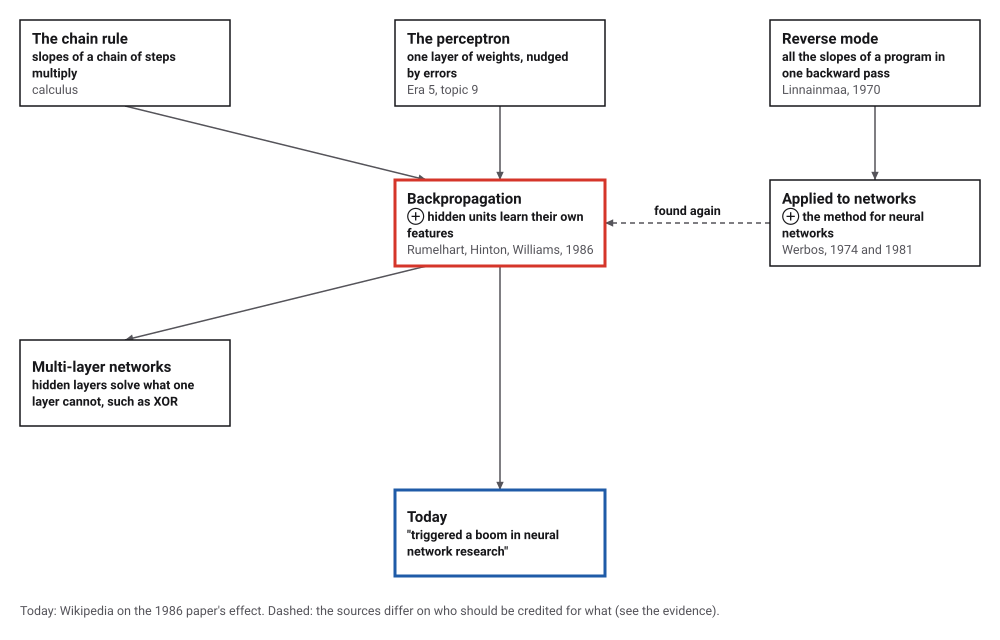
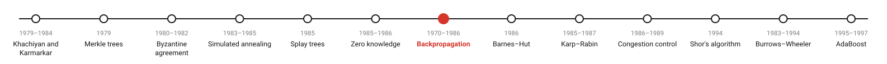
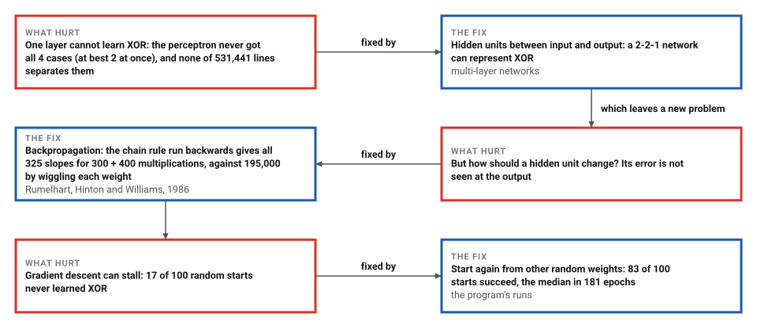
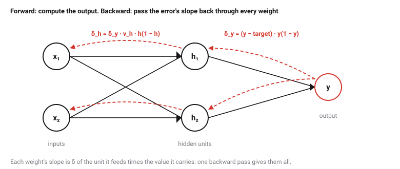
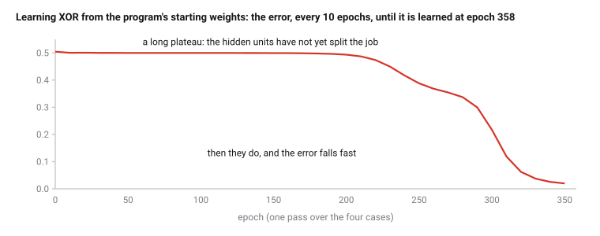

# Backpropagation

*Era 7 · topic 7 · 1970–1986* · [Era 7 index](../README.md) · [← Zero-Knowledge Proofs](../06-zero-knowledge/README.md) · [The Barnes–Hut Tree Code →](../08-barnes-hut/README.md) · [Interactive edition](backpropagation.html) · [Program](../../../code/era-07-randomness-networks-and-learning/07-backpropagation/)

> **Field note from the visiting historian.** I watched two hidden units learn exclusive-or. For two hundred epochs the error barely moved; then the units divided the work between them and the error fell to almost nothing by epoch 358. The method had been found several times; it took a four-page paper in 1986 for this species to notice it.

| | |
|---|---|
| **When** | 1970 (Linnainmaa); 1981 (Werbos); 1986 (Rumelhart, Hinton, Williams) |
| **Where** | Helsinki; the 1986 paper in Nature |
| **What hurt** | No well-known way to train hidden layers |
| **The fix** | The chain rule, backwards: every slope in one pass |
| **Checked** | 325 slopes agree with wiggling to 8.6 × 10⁻⁸ |

## How ideas combined

A new algorithm is usually an older idea combined with a new one. The perceptron (Era 5) learned one layer of weights. Networks with hidden layers could do more, but needed a way to tell each hidden weight how to change. The chain rule of calculus, run backwards through a computation, gives every slope at once; Linnainmaa described that for computer programs in 1970, Werbos applied it to networks, and Rumelhart, Hinton and Williams showed in 1986 what hidden units learn with it. Each box names the idea that was added.

<picture>
  <source media="(prefers-color-scheme: dark)" srcset="assets/family-dark.svg">
  
</picture>
*Red: the 1986 paper that made the method famous. Blue: what followed.*

## Teach a network exclusive-or

Two inputs, two hidden units, one output, all sigmoid, trained by backpropagation exactly as the program does it (rate 0.5, momentum 0.9), from the program's starting weights. The square shows the network's output for every input between 0 and 1: red above 0.5, blue below. XOR wants red at (0, 1) and (1, 0) and blue at (0, 0) and (1, 1), which no straight line can split. Train and watch: for a long time nothing seems to happen, then the hidden units divide the job and the colours snap into place. The widget repeats the program's arithmetic, so its error matches the program's at every tenth epoch. Then try random starts.

| Input | Target | Output after training |
|---|---|---|
| (0, 0) | 0 | 0.086 |
| (0, 1) | 1 | 0.900 |
| (1, 0) | 1 | 0.904 |
| (1, 1) | 0 | 0.081 |
*In the interactive edition you can train the network yourself and watch its output change.*

## Era 7, randomness, networks and learning

<picture>
  <source media="(prefers-color-scheme: dark)" srcset="assets/era-timeline-dark.svg">
  
</picture>

## Each fix leaves a new pain

<picture>
  <source media="(prefers-color-scheme: dark)" srcset="assets/chain-dark.svg">
  
</picture>
*Read it as a snake: each new problem sits directly under the fix that exposed it.*

## The chain rule, run backwards

**Forward.** Each unit adds its inputs times their weights, plus a bias, and squashes the sum with the sigmoid 1/(1 + e⁻ˢ). The error is half the sum of the squared misses.

**Backward.** The slope of the error with respect to the output unit's sum is δ_y = (y − target) · y(1 − y). A hidden unit's δ is the δ of the unit it feeds, times the weight between them, times its own h(1 − h). The slope for any weight is the δ of the unit it feeds times the value flowing through it. One backward pass computes every δ, so every slope, for about the cost of one more forward pass.

<picture>
  <source media="(prefers-color-scheme: dark)" srcset="assets/network-dark.svg">
  
</picture>

**Descent.** Move every weight a little against its slope (here with momentum: part of the previous step is repeated), and repeat over the training cases until the error is small.

> **Key idea.** To learn, every weight needs to know which way to move. Measuring that by wiggling each weight costs one run of the network per weight; the chain rule run backwards gets all of them for the price of about one run.

## Slopes, starts and a plateau

**One layer.** The perceptron rule learned AND in 5 epochs, but in 1,000 epochs never got all four XOR cases right (at best 2 at once); of 531,441 straight lines tried on a grid, the best put 3 of the 4 cases on the right side.

**The slopes.** In a network of 10 inputs, 20 hidden units and 5 outputs (325 weights), backpropagation took one forward run (300 multiplications) and one backward run (400); wiggling each weight up and down took 650 forward runs (195,000 multiplications). The two sets of 325 slopes agreed to a relative difference of at most 8.6 × 10⁻⁸.

**Random starts.** From 100 random starting weights in [−1, 1], 83 learned XOR within 5,000 epochs (the median after 181, the fastest 113, the slowest 768); the other 17 got stuck.

<picture>
  <source media="(prefers-color-scheme: dark)" srcset="assets/curve-dark.svg">
  
</picture>

| Input | Target | Output after training |
|---|---|---|
| (0, 0) | 0 | 0.086 |
| (0, 1) | 1 | 0.900 |
| (1, 0) | 1 | 0.904 |
| (1, 1) | 0 | 0.081 |

## Found several times, famous once

David Rumelhart, Geoffrey Hinton and Ronald Williams, "Learning representations by back-propagating errors" (*Nature* 323: 533–536, October 1986): "We describe a new learning procedure, back-propagation, for networks of neurone-like units." The abstract explains that adjusting the weights to reduce the output error makes hidden units come to represent important features of the task, which sets it apart from the perceptron-convergence procedure. Wikipedia's article on Williams says the paper "triggered a boom in neural network research".

The method had been found before. Linnainmaa's 1970 master's thesis at Helsinki "introduced the reverse mode of automatic differentiation", without reference to neural networks (Wikipedia). Schmidhuber's survey traces the idea to Kelley (1960), Bryson (1961) and Dreyfus (1962), dates "the first NN-specific application of efficient BP" to Werbos in 1981, and says the 1986 paper "significantly contributed to the popularisation of BP for NNs". Widrow and Lehr (1990) instead credit Werbos's 1974 dissertation with first publishing the method, note Parker's rediscovery (1982, MIT report 1985), and say Rumelhart, Hinton and Williams "also rediscovered the technique". The catalog marks the credit for 1974 **Disputed**.

## The perceptron, with depth

Era 5's perceptron adjusted its weights by the error at its single output. Backpropagation keeps that idea and passes the error back through any number of layers, so each hidden unit gets its share of the blame.

> **Full circle.** The perceptron could not learn XOR in 1,000 epochs. Two hidden units trained by backpropagation learned it in 358, from the starting weights shown above.

## Before you read on

<details>
<summary><b>1.</b> Why can no single layer learn XOR?</summary>

Its output is a threshold on a weighted sum, so it separates the plane with a straight line, and no line puts (0, 1) and (1, 0) on one side and (0, 0) and (1, 1) on the other.
</details>

<details>
<summary><b>2.</b> The output is 0.9 and the target 1. What is δ_y?</summary>

(0.9 − 1) × 0.9 × 0.1 = −0.009.
</details>

<details>
<summary><b>3.</b> A network has a million weights. How many forward runs does wiggling each weight need, and how many does backpropagation need?</summary>

Two million (up and down for each); backpropagation needs one forward and one backward run.
</details>

<details>
<summary><b>4.</b> Why does the error stay near 0.5 for a long time before falling?</summary>

At first both hidden units do nearly the same thing; only after small differences grow do they split the job, and then the error drops quickly.
</details>

<details>
<summary><b>5.</b> Some random starts never learn XOR. What can you do?</summary>

Start again from other random weights, or change the learning rate or the number of hidden units.
</details>


## Where the evidence lives

| | Object | Where to see it | Licence |
|---|---|---|---|
| — | **Learning representations by back-propagating errors (1986)**. *Nature* 323: 533–536, by Rumelhart, Hinton and Williams; the text was not opened for this book, only its record and abstract. | [The paper's record (ML Anthology)](https://mlanthology.org/misc/1986/rumelhart1986misc-learning) | Drawn placeholder. |

## Every link was opened before it was listed

| Level | Link | Why |
|---|---|---|
| Start | [Introduction to Neural Nets: videos](https://cs.wellesley.edu/~cs332/videos/Neural_Nets_videos.html) — Wellesley College CS 332, listing Grant Sanderson's 3Blue1Brown videos | "What is backpropagation really doing?" and "Backpropagation calculus", with suggested stopping points |
| Deeper | [30 Years of Adaptive Neural Networks](https://isl.stanford.edu/people/widrow/papers/j199030years.pdf) — B. Widrow, M. Lehr, *Proc. IEEE* (1990) | Perceptron, Madaline and backpropagation, by one of the field's pioneers |
| Deeper | [Deep Learning in Neural Networks: An Overview](https://arxiv.org/pdf/1404.7828) — J. Schmidhuber (2014) | Section 5.5 traces backpropagation from the 1960s to 1986 |
| Scholar | [Learning Representations by Back-Propagating Errors](https://mlanthology.org/misc/1986/rumelhart1986misc-learning) — D. Rumelhart, G. Hinton, R. Williams, *Nature* (1986), ML Anthology record | The abstract and full citation of the paper that made the method famous |

More, with certainty labels and the gaps we could not fill: [Era 7 reference catalog](https://github.com/vij658/AlgorithmEvolutionAtlas/blob/main/book/era-07-randomness-networks-and-learning/reference-catalog.md).

## The program behind every number here

[Backpropagation.java](https://github.com/vij658/AlgorithmEvolutionAtlas/blob/main/code/era-07-randomness-networks-and-learning/07-backpropagation/Backpropagation.java) makes **414 checks**: the perceptron on AND and XOR (and 531,441 lines, none separating XOR), 100 random starts on XOR, every one of 325 backpropagated slopes against wiggling the weight, and one XOR run from fixed weights. Run it with `java Backpropagation.java` (JDK 17 or newer). The heart of it:

```java
/** The error 1/2 sum (y - t)^2 over the four patterns, and its gradient by backpropagation. */
static double errorAndGradient(double[] w, double[] t, double[] grad) {
    Arrays.fill(grad, 0);
    double E = 0;
    double[] h = new double[2];
    for (int i = 0; i < 4; i++) {
        double[] x = INPUTS[i];
        double y = forward(w, x, h)[0];
        E += 0.5 * (y - t[i]) * (y - t[i]);
        double dy = (y - t[i]) * y * (1 - y);          // slope of E at the output unit's input sum
        grad[6] += dy * h[0]; grad[7] += dy * h[1]; grad[8] += dy;
        double dh0 = dy * w[6] * h[0] * (1 - h[0]);    // chain rule: back through the output weight
        double dh1 = dy * w[7] * h[1] * (1 - h[1]);
        grad[0] += dh0 * x[0]; grad[1] += dh0 * x[1]; grad[2] += dh0;
        grad[3] += dh1 * x[0]; grad[4] += dh1 * x[1]; grad[5] += dh1;
    }
    return E;
}
```

