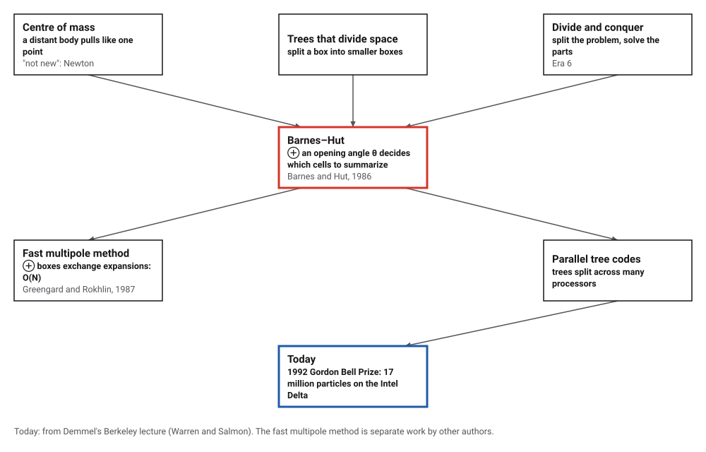
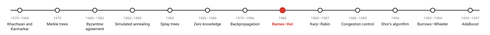
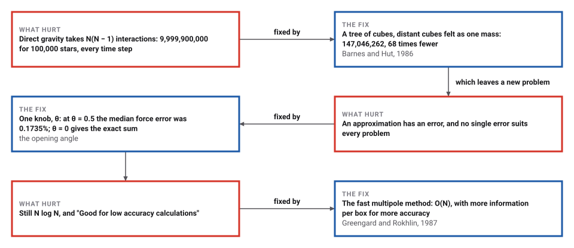
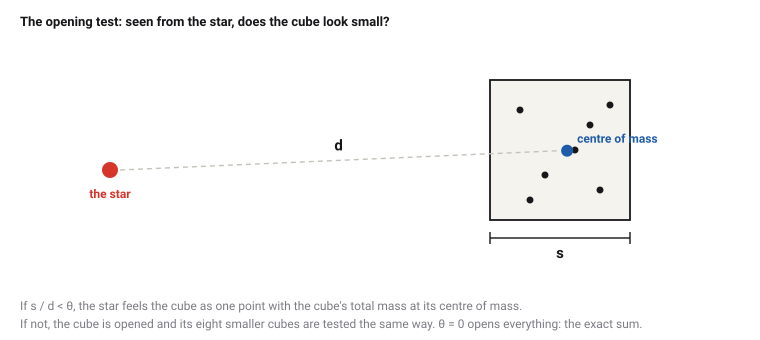

# The Barnes–Hut Tree Code

*Era 7 · topic 8 · 1986* · [Era 7 index](../README.md) · [← Backpropagation](../07-backpropagation/README.md) · [Karp–Rabin Fingerprints →](../09-karp-rabin/README.md) · [Interactive edition](barnes-hut.html) · [Program](../../../code/era-07-randomness-networks-and-learning/08-barnes-hut/)

> **Field note from the visiting historian.** For 100,000 stars, the direct sum needs 9,999,900,000 interactions per step. The tree needed 147,046,262, and each force came out within a fraction of a percent. This species learned to simulate its galaxies by agreeing not to look too closely at the far side.

| | |
|---|---|
| **When** | 1986 |
| **Where** | Published in Nature |
| **What hurt** | N(N − 1) interactions per time step |
| **The fix** | An octree; distant cubes as one mass; the opening angle θ |
| **Checked** | 68 times fewer interactions at N = 100,000 |

## How ideas combined

A new algorithm is usually an older idea combined with a new one. A distant crowd of stars pulls almost like one heavy star at its centre of mass, an approximation as old as Newton. Barnes and Hut made it systematic: a tree of cubes, each split into eight, and one rule (the opening angle θ) for when a cube is far enough away to be summarized. Each box names the idea that was added.

<picture>
  <source media="(prefers-color-scheme: dark)" srcset="assets/family-dark.svg">
  
</picture>
*Red: Barnes and Hut's step. Blue: where tree codes went.*

## Which cells does one star feel?

Four hundred stars in three clusters, in a quadtree (the flat version of Barnes and Hut's octree). The red star needs the pull of all the others. Each blue square is a whole cell that, seen from the red star, looks small enough (its width divided by its distance below θ) to be felt as one mass at its centre of mass, the blue ring; everything else is felt star by star. Move θ, click other stars, and compare the number of interactions and the error with the exact sum. These are the widget's own stars, so its numbers are not the program's.

| θ | Interactions per star | Median force error | 99th percentile |
|---|---|---|---|
| 0.2 | 4,075 | 0.0162% | 0.067% |
| 0.3 | 2,352 | 0.0461% | 0.239% |
| 0.5 | 954 | 0.1735% | 1.054% |
| 0.7 | 470 | 0.4214% | 2.654% |
| 1.0 | 235 | 1.2258% | 8.331% |
*In the interactive edition you can choose a star and change θ, and see which cells it feels as one mass.*

## Era 7, randomness, networks and learning

<picture>
  <source media="(prefers-color-scheme: dark)" srcset="assets/era-timeline-dark.svg">
  
</picture>

## Each fix leaves a new pain

<picture>
  <source media="(prefers-color-scheme: dark)" srcset="assets/chain-dark.svg">
  
</picture>
*Read it as a snake: each new problem sits directly under the fix that exposed it.*

## A tree of cubes

**Build.** Put all the stars in one box. Split any box holding more than one star into eight equal cubes, and repeat until every cube holds at most one star. Each cube records its total mass and its centre of mass.

**Walk.** To find the pull on one star, start at the top:

<picture>
  <source media="(prefers-color-scheme: dark)" srcset="assets/criterion-dark.svg">
  
</picture>

A star meets a few cubes at each level of the tree, so it feels about log N of them instead of N − 1 stars, and a whole time step costs about N log N.

> **Key idea.** You do not need to know every star in a far-away cluster to feel its pull: its total mass and centre are enough. A tree lets each star decide, cube by cube, how much detail it needs.

## Interactions and errors

**The tree.** 2,000 stars in a Plummer sphere (a standard model of a star cluster) gave a tree of 2,961 cubes, 10 levels deep. With θ = 0 every cube is opened: 3,998,000 interactions, exactly N(N − 1), and forces equal to the direct sum to a relative difference of 2.4 × 10⁻¹⁴.

**Interactions,** θ = 0.5. The direct count per star grows like N; the tree's grows far more slowly:

| Stars N | Direct, per star | Tree, per star | Times fewer |
|---|---|---|---|
| 1,000 | 999 | 353 | 3 |
| 3,000 | 2,999 | 615 | 5 |
| 10,000 | 9,999 | 959 | 10 |
| 30,000 | 29,999 | 1,241 | 24 |
| 100,000 | 99,999 | 1,470 | 68 |

**Accuracy,** 10,000 stars, every star's tree force against the exact sum:

| θ | Interactions per star | Median force error | 99th percentile |
|---|---|---|---|
| 0.2 | 4,075 | 0.0162% | 0.067% |
| 0.3 | 2,352 | 0.0461% | 0.239% |
| 0.5 | 954 | 0.1735% | 1.054% |
| 0.7 | 470 | 0.4214% | 2.654% |
| 1.0 | 235 | 1.2258% | 8.331% |

## A letter to Nature

Josh Barnes and Piet Hut, "A hierarchical O(N log N) force-calculation algorithm", *Nature* 324 (6096): 446–449, published 4 December 1986, a letter. Wikipedia's account: the method "is notable for having order O(n log n) compared to a direct-sum algorithm which would be O(n2)"; "The space is recursively subdivided into octants until each subdivision contains 0 or 1 bodies"; a cell is far enough away when the ratio of its width to its distance is "smaller than a threshold value θ"; "larger values of θ increase the speed of the simulation but decreases its accuracy", and with θ = 0 it "degenerates to a direct-sum algorithm".

Demmel's Berkeley lecture (2016) calls Barnes–Hut "An O(N log N) approximate algorithm for the N-Body problem", "Good for low accuracy calculations", and Greengard and Rokhlin's fast multipole method (1987) "An O(N) approximate algorithm", noting that the centre-of-mass approximation is "not new", going back to Newton, and that Warren and Salmon won the 1992 Gordon Bell Prize for a 17-million-particle simulation. Greengard's Wikipedia article says the fast multipole method is "recognized as one of the top-ten algorithms of the 20th century". The NEMO toolkit still distributes a tree code by Joshua E. Barnes, `hackforce`, whose opening tolerance defaults to 1.0.

## Divide and conquer, in space

Era 6's fast algorithms split a problem into halves (the FFT) or blocks (Strassen) and combined the answers. Barnes and Hut split space itself, and combine not answers but summaries: a mass and a centre for each cube.

> **Full circle.** For 100,000 stars the direct sum needs 9,999,900,000 interactions per step; the tree, 147,046,262. The cost of that saving, at θ = 0.5, is a median error of 0.1735% in each force.

## Before you read on

<details>
<summary><b>1.</b> A cube 1 light-year wide is 10 light-years away. Is it opened at θ = 0.5?</summary>

No: s/d = 0.1 < 0.5, so it is felt as one mass.
</details>

<details>
<summary><b>2.</b> What happens with θ = 0?</summary>

No cube passes the test, so every cube is opened down to single stars: the exact direct sum.
</details>

<details>
<summary><b>3.</b> Doubling N roughly doubles the direct work per star. What does it do to the tree's work per star?</summary>

Adds roughly a constant: in the program, 100 times more stars took about 4 times more interactions per star.
</details>

<details>
<summary><b>4.</b> Why does the error grow with θ?</summary>

Larger θ summarizes nearer and bigger cubes, where the centre-of-mass approximation is cruder.
</details>

<details>
<summary><b>5.</b> Why would astronomers accept any error at all?</summary>

Because the direct sum limited simulations to a few thousand stars, far too few to look like a galaxy; a small, controlled error buys many more stars.
</details>


## Where the evidence lives

| | Object | Where to see it | Licence |
|---|---|---|---|
| — | **Barnes and Hut's letter (1986)**. *Nature* 324: 446–449, 4 December 1986; only its record was opened for this book. | [A saved copy of the Nature page](https://isidore.co/misc/Physics%20papers%20and%20books/Zotero/storage/IMT92TIC/324446a0.html) | Drawn placeholder. |
| — | **hackforce, a tree code by J. E. Barnes**. Part of the NEMO stellar dynamics toolkit. | [The manual page](https://bima.astro.umd.edu/nemo/man_html/hackforce.1.html) | Drawn placeholder. |

## Every link was opened before it was listed

| Level | Link | Why |
|---|---|---|
| Start | [Barnes–Hut simulation](https://en.wikipedia.org/wiki/Barnes%E2%80%93Hut_simulation) — Wikipedia | The tree, the opening angle, and the speed–accuracy trade-off |
| Start | [The Barnes-Hut Galaxy Simulator](https://beltoforion.de/en/barnes-hut-galaxy-simulator/) — Ingo Berg | Diagrams, pseudocode, an animation of θ and a video of two colliding galaxies (its remarks on θ are not consistent throughout) |
| Deeper | [Hierarchical Methods for the N-Body problem](https://people.eecs.berkeley.edu/%7Edemmel/cs267_Spr16/Lectures/lecture25_NBody_jwd16_4pp.pdf) — J. Demmel, UC Berkeley CS 267 (2016) | Barnes–Hut beside the fast multipole method, and running both in parallel |
| Scholar | [hackforce manual page](https://bima.astro.umd.edu/nemo/man_html/hackforce.1.html) — NEMO toolkit, J. E. Barnes | A working tree code by one of the inventors, still distributed |

More, with certainty labels and the gaps we could not fill: [Era 7 reference catalog](https://github.com/vij658/AlgorithmEvolutionAtlas/blob/main/book/era-07-randomness-networks-and-learning/reference-catalog.md).

## The program behind every number here

[BarnesHut.java](https://github.com/vij658/AlgorithmEvolutionAtlas/blob/main/code/era-07-randomness-networks-and-learning/08-barnes-hut/BarnesHut.java) makes **2,022 checks**: the exact forces with θ = 0 on 2,000 stars, the interaction counts for 1,000 to 100,000 stars, and the force error of every one of 10,000 stars at five values of θ. Run it with `java BarnesHut.java` (JDK 17 or newer). The heart of it:

```java
/** The acceleration on star b from the tree, opening cubes with s / d >= theta. */
static void force(Cell c, int b, double theta, double[] acc) {
    if (c.mass == 0 || c.body == b) return;
    double gx = c.mx / c.mass, gy = c.my / c.mass, gz = c.mz / c.mass;
    double dx = gx - pos[b][0], dy = gy - pos[b][1], dz = gz - pos[b][2];
    double d2 = dx * dx + dy * dy + dz * dz;
    if (c.child == null || 4 * c.half * c.half < theta * theta * d2) {     // width^2 = 4 half^2; (s/d)^2 < theta^2
        if (c.child != null || c.body != b) {
            double inv = 1 / Math.sqrt(d2 + SOFT2);
            double f = c.mass * inv * inv * inv;
            acc[0] += f * dx; acc[1] += f * dy; acc[2] += f * dz;
            interactions++;
        }
        return;
    }
    for (Cell ch : c.child) if (ch != null) force(ch, b, theta, acc);
}
```

