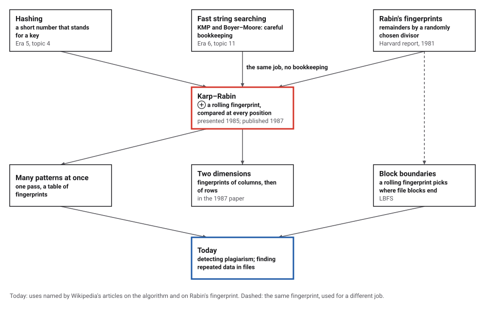
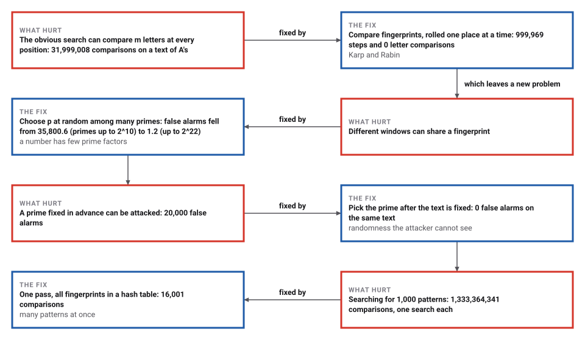
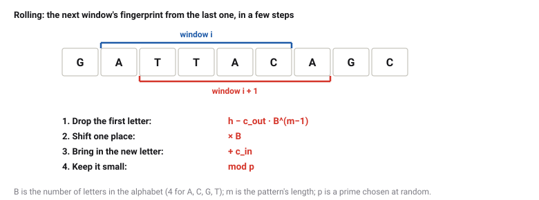

# Karp–Rabin Fingerprints

*Era 7 · topic 9 · 1985–1987* · [Era 7 index](../README.md) · [← The Barnes–Hut Tree Code](../08-barnes-hut/README.md) · [TCP Congestion Control →](../10-tcp-congestion-control/README.md) · [Interactive edition](karp-rabin.html) · [Program](../../../code/era-07-randomness-networks-and-learning/09-karp-rabin/)

> **Field note from the visiting historian.** An adversary built a text for the prime 101, and it raised 20,000 false alarms. I chose a prime at random after reading the text, and the same text raised 0. This species discovered that a coin tossed at the right moment beats any opponent who has to move first.

| | |
|---|---|
| **When** | Presented 1985; published 1987 |
| **Where** | IBM Journal of Research and Development |
| **What hurt** | Intricate preprocessing; m × n comparisons at worst |
| **The fix** | Rolling fingerprints modulo a random prime |
| **Checked** | 31,999,008 comparisons became 0 |

## How ideas combined

A new algorithm is usually an older idea combined with a new one. Knuth, Morris, Pratt, Boyer and Moore (Era 6) searched text fast by careful bookkeeping about the pattern. Hashing (Era 5) had long turned keys into short numbers. Rabin had shown in 1981 that remainders by a randomly chosen divisor make fingerprints that are hard to fool. Karp and Rabin made the fingerprint roll along the text, one letter at a time. Each box names the idea that was added.

<picture>
  <source media="(prefers-color-scheme: dark)" srcset="assets/family-dark.svg">
  
</picture>
*Red: Karp and Rabin's step. Blue: where rolling fingerprints are used.*

## Fingerprints under every window

Type a text and a pattern. Under each letter is the fingerprint of the window that starts there: the window's characters read as one big number (each character a digit in base 256) and reduced modulo the prime p. Letters are compared only where a window's fingerprint equals the pattern's: blue for a true match, red for a false alarm. With p = 7 or 13 false alarms are everywhere; with a larger prime they vanish. The program uses an alphabet of 4 letters and random primes below 2³¹.

| Primes up to | How many primes | False alarms (mean of 20) | Bound |
|---|---|---|---|
| 2^10 | 172 | 35,800.6 | 87,207 |
| 2^14 | 1,900 | 1,395.5 | 7,894 |
| 2^18 | 23,000 | 17.4 | 652 |
| 2^22 | 295,947 | 1.2 | 51 |
*In the interactive edition you can type a text and a pattern and change the prime.*

## Era 7, randomness, networks and learning

<picture>
  <source media="(prefers-color-scheme: dark)" srcset="assets/era-timeline-dark.svg">
  
</picture>

## Each fix leaves a new pain

<picture>
  <source media="(prefers-color-scheme: dark)" srcset="assets/chain-dark.svg">
  
</picture>
*Read it as a snake: each new problem sits directly under the fix that exposed it.*

## Compare numbers, not letters

**A fingerprint.** Read the m letters of the pattern as the digits of one big number, and keep its remainder modulo a prime p. Do the same for each window of m letters in the text.

<picture>
  <source media="(prefers-color-scheme: dark)" srcset="assets/roll-dark.svg">
  
</picture>

**Why a random prime.** Two different windows have the same fingerprint only if p divides the difference of the two numbers. A number below 2⁶⁴ has at most 15 different prime factors, so if p is chosen at random from a large set of primes, after the text is written, the chance that it happens to be one of those few is tiny, for every window, whatever the text. A prime fixed in advance has no such protection: knowing it, one can write a text full of collisions.

**Extensions.** Put the fingerprints of many patterns in a hash table and check each window against all of them in one pass. In two dimensions, roll fingerprints down each column of the grid, then roll the column fingerprints across each row.

> **Key idea.** Randomness chosen after the input is fixed cannot be exploited by whoever chose the input. A cheap fingerprint plus a random prime turns "probably the same" into "the same", with a check only when it matters.

## A million letters

**One pattern,** 32 letters, in 1,000,000 random letters A, C, G, T: the obvious method made 1,334,853 letter comparisons; fingerprints modulo the random prime 1,089,796,921 took 999,969 rolling steps, 32 letter comparisons and 0 false alarms, and found 1 match. On a text of 1,000,000 A's with the pattern AAA…AC, the obvious method made 31,999,008 comparisons (m at every position); the fingerprints 999,969 rolling steps and 0 comparisons.

**False alarms against the size of the prime,** a 32-letter pattern that does not occur, 20 random primes of each size; the bound is positions × 15 / (number of primes):

| Primes up to | How many primes | False alarms (mean of 20) | Bound |
|---|---|---|---|
| 2^10 | 172 | 35,800.6 | 87,207 |
| 2^14 | 1,900 | 1,395.5 | 7,894 |
| 2^18 | 23,000 | 17.4 | 652 |
| 2^22 | 295,947 | 1.2 | 51 |

**The adversary.** A text of 640,000 letters built from 20,000 copies of the pattern, each with its last 4 letters changed so that the fingerprint modulo 101 is unchanged. With p = 101: 20,000 false alarms and 580,000 letter comparisons. With a prime chosen at random afterwards (615,568,903): 0 false alarms, 0 comparisons.

**Many patterns.** 1,000 patterns of 32 letters, half copied from the text: one pass with all their fingerprints in a hash table took 999,969 rolling steps and 16,001 letter comparisons and found all 500 that occur; 1,000 separate searches by the obvious method made 1,333,364,341 comparisons.

**Two dimensions.** A 16 × 16 block copied from row 613, column 271 of a 1,000 × 1,000 grid of random letters: 1,954,225 rolling steps, 1 window checked letter by letter, found in the right place. Here the obvious method made only 1,292,953 letter comparisons, because random letters mismatch at once; fingerprints pay off when many windows look alike.

## Fingerprints, not strings

Richard Karp and Michael Rabin, "Efficient randomized pattern-matching algorithms" (*IBM Journal of Research and Development* 31(2): 249–260, 1987, from a conference held on 1 December 1985 at Yorktown Heights): randomized algorithms for finding a pattern in a text that work on much shorter fingerprints of the strings, use a constant amount of storage, run essentially in real time, are simple to implement, and extend to higher-dimensional pattern matching (summarized from the abstract in the Hebrew University's record).

Wikipedia: the algorithm "uses a rolling hash to quickly filter out positions of the text that cannot match the pattern"; its expected time is "linear in the combined length of the pattern and text" and its worst case "the product of the two lengths"; it is "a useful algorithm for multiple pattern search"; "A practical application of the algorithm is detecting plagiarism"; and "the hash function should be selected randomly from a family of hash functions". Rabin's fingerprint (1981) divides by a randomly chosen irreducible polynomial; LBFS uses it to "implement variable size shift-resistant blocks".

Lecture notes on fingerprinting (CS 174, 2007) give the argument this page uses: "pick a random prime p ∈ {2, ..., T}", a false match needs p to divide the difference, and "the number of primes that divide any given n-bit number is at most π(n)".

## String search, again

Era 6 made string search fast by knowing the pattern well. Karp and Rabin make it fast by knowing the pattern hardly at all, a single number, and by leaving the choice of prime to chance.

> **Full circle.** On the worst text for the obvious method, 31,999,008 letter comparisons became 0; on an attacker's text built for p = 101, 20,000 false alarms became 0 once the prime was chosen at random.

## Before you read on

<details>
<summary><b>1.</b> With p = 13, about what fraction of non-matching windows will be false alarms?</summary>

About 1 in 13, if the fingerprints are spread evenly.
</details>

<details>
<summary><b>2.</b> Why must the prime be chosen after the text is fixed?</summary>

If the text's author knows p, they can make many windows' numbers differ from the pattern's by multiples of p.
</details>

<details>
<summary><b>3.</b> How does the fingerprint of the next window come from the last one?</summary>

Subtract the first letter times B^(m−1), multiply by B, add the new letter, take the remainder modulo p.
</details>

<details>
<summary><b>4.</b> Why is a false alarm harmless to the answer?</summary>

Every fingerprint match is checked letter by letter, so a false alarm costs time but never gives a wrong result.
</details>

<details>
<summary><b>5.</b> Searching for 1,000 patterns at once: what makes one pass enough?</summary>

Each window's fingerprint is looked up in a table of all the patterns' fingerprints, so one rolling pass serves them all.
</details>


## Where the evidence lives

| | Object | Where to see it | Licence |
|---|---|---|---|
| — | **Efficient randomized pattern-matching algorithms (1987)**. *IBM Journal of Research and Development* 31(2): 249–260; the text was not opened for this book. | [The paper's record (Hebrew University)](https://cris.huji.ac.il/en/publications/efficient-randomized-pattern-matching-algorithms/) | Drawn placeholder. |

## Every link was opened before it was listed

| Level | Link | Why |
|---|---|---|
| Start | [Rabin–Karp algorithm](https://en.wikipedia.org/wiki/Rabin%E2%80%93Karp_algorithm) — Wikipedia | Rolling hashes, worked examples, many patterns |
| Deeper | [Fingerprinting & Applications](https://www.cs.ox.ac.uk/people/varun.kanade/teaching/CS174-Fall2012/fingerprint.pdf) — CS 174 lecture notes (2007) | Why a random prime makes false matches unlikely, with the counting argument |
| Deeper | [Rabin fingerprint](https://en.wikipedia.org/wiki/Rabin_fingerprint) — Wikipedia | The polynomial version, and its use for finding block boundaries in file systems |
| Scholar | [Efficient randomized pattern-matching algorithms](https://cris.huji.ac.il/en/publications/efficient-randomized-pattern-matching-algorithms/) — R. Karp, M. Rabin, *IBM J. Res. Dev.* (1987), Hebrew University record | Citation and abstract of the paper |

More, with certainty labels and the gaps we could not fill: [Era 7 reference catalog](https://github.com/vij658/AlgorithmEvolutionAtlas/blob/main/book/era-07-randomness-networks-and-learning/reference-catalog.md).

## The program behind every number here

[KarpRabin.java](https://github.com/vij658/AlgorithmEvolutionAtlas/blob/main/code/era-07-randomness-networks-and-learning/09-karp-rabin/KarpRabin.java) makes **20,092 checks**: a search in a million letters and the worst case for the obvious method, false alarms for 80 random primes against the prime-counting bound, an attacker's text against a fixed and a random prime, 1,000 patterns in one pass (each checked against its own search), and a block in a million-letter grid. Run it with `java KarpRabin.java` (JDK 17 or newer). The heart of it:

```java
/** Karp-Rabin with modulus p, base 4: returns the number of true matches; counts false alarms and comparisons. */
static int karpRabin(byte[] t, byte[] pat, long p) {
    int m = pat.length, count = 0;
    long hp = 0, ht = 0, top = 1;                                   // top = 4^(m-1) mod p
    for (int j = 0; j < m; j++) { hp = (hp * 4 + pat[j]) % p; ht = (ht * 4 + t[j]) % p; if (j > 0) top = top * 4 % p; }
    for (int i = 0; i + m <= t.length; i++) {
        if (i > 0) {                                                 // roll: drop t[i-1], bring in t[i+m-1]
            ht = (ht + p - t[i - 1] * top % p) % p;
            ht = (ht * 4 + t[i + m - 1]) % p;
        }
        hashSteps++;
        if (ht == hp) {
            int j = 0;
            while (j < m) { comparisons++; if (t[i + j] != pat[j]) break; j++; }
            if (j == m) count++; else falseAlarms++;
        }
    }
    return count;
}
```

