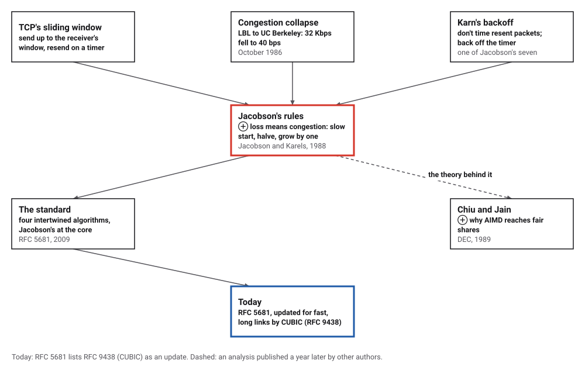
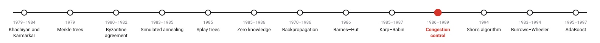
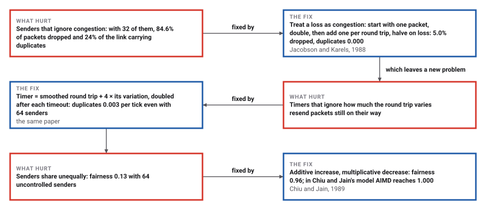
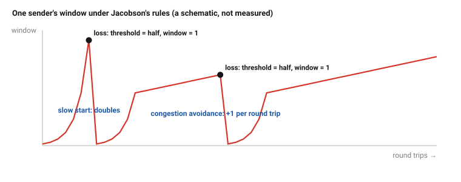

# TCP Congestion Control

*Era 7 · topic 10 · 1986–1989* · [Era 7 index](../README.md) · [← Karp–Rabin Fingerprints](../09-karp-rabin/README.md) · [Shor's Factoring Algorithm →](../11-shor-factoring/README.md) · [Interactive edition](tcp-congestion-control.html) · [Program](../../../code/era-07-randomness-networks-and-learning/10-tcp-congestion-control/)

> **Field note from the visiting historian.** I watched 32 uncontrolled senders lose 84.6% of their packets and spend 24% of the link on copies. With Jacobson's rules they lost 5.0%, kept the link full, and shared it almost equally, without exchanging a single word.

| | |
|---|---|
| **When** | Collapse 1986; paper 1988; analysis 1989 |
| **Where** | Lawrence Berkeley Laboratory and UC Berkeley; DEC |
| **What hurt** | Congestion collapse: losses, timeouts and duplicate packets |
| **The fix** | Slow start, AIMD, variance-based timers |
| **Checked** | 32 senders: 84.6% dropped became 5.0% |

## How ideas combined

A new algorithm is usually an older idea combined with a new one. TCP already sent as much as the receiver allowed and resent anything not acknowledged in time. In October 1986 that brought the early Internet to a standstill. Jacobson and Karels added one idea: a lost packet is a sign that the network is overloaded, so slow down. Chiu and Jain explained a year later why the particular way of slowing down they chose leads to fair shares. Each box names the idea that was added.

<picture>
  <source media="(prefers-color-scheme: dark)" srcset="assets/family-dark.svg">
  
</picture>
*Red: Jacobson's rules. Blue: the standard today.*

## Two senders, one link

Chiu and Jain's picture. The horizontal axis is sender 1's rate, the vertical sender 2's; the black line is full use of the link, the dashed blue line equal shares. Each step both senders learn only one bit, over or under capacity, and both apply the same rule: increase by adding 0.01 or multiplying by 1.05; decrease by subtracting 0.02 or halving. Starting from (0.1, 0.6), run each rule for 2,000 steps: only additive increase with multiplicative decrease (AIMD) ends at equal shares. The widget repeats the program's arithmetic, so from that start its averages equal the program's. Click anywhere to start elsewhere.

| Rule | Fairness | Total use | Ending at |
|---|---|---|---|
| AIMD | 1.000 | 0.750 | (0.330, 0.330) |
| AIAD | 0.793 | 0.980 | (0.240, 0.740) |
| MIMD | 0.662 | 0.742 | (0.147, 0.883) |
| MIAD | 0.500 | 1.016 | (0.000, 1.003) |
*In the interactive edition you can run the four rules from any starting point.*

## Era 7, randomness, networks and learning

<picture>
  <source media="(prefers-color-scheme: dark)" srcset="assets/era-timeline-dark.svg">
  
</picture>

## Each fix leaves a new pain

<picture>
  <source media="(prefers-color-scheme: dark)" srcset="assets/chain-dark.svg">
  
</picture>
*Read it as a snake: each new problem sits directly under the fix that exposed it.*

## Loss means slow down

**Conservation of packets.** In Jacobson's words, "A new packet isn't put into the network until an old packet leaves." Acknowledgements clock the sender: each one that returns makes room for one more packet.

**The window.** Keep a congestion window, cwnd: at most that many packets in flight. *Slow start:* begin at one packet and add one for every acknowledgement, which doubles the window every round trip. *Congestion avoidance:* past a threshold, add one packet per round trip. *On a loss:* set the threshold to half the window and start again from one packet. *Fast retransmit:* three duplicate acknowledgements mean a packet was lost, so resend it at once without waiting for the timer.

<picture>
  <source media="(prefers-color-scheme: dark)" srcset="assets/sawtooth-dark.svg">
  
</picture>

**The timer.** Measure the round trip, keep a smoothed average and a smoothed variation, and wait the average plus four times the variation; after each timeout, double the wait. Never time a packet that was resent (Karn), since its acknowledgement may belong to either copy.

> **Key idea.** A network has no central controller, but every sender can infer congestion from its own losses. If every sender backs off by halving and probes by adding, they share the link fully and fairly without ever talking to each other.

## One bottleneck, many senders

**The simulation.** Senders share one link that carries 1 packet per tick, behind a 120-packet buffer; a round trip takes 41 ticks when the queue is empty; 50,000 ticks were measured after 10,000 to settle. *Useful:* new packets delivered per tick (at most 1). *Duplicates:* copies of packets already delivered, per tick. *Fairness:* Jain's index of the senders' useful rates, 1 when equal. Without congestion control: a fixed window of 32 packets, a timer of twice the smoothed round trip, and everything resent from the oldest unacknowledged packet on a timeout. With Jacobson's rules: slow start, congestion avoidance, fast retransmit and the variance-based timer with backoff.

| Senders | Fixed: useful | duplicates | dropped | fairness | Jacobson: useful | duplicates | dropped | fairness |
|---|---|---|---|---|---|---|---|---|
| 1 | 0.800 | 0.000 | 0.0% | 1.00 | 1.000 | 0.000 | 0.0% | 1.00 |
| 2 | 1.000 | 0.000 | 0.0% | 1.00 | 1.000 | 0.000 | 0.0% | 1.00 |
| 4 | 1.000 | 0.000 | 0.0% | 1.00 | 1.000 | 0.000 | 0.2% | 1.00 |
| 8 | 0.966 | 0.034 | 21.0% | 0.69 | 1.000 | 0.000 | 0.5% | 1.00 |
| 16 | 0.862 | 0.138 | 49.8% | 0.62 | 1.000 | 0.000 | 1.8% | 0.99 |
| 32 | 0.760 | 0.240 | 84.6% | 0.35 | 1.000 | 0.000 | 5.0% | 0.97 |
| 64 | 0.848 | 0.152 | 93.1% | 0.13 | 0.997 | 0.003 | 11.4% | 0.96 |

With 32 senders the uncontrolled ones lost 84.6% of what they sent and filled 24% of the link with duplicates; Jacobson's lost 5.0% and sent almost no duplicates. This small model shows the mechanism, not the thousandfold collapse of 1986: a single link loses no capacity to packets dropped before it.

**Chiu and Jain's model,** two users starting at (0.1, 0.6), averaged over the last 200 of 2,000 steps:

| Rule | Fairness | Total use | Ending at |
|---|---|---|---|
| AIMD | 1.000 | 0.750 | (0.330, 0.330) |
| AIAD | 0.793 | 0.980 | (0.240, 0.740) |
| MIMD | 0.662 | 0.742 | (0.147, 0.883) |
| MIAD | 0.500 | 1.016 | (0.000, 1.003) |

## From 32 kilobits to 40 bits

Van Jacobson (Lawrence Berkeley Laboratory) and Michael Karels (University of California at Berkeley), "Congestion Avoidance and Control" (SIGCOMM '88; revised November 1988): "In October of '86, the Internet had the first of what became a series of 'congestion collapses'"; "the data throughput from LBL to UC Berkeley" "dropped from 32 Kbps to 40 bps". The paper lists seven new algorithms, from "(i) round-trip-time variance estimation" and "(iii) slow-start" to "(vi) Karn's clamped retransmit backoff" and "(vii) fast retransmit", and states the rules: "On any timeout, set cwnd to half the current window size (this is the multiplicative decrease)"; "On each ack for new data, increase cwnd by 1/cwnd (this is the additive increase)."

Dah-Ming Chiu and Raj Jain (Digital Equipment Corporation), "Analysis of the Increase and Decrease Algorithms for Congestion Avoidance in Computer Networks" (*Computer Networks and ISDN Systems* 17, 1989): "a simple additive increase and multiplicative decrease algorithm satisfies the sufficient conditions for convergence to an efficient and fair state regardless of the starting state of the network", shown with "a trajectory through an n-dimensional vector space". Byers's seminar notes add that the paper proves sufficiency, not necessity, and assumes synchronous feedback.

RFC 5681 (2009), the Internet standard, "defines TCP's four intertwined congestion control algorithms" (slow start, congestion avoidance, fast retransmit and fast recovery) and says "The core algorithms we describe were developed by Van Jacobson".

## Agreement without a referee

This era's Byzantine generals (topic 3) agree by exchanging many messages. TCP's senders exchange none at all with each other, yet they converge on sharing a link equally, because each reacts to the same signal, loss, with the same rule.

> **Full circle.** Two users who learn only "over" or "under" each step, starting at 0.1 and 0.6: with AIMD they end at (0.330, 0.330), fairness 1.000.

## Before you read on

<details>
<summary><b>1.</b> Slow start begins at 1 packet. How large is the window after 5 round trips without loss?</summary>

32 packets: it doubles every round trip.
</details>

<details>
<summary><b>2.</b> Why halve on a loss rather than subtract one?</summary>

Multiplicative decrease shrinks large senders more than small ones, which pulls them towards equal shares; it also backs off fast enough to drain a queue.
</details>

<details>
<summary><b>3.</b> In AIAD, why does the difference between the senders never change?</summary>

Both add or subtract the same amount at every step.
</details>

<details>
<summary><b>4.</b> Why should a resent packet not be used to time the round trip?</summary>

Its acknowledgement could answer the original or the copy, so the measurement could be wildly wrong (Karn's rule).
</details>

<details>
<summary><b>5.</b> The average round trip is 100 ms and its variation 10 ms. What is the timer?</summary>

100 + 4 × 10 = 140 ms; after a timeout, 280 ms.
</details>


## Where the evidence lives

| | Object | Where to see it | Licence |
|---|---|---|---|
| — | **Congestion Avoidance and Control (1988)**. Jacobson and Karels, revised November 1988. | [The paper (PDF, on a Princeton course page)](https://www.cs.princeton.edu/courses/archive/fall08/cos561/papers/jacobson88.pdf) | Drawn placeholder. |
| — | **RFC 5681, TCP Congestion Control (2009)**. The standard that carries Jacobson's algorithms. | [RFC 5681](https://rfc-editor.org/rfc/rfc5681) | Drawn placeholder. |

## Every link was opened before it was listed

| Level | Link | Why |
|---|---|---|
| Start | [CS791 notes: Chiu–Jain and Jacobson](https://cs-web.bu.edu/fac/byers/courses/791/F99/scribe_notes/cs791-notes-990914.html) — J. Byers, Boston University (1999) | A short walk through both papers, with their weak points |
| Deeper | [RFC 5681: TCP Congestion Control](https://rfc-editor.org/rfc/rfc5681) — IETF (2009) | The rules as the Internet standard states them today |
| Scholar | [Congestion Avoidance and Control](https://www.cs.princeton.edu/courses/archive/fall08/cos561/papers/jacobson88.pdf) — V. Jacobson, M. Karels (1988) | The collapse, the seven algorithms, and the reasoning behind them |
| Scholar | [Analysis of the Increase and Decrease Algorithms for Congestion Avoidance](https://sites.cs.ucsb.edu/~ravenben/classes/papers/cj89.pdf) — D.-M. Chiu, R. Jain, *Computer Networks and ISDN Systems* (1989) | Why additive increase and multiplicative decrease converge to fairness |

More, with certainty labels and the gaps we could not fill: [Era 7 reference catalog](https://github.com/vij658/AlgorithmEvolutionAtlas/blob/main/book/era-07-randomness-networks-and-learning/reference-catalog.md).

## The program behind every number here

[TcpCongestion.java](https://github.com/vij658/AlgorithmEvolutionAtlas/blob/main/code/era-07-randomness-networks-and-learning/10-tcp-congestion-control/TcpCongestion.java) makes **27 checks**: a packet-level simulation of 1 to 64 senders, both kinds, with the link's capacity and the measured useful rate checked in every run, and Chiu and Jain's four rules from the same start. Run it with `java TcpCongestion.java` (JDK 17 or newer). The heart of it:

```java
static void onAck(Sender x, int ack, long t) {
    if (ack > x.base) {
        int newly = ack - x.base;
        x.base = ack;
        if (x.next < x.base) x.next = x.base;
        if (x.timedSeq >= 0 && ack > x.timedSeq) {           // a round-trip sample
            double r = t - x.timedAt;
            if (x.srtt < 0) { x.srtt = r; x.rttvar = r / 2; }
            else { x.rttvar += 0.25 * (Math.abs(r - x.srtt) - x.rttvar); x.srtt += 0.125 * (r - x.srtt); }
            x.rto = x.tahoe ? x.srtt + 4 * x.rttvar : 2 * x.srtt;
            x.timedSeq = -1;
        }
        if (x.tahoe) for (int k = 0; k < newly; k++) x.cwnd += x.cwnd < x.ssthresh ? 1 : 1 / x.cwnd;
        x.dupacks = 0;
        x.timer = x.base < x.next ? t + (long) x.rto : -1;
    } else if (ack == x.base && x.base < x.next && x.tahoe) {
        if (++x.dupacks == 3) {                              // fast retransmit
            x.ssthresh = Math.max(Math.min(x.cwnd, 64) / 2, 2);
            x.cwnd = 1;
            x.next = x.base;
            x.timedSeq = -1;
            x.timer = t + (long) x.rto;
        }
    }
}

static void onTimeout(Sender x, long t) {
    x.timeouts++;
    x.next = x.base;                                         // go back and resend from the oldest lost packet
    x.timedSeq = -1;
    if (x.tahoe) {
        x.ssthresh = Math.max(Math.min(x.cwnd, 64) / 2, 2);
        x.cwnd = 1;
        x.rto = Math.min(x.rto * 2, 64.0 * BASE_RTT);        // exponential backoff
    }
    x.timer = t + (long) x.rto;
    x.dupacks = 0;
}
```

