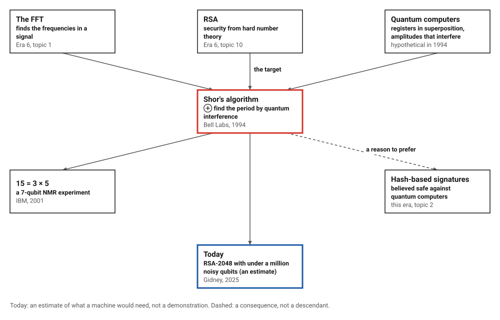
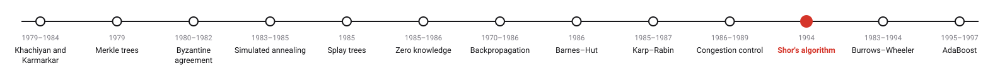
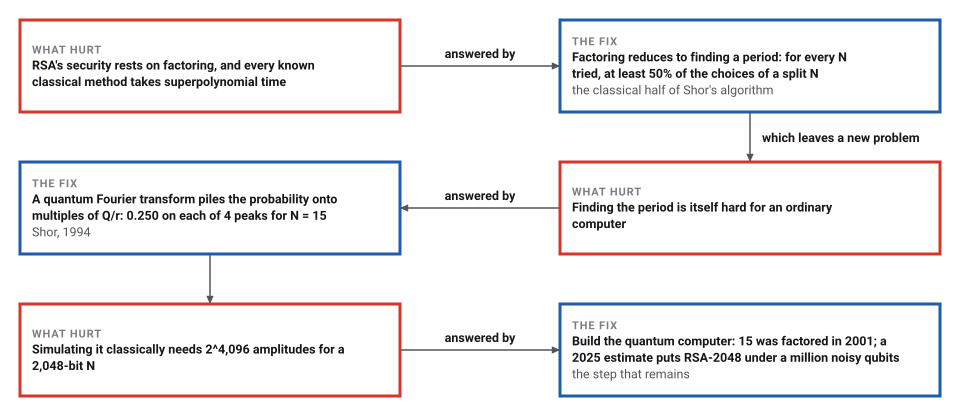
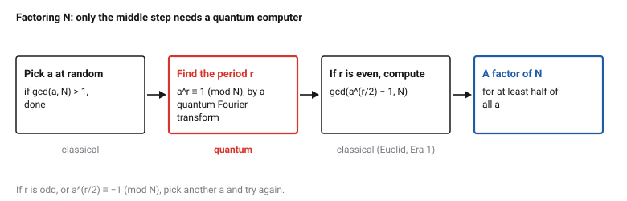

# Shor's Factoring Algorithm

*Era 7 · topic 11 · 1994* · [Era 7 index](../README.md) · [← TCP Congestion Control](../10-tcp-congestion-control/README.md) · [The Burrows–Wheeler Transform →](../12-burrows-wheeler/README.md) · [Interactive edition](shor-factoring.html) · [Program](../../../code/era-07-randomness-networks-and-learning/11-shor-factoring/)

> **Field note from the visiting historian.** I simulated the quantum computer on an ordinary one, storing every amplitude, and it factored N = 1,007 after a couple of measurements. For a number of 2,048 bits the same simulation would need 2^4,096 stored numbers. This species has the algorithm; it does not yet have the machine.

| | |
|---|---|
| **When** | 1994 |
| **Where** | Bell Labs, Murray Hill |
| **What hurt** | Factoring seemed superpolynomial on any computer |
| **The fix** | Period finding by a quantum Fourier transform |
| **Checked** | 12 numbers factored in 23 simulated measurements |

## How ideas combined

A new algorithm is usually an older idea combined with a new one. The fast Fourier transform (Era 6) finds the frequencies hidden in a signal. RSA (Era 6) bet that factoring is hard. Quantum computers, in 1994 still hypothetical machines, hold many values at once as amplitudes that can interfere. Shor saw that factoring reduces to finding a frequency, the period of a repeating sequence, and that a quantum computer could find it by interference. Each box names the idea that was added.

<picture>
  <source media="(prefers-color-scheme: dark)" srcset="assets/family-dark.svg">
  
</picture>
*Red: Shor's algorithm. Blue: where things stand.*

## Find the period, then the factors

The quantum step, simulated in your browser the way the program does it: store every one of the Q amplitudes, keep the x whose a^x mod N equals 1 (the second register's measurement), and apply a Fourier transform. The bars show the chance of each measurement y; they pile up near multiples of Q/r. Press Measure: the widget picks a y with those chances, runs continued fractions on y/Q to guess the period, and finishes with Euclid's gcd. For N = 15 with a = 7 and N = 21 with a = 2, the probabilities match the program's.

| N | Factors | Q | Choices of a | Measurements |
|---|---|---|---|---|
| 15 | 3 × 5 | 2^8 | 1 | 1 |
| 21 | 3 × 7 | 2^9 | 2 | 5 |
| 35 | 5 × 7 | 2^11 | 1 | 1 |
| 77 | 7 × 11 | 2^13 | 1 | 1 |
| 143 | 11 × 13 | 2^15 | 1 | 1 |
| 221 | 13 × 17 | 2^16 | 1 | 1 |
| 323 | 17 × 19 | 2^17 | 1 | 1 |
| 391 | 17 × 23 | 2^18 | 1 | 1 |
| 437 | 19 × 23 | 2^18 | 2 | 5 |
| 667 | 23 × 29 | 2^19 | 1 | 2 |
| 899 | 29 × 31 | 2^20 | 1 | 2 |
| 1,007 | 19 × 53 | 2^20 | 1 | 2 |
*In the interactive edition you can measure the simulated register and watch the factors appear.*

## Era 7, randomness, networks and learning

<picture>
  <source media="(prefers-color-scheme: dark)" srcset="assets/era-timeline-dark.svg">
  
</picture>

## Each fix leaves a new pain

<picture>
  <source media="(prefers-color-scheme: dark)" srcset="assets/chain-dark.svg">
  
</picture>
*Read it as a snake: each new problem sits directly under the fix that exposed it.*

## Factoring is finding a period

<picture>
  <source media="(prefers-color-scheme: dark)" srcset="assets/flow-dark.svg">
  
</picture>

**Why a period helps.** If a^r ≡ 1 (mod N) and r is even, then (a^(r/2) − 1)(a^(r/2) + 1) is a multiple of N. Unless a^(r/2) ≡ −1, neither factor is a multiple of N by itself, so each shares a proper factor with N, and Euclid's algorithm finds it.

**The quantum step.** A register of about 2 log₂ N qubits holds every x from 0 to Q − 1 at once; a second register gets a^x mod N. Measuring the second register leaves the first holding only the x with that value: x₀, x₀ + r, x₀ + 2r, … The quantum Fourier transform makes those amplitudes interfere so that measuring gives a y close to a multiple of Q/r. Continued fractions turn y/Q into a fraction with denominator r (or a divisor of it).

**Why simulation does not help.** An ordinary computer must store one complex number for every value the register can hold: Q of them, about N². The program does exactly that, which is why it stops at N = 1,007.

> **Key idea.** The hard part of factoring hides a regularity: a period. A Fourier transform is the tool for finding periods, and a quantum computer can apply it to an exponentially large register in polynomial time.

## The reduction, the peaks and the cost

**The reduction.** For 18 products of two distinct odd primes from 15 to 25,217, every a with no factor in common with N, its period found by brute force: the share of a's that split N was never below 50%.

| N | a that work | a tried | Share |
|---|---|---|---|
| 15 | 6 | 7 | 86% |
| 21 | 6 | 11 | 55% |
| 91 | 54 | 71 | 76% |
| 1,007 | 702 | 935 | 75% |
| 3,233 | 1,950 | 3,119 | 63% |
| 25,217 | 12,450 | 24,899 | 50% |

**The peaks.** N = 15, a = 7: the period is 4 and Q = 256 is a multiple of it, so all the probability sits exactly on y = 0, 64, 128, 192 (0.250 each, 0.000 elsewhere). N = 21, a = 2: the period is 6, Q/r = 85.33 is not a whole number, and the integers nearest the multiples (0, 85, 171, 256, 341, 427) carry 0.793 of the probability together.

**The whole algorithm,** simulated with every amplitude stored, a chosen at random with no factor in common with N: 23 simulated measurements in all.

| N | Factors | Q | Choices of a | Measurements |
|---|---|---|---|---|
| 15 | 3 × 5 | 2^8 | 1 | 1 |
| 21 | 3 × 7 | 2^9 | 2 | 5 |
| 35 | 5 × 7 | 2^11 | 1 | 1 |
| 77 | 7 × 11 | 2^13 | 1 | 1 |
| 143 | 11 × 13 | 2^15 | 1 | 1 |
| 221 | 13 × 17 | 2^16 | 1 | 1 |
| 323 | 17 × 19 | 2^17 | 1 | 1 |
| 391 | 17 × 23 | 2^18 | 1 | 1 |
| 437 | 19 × 23 | 2^18 | 2 | 5 |
| 667 | 23 × 29 | 2^19 | 1 | 2 |
| 899 | 29 × 31 | 2^20 | 1 | 2 |
| 1,007 | 19 × 53 | 2^20 | 1 | 2 |

**The cost of simulating:**

| Bits in N | Qubits in the first register | Amplitudes a simulation stores |
|---|---|---|
| 10 | 20 | 2^20 |
| 20 | 40 | 2^40 |
| 64 | 128 | 2^128 |
| 512 | 1,024 | 2^1,024 |
| 2,048 | 4,096 | 2^4,096 |

## On a hypothetical computer

Peter Shor, at Bell Labs in Murray Hill, announced the result in 1994 ("Algorithms for Quantum Computation: Discrete Log and Factoring", DIMACS technical report 94-37: these computers "can factor integers and find discrete logarithms in polynomial time"). The full version, "Polynomial-Time Algorithms for Prime Factorization and Discrete Logarithms on a Quantum Computer" (arXiv quant-ph/9508027, 1995; *SIAM Journal on Computing*), gives "Efficient randomized algorithms ... for these two problems on a hypothetical quantum computer".

Wikipedia describes the algorithm as "A classical reduction of the factoring problem to the problem of order-finding" plus a quantum step, with continued fractions to "extract the period from the measurement outcomes"; it records a 2001 IBM experiment using "an NMR implementation of a quantum computer with seven qubits" (which factored 15, per the History of Information page, with doubts since "no entanglement was observed"), and says that of later small demonstrations "none of these demonstrations fulfill the requirements of Shor's algorithm". Smolin, Smith and Vargo of IBM showed that "compiled" versions can factor any product of two primes with two qubits, so "the correct measure of difficulty ... is not the size of number factored".

Craig Gidney's 2025 estimate: "a 2048 bit RSA integer could be factored in less than a week using less than one million noisy qubits", "compared to 20 million in Gidney+Ekerå 2019". That is an estimate of what a machine would need, not a report of one.

## Euclid and Fourier, with qubits

Shor's algorithm ends with the oldest algorithm in this book, Euclid's greatest common divisor (Era 1), and turns on the fast Fourier transform (Era 6). The only new ingredient is the machine that runs the transform.

> **Full circle.** Era 6 built public-key cryptography on the hardness of factoring. Era 7 shows that the hardness belongs to the kind of computer, not to the problem: a 2,048-bit number needs 4,096 qubits in the first register, or 2^4,096 stored numbers to simulate them.

## Before you read on

<details>
<summary><b>1.</b> The powers of 7 modulo 15 are 1, 7, 4, 13, 1, … What is r, and what factors does it give?</summary>

r = 4; 7² = 49 ≡ 4, and gcd(4 − 1, 15) = 3, gcd(4 + 1, 15) = 5.
</details>

<details>
<summary><b>2.</b> Why must r be even?</summary>

To split a^r − 1 into (a^(r/2) − 1)(a^(r/2) + 1).
</details>

<details>
<summary><b>3.</b> For N = 15, Q = 256 and r = 4. Which y can be measured?</summary>

Only 0, 64, 128 and 192, each with probability ¼.
</details>

<details>
<summary><b>4.</b> Why is Q chosen at least N²?</summary>

So that continued fractions can recover r from y/Q: the peaks are close enough to k/r to pin down a fraction with denominator below N.
</details>

<details>
<summary><b>5.</b> Why can't an ordinary computer just run this simulation for a 2,048-bit number?</summary>

It would need to store 2^4,096 complex numbers, far more than there are atoms in the observable universe.
</details>


## Where the evidence lives

| | Object | Where to see it | Licence |
|---|---|---|---|
| — | **Shor's paper (1995 version)**. "Polynomial-Time Algorithms for Prime Factorization and Discrete Logarithms on a Quantum Computer". | [arXiv quant-ph/9508027](https://arxiv.org/abs/quant-ph/9508027) | Drawn placeholder. |

## Every link was opened before it was listed

| Level | Link | Why |
|---|---|---|
| Start | [Shor's algorithm](https://en.wikipedia.org/wiki/Shor%27s_algorithm) — Wikipedia | The reduction, the quantum step, and the experiments so far |
| Deeper | [Pretending to factor large numbers on a quantum computer](https://ar5iv.labs.arxiv.org/html/1301.7007) — J. Smolin, G. Smith, A. Vargo (IBM, 2013) | Why "we factored N on a quantum computer" needs careful reading |
| Deeper | [How to factor 2048 bit RSA integers with less than a million noisy qubits](https://research.google/pubs/how-to-factor-2048-bit-rsa-integers-with-less-than-a-million-noisy-qubits/) — C. Gidney, Google (2025) | What breaking real RSA would take, as currently estimated |
| Scholar | [Polynomial-Time Algorithms for Prime Factorization and Discrete Logarithms on a Quantum Computer](https://arxiv.org/abs/quant-ph/9508027) — P. Shor, arXiv (1995), *SIAM J. Computing* | The algorithm and its analysis |
| Scholar | [Algorithms for Quantum Computation: Discrete Log and Factoring](https://archive.dimacs.rutgers.edu/TechnicalReports/abstracts/1994/94-37.html) — P. Shor, DIMACS TR 94-37 (1994) | The 1994 announcement |

More, with certainty labels and the gaps we could not fill: [Era 7 reference catalog](https://github.com/vij658/AlgorithmEvolutionAtlas/blob/main/book/era-07-randomness-networks-and-learning/reference-catalog.md).

## The program behind every number here

[ShorFactoring.java](https://github.com/vij658/AlgorithmEvolutionAtlas/blob/main/code/era-07-randomness-networks-and-learning/11-shor-factoring/ShorFactoring.java) makes **23,551 checks**: the classical reduction for every a and 18 values of N, the exact probability peaks for N = 15 and 21, and the whole algorithm simulated with every amplitude stored for 12 values of N, each factor checked. Run it with `java ShorFactoring.java` (JDK 17 or newer). The heart of it:

```java
/** The classical post-processing: a factor of n from the order r of a, or -1 if this a fails. */
static long splitWith(long a, long r, long n) {
    if (r % 2 == 1) return -1;
    long h = powmod(a, r / 2, n);
    if (h == n - 1) return -1;
    long f = gcd(h - 1, n);
    return f > 1 && f < n ? f : -1;
}

/** Continued fractions: the denominators of the convergents of y / Q, smallest first. */
static List<Long> convergentDenominators(long y, long Q, long limit) {
    List<Long> out = new ArrayList<>();
    long h0 = 0, h1 = 1, k0 = 1, k1 = 0;               // standard recurrence, starting from the empty fraction
    long num = y, den = Q;
    while (den != 0) {
        long q = num / den;
        long h2 = q * h1 + h0, k2 = q * k1 + k0;
        if (k2 >= limit) break;
        out.add(k2);
        h0 = h1; h1 = h2; k0 = k1; k1 = k2;
        long t = num - q * den; num = den; den = t;
    }
    return out;
}
```

