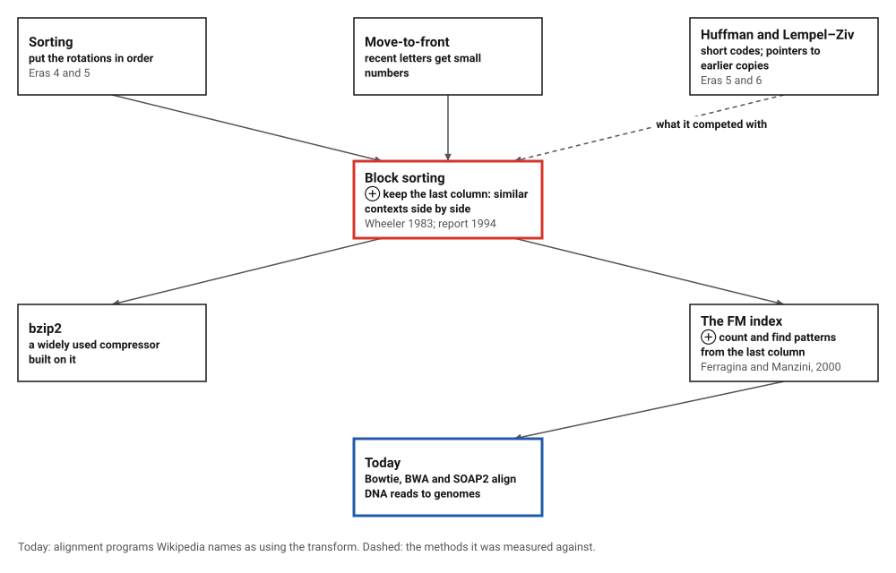
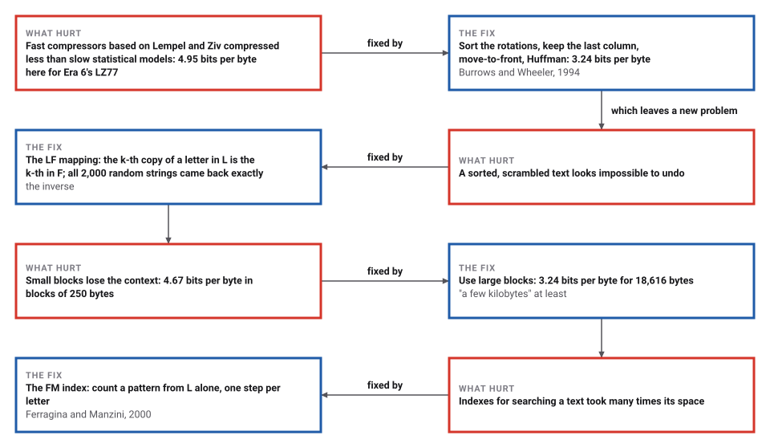
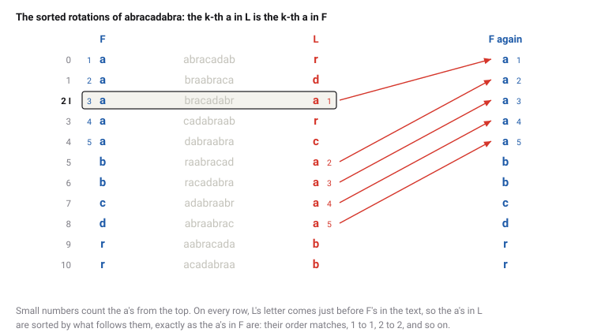

# The Burrows–Wheeler Transform

*Era 7 · topic 12 · 1983–1994* · [Era 7 index](../README.md) · [← Shor's Factoring Algorithm](../11-shor-factoring/README.md) · [AdaBoost →](../13-adaboost/README.md) · [Interactive edition](burrows-wheeler.html) · [Program](../../../code/era-07-randomness-networks-and-learning/12-burrows-wheeler/)

> **Field note from the visiting historian.** I sorted the rotations of this book's own field notes. The 18,323 runs of letters became 10,072, and the text compressed to 3.24 bits per byte, better than gzip's method on the same text. From the same column I could count any word without reading the text at all.

| | |
|---|---|
| **When** | Found 1983; published 1994 |
| **Where** | AT&T Bell Laboratories; DEC Systems Research Center, Palo Alto |
| **What hurt** | Fast compressors compressed less than slow ones |
| **The fix** | Sort the rotations, keep the last column |
| **Checked** | 3.24 bits per byte; 2,000 round trips exact |

## How ideas combined

A new algorithm is usually an older idea combined with a new one. Lempel and Ziv (Era 6) compressed by pointing back at earlier copies; Huffman (Era 5) gave common symbols short codes. Wheeler found a third way: sort every rotation of a block of text, keep only the last letter of each, and the letters come out grouped by the context that follows them, ready for move-to-front and Huffman. Ferragina and Manzini later used the same column as an index. Each box names the idea that was added.

<picture>
  <source media="(prefers-color-scheme: dark)" srcset="assets/family-dark.svg">
  
</picture>
*Red: the transform. Blue: where it is used today.*

## Sort, keep the last column, undo it

Type a short text. The table shows its rotations, sorted: F in blue, L in red, and the row marked I holds the text itself. The transform keeps only L and I. Press Invert one letter to rebuild the text from L alone, backwards, by the LF mapping. Then type a pattern and press Search one letter: backward search narrows the range of rows that begin with longer and longer pieces of the pattern, looking only at L. For abracadabra the widget's L and I match the program's.

| Row | F | Middle | L |
|---|---|---|---|
| 0 | a | abracadab | r |
| 1 | a | braabraca | d |
| 2 | a | bracadabr | a |
| 3 | a | cadabraab | r |
| 4 | a | dabraabra | c |
| 5 | b | raabracad | a |
| 6 | b | racadabra | a |
| 7 | c | adabraabr | a |
| 8 | d | abraabrac | a |
| 9 | r | aabracada | b |
| 10 | r | acadabraa | b |
*In the interactive edition you can transform your own text, invert it and search it.*

## Era 7, randomness, networks and learning

<picture>
  <source media="(prefers-color-scheme: dark)" srcset="assets/era-timeline-dark.svg">
  
</picture>

## Each fix leaves a new pain

<picture>
  <source media="(prefers-color-scheme: dark)" srcset="assets/chain-dark.svg">
  
</picture>
*Read it as a snake: each new problem sits directly under the fix that exposed it.*

## The last column remembers everything

**The transform.** Write every rotation of the block, sort them, keep the last column L and the row I where the original sits. For abracadabra, L = rdarcaaaabb and I = 2: the 11 runs of the text became 7 in L.

**Why it groups letters.** Rotations that begin with the same context are sorted together, and L holds the letter just before each. In this book's field notes, "he" is preceded 309 times by: t 227, T 32, space 21, c 11. In L, those letters sit side by side.

<picture>
  <source media="(prefers-color-scheme: dark)" srcset="assets/lf-dark.svg">
  
</picture>

**Undoing it.** F is just L sorted. The LF mapping takes row j to the row whose F letter is the same letter as L[j], counting copies in order. Start at row I, read L, move by LF, and the text comes out backwards.

**Compressing it.** Move-to-front replaces each letter by its position in a list of recently used letters, then moves it to the front; runs of the same letter become runs of zeros. A Huffman code then packs those small numbers into few bits.

> **Key idea.** Sorting by what comes after a letter gathers letters that share a context, which makes text easy to compress, and the sorted order is so regular that one column and one number are enough to rebuild everything, or to search it.

## This book's own text

**Compression,** on this book's field notes (18,616 bytes, the same text as Era 6's Lempel–Ziv program). Runs of equal letters: 18,323 in the text, 10,072 in L. After move-to-front, 45.9% of the numbers were 0 and 70.2% below 4.

| Method | Bits per byte |
|---|---|
| Huffman's code on single bytes | 4.48 |
| LZ77 (Era 6's program) | 4.95 |
| Deflate (gzip's method, level 9) | 3.46 |
| Burrows–Wheeler, move-to-front, Huffman | 3.24 |

**Block size.** The field notes cut into blocks, each transformed and coded on its own (32 bits per block to record I):

| Block size (bytes) | Bits per byte |
|---|---|
| 250 | 4.67 |
| 1,000 | 4.25 |
| 4,000 | 3.81 |
| 18,616 | 3.24 |

**Searching.** Occurrences counted from L alone by backward search, one step per pattern letter, against scanning all 18,616 positions; 500 more random patterns agreed with scanning:

| Pattern | Occurrences | Steps |
|---|---|---|
| "the" | 227 | 3 |
| "algorithm" | 8 | 9 |
| "Era" | 3 | 3 |
| " of the " | 8 | 8 |
| "Euclid" | 1 | 6 |
| "quantum" | 0 | 3 |

**Round trips.** 2,000 random strings, 1 to 300 letters over alphabets of 1 to 26, and every block above, transformed and inverted: every one came back exactly.

## A research report from Palo Alto

M. Burrows and D. J. Wheeler, "A Block-sorting Lossless Data Compression Algorithm", SRC Research Report 124 (Systems Research Center of Digital Equipment Corporation, Palo Alto, 10 May 1994): "The algorithm works by applying a reversible transformation to a block of input text. The transformation does not itself compress the data, but reorders it to make it easy to compress with simple algorithms such as move-to-front coding." It achieves "speed comparable to algorithms based on the techniques of Lempel and Ziv, but obtains compression close to the best statistical modelling techniques", and "The size of the input block must be large (a few kilobytes) to achieve good compression." "The algorithm described here was discovered by one of the authors (Wheeler) in 1983 while he was working at AT&T Bell Laboratories, though it has not previously been published." On the Calgary Corpus they report mean bits per character of 3.63 for compress, 2.71 for gzip and 2.43 for theirs.

Langmead's tutorial (2013) explains the LF mapping and backward search, and that in 2000 Ferragina and Manzini showed the transform with small auxiliary tables is a space-efficient index, the FM index. Wikipedia names bzip2 as a user, and Bowtie, BWA and SOAP2 as alignment programs "that use the Burrows–Wheeler transform"; Bowtie (Langmead and others, 2009) needs "around 2.2GB for the human genome".

## Compression, then search

Era 6's Lempel and Ziv and this era's Karp and Rabin treated compressing text and searching it as separate jobs. The Burrows–Wheeler transform does both with one column: the same L that compresses well also answers "how many times does this pattern occur?".

> **Full circle.** On the same 18,616 bytes, Era 6's LZ77 used 4.95 bits per byte; the transform, with move-to-front and Huffman, 3.24. And from that same L, "the" was counted (227 times) in 3 steps.

## Before you read on

<details>
<summary><b>1.</b> Write the sorted rotations of "banana" and read off L.</summary>

abanan, anaban, ananab, banana, nabana, nanaba: L = nnbaaa, and the text is row 3.
</details>

<details>
<summary><b>2.</b> Why is F not stored?</summary>

F is just the letters of L in sorted order, so it can be rebuilt from L.
</details>

<details>
<summary><b>3.</b> Move-to-front on "aaab" with the list a, b, …: what numbers come out?</summary>

0 0 0 1: three a's at the front, then b in position 1.
</details>

<details>
<summary><b>4.</b> Why do small blocks compress worse?</summary>

There are fewer rotations with each context, so letters are grouped less, and each block also pays for its own bookkeeping.
</details>

<details>
<summary><b>5.</b> How many steps does backward search take for a pattern of 20 letters in a genome of 3 billion?</summary>

20, one per pattern letter, whatever the genome's size (with the counting tables precomputed).
</details>


## Where the evidence lives

| | Object | Where to see it | Licence |
|---|---|---|---|
| — | **SRC Research Report 124 (1994)**. "A Block-sorting Lossless Data Compression Algorithm", Burrows and Wheeler. | [The report (PDF, on a Cambridge course page)](https://www.cl.cam.ac.uk/teaching/0304/DSAlgs/SRC-124.pdf) | Drawn placeholder. |

## Every link was opened before it was listed

| Level | Link | Why |
|---|---|---|
| Start | [Burrows–Wheeler transform](https://en.wikipedia.org/wiki/Burrows%E2%80%93Wheeler_transform) — Wikipedia | The transform worked by hand, and its inverse |
| Deeper | [Lecture 5: Library Complexity and Short Read Alignment (Mapping)](https://ocw.mit.edu/courses/7-91j-foundations-of-computational-and-systems-biology-spring-2014/resources/lecture-5-library-complexity-and-short-read-alignment-mapping/) — MIT OpenCourseWare, David Gifford, 7.91J (Spring 2014) | Builds an FM index from the Burrows–Wheeler transform to align DNA reads, with video and transcript |
| Deeper | [Introduction to the Burrows-Wheeler Transform and FM Index](https://www.cl.cam.ac.uk/teaching/2324/Bioinfo/papers/bwt_fm.pdf) — B. Langmead (2013) | The LF mapping and backward search, step by step |
| Scholar | [A Block-sorting Lossless Data Compression Algorithm](https://www.cl.cam.ac.uk/teaching/0304/DSAlgs/SRC-124.pdf) — M. Burrows, D. Wheeler, SRC Research Report 124 (1994) | The transform, its inverse, and the measurements |

More, with certainty labels and the gaps we could not fill: [Era 7 reference catalog](https://github.com/vij658/AlgorithmEvolutionAtlas/blob/main/book/era-07-randomness-networks-and-learning/reference-catalog.md).

## The program behind every number here

[BurrowsWheeler.java](https://github.com/vij658/AlgorithmEvolutionAtlas/blob/main/code/era-07-randomness-networks-and-learning/12-burrows-wheeler/BurrowsWheeler.java) makes **2,614 checks**: the transform and its inverse on abracadabra, the field notes and every block of four sizes, compression against Huffman and Deflate, backward search against scanning for 506 patterns, and 2,000 random round trips. Run it with `java BurrowsWheeler.java` (JDK 17 or newer). The heart of it:

```java
/** Inverts the transform with the LF mapping: walk backwards from row I. */
static byte[] inverse(byte[] L, int I) {
    int n = L.length;
    int[] count = new int[257];
    for (byte b : L) count[(b & 0xff) + 1]++;
    for (int c = 1; c <= 256; c++) count[c] += count[c - 1];           // count[c] = letters smaller than c
    int[] seen = new int[256], lf = new int[n];
    for (int j = 0; j < n; j++) { int c = L[j] & 0xff; lf[j] = count[c] + seen[c]++; }
    byte[] s = new byte[n];
    int row = I;
    for (int k = n - 1; k >= 0; k--) { s[k] = L[row]; row = lf[row]; }
    return s;
}

/** Backward search: the number of sorted rotations that begin with p. */
static int fmCount(byte[] p) {
    int lo = 0, hi = occ[firstPresent()].length - 1;          // rows [lo, hi)
    for (int k = p.length - 1; k >= 0 && lo < hi; k--) {
        int c = p[k] & 0xff;
        fmSteps++;
        if (occ[c] == null) return 0;
        lo = C[c] + occ[c][lo];
        hi = C[c] + occ[c][hi];
    }
    return Math.max(0, hi - lo);
}
```

