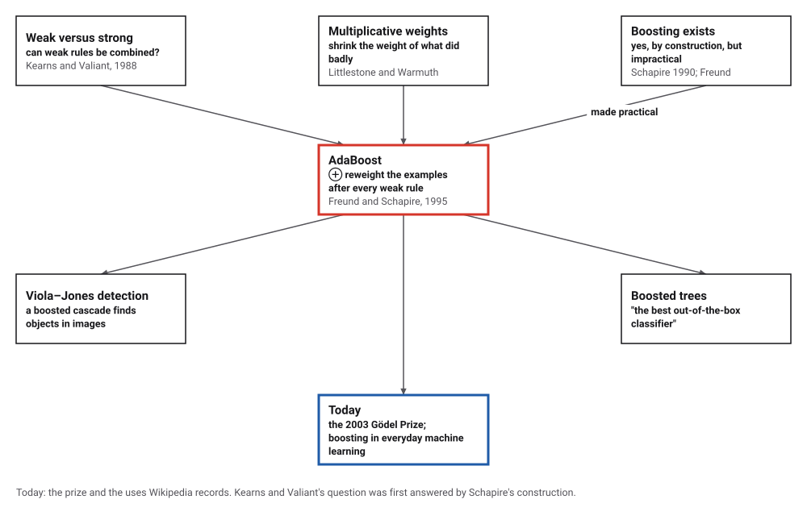
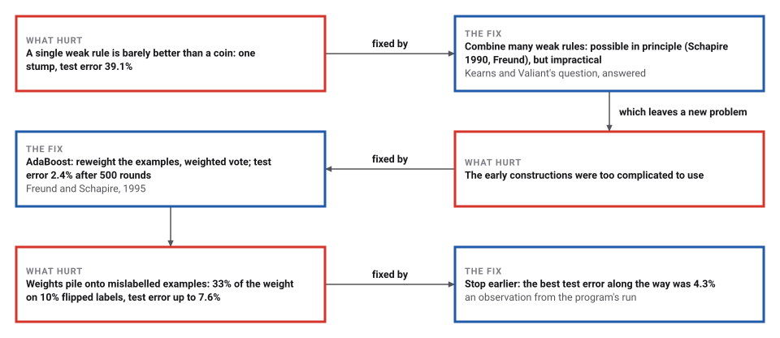
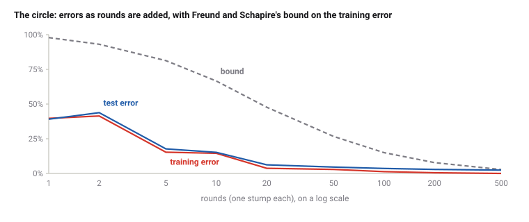

# AdaBoost

*Era 7 · topic 13 · 1995–1997* · [Era 7 index](../README.md) · [← The Burrows–Wheeler Transform](../12-burrows-wheeler/README.md) · [Interactive edition](adaboost.html) · [Program](../../../code/era-07-randomness-networks-and-learning/13-adaboost/)

> **Field note from the visiting historian.** No straight line can draw a circle. I watched 500 of them, each chosen to fix what the others missed, vote their way to a test error of 2.4%. When I mislabelled a tenth of the examples, the votes chased the mistakes, and I learned when to stop.

| | |
|---|---|
| **When** | Extended abstract 1995; journal 1997 |
| **Where** | AT&T |
| **What hurt** | Weak rules of thumb; impractical ways to combine them |
| **The fix** | Reweight examples after each rule; weighted vote |
| **Checked** | Test error 39.1% with 1 stump, 2.4% with 500 |

## How ideas combined

A new algorithm is usually an older idea combined with a new one. Kearns and Valiant asked whether rules only slightly better than chance could always be combined into accurate ones. Schapire proved in 1990 that they could, and Freund found another way, but neither was practical. Freund and Schapire then took the multiplicative weight updates that Littlestone and Warmuth had used for on-line learning and applied them to the training examples. Each box names the idea that was added.

<picture>
  <source media="(prefers-color-scheme: dark)" srcset="assets/family-dark.svg">
  
</picture>
*Red: AdaBoost. Blue: what followed.*

## Watch the weights move

One hundred and twenty points, red inside the dashed circle and blue outside, made by the same simple generator as the program. Each round AdaBoost picks the stump (one vertical or horizontal line) with the smallest weighted error, then shrinks the weight of every point it got right, so the next round attends to the points still being missed (big dots). The shading is the vote of all the stumps so far; ringed points are its mistakes. No single line can draw a circle, but the vote of a few dozen comes close. The widget repeats the program's arithmetic, so its mistakes and errors match the program's, round by round.

| Round | Training mistakes (of 120) | Weighted error of the round's stump |
|---|---|---|
| 1 | 45 | 0.3750 |
| 2 | 47 | 0.3178 |
| 3 | 45 | 0.3632 |
| 4 | 22 | 0.2926 |
| 5 | 45 | 0.3545 |
| 6 | 12 | 0.3208 |
| 7 | 12 | 0.3429 |
| 8 | 8 | 0.3187 |
| 9 | 8 | 0.3500 |
| 10 | 8 | 0.3794 |
| 11 | 12 | 0.3316 |
| 12 | 7 | 0.3752 |
*In the interactive edition you can run the rounds and watch the weights shift.*

## Era 7, randomness, networks and learning

<picture>
  <source media="(prefers-color-scheme: dark)" srcset="assets/era-timeline-dark.svg">
  
</picture>

## Each fix leaves a new pain

<picture>
  <source media="(prefers-color-scheme: dark)" srcset="assets/chain-dark.svg">
  
</picture>
*Read it as a snake: each new problem sits directly under the fix that exposed it.*

## Reweight, then vote

**Weights.** Start with every training example weighted equally. The weak learner must find a rule whose error, counted with these weights, is below ½.

**The update.** With weighted error ε, multiply the weight of every example the rule got right by β = ε/(1 − ε), which is less than 1, and rescale so the weights sum to 1. The examples the rule missed now carry half the weight, so the next rule cannot ignore them.

**The vote.** The final classifier adds up the rules' votes, each with weight log(1/β): accurate rules speak louder. Freund and Schapire proved that the training error is at most the product, over the rounds, of 2√(ε(1 − ε)), which falls exponentially as long as every rule beats a coin by some margin.

<picture>
  <source media="(prefers-color-scheme: dark)" srcset="assets/errors-dark.svg">
  
</picture>

> **Key idea.** You do not need a clever learner, only one that is never quite useless. By changing which examples matter each round, AdaBoost forces a series of weak rules to cover each other's mistakes.

## A circle from straight lines

**The circle.** 1,000 training points and 20,000 test points, labelled by whether they lie inside a circle of radius 0.35. The stumps' weighted errors ranged from 0.332 to 0.474, all below ½; the training error never exceeded the bound, and reached 0 after 224 rounds, while the test error kept falling.

| Rounds | Training error | Bound | Test error |
|---|---|---|---|
| 1 | 39.7% | 97.9% | 39.1% |
| 2 | 41.4% | 93.1% | 43.8% |
| 5 | 15.3% | 81.3% | 17.7% |
| 10 | 14.5% | 66.6% | 15.2% |
| 20 | 3.7% | 47.7% | 6.2% |
| 50 | 2.9% | 26.7% | 4.6% |
| 100 | 1.3% | 15.0% | 3.6% |
| 200 | 0.5% | 7.8% | 2.9% |
| 500 | 0.0% | 2.8% | 2.4% |

**Noisy labels.** A new training set with 98 labels (10%) flipped at random, tested on the same clean points. The weights pile onto the flipped examples, which no honest rule can get right, and after a while the test error rises; the best along the way was 4.3%.

| Rounds | Training error | Test error | Weight on the flipped examples |
|---|---|---|---|
| 10 | 19.3% | 13.3% | 18% |
| 50 | 11.7% | 4.6% | 31% |
| 200 | 12.1% | 6.1% | 33% |
| 500 | 11.4% | 7.6% | 33% |

## A question becomes a method

Yoav Freund and Robert Schapire (AT&T Labs), "A decision-theoretic generalization of on-line learning and an application to boosting" (*Journal of Computer and System Sciences* 55(1): 119–139, 1997; "An extended abstract of this work appeared in the Proceedings of the Second European Conference on Computational Learning Theory, Barcelona, March, 1995"): "We show that the multiplicative weight-update rule of Littlestone and Warmuth can be adapted to this model". In AdaBoost "The update rule reduces the probability assigned to those examples on which the hypothesis makes a good prediction", with β = ε/(1 − ε) and a final vote weighted by log(1/β); Theorem 6 bounds the training error by the product of 2√(ε(1 − ε)). The paper recalls that "Schapire showed that any weak learning algorithm can be efficiently transformed" into a strong one.

Wikipedia: AdaBoost, "short for Adaptive Boosting", was "formulated by Yoav Freund and Robert Schapire in 1995", who "won the 2003 Gödel Prize for their work"; it "is typically used to combine weak base learners (such as decision stumps)"; its exponential loss can "result in excessive weights being assigned to outliers"; with trees it "is often referred to as the best out-of-the-box classifier"; and Viola and Jones's object detection framework uses a boosted cascade. Kearns's article dates the question "is weakly learnability equivalent to strong learnability?" to 1988–1989 and says Schapire's 1990 answer was a "proof by construction, not practical".

## The perceptron's mistakes, put to work

Era 5's perceptron adjusted its weights after each mistake. AdaBoost adjusts weights too, but on the examples rather than the rule: the examples it keeps getting wrong become the ones that matter. Backpropagation (topic 7) trains one strong model; AdaBoost trains many weak ones and lets them vote.

> **Full circle.** One stump on the circle: test error 39.1%. 500 stumps voting: 2.4%. None of them could draw a curve; together they drew a circle.

## Before you read on

<details>
<summary><b>1.</b> A stump has weighted error 0.25. By what factor are the weights of the examples it got right multiplied, and what is its vote?</summary>

β = 0.25/0.75 = 1/3; its vote is log 3 ≈ 1.10.
</details>

<details>
<summary><b>2.</b> After the update, how much of the total weight sits on the examples the stump got wrong?</summary>

Exactly half: ε before rescaling, against (1 − ε)·β = ε for the right ones.
</details>

<details>
<summary><b>3.</b> Why must every weak rule have weighted error below ½?</summary>

Otherwise β ≥ 1 and the vote weight log(1/β) is zero or negative: the rule adds nothing, and the bound stops shrinking.
</details>

<details>
<summary><b>4.</b> Why do mislabelled examples gather weight?</summary>

No honest rule gets them right, so their weights are never shrunk while everything else's is.
</details>

<details>
<summary><b>5.</b> With ε = 0.4 every round, about how many rounds bring the bound below 1%?</summary>

2√(0.4 × 0.6) ≈ 0.98 per round, so about 230 rounds (0.98²³⁰ ≈ 0.01).
</details>


## Where the evidence lives

| | Object | Where to see it | Licence |
|---|---|---|---|
| — | **Freund and Schapire's journal paper (1997)**. *Journal of Computer and System Sciences* 55(1): 119–139; the 1995 extended abstract was not opened. | [The paper (PDF, on a Northeastern course page)](https://khoury.northeastern.edu/home/vip/teach/IRcourse/6_ML/other_notes/freund_schapire_adaboost_journal.pdf) | Drawn placeholder. |

## Every link was opened before it was listed

| Level | Link | Why |
|---|---|---|
| Start | [Lecture 17: Learning: Boosting](https://www.ocw.mit.edu/courses/6-034-artificial-intelligence-fall-2010/resources/lecture-17-learning-boosting) — MIT OpenCourseWare, Patrick Winston, 6.034 (Fall 2010) | "Can multiple weak classifiers be used to make a strong one?", worked through with video and transcript |
| Start | [AdaBoost](https://en.wikipedia.org/wiki/AdaBoost) — Wikipedia | The algorithm, its loss function, and where it is used |
| Deeper | [Michael Kearns](https://en.wikipedia.org/wiki/Michael_Kearns_(computer_scientist) — Wikipedia | The weak-versus-strong learning question that started boosting |
| Scholar | [A decision-theoretic generalization of on-line learning and an application to boosting](https://khoury.northeastern.edu/home/vip/teach/IRcourse/6_ML/other_notes/freund_schapire_adaboost_journal.pdf) — Y. Freund, R. Schapire, *J. Comput. Syst. Sci.* (1997) | AdaBoost, its weight update, and the training error bound |

More, with certainty labels and the gaps we could not fill: [Era 7 reference catalog](https://github.com/vij658/AlgorithmEvolutionAtlas/blob/main/book/era-07-randomness-networks-and-learning/reference-catalog.md).

## The program behind every number here

[AdaBoost.java](https://github.com/vij658/AlgorithmEvolutionAtlas/blob/main/code/era-07-randomness-networks-and-learning/13-adaboost/AdaBoost.java) makes **1,003 checks**: 500 rounds on the circle with the bound checked after every one, 500 rounds on noisy labels, and the 40 rounds the widget repeats. Run it with `java AdaBoost.java` (JDK 17 or newer). The heart of it:

```java
/** One round of AdaBoost: returns the stump's weighted error. */
static double round(double[][] p) {
    double[] e = new double[1];
    Stump h = bestStump(p, weights, e);
    double eps = e[0];
    double beta = eps / (1 - eps);
    for (int i = 0; i < p.length; i++) if (h.predict(p[i]) == p[i][2]) weights[i] *= beta;
    double sum = 0;
    for (double x : weights) sum += x;
    for (int i = 0; i < p.length; i++) weights[i] /= sum;
    stumps.add(h);
    votes.add(Math.log(1 / beta));
    bound *= 2 * Math.sqrt(eps * (1 - eps));
    return eps;
}
```

