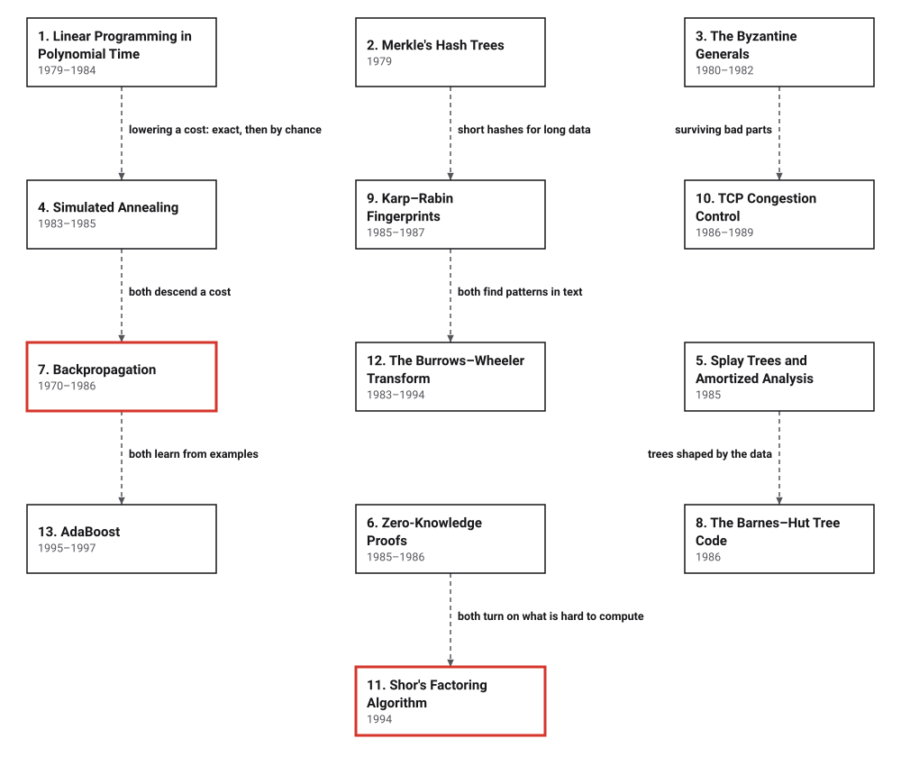

# Era 7 — Randomness, Networks and Learning

*1979 to 1995* · [Book contents](../README.md) · [Interactive edition](index.html) · [Reference catalog](reference-catalog.md) · [Programs](../../code/era-07-randomness-networks-and-learning/README.md)

> **Field note from the visiting historian.** In the sixth era, the species learned that some problems may have no fast method. In this one, it learns to use chance on purpose, to keep networks of computers working when parts fail or lie, and to make machines that learn from examples.

## When

<picture>
  <source media="(prefers-color-scheme: dark)" srcset="assets/era-timeline-dark.svg">
  
</picture>

## How the ideas combined

<picture>
  <source media="(prefers-color-scheme: dark)" srcset="assets/era-map-dark.svg">
  
</picture>

*Dashed lines join related developments; none of them is a claim that one inventor learned from the other. Most boxes build on earlier eras: polynomial-time linear programming on the simplex method (Era 4); Merkle's trees and zero-knowledge proofs on public keys and NP-completeness (Era 6); the Byzantine generals on logical clocks (Era 6); annealing on Monte Carlo (Era 4); splay trees on balanced trees (Era 5); backpropagation and AdaBoost on the perceptron (Era 5); Karp and Rabin on fast string searching (Era 6); Shor on the fast Fourier transform and RSA (Era 6); Burrows and Wheeler on Huffman (Era 5) and Lempel and Ziv (Era 6).*

## The topics

| # | Topic | When | What hurt | Read |
|---|---|---|---|---|
| 1 | **Linear Programming in Polynomial Time** | Klee–Minty 1972; Khachiyan 1979; Karmarkar 1984 | The simplex method had no polynomial guarantee | [page](01-linear-programming/README.md) · [interactive](01-linear-programming/linear-programming.html) · [program](../../code/era-07-randomness-networks-and-learning/01-linear-programming/README.md) |
| 2 | **Merkle's Hash Trees** | Thesis and patent filing 1979; patent 1982 | Checking one block meant a fingerprint for every block | [page](02-merkle-trees/README.md) · [interactive](02-merkle-trees/merkle-trees.html) · [program](../../code/era-07-randomness-networks-and-learning/02-merkle-trees/README.md) |
| 3 | **The Byzantine Generals** | 1980 and 1982 | A faulty part could tell different parts different things | [page](03-byzantine-generals/README.md) · [interactive](03-byzantine-generals/byzantine-generals.html) · [program](../../code/era-07-randomness-networks-and-learning/03-byzantine-generals/README.md) |
| 4 | **Simulated Annealing** | 1983; Černý 1985 | Improving by small steps stops at the first local optimum | [page](04-simulated-annealing/README.md) · [interactive](04-simulated-annealing/simulated-annealing.html) · [program](../../code/era-07-randomness-networks-and-learning/04-simulated-annealing/README.md) |
| 5 | **Splay Trees and Amortized Analysis** | 1985 | Balanced trees needed bookkeeping and judged each operation alone | planned · [references](reference-catalog.md#5-splay-trees-and-amortized-analysis) |
| 6 | **Zero-Knowledge Proofs** | 1985; all of NP 1986 | Proving you know a secret meant revealing it | planned · [references](reference-catalog.md#6-zero-knowledge-proofs) |
| 7 | **Backpropagation** | Linnainmaa 1970; Werbos 1981; Rumelhart, Hinton and Williams 1986 | No well-known way to train hidden layers | planned · [references](reference-catalog.md#7-backpropagation) |
| 8 | **The Barnes–Hut Tree Code** | 1986 | Gravity took N(N − 1) interactions per step | planned · [references](reference-catalog.md#8-the-barneshut-tree-code) |
| 9 | **Karp–Rabin Fingerprints** | Presented 1985; published 1987 | Fast search needed intricate preprocessing; m × n at worst | planned · [references](reference-catalog.md#9-karprabin-fingerprints) |
| 10 | **TCP Congestion Control** | Collapse 1986; paper 1988; Chiu and Jain 1989 | Senders overran the network: congestion collapse | planned · [references](reference-catalog.md#10-tcp-congestion-control) |
| 11 | **Shor's Factoring Algorithm** | 1994 | Factoring seemed to need superpolynomial time on any computer | planned · [references](reference-catalog.md#11-shors-factoring-algorithm) |
| 12 | **The Burrows–Wheeler Transform** | Wheeler 1983; report 1994; FM index 2000 | Fast compressors compressed less than slow models | planned · [references](reference-catalog.md#12-the-burrowswheeler-transform) |
| 13 | **AdaBoost** | Question 1988; abstract 1995; journal 1997 | Weak rules of thumb could not be combined in practice | planned · [references](reference-catalog.md#13-adaboost) |

The interactive edition is a single HTML file per topic: download it and open it in a browser, or use the published copy linked from the [book contents](../README.md).
