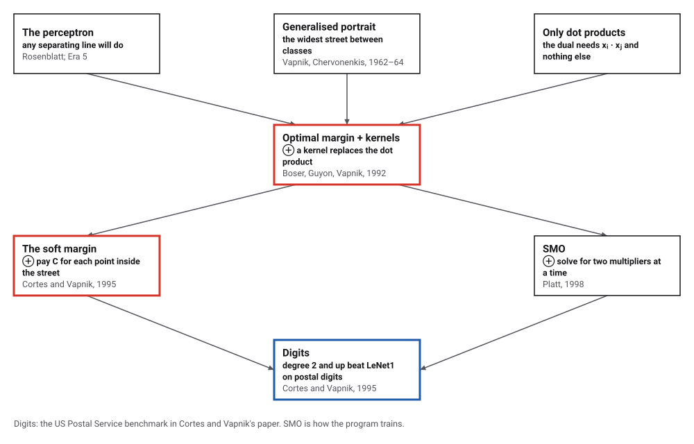
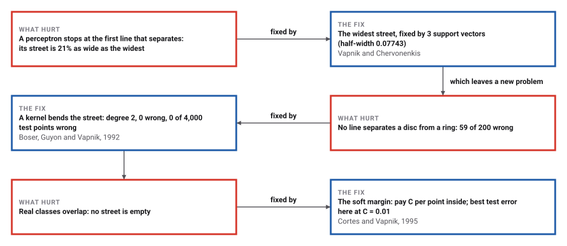
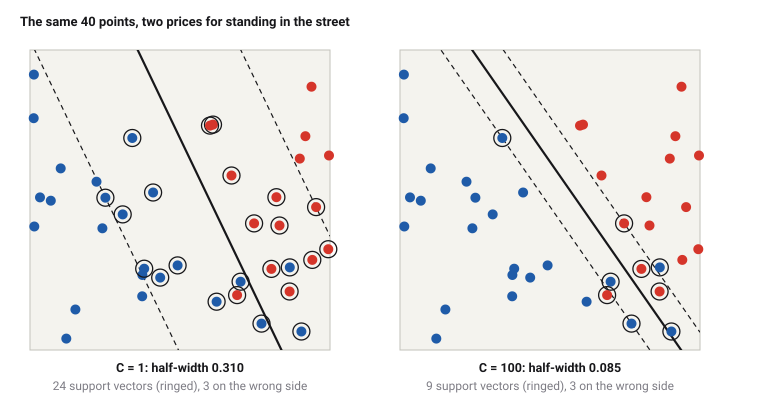

# Support Vector Machines

*Era 8 · topic 1 · 1992–1995* · [Era 8 index](../README.md) · [Approximation by Semidefinite Programming →](../02-max-cut/README.md) · [Interactive edition](support-vector-machines.html) · [Program](../../../code/era-08-the-web-the-genome-and-the-ledger/01-support-vector-machines/)

> **Field note from the visiting historian.** I gave a perceptron and a support vector machine the same 60 points. Both drew a correct line. The machine's left a street of half-width 0.07743, held in place by 3 points; the perceptron's left 0.01629. On a disc inside a ring, a straight line got 59 of 200 wrong; a kernel of degree 2 got 0.

| | |
|---|---|
| **When** | 1962–64 (Moscow); kernels 1992; soft margin 1995 |
| **Where** | Institute of Control Sciences, Moscow; AT&T Bell Laboratories |
| **What hurt** | Any separating line, curved boundaries, overlapping classes |
| **The fix** | The widest margin; kernels; a price C for slack |
| **Checked** | Street 0.07743 = direct search 0.07743 |

## How ideas combined

A new algorithm is usually an older idea combined with a new one. The perceptron (Era 5) learned a separating line by correcting mistakes. Vapnik and Chervonenkis asked for the best separating line: the one with the widest margin. Boser, Guyon and Vapnik noticed that the method touches the examples only through dot products, and swapped in kernels; Cortes and Vapnik let points stand inside the margin, at a price. Each box names the idea that was added.

<picture>
  <source media="(prefers-color-scheme: dark)" srcset="assets/family-dark.svg">
  
</picture>
*Red: the support vector machine's steps. Blue: the result Cortes and Vapnik reported.*

## Find the widest street

Forty points from the program's generator, red (+1) and blue (−1), labelled by which side of a slightly noisy diagonal they fall. The solid line is the machine's boundary, the dashed lines the edges of its street, the yellow band the street itself; ringed points are the support vectors, the only ones that decide where the street goes. Change the price C: a small C buys a wide street with many points inside it, a large C a narrow one. Click to add points of your own. With the program's points, the widget repeats the program's arithmetic step for step and shows the same numbers.

| C | w | b | Half-width | Support vectors | Wrong side | Steps |
|---|---|---|---|---|---|---|
| 0.1 | (0.5729, 0.2553) | -1.2418 | 1.5944 | 33 | 16 | 18 |
| 1 | (2.9111, 1.3948) | -2.4402 | 0.3098 | 24 | 3 | 25 |
| 10 | (5.1739, 3.6015) | -4.7979 | 0.1586 | 14 | 3 | 97 |
| 100 | (9.6143, 6.6954) | -9.0084 | 0.0854 | 9 | 3 | 152 |
*In the interactive edition you can change C and add points, and watch the street move.*

## Era 8, the Web, the genome and the ledger

<picture>
  <source media="(prefers-color-scheme: dark)" srcset="assets/era-timeline-dark.svg">
  
</picture>

## Each fix leaves a new pain

<picture>
  <source media="(prefers-color-scheme: dark)" srcset="assets/chain-dark.svg">
  
</picture>
*Read it as a snake: each new problem sits directly under the fix that exposed it.*

## The widest street

**The street.** Write the boundary as w · x + b = 0 and ask every example to satisfy y(w · x + b) ≥ 1, with y = +1 or −1. The two lines w · x + b = ±1 are the edges of an empty street of width 2/|w|. The widest street has the smallest |w|: a quadratic program.

**Support vectors.** The program's dual form has one multiplier αᵢ ≥ 0 per example, with w = Σ αᵢ yᵢ xᵢ. At the optimum αᵢ is zero for every example strictly outside the street; only the examples on its edges, the support vectors, have αᵢ > 0. Move any other point (without crossing the edge) and nothing changes.

**Kernels.** The dual needs the examples only through dot products xᵢ · xⱼ. Replace each by a function K(xᵢ, xⱼ) that is a dot product in some other space, and the same algorithm draws a straight street there, which is a curved one here. (x · z + 1)² is the dot product of six features, 1, √2x₁, √2x₂, x₁², x₂², √2x₁x₂, without ever computing them.

**The soft margin.** Let example i stand inside the street, or on the wrong side, by a slack ξᵢ ≥ 0 and pay C ξᵢ for it. In the dual this changes only one thing: every αᵢ is capped at C.

**Training.** The program uses sequential minimal optimization: change two multipliers at a time, the pair that most violates the optimality conditions, by a formula; repeat until no pair violates them by more than 10⁻¹⁰.

<picture>
  <source media="(prefers-color-scheme: dark)" srcset="assets/street-dark.svg">
  
</picture>

> **Key idea.** Do not just separate: separate with room to spare, and let only the examples at the edge decide. Then compare examples by any kernel you like; the algorithm never needs to see the new coordinates.

## Street, curve and price

**The widest street.** 60 points, separable, none closer than 0.06 to the line x + y = 1. The machine found a street of half-width 0.07743 in 885 two-multiplier steps, decided by 3 support vectors; a direct search over 200,000 directions of the line, refined, found the same 0.07743. Rosenblatt's perceptron on the same points, in the same order, separated them after 11 corrections in 2 sweeps, with a street of half-width 0.01629: 21% of the widest.

**The kernel trick.** (x · z + 1)² against the dot product of the six features, for 100,000 random pairs of points: the largest relative difference was 1.5 × 10⁻¹⁴, rounding error.

**A disc inside a ring.** 100 points inside a disc of radius 0.3, 100 in the ring from 0.5 to 0.8, C = 10, tested on 4,000 more:

| Kernel | Training points wrong (of 200) | Test points wrong (of 4,000) | Support vectors |
|---|---|---|---|
| linear | 59 | 1358 (34.0%) | 181 |
| **degree-2 polynomial** | **0** | **0 (0.0%)** | **25** |
| Gaussian, gamma 10 | 0 | 0 (0.0%) | 20 |

**Two overlapping clouds.** 100 points around (−1, 0) and 100 around (1, 0), spread 0.8, so no street can be empty; tested on 5,000 more:

| C | Half-width | Support vectors | Inside the street or beyond | Training errors | Test error |
|---|---|---|---|---|---|
| **0.01** | **1.303** | **132** | **130** | **20** | **10.64%** |
| 0.1 | 0.700 | 69 | 66 | 16 | 10.80% |
| 1 | 0.500 | 47 | 45 | 16 | 11.38% |
| 10 | 0.367 | 43 | 40 | 16 | 12.04% |
| 100 | 0.358 | 42 | 39 | 16 | 12.04% |

## Moscow to Holmdel

Royal Holloway's Centre for Reliable Machine Learning: the ideas were "first proposed by V. N. Vapnik and A. Ya. Chervonenkis" as the "Generalised Portrait Method" at the Institute of Control Sciences in Moscow; "the development of these ideas started in 1962", first published in 1964; in 1992 Boser, Guyon and Vapnik "suggested a way to create nonlinear classifiers". Wikipedia dates the invention to 1964 (with *citation needed*) and the soft margin to 1993, published 1995.

Boser, Guyon and Vapnik (AT&T Bell Laboratories, 1992): "A training algorithm that maximizes the margin between the training patterns and the decision boundary is presented"; the solution rests on "the subset of training patterns that are closest to the decision boundary". Cortes and Vapnik (AT&T Bell Labs, Holmdel; *Machine Learning* 20, 1995): "The support-vector network is a new learning machine for two-group classification problems"; "We here extend this result to non-separable training data". On the US Postal Service digits, polynomials of degree 1 to 7 gave 12.0, 4.7, 4.4, 4.3, 4.3, 4.2 and 4.3% raw error, against 2.5% for people and 5.1% for LeNet1. The paper's text also says a single classifier's error "does not exceed 1.5%", which does not match its own table; the catalog marks that **disputed**.

## The perceptron, with room to spare

The perceptron (Era 5) and the support vector machine both draw a line w · x + b = 0. The difference is which line: the perceptron takes the first that works, the support vector machine the one that works with the most room. Backpropagation (Era 7) bent the boundary by learning features in hidden layers; kernels bend it by choosing the comparison instead. LSTM (topic 6) goes the other way, and learns its features over time.

> **Full circle.** On the same 60 points the perceptron's street was 21% as wide as the widest. The line it found was correct; it just had no reason to prefer a safer one.

## Before you read on

<details>
<summary><b>1.</b> The boundary is 3x₁ + 4x₂ − 2 = 0, scaled so that the nearest points satisfy |w · x + b| = 1. How wide is the street?</summary>

2/|w| = 2/5 = 0.4.
</details>

<details>
<summary><b>2.</b> You delete a training point that is not a support vector and retrain. What changes?</summary>

Nothing: its multiplier was zero, so it never entered w or b.
</details>

<details>
<summary><b>3.</b> Why can the kernel (x · z + 1)² separate a disc from a ring?</summary>

Its features include x₁² and x₂², and x₁² + x₂² < r² is a straight cut in those features.
</details>

<details>
<summary><b>4.</b> What happens to the street as C grows very large?</summary>

Standing inside costs almost infinitely much, so the machine narrows the street until as few points as possible are inside: the hard margin, if one exists.
</details>

<details>
<summary><b>5.</b> Why did the soft margin choose σ = 1 (a penalty proportional to the slack) rather than counting errors?</summary>

Counting errors makes the problem NP-complete; Cortes and Vapnik chose the case that keeps a unique solution.
</details>


## Where the evidence lives

| | Object | Where to see it | Licence |
|---|---|---|---|
| — | **Cortes and Vapnik's paper (1995)**. *Machine Learning* 20, 273–297: the soft margin and the digit experiments. | [The paper (PDF, on a University of Illinois Chicago page)](https://homepages.math.uic.edu/~lreyzin/papers/cortes95.pdf) | Drawn placeholder. |

## Every link was opened before it was listed

| Level | Link | Why |
|---|---|---|
| Start | [Lecture 16: Learning: Support Vector Machines](https://www.ocw.mit.edu/courses/6-034-artificial-intelligence-fall-2010/resources/lecture-16-learning-support-vector-machines) — Patrick Winston, MIT OpenCourseWare 6.034 (2010); the page hosts the video and a transcript | The widest street, derived on a blackboard |
| Start | [Support Vector Machines](https://cml.rhul.ac.uk/svm.html) — Royal Holloway, University of London | The Moscow origins, 1962 to 1964 |
| Deeper | [Support vector machine](https://en.wikipedia.org/wiki/Support_vector_machine) — Wikipedia | Margins, the hinge loss, kernels and training by SMO |
| Scholar | [A Training Algorithm for Optimal Margin Classifiers](https://classes.engr.oregonstate.edu/eecs/fall2023/ai534-400/extra/boser-1992.pdf) — B. Boser, I. Guyon, V. Vapnik (1992), on an Oregon State course page | Maximum margins with kernels |
| Scholar | [Support-Vector Networks](https://homepages.math.uic.edu/~lreyzin/papers/cortes95.pdf) — C. Cortes, V. Vapnik, *Machine Learning* (1995), on a UIC page | The soft margin and the digit experiments |

More, with certainty labels and the gaps we could not fill: [Era 8 reference catalog](https://github.com/vij658/AlgorithmEvolutionAtlas/blob/main/book/era-08-the-web-the-genome-and-the-ledger/reference-catalog.md).

## The program behind every number here

[SupportVectorMachines.java](https://github.com/vij658/AlgorithmEvolutionAtlas/blob/main/code/era-08-the-web-the-genome-and-the-ledger/01-support-vector-machines/SupportVectorMachines.java) makes **101,843 checks**: the optimality conditions for every example after every training run, the widest street against a direct search, 100,000 kernel evaluations against the explicit features, and the widget's four runs. Run it with `java SupportVectorMachines.java` (JDK 17 or newer). The heart of it:

```java
/**
 * Sequential minimal optimization on the dual: minimize 1/2 a'Qa - sum a with Q_ij = y_i y_j K_ij,
 * 0 <= a_i <= C, sum y_i a_i = 0. Each step picks the maximal violating pair and solves for those two exactly.
 */
static Svm train(double[][] x, int[] y, Kernel kern, double C) {
    int n = x.length;
    double[][] Q = new double[n][n];
    for (int i = 0; i < n; i++) for (int j = 0; j < n; j++) Q[i][j] = y[i] * y[j] * kern.k(x[i], x[j]);
    double[] a = new double[n], G = new double[n];
    Arrays.fill(G, -1);
    int it = 0;
    while (true) {
        int i = -1, j = -1;
        double gmax = Double.NEGATIVE_INFINITY, gmin = Double.POSITIVE_INFINITY;
        for (int t = 0; t < n; t++) {
            boolean up = y[t] == 1 ? a[t] < C : a[t] > 0;
            boolean low = y[t] == 1 ? a[t] > 0 : a[t] < C;
            double v = -y[t] * G[t];
            if (up && v > gmax) { gmax = v; i = t; }
            if (low && v < gmin) { gmin = v; j = t; }
        }
        if (gmax - gmin < 1e-10 || it >= 2_000_000) break;
        it++;
        double ai = a[i], aj = a[j];
        if (y[i] != y[j]) {
            double quad = Q[i][i] + Q[j][j] + 2 * Q[i][j];
            if (quad <= 0) quad = 1e-12;
            double delta = (-G[i] - G[j]) / quad, diff = a[i] - a[j];
            a[i] += delta; a[j] += delta;
            if (diff > 0) { if (a[j] < 0) { a[j] = 0; a[i] = diff; } }
            else { if (a[i] < 0) { a[i] = 0; a[j] = -diff; } }
            if (diff > 0) { if (a[i] > C) { a[i] = C; a[j] = C - diff; } }
            else { if (a[j] > C) { a[j] = C; a[i] = C + diff; } }
        } else {
            double quad = Q[i][i] + Q[j][j] - 2 * Q[i][j];
            if (quad <= 0) quad = 1e-12;
            double delta = (G[i] - G[j]) / quad, sum = a[i] + a[j];
            a[i] -= delta; a[j] += delta;
            if (sum > C) { if (a[i] > C) { a[i] = C; a[j] = sum - C; } }
            else { if (a[j] < 0) { a[j] = 0; a[i] = sum; } }
            if (sum > C) { if (a[j] > C) { a[j] = C; a[i] = sum - C; } }
            else { if (a[i] < 0) { a[i] = 0; a[j] = sum; } }
        }
        double di = a[i] - ai, dj = a[j] - aj;
        for (int k = 0; k < n; k++) G[k] += Q[i][k] * di + Q[j][k] * dj;
    }
    // the offset: from the examples strictly inside (0, C), which sit exactly on the edge of the street
    double sum = 0; int free = 0, ub = 0;
    double hi = Double.POSITIVE_INFINITY, lo = Double.NEGATIVE_INFINITY;
    for (int t = 0; t < n; t++) {
        double yg = y[t] * G[t];
        if (a[t] > 1e-12 && a[t] < C - 1e-12) { sum += yg; free++; }
        else if ((a[t] <= 1e-12) == (y[t] == 1)) hi = Math.min(hi, yg); else lo = Math.max(lo, yg);
    }
    double rho = free > 0 ? sum / free : (hi + lo) / 2;
    Svm m = new Svm();
    m.x = x; m.y = y; m.alpha = a; m.b = -rho; m.kern = kern; m.C = C; m.iterations = it;
    for (int t = 0; t < n; t++) if (a[t] < 1e-12) a[t] = 0;
    // the optimality (KKT) conditions, checked for every example
    for (int t = 0; t < n; t++) {
        double yf = y[t] * m.f(x[t]);
        if (a[t] == 0) check(yf >= 1 - 1e-6, "an example with alpha 0 is outside the street");
        else if (a[t] >= C - 1e-9) check(yf <= 1 + 1e-6, "an example with alpha C is inside the street or beyond");
        else check(Math.abs(yf - 1) < 1e-6, "a free support vector is exactly on the edge of the street");
    }
    double ya = 0;
    for (int t = 0; t < n; t++) ya += y[t] * a[t];
    check(Math.abs(ya) < 1e-9, "sum of y_i alpha_i is zero");
    return m;
}
```

