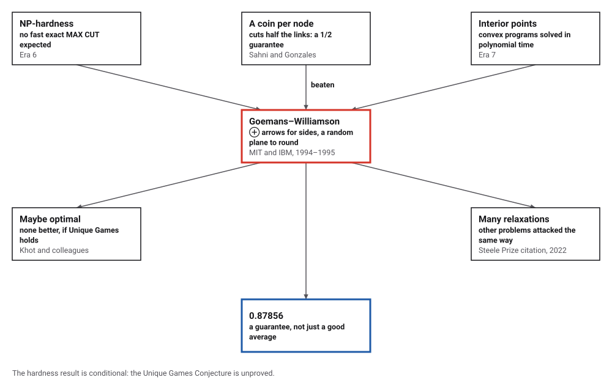
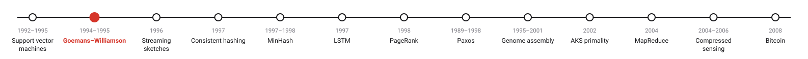
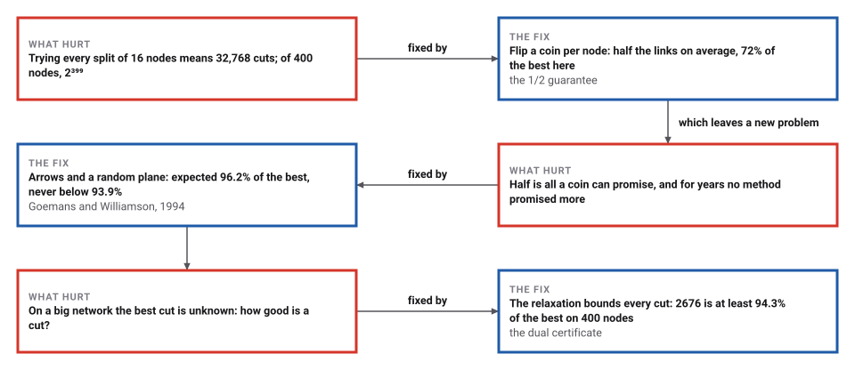
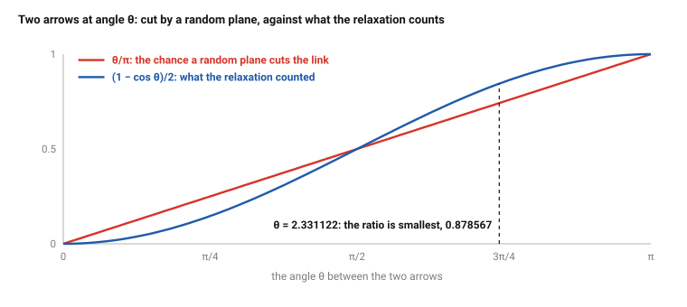

# Approximation by Semidefinite Programming

*Era 8 · topic 2 · 1994–1995* · [Era 8 index](../README.md) · [← Support Vector Machines](../01-support-vector-machines/README.md) · [Streaming Sketches →](../03-streaming-sketches/README.md) · [Interactive edition](max-cut.html) · [Program](../../../code/era-08-the-web-the-genome-and-the-ledger/02-max-cut/)

> **Field note from the visiting historian.** I asked for the best way to split 200 small networks and checked every answer by trying all 32,768 splits. A coin got 72% of the best links on average; a random plane through the arrows got 96.2%, and never less than 93.9%. On a network of 400 nodes nobody can try every split, but the arrows themselves proved my best cut was within 5.7% of perfect.

| | |
|---|---|
| **When** | STOC 1994; Journal of the ACM, November 1995 |
| **Where** | MIT; IBM T. J. Watson Research Center |
| **What hurt** | MAX CUT is NP-hard; the best guarantee was 1/2 |
| **The fix** | Arrows for sides, a semidefinite program, a random plane |
| **Checked** | Constant 0.878567 at θ = 2.331122 |

## How ideas combined

A new algorithm is usually an older idea combined with a new one. NP-completeness (Era 6) said that MAX CUT probably has no fast exact method. A coin flip per node promised half the links. Interior-point methods (Era 7) had made convex programs, including semidefinite ones, solvable in polynomial time. Goemans and Williamson relaxed each node's side into an arrow, solved for the best arrows, and rounded them with a random plane. Each box names the idea that was added.

<picture>
  <source media="(prefers-color-scheme: dark)" srcset="assets/family-dark.svg">
  
</picture>
*Red: Goemans and Williamson's algorithm. Blue: its guarantee.*

## Throw a plane through the arrows

The Petersen graph has 10 nodes and 15 links; its best cut has 12 links. The program solved the relaxation and gave every node an arrow in 5 dimensions. Each throw picks a random plane through the middle; nodes on one side turn red, the rest blue, and the cut links are drawn solid. The planes come from the program's own generator, so the widget's cuts match the program's, throw by throw. Compare with a coin per node.

| Plane | Links cut (of 15) |
|---|---|
| 1 | 11 |
| 2 | 9 |
| 3 | 11 |
| 4 | 12 |
| 5 | 11 |
| 6 | 12 |
| 7 | 12 |
| 8 | 10 |
| 9 | 12 |
| 10 | 11 |
| 11 | 12 |
| 12 | 11 |
| 13 | 11 |
| 14 | 11 |
| 15 | 11 |
| 16 | 12 |
| 17 | 12 |
| 18 | 11 |
| 19 | 11 |
| 20 | 12 |
*In the interactive edition you can throw the planes yourself and compare them with coin flips.*

## Era 8, the Web, the genome and the ledger

<picture>
  <source media="(prefers-color-scheme: dark)" srcset="assets/era-timeline-dark.svg">
  
</picture>

## Each fix leaves a new pain

<picture>
  <source media="(prefers-color-scheme: dark)" srcset="assets/chain-dark.svg">
  
</picture>
*Read it as a snake: each new problem sits directly under the fix that exposed it.*

## Relax, solve, round

**The problem.** Give each node i a side xᵢ = +1 or −1. A link between i and j is cut when xᵢ ≠ xⱼ, so the cut counts (1 − xᵢxⱼ)/2 over the links. Maximize that.

**The relaxation.** Replace each number xᵢ by a unit arrow vᵢ in n dimensions and the product xᵢxⱼ by the dot product vᵢ · vⱼ. Arrows in one dimension are just ±1, so the best arrows do at least as well as the best cut. Finding the best arrows is a semidefinite program, which can be solved to any accuracy in polynomial time. (The program uses a simple low-rank method: turn each arrow to point away from the sum of its neighbours', over and over, then prove the answer optimal with a certificate from the dual program.)

**The rounding.** Pick a random plane through the origin and put each node on the side its arrow points to. Two arrows at angle θ land on opposite sides with probability θ/π. The relaxation counted that link as (1 − cos θ)/2. The ratio of the two is never below 0.87856, so the expected cut is at least 0.87856 times the relaxation, and so at least 0.87856 times the best cut.

<picture>
  <source media="(prefers-color-scheme: dark)" srcset="assets/ratio-dark.svg">
  
</picture>

> **Key idea.** Solve an easier problem exactly, then round its answer at random in a way whose loss you can bound. The random plane loses at most 12% of what the relaxation counted, link by link.

## Guarantee and practice

**The constant.** The smallest value of 2θ/(π(1 − cos θ)) is 0.878567, at θ = 2.331122 radians (133.56°), as the paper states.

**The 5-cycle.** The relaxation's value is 4.522542, which equals (5/2)(1 + cos(π/5)) = 4.522542; neighbouring arrows sit 144.0° apart. The best cut has 4 links, so here the best cut is only 0.8845 of the relaxation, and the random plane's expected cut is exactly 4.

**200 random networks of 16 nodes**, each link present with probability ½. Every relaxation was certified optimal by its dual, and every best cut found by trying all 32,768 splits. As fractions of the best cut:

| Method | Average | Lowest | Found the best |
|---|---|---|---|
| Coin flip (expected) | 0.7194 | — | — |
| Local search from a coin flip | 0.9497 | 0.8000 | 42 of 200 |
| **Random plane (expected)** | **0.9620** | **0.9386** | **—** |
| Best of 100 random planes | 0.9999 | — | 199 of 200 |

The best cut was never less than 0.9489 of the relaxation, so the relaxation itself was always within 5% of the truth.

**400 nodes**, 4094 links: far too many splits to try. The relaxation (arrows in 30 dimensions) is 2837.98, and its dual proves that no cut exceeds 2837.98. The expected random-plane cut is 2593.3; the best of 100 planes, each improved by local search, cut 2676 links, so at least 94.3% of the best possible. The best of 100 coin flips with the same local search cut 2641.

## A constant that stood still for years

Goemans (MIT) and Williamson (IBM T. J. Watson), *Journal of the ACM* 42(6), November 1995 (preliminary version at STOC, Montreal, 1994): "We present randomized approximation algorithms for the maximum cut (MAX CUT)" that "always deliver solutions of expected value at least .87856 times the optimal value". The rounding picks "a random hyperplane through the origin (with r as its normal)"; the constant "achieves its value for θ = 2.331122...". Before them, the 1/2 of Sahni and Gonzales stood, and "no progress was made in improving the constant". The journal version notes that the conference version's derandomization "had a subtle error".

The 2022 AMS Steele Prize for Seminal Contribution to Research went to the paper, which "yields an approximation ratio of 0.878" and led many problems to be "studied via relaxation to semidefinite programs". Khot and O'Donnell (*Theory of Computing*, 2009) report hardness results that "match the above two guarantees of Goemans and Williamson, assuming Khot's 'Unique Games Conjecture'": if that unproved conjecture holds, no fast algorithm can promise more than 0.878.

## Linear programming, one dimension up

The interior-point methods of Era 7 solve linear programs by walking through the inside of a region of numbers. Semidefinite programs are the same idea with matrices in place of numbers, and the same methods solve them. Compressed sensing (topic 12) is another relaxation that turned out to be exact: swap a hard count of nonzero entries for a sum of absolute values.

> **Full circle.** A coin promised half. Arrows and a plane promised 0.878567, and on 200 random networks delivered 96.2% on average.

## Before you read on

<details>
<summary><b>1.</b> Two arrows point in opposite directions (θ = π). What is the chance a random plane separates them, and what did the relaxation count?</summary>

Both are 1: the plane always separates them, and (1 − cos π)/2 = 1.
</details>

<details>
<summary><b>2.</b> Two arrows are at right angles. Compare θ/π with (1 − cos θ)/2.</summary>

θ/π = 1/2 and (1 − cos θ)/2 = 1/2: no loss at all.
</details>

<details>
<summary><b>3.</b> Why is the relaxation's value at least the best cut?</summary>

Any cut is a choice of arrows that all lie on one line (±1), so it is one of the relaxation's options.
</details>

<details>
<summary><b>4.</b> A triangle (3 nodes, 3 links): what is the best cut, and roughly what is the relaxation?</summary>

The best cut has 2 links. Three arrows 120° apart give 3 × (1 − cos 120°)/2 = 2.25.
</details>

<details>
<summary><b>5.</b> Why is 0.878 called a guarantee and not a typical result?</summary>

It holds for every network, in expectation; on the random networks here the plane did much better, 96% on average.
</details>


## Where the evidence lives

| | Object | Where to see it | Licence |
|---|---|---|---|
| — | **Goemans and Williamson's paper (1995)**. *Journal of the ACM* 42(6): the relaxation, the random hyperplane and the constant. | [The paper (PDF, MIT)](https://math.mit.edu/~goemans/PAPERS/maxcut-jacm.pdf) | Drawn placeholder. |

## Every link was opened before it was listed

| Level | Link | Why |
|---|---|---|
| Start | [Williamson and Goemans receive 2022 Steele Prize](https://bowers.cornell.edu/news-stories/david-williamson-and-michel-goemans-receive-2022-steele-prize-seminal-contribution-research) — Cornell University (2022) | What the paper did and why it mattered |
| Deeper | [Goemans and Williamson (1995): Algorithm for MAXCUT](https://www.cs.toronto.edu/~deepkush/teaching/373s22/hwk/tutorial6-max-cut.pdf) — University of Toronto course notes | The relaxation and the rounding, step by step |
| Scholar | [Improved approximation algorithms for maximum cut and satisfiability problems using semidefinite programming](https://math.mit.edu/~goemans/PAPERS/maxcut-jacm.pdf) — M. Goemans, D. Williamson, *J. ACM* (1995) | The algorithm, the constant and the proofs |
| Scholar | [SDP gaps and UGC-hardness for Max-Cut-Gain](https://zesty2.cs.uchicago.edu/articles/v005a004/v005a004.pdf) — S. Khot, R. O'Donnell, *Theory of Computing* (2009) | Why 0.878 may be the best possible |

More, with certainty labels and the gaps we could not fill: [Era 8 reference catalog](https://github.com/vij658/AlgorithmEvolutionAtlas/blob/main/book/era-08-the-web-the-genome-and-the-ledger/reference-catalog.md).

## The program behind every number here

[GoemansWilliamson.java](https://github.com/vij658/AlgorithmEvolutionAtlas/blob/main/code/era-08-the-web-the-genome-and-the-ledger/02-max-cut/GoemansWilliamson.java) makes **183,203 checks**: the constant on a grid of 100,000 angles, every sweep of the coordinate method, the dual certificate for every relaxation, the guarantee on 200 random networks against exhaustive search, and the Petersen graph's planes. Run it with `java GoemansWilliamson.java` (JDK 17 or newer). The heart of it:

```java
/** The relaxation's arrows (rank k), found by the low-rank coordinate method. Returns v[n][k]. */
static double[][] relax(double[][] w, int k) {
    int n = w.length;
    double[][] v = new double[n][k];
    for (double[] vi : v) { // random start: a point in a cube, scaled to unit length
        double len;
        do { len = 0; for (int d = 0; d < k; d++) { vi[d] = 2 * next32() - 1; len += vi[d] * vi[d]; } } while (len < 1e-6);
        len = Math.sqrt(len);
        for (int d = 0; d < k; d++) vi[d] /= len;
    }
    int[][] nb = new int[n][];
    for (int i = 0; i < n; i++) {
        int c = 0;
        for (int j = 0; j < n; j++) if (w[i][j] != 0) c++;
        nb[i] = new int[c];
        c = 0;
        for (int j = 0; j < n; j++) if (w[i][j] != 0) nb[i][c++] = j;
    }
    double prev = Double.NEGATIVE_INFINITY;
    for (int sweep = 0; sweep < 1_000_000; sweep++) {
        double moved = 0;
        for (int i = 0; i < n; i++) {
            double[] g = new double[k];
            for (int j : nb[i]) for (int d = 0; d < k; d++) g[d] += w[i][j] * v[j][d];
            double len = 0;
            for (int d = 0; d < k; d++) len += g[d] * g[d];
            len = Math.sqrt(len);
            if (len > 1e-15) for (int d = 0; d < k; d++) {
                double nv = -g[d] / len;
                moved = Math.max(moved, Math.abs(nv - v[i][d]));
                v[i][d] = nv;
            }
        }
        double val = sdpValue(w, v, nb);
        check(val >= prev - 1e-9, "each sweep of the coordinate method can only improve the value");
        prev = val;
        if (moved < 1e-11) break;
    }
    return v;
}

/** The exact expected cut of a random plane: sum of w arccos(v_i . v_j) / pi. */
static double expectedCut(double[][] w, double[][] v) {
    double s = 0;
    for (int i = 0; i < w.length; i++) for (int j = i + 1; j < w.length; j++)
        if (w[i][j] != 0) s += w[i][j] * Math.acos(Math.max(-1, Math.min(1, dot(v[i], v[j])))) / Math.PI;
    return s;
}
```

