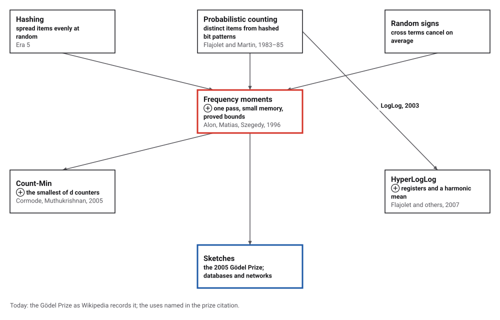
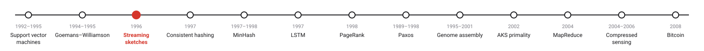
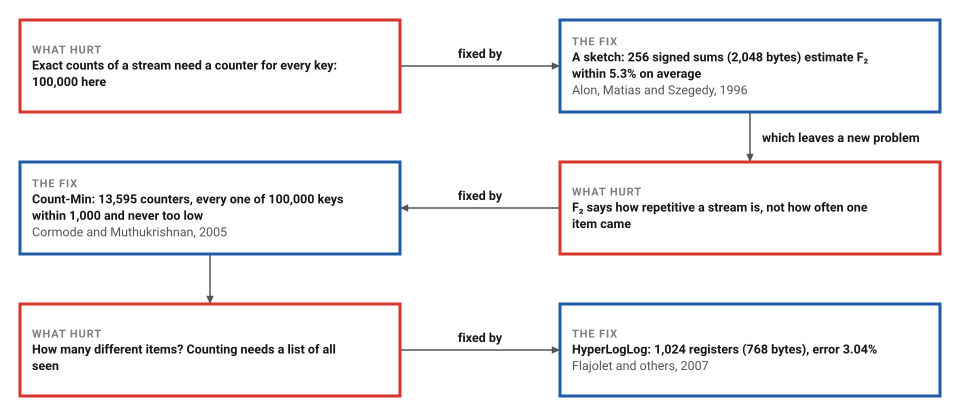
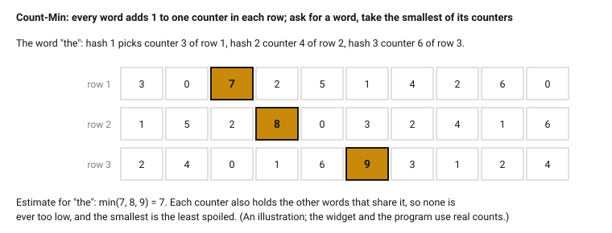

# Streaming Sketches

*Era 8 · topic 3 · 1996* · [Era 8 index](../README.md) · [← Approximation by Semidefinite Programming](../02-max-cut/README.md) · [Consistent Hashing →](../04-consistent-hashing/README.md) · [Interactive edition](streaming-sketches.html) · [Program](../../../code/era-08-the-web-the-genome-and-the-ledger/03-streaming-sketches/)

> **Field note from the visiting historian.** I let 1,000,000 items flow past and kept almost nothing. 2,048 bytes of signed sums told me how repetitive the stream was to within 5.3%; 13,595 counters told me how often any one key came, never too low; 3,072 bytes of registers told me there were about 64,608 different keys, to 1.48%.

| | |
|---|---|
| **When** | Flajolet–Martin 1983–85; AMS 1996; Count-Min 2005; HyperLogLog 2007 |
| **Where** | Tel Aviv, Bell Labs, AT&T; INRIA, IBM; Rutgers |
| **What hurt** | Exact counts need memory for every item |
| **The fix** | Small random summaries, updated in one pass |
| **Checked** | All 100,000 Count-Min queries; HyperLogLog 1.48% at m = 4,096 |

## How ideas combined

A new algorithm is usually an older idea combined with a new one. Hashing (Era 5) scatters items at random. Flajolet and Martin used the bit patterns of hashed items to count distinct ones in a single pass. Alon, Matias and Szegedy multiplied counts by random signs so that the cross terms cancel, and proved which questions about a stream need little memory and which need a lot. Each box names the idea that was added.

<picture>
  <source media="(prefers-color-scheme: dark)" srcset="assets/family-dark.svg">
  
</picture>
*Red: the 1996 paper credited with founding the field. Blue: where it led.*

## Count words you cannot keep

A paragraph of 82 words (62 different) streams into a Count-Min sketch of three rows of 32 counters. Each word adds 1 to one counter in each row, chosen by that row's hash. Click any word to ask how often it has been seen: the answer is the smallest of its three counters, which is never too low but often too high, because other words share the cells. The widget uses the program's hash functions, and after the last word its 96 counters equal the program's.

| Word | True count | Estimate |
|---|---|---|
| and | 4 | 6 |
| of | 7 | 8 |
| one | 3 | 3 |
| the | 4 | 5 |
*In the interactive edition you can feed the words in one by one and query any of them. In the program's run, 36 of 62 words were overestimated.*

## Era 8, the Web, the genome and the ledger

<picture>
  <source media="(prefers-color-scheme: dark)" srcset="assets/era-timeline-dark.svg">
  
</picture>

## Each fix leaves a new pain

<picture>
  <source media="(prefers-color-scheme: dark)" srcset="assets/chain-dark.svg">
  
</picture>
*Read it as a snake: each new problem sits directly under the fix that exposed it.*

## Three questions, three sketches

**How repetitive is the stream?** The second frequency moment is F₂ = Σ (count of item i)². Give every item a random sign s(i) = ±1 and keep one number, Z = the sum of s(item) over the stream. Then Z² = Σ count² + Σ (cross terms with random signs), and the cross terms cancel on average, so Z² averages to F₂. Average many independent copies to narrow the spread; take the median of several averages to make a bad answer rare. The signs come from a random cubic polynomial modulo a prime, which makes any four of them independent: exactly what the proof needs.

**How often did this item come?** Count-Min keeps d rows of w counters, each row with its own hash. Every item adds 1 to its counter in each row. Other items that share a counter only add, so each counter is an overestimate and the smallest of the d is the best one. With w = e/ε and d = ln(1/δ), the estimate exceeds the truth by more than ε times the stream's length with probability at most δ.

<picture>
  <source media="(prefers-color-scheme: dark)" srcset="assets/countmin-dark.svg">
  
</picture>

**How many different items?** Hash every item to a random-looking string of bits. Among n different items, about one in 2ᵏ has a hash starting with k zeros, so the longest run of leading zeros says roughly log₂ n. One such guess is crude; HyperLogLog splits the items into m groups by the first bits of the hash, keeps the longest run in each group (a register of 6 bits), and combines the m guesses with a harmonic mean. Its error is about 1.04/√m, however many items there are. Repeats change nothing: a second copy of an item hashes to the same bits.

> **Key idea.** Decide in advance which question you will ask, and keep only a small random summary that answers it, with an error you can state. A different question needs a different sketch, and some questions, like the largest count exactly, need memory proportional to the stream whatever you do.

## A million items, a few kilobytes

**The stream.** 1,000,000 items drawn from 100,000 keys with a Zipf law, so a few keys are very common: exactly 64,608 different keys appeared, F₂ = 27,091,489,822, and the commonest key appeared 134,997 times.

**F₂ from signed sums.** Each average below was repeated 40 times with fresh random signs:

| Copies averaged | Memory | Average error | Promised within | Trials within |
|---|---|---|---|---|
| 64 | 512 | 11.1% | 50.0% | 40 of 40 |
| **256** | **2,048** | **5.3%** | **25.0%** | **40 of 40** |

The median of 9 averages of 256 copies gave 28,759,442,926 against 27,091,489,822, an error of 6.2%.

**Count-Min**, ε = 0.001, δ = 0.01: 5 rows of 2,719 counters, 13,595 in all, against 100,000 for exact counts. All 100,000 keys were queried: none was too low, 0 were too high by more than εm = 1,000 (at most 1,000 are allowed), and the largest overestimate was 247. Every one of the 10 keys holding at least 1% of the stream was reported.

**Distinct items** (64,608 of them), with 200 different hash functions; the spread is the root-mean-square relative error:

| Registers m | HyperLogLog | Theory 1.04/√m | Bytes | Flajolet–Martin | Theory 0.78/√m | Bytes |
|---|---|---|---|---|---|---|
| 64 | 13.70% | 13.00% | 48 | 9.96% | 9.75% | 512 |
| 256 | 6.33% | 6.50% | 192 | 4.72% | 4.88% | 2,048 |
| 1,024 | 3.04% | 3.25% | 768 | 2.37% | 2.44% | 8,192 |
| 4,096 | 1.48% | 1.63% | 3,072 | 1.17% | 1.22% | 32,768 |

HyperLogLog's registers are smaller than Flajolet and Martin's bitmaps, so for the same memory it is more accurate. Ten million distinct items in 2,048 registers (1,536 bytes): estimate 9,609,228, error 3.91%.

## Founding a field in logarithmic space

Alon (Tel Aviv University), Matias (Bell Laboratories) and Szegedy (AT&T Research), first at STOC in May 1996: "Surprisingly, it turns out that the numbers F0, F1 and F2 can be approximated in logarithmic space", while F_k for k ≥ 6 needs polynomial space and the largest count needs Ω(n). The F₂ estimator uses four-wise independent ±1 values, E(X) = F₂ and variance at most 2F₂², with averages of 16/λ² copies and a median of 2 log(1/δ) averages. Wikipedia: the field "was first formalized and popularized" by this paper, whose authors won the Gödel Prize in 2005.

Flajolet (INRIA) and Martin (IBM, Hursley), *JCSS* 1985: algorithms that "estimate the number of distinct elements in a large collection of data" in one pass, about 5% error with 256 words. Cormode and Muthukrishnan, *Journal of Algorithms*, April 2005: "We introduce a new sublinear space data structure-the Count-Min Sketch- for summarizing data streams", with aᵢ ≤ âᵢ and, with probability 1 − δ, âᵢ ≤ aᵢ + ε‖a‖₁. Flajolet, Fusy, Gandouet and Meunier, 2007: HyperLogLog's error is "typically about 1.04/√m", estimating cardinalities "well beyond 10⁹" with "a typical accuracy of 2% while using a memory of only 1.5 kilobytes".

## Hashing, used for forgetting

Era 5's hash tables used hashing to find things quickly. Sketches use it to forget most of what they see, on purpose and with a known cost. MinHash (topic 5) is a sketch for similarity; consistent hashing (topic 4) uses the same scattering to decide which machine holds what.

> **Full circle.** 1,000,000 items, 64,608 different. A list of them would take hundreds of kilobytes; HyperLogLog with 4,096 registers (3,072 bytes) counted them to within 1.48%.

## Before you read on

<details>
<summary><b>1.</b> A stream has the items a, a, b. With signs s(a) = +1, s(b) = −1, what is Z² and what is F₂?</summary>

Z = 1 + 1 − 1 = 1, so Z² = 1; F₂ = 2² + 1² = 5. One copy is a poor guess; the average over random signs is exactly 5.
</details>

<details>
<summary><b>2.</b> Why can Count-Min never report a count below the truth?</summary>

Every occurrence of the item added 1 to each of its counters, and nothing ever subtracts.
</details>

<details>
<summary><b>3.</b> You want ε = 0.01 and δ = 0.001. How many counters?</summary>

w = ⌈e/0.01⌉ = 272 per row, d = ⌈ln 1000⌉ = 7 rows: 1,904 counters.
</details>

<details>
<summary><b>4.</b> HyperLogLog with m = 1,024 registers: roughly what error should you expect?</summary>

1.04/√1024 = 1.04/32 ≈ 3.3%; the program measured 3.04%.
</details>

<details>
<summary><b>5.</b> Why does a stream with every item repeated ten times give the same HyperLogLog estimate?</summary>

Each register keeps a maximum over hashed values, and a repeat hashes to the same value.
</details>


## Where the evidence lives

| | Object | Where to see it | Licence |
|---|---|---|---|
| — | **Alon, Matias and Szegedy's paper (1996)**. First presented at STOC in May 1996; the author's copy of the journal version. | [The paper (PDF, Princeton)](https://web.math.princeton.edu/~nalon/PDFS/amsz4.pdf) | Drawn placeholder. |

## Every link was opened before it was listed

| Level | Link | Why |
|---|---|---|
| Start | [Philippe Flajolet's contribution to streaming algorithms](https://lumbroso.princeton.edu/talk/2013-06-20-aggregate-knowledge/talk-2013-06-20-ak-summit-flajolet-lumbroso-slides.pdf) — J. Lumbroso (2013), slides | From probabilistic counting to HyperLogLog |
| Deeper | [Streaming algorithm](https://en.wikipedia.org/wiki/Streaming_algorithm) — Wikipedia | Frequency moments, heavy hitters, distinct elements and lower bounds |
| Scholar | [Probabilistic Counting Algorithms for Data Base Applications](https://www.Gwern.net/doc/cs/algorithm/1985-flajolet.pdf) — P. Flajolet, G. N. Martin, *JCSS* (1985) | Counting distinct items with hashed bit positions |
| Scholar | [The space complexity of approximating the frequency moments](https://web.math.princeton.edu/~nalon/PDFS/amsz4.pdf) — N. Alon, Y. Matias, M. Szegedy (STOC 1996; author's copy) | Sketches, and the lower bounds |
| Scholar | [An Improved Data Stream Summary: The Count-Min Sketch and its Applications](https://www.cs.tufts.edu/~nr/cs257/archive/graham-cormode/count-min.pdf) — G. Cormode, S. Muthukrishnan (preprint of the 2005 paper) | Point queries that are never too low |
| Scholar | [HyperLogLog: the analysis of a near-optimal cardinality estimation algorithm](https://dmtcs.episciences.org/3545/pdf) — P. Flajolet, É. Fusy, O. Gandouet, F. Meunier (2007) | Distinct counts in 1.5 kilobytes |

More, with certainty labels and the gaps we could not fill: [Era 8 reference catalog](https://github.com/vij658/AlgorithmEvolutionAtlas/blob/main/book/era-08-the-web-the-genome-and-the-ledger/reference-catalog.md).

## The program behind every number here

[StreamingSketches.java](https://github.com/vij658/AlgorithmEvolutionAtlas/blob/main/code/era-08-the-web-the-genome-and-the-ledger/03-streaming-sketches/StreamingSketches.java) makes **100,082 checks**: every one of 100,000 Count-Min queries, the one-pass sums against key-by-key sums, the error bands of the F₂ sketch, HyperLogLog and Flajolet–Martin over 200 hash functions, and the widget's 96 counters. Run it with `java StreamingSketches.java` (JDK 17 or newer). The heart of it:

```java
static double hyperLogLog(int[] keys, int b, long salt) {
    int m = 1 << b;
    byte[] reg = new byte[m];
    for (int x : keys) {
        long h = mix64(x * 0x9e3779b97f4a7c15L + salt);
        int j = (int) (h >>> (64 - b));
        long rest = h << b;
        int rho = rest == 0 ? 64 - b + 1 : Long.numberOfLeadingZeros(rest) + 1;
        if (rho > reg[j]) reg[j] = (byte) rho;
    }
    double sum = 0;
    int zeros = 0;
    for (byte r : reg) { sum += Math.pow(2, -r); if (r == 0) zeros++; }
    double alpha = m == 16 ? 0.673 : m == 32 ? 0.697 : m == 64 ? 0.709 : 0.7213 / (1 + 1.079 / m);
    double e = alpha * m * (double) m / sum;
    if (e <= 2.5 * m && zeros > 0) e = m * Math.log((double) m / zeros); // small range: count empty registers
    return e;
}
```

