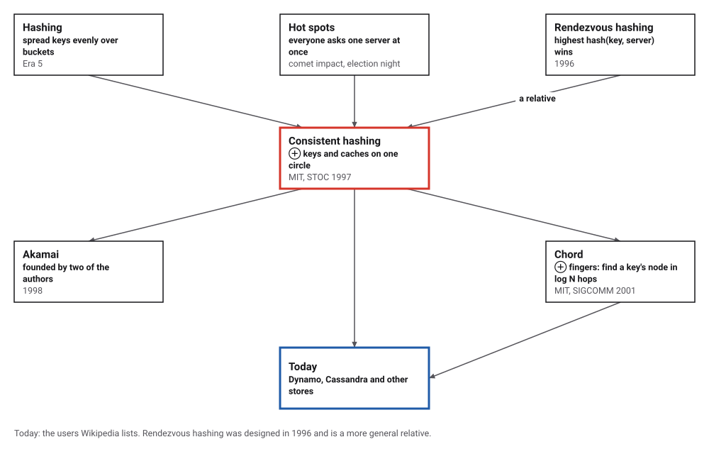
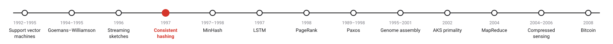
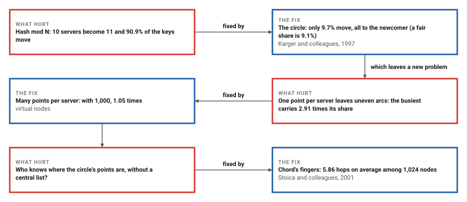
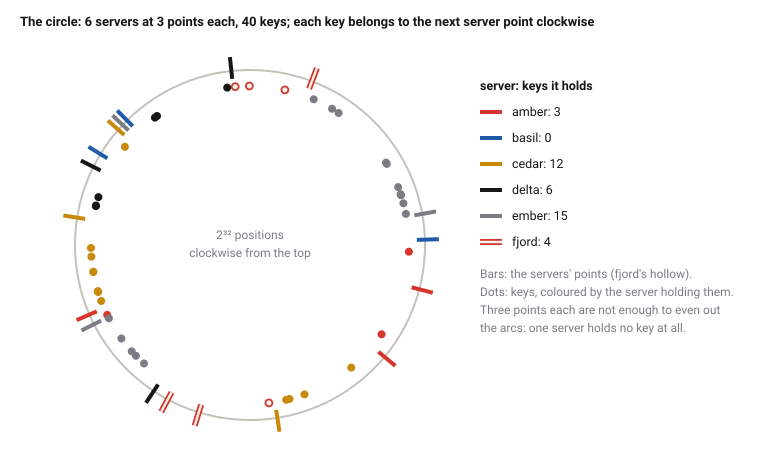

# Consistent Hashing

*Era 8 · topic 4 · 1997* · [Era 8 index](../README.md) · [← Streaming Sketches](../03-streaming-sketches/README.md) · [MinHash and Locality-Sensitive Hashing →](../05-minhash/README.md) · [Interactive edition](consistent-hashing.html) · [Program](../../../code/era-08-the-web-the-genome-and-the-ledger/04-consistent-hashing/)

> **Field note from the visiting historian.** I gave 100,000 keys to ten servers and added an eleventh. Dividing by the count, 90.9% of the keys had to move. On the circle, 9.7% moved, every one of them to the newcomer.

| | |
|---|---|
| **When** | STOC 1997; Akamai 1998; Chord 2001 |
| **Where** | MIT Laboratory for Computer Science |
| **What hurt** | Hash mod N moves nearly every key when N changes |
| **The fix** | Keys and servers on one circle; many points per server |
| **Checked** | 9.7% of keys moved, all to the new server |

## How ideas combined

A new algorithm is usually an older idea combined with a new one. Hashing (Era 5) spreads keys evenly over a fixed number of buckets. The Web's hot spots needed caches that come and go. Karger and his colleagues at MIT put the caches on the same circle of hash values as the keys, so that a change of caches moves only a few keys. Two of them founded Akamai the next year, and Chord turned the circle into a network that needs no central list. Each box names the idea that was added.

<picture>
  <source media="(prefers-color-scheme: dark)" srcset="assets/family-dark.svg">
  
</picture>
*Red: consistent hashing. Blue: where it is used now.*

## Add a server, take one away

Six servers, each at three points on a circle of 2³² hash values (the coloured bars; fjord's and gamma's are hollow), and forty keys (dots), each belonging to the first server point clockwise from it. Let gamma join, or let cedar leave: the keys that change hands are ringed, and they are only the ones next to the change. Tick the box to see what dividing the hash by the number of servers would have moved instead. The widget computes the same hashes as the program.

| Change | Keys that move (of 40) |
|---|---|
| gamma joins | 7 |
| cedar leaves | 12 |
| hash mod 6 → mod 7 | 38 |
*In the interactive edition you can add and remove servers and compare with hash mod N.*

## Era 8, the Web, the genome and the ledger

<picture>
  <source media="(prefers-color-scheme: dark)" srcset="assets/era-timeline-dark.svg">
  
</picture>

## Each fix leaves a new pain

<picture>
  <source media="(prefers-color-scheme: dark)" srcset="assets/chain-dark.svg">
  
</picture>
*Read it as a snake: each new problem sits directly under the fix that exposed it.*

## One circle for keys and servers

**Hash mod N.** server = hash(key) mod N spreads keys evenly. But a key stays put when N goes from 10 to 11 only if its hash leaves the same remainder for both, which happens for about one key in eleven: the other ten elevenths move.

**The circle.** Hash every key and every server onto the same circle of numbers, and give each key to the first server point clockwise from it. A new server takes over only the keys between its point and the point before it; a server that leaves hands its keys to the next point. Nothing else moves. The 1997 paper calls this property *monotonicity*.

<picture>
  <source media="(prefers-color-scheme: dark)" srcset="assets/ring-dark.svg">
  
</picture>

**Many points per server.** With one point each, the arcs between points are uneven, and so are the loads. Place every server at many points ("virtual nodes") and each server's share is the sum of many small arcs, which evens out.

**Chord.** To find a key's server without a central list, each node of Chord keeps "fingers": the nodes 1, 2, 4, 8, … places ahead of it on the circle. A lookup jumps along the farthest finger that does not overshoot the key, at least halving the remaining distance each time, so it needs about log₂ N hops.

> **Key idea.** Make the assignment depend on positions, not on the number of servers. Then a change of servers is a local event: only the neighbours of the change are affected.

## What moves, and how even

**Ten servers become eleven**, 100,000 keys:

| Method | Keys that move | Share | Where they go |
|---|---|---|---|
| hash mod N | 90,863 | 90.9% | almost all, everywhere |
| **circle, 100 points per server** | **9,662** | **9.7%** | **only to the new server** |
| rendezvous hashing | 9,116 | 9.1% | only to the new server |

**A server leaves** (one point per server): server 3's 1,408 keys (1.4% of all; an uneven arc) all moved to server 5, the next point clockwise, and no other key moved.

**Load balance**, 10 servers and 100,000 keys, over 50 different sets of servers:

| Points per server | Busiest server, times its fair share (average) | Worst of 50 |
|---|---|---|
| 1 | 2.91 | 4.80 |
| 10 | 1.58 | 2.03 |
| 100 | 1.15 | 1.34 |
| **1,000** | **1.05** | **1.09** |

**Clients that disagree.** 20 servers; 10 clients each know only a random 12 to 20 of them. Over all clients, one key is sent to 2.12 different servers on average (at most 4) with the circle, against 6.11 (at most 9) with hash mod the number of servers each knows. The 1997 paper calls this the *spread*.

**Chord**: 1,024 nodes at random places on a circle of 2³² identifiers, 10,000 lookups from random nodes: 5.86 hops on average and at most 11 (log₂ 1,024 = 10).

| Hops | Lookups |
|---|---|
| 0 | 12 |
| 1 | 10 |
| 2 | 91 |
| 3 | 481 |
| 4 | 1,228 |
| 5 | 2,219 |
| 6 | 2,552 |
| 7 | 2,012 |
| 8 | 1,008 |
| 9 | 343 |
| 10 | 41 |
| 11 | 3 |

## Swamped servers and a circle

Karger, Lehman, Leighton, Levine, Lewin and Panigrahy (MIT Laboratory for Computer Science): "Hot spots occur any time a large number of clients wish to simultaneously access data from a single server", as at JPL during the Shoemaker–Levy 9 comet impact and at political sites on election night; "a consistent hash function is one which changes minimally as the range of the function changes", judged by balance, monotonicity, spread and load. Their construction maps buckets and items to the unit interval, each bucket at about a constant times log C points. The opened copy prints no venue; Wikipedia gives the 1997 Symposium on Theory of Computing and records that Lewin and Leighton founded Akamai in 1998, that on average only K/N keys are remapped, and that Teradata had used the technique in 1986 without the name.

Stoica, Morris, Karger, Kaashoek and Balakrishnan (MIT, SIGCOMM, August 2001): "given a key, it maps the key onto a node", using "a variant of consistent hashing", with a finger table and O(log N) hops, and "adding virtual nodes as an indirection layer can significantly improve load balance".

## Hashing, made to forgive change

Era 5's hash tables assumed a fixed number of buckets; when the table grew, everything was rehashed at once. A web of caches cannot stop to rehash. MapReduce (topic 11) still sends each key to a reducer by hash mod R, because its R is fixed for one job; long-lived stores like Dynamo use the circle.

> **Full circle.** Ten servers became eleven. Dividing by the count moved 90.9% of the keys; the circle moved 9.7%, and every one of them to the newcomer.

## Before you read on

<details>
<summary><b>1.</b> With hash mod N, about what share of keys keeps its server when N goes from 4 to 5?</summary>

About 1/5: a key stays only if hash mod 4 = hash mod 5, which holds for 4 of every 20 consecutive hashes.
</details>

<details>
<summary><b>2.</b> On the circle, a server leaves. Which keys move, and where to?</summary>

Only its own keys, each to the next server point clockwise.
</details>

<details>
<summary><b>3.</b> Why do many points per server even out the load?</summary>

Each server's share becomes the sum of many independent small arcs, whose total varies much less than one arc.
</details>

<details>
<summary><b>4.</b> Chord has 1,024 nodes. Roughly how many hops should a lookup take?</summary>

About log₂ 1024 = 10 at most; the program measured 5.86 on average.
</details>

<details>
<summary><b>5.</b> Two clients know different sets of servers. Why does the circle keep their answers close?</summary>

A key's owner changes only if a server near it on the circle is missing from a client's list; with hash mod N, any difference in the count changes almost every answer.
</details>


## Where the evidence lives

| | Object | Where to see it | Licence |
|---|---|---|---|
| — | **Karger and colleagues' paper (1997)**. Consistent hashing and random trees, for relieving hot spots on the World Wide Web. | [The paper (PDF, on a Brown University course page)](https://cs.brown.edu/courses/csci2950-u/f09/papers/chash97stoc.pdf) | Drawn placeholder. |

## Every link was opened before it was listed

| Level | Link | Why |
|---|---|---|
| Start | [Consistent hashing](https://en.wikipedia.org/wiki/Consistent_hashing) — Wikipedia | The circle, virtual nodes and where it is used |
| Scholar | [Consistent Hashing and Random Trees](https://cs.brown.edu/courses/csci2950-u/f09/papers/chash97stoc.pdf) — D. Karger et al., STOC (1997), on a Brown course page | Hot spots, the four properties and the construction |
| Scholar | [Chord: A Scalable Peer-to-peer Lookup Service for Internet Applications](https://pdos.csail.mit.edu/archive/6.824-2012/papers/stoica-chord.pdf) — I. Stoica et al., SIGCOMM (2001), on an MIT course page | Consistent hashing without a central directory |

More, with certainty labels and the gaps we could not fill: [Era 8 reference catalog](https://github.com/vij658/AlgorithmEvolutionAtlas/blob/main/book/era-08-the-web-the-genome-and-the-ledger/reference-catalog.md).

## The program behind every number here

[ConsistentHashing.java](https://github.com/vij658/AlgorithmEvolutionAtlas/blob/main/code/era-08-the-web-the-genome-and-the-ledger/04-consistent-hashing/ConsistentHashing.java) makes **31,622 checks**: that every key that moves goes to the new server (100,000 keys, two methods), that a leaving server's keys all go to its successor, 10,000 Chord lookups ending at the right node, and the widget's circle. Run it with `java ConsistentHashing.java` (JDK 17 or newer). The heart of it:

```java
static int owner(TreeMap<Long, Integer> r, long h) {
    Map.Entry<Long, Integer> e = r.ceilingEntry(h);
    return (e != null ? e : r.firstEntry()).getValue();
}
```

