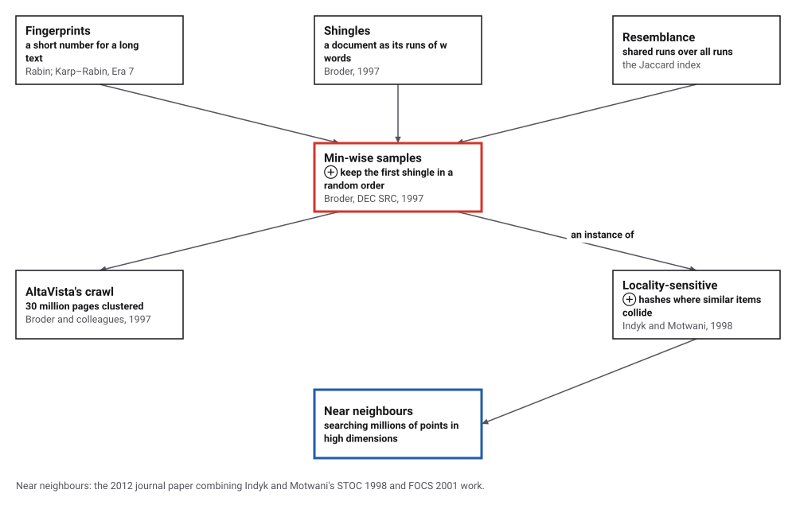
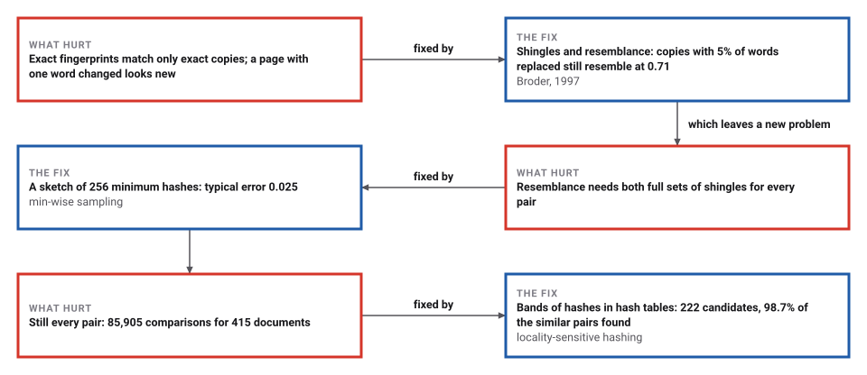
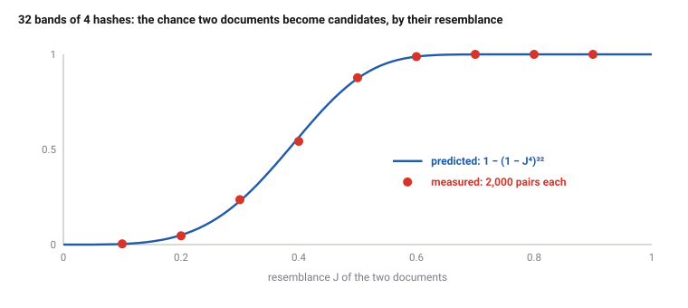

# MinHash and Locality-Sensitive Hashing

*Era 8 · topic 5 · 1997–1998* · [Era 8 index](../README.md) · [← Consistent Hashing](../04-consistent-hashing/README.md) · [Long Short-Term Memory →](../06-lstm/README.md) · [Interactive edition](minhash.html) · [Program](../../../code/era-08-the-web-the-genome-and-the-ledger/05-minhash/)

> **Field note from the visiting historian.** I copied pieces of my own notes and spoiled a few words in each. With 256 minimum hashes per piece I could tell how alike any two were to within 0.025, and by banding the hashes I found 98.7% of the near-copies while checking 222 pairs instead of 85,905.

| | |
|---|---|
| **When** | 1997 (MinHash); 1998 (locality-sensitive hashing) |
| **Where** | Digital Systems Research Center, Palo Alto; Stanford |
| **What hurt** | Near-duplicates among millions of pages; n² comparisons |
| **The fix** | Minimum hashes estimate resemblance; bands make similar pages collide |
| **Checked** | Exactly, on all 16,129 subset pairs; 98.7% of similar pairs found |

## How ideas combined

A new algorithm is usually an older idea combined with a new one. Fingerprints (Era 7) give a long text a short number, but only exact copies share one. Broder cut documents into overlapping runs of words, measured how much two sets of runs overlap, and then sampled that overlap cheaply: the smallest shingle under a random order. Indyk and Motwani made hashing that puts similar things together into a general method for finding near neighbours. Each box names the idea that was added.

<picture>
  <source media="(prefers-color-scheme: dark)" srcset="assets/family-dark.svg">
  
</picture>
*Red: MinHash. Blue: where the idea led.*

## Two sentences, 32 minimum hashes

Two sentences cut into shingles of two words: yellow ones are shared, red only in A, blue only in B. The resemblance is shared shingles over all shingles. Each of the 32 squares is one hash function: it is dark when the smallest hash of A's shingles equals the smallest hash of B's. The fraction of dark squares estimates the resemblance. With the program's sentences the widget computes the same hashes and finds the same 17 agreements; edit the sentences and watch the squares change.

|  | Value |
|---|---|
| Shingles in A, in B | 21, 21 |
| Shared | 15 |
| Resemblance | 15/27 = 0.556 |
| Minima that agree (of 32) | 17 |
| Estimate | 0.531 |
*In the interactive edition you can edit both sentences and watch the 32 minima agree and disagree.*

## Era 8, the Web, the genome and the ledger

<picture>
  <source media="(prefers-color-scheme: dark)" srcset="assets/era-timeline-dark.svg">
  
</picture>

## Each fix leaves a new pain

<picture>
  <source media="(prefers-color-scheme: dark)" srcset="assets/chain-dark.svg">
  
</picture>
*Read it as a snake: each new problem sits directly under the fix that exposed it.*

## The first shingle in a random order

**Shingles and resemblance.** Cut a document into its overlapping runs of w words: "a search engine", "search engine that", and so on. Two documents resemble each other in proportion to the runs they share: resemblance J = |A ∩ B| / |A ∪ B|, from 0 (nothing shared) to 1 (the same set).

**The one-line proof.** Put every possible shingle in a random order and look at the first one, among all the shingles of A and B together. It is equally likely to be any member of the union. A and B have the same first shingle exactly when that member is in both, which happens with probability |A ∩ B| / |A ∪ B| = J. Repeat with k independent orders (in practice, k hash functions) and the fraction of agreements estimates J with an error of about √(J(1 − J)/k).

**Banding.** To find similar pairs without comparing all of them, cut each document's sketch into b bands of r hashes and put each band in a hash table. Two documents become candidates if any whole band matches, which happens with probability 1 − (1 − J^r)^b: close to 0 for unlike documents, close to 1 for similar ones, with a steep step between.

<picture>
  <source media="(prefers-color-scheme: dark)" srcset="assets/scurve-dark.svg">
  
</picture>

> **Key idea.** Make the hash fit the question. An ordinary hash scatters near-copies; a minimum hash collides with exactly the probability that two documents resemble each other, so similarity turns into a lookup.

## Near-copies of this book's field notes

**The key fact, exactly.** For all 16,129 pairs of non-empty subsets of a 7-element universe and all 5,040 orders of it, the minima agree in exactly the fraction |A ∩ B| / |A ∪ B| of the orders, as a fraction with no rounding.

**Documents.** The field notes (3,337 words) cut into 83 pieces of 40 words, each with 4 copies in which a share of the words was replaced at random: 415 documents, shingles of 4 words. Replacing a word spoils every shingle that contains it, so resemblance falls fast:

| Words replaced | Average resemblance to the original |
|---|---|
| 5% | 0.71 |
| 10% | 0.55 |
| 20% | 0.27 |
| 40% | 0.08 |

**MinHash estimates** over the 332 pairs of a piece and its copies:

| Hash functions | Bytes per document | Typical error | Theory √(J(1 − J)/k) |
|---|---|---|---|
| 16 | 128 | 0.095 | 0.100 |
| 64 | 512 | 0.048 | 0.050 |
| 256 | 2,048 | 0.025 | 0.025 |

**Banding**, 32 bands of 4, on 2,000 pairs of 200-element sets at each resemblance:

| Resemblance | Became candidates | 1 − (1 − J⁴)³² |
|---|---|---|
| 0.10 | 0.004 | 0.003 |
| 0.20 | 0.046 | 0.051 |
| 0.30 | 0.236 | 0.226 |
| 0.40 | 0.543 | 0.559 |
| 0.50 | 0.877 | 0.869 |
| 0.60 | 0.988 | 0.988 |
| 0.70 | 1.000 | 1.000 |
| 0.80 | 1.000 | 1.000 |
| 0.90 | 1.000 | 1.000 |

**Finding every similar pair** among 415 documents. Comparing every pair took 85,905 comparisons and found 157 pairs with resemblance at least 0.5. Banding the first 128 of the 256 hashes gave 222 candidate pairs to check, and they included 155 of the 157 (98.7%); 67 candidates turned out to be below 0.5.

## Thirty million pages in Palo Alto

Broder (Digital Systems Research Center, Palo Alto), "On the resemblance and containment of documents" (Compression and Complexity of Sequences, 1997): resemblance |S(A,w) ∩ S(B,w)| / |S(A,w) ∪ S(B,w)|; under a random permutation the smallest element of the union lies in both sets with probability equal to the resemblance; "100 samples seems reasonable and 200 seems more than enough", with sketches of 300 to 800 bytes. With Glassman, Manasse and Zweig (SRC Technical Note 1997-015) he clustered "a collection of over 30,000,000 documents" from an AltaVista Web walk of April 1996, about 150 GB, at 50% resemblance: 3.6 million clusters holding 12.3 million documents, in about 10.5 CPU-days.

Wikipedia: MinHash "was published by Andrei Broder in a 1997 conference" and "initially used in the AltaVista search engine to detect duplicate web pages"; "The probability that hmin(A) = hmin(B) is true is equal to the similarity J(A,B)"; with k hash functions "its expected error is O(1/√k)". Har-Peled, Indyk and Motwani (*Theory of Computing*, 2012), "based on the material from the authors' STOC'98 and FOCS'01 papers": approximate nearest neighbours in high dimensions with query times "sub-linear" in the data.

## Fingerprints that tolerate change

Karp and Rabin's fingerprints (Era 7) were built so that different texts almost never collide. MinHash is built so that similar texts collide often. Both are hashing; the difference is what a collision should mean. Genome assembly (topic 9) cuts reads into k-letter words just as Broder cut documents into shingles.

> **Full circle.** Comparing every pair of 415 documents took 85,905 comparisons. Bands of minimum hashes proposed 222, and 98.7% of the similar pairs were among them.

## Before you read on

<details>
<summary><b>1.</b> A = {1, 2, 3, 4}, B = {3, 4, 5}. What is the resemblance?</summary>

Shared {3, 4}, union {1, 2, 3, 4, 5}: 2/5 = 0.4.
</details>

<details>
<summary><b>2.</b> Why can changing one word of a 40-word piece remove up to 4 of its 4-word shingles?</summary>

Every shingle that contains the word changes, and with w = 4 up to four shingles contain it.
</details>

<details>
<summary><b>3.</b> With 100 hash functions and J = 0.5, about how far off is the estimate?</summary>

√(0.5 × 0.5 / 100) = 0.05.
</details>

<details>
<summary><b>4.</b> With 32 bands of 4, what is the chance a pair with J = 0.5 becomes a candidate?</summary>

1 − (1 − 0.5⁴)³² = 1 − (15/16)³² ≈ 0.87; the program measured 0.877.
</details>

<details>
<summary><b>5.</b> Why does banding miss some similar pairs and propose some dissimilar ones?</summary>

The S-curve is steep but not a step: near the threshold the chance is neither 0 nor 1.
</details>


## Where the evidence lives

| | Object | Where to see it | Licence |
|---|---|---|---|
| — | **Syntactic Clustering of the Web (1997)**. SRC Technical Note 1997-015: 30 million pages from AltaVista, clustered by resemblance. | [The technical note (PDF)](https://archives.iw3c2.org/www2010/pubs/77977/src-tn-1997-015.pdf) | Drawn placeholder. |

## Every link was opened before it was listed

| Level | Link | Why |
|---|---|---|
| Start | [MinHash](https://en.wikipedia.org/wiki/MinHash) — Wikipedia | The one-line proof and the error of k samples |
| Deeper | [Syntactic Clustering of the Web](https://archives.iw3c2.org/www2010/pubs/77977/src-tn-1997-015.pdf) — A. Broder, S. Glassman, M. Manasse, G. Zweig (1997) | What it took to cluster 30 million pages |
| Scholar | [On the resemblance and containment of documents](https://www.cs.princeton.edu/courses/archive/spring13/cos598C/broder97resemblance.pdf) — A. Broder (1997), on a Princeton course page | Shingles, resemblance and min-wise samples |
| Scholar | [Approximate Nearest Neighbor: Towards Removing the Curse of Dimensionality](https://mirror.theoryofcomputing.org/articles/v008a014/) — S. Har-Peled, P. Indyk, R. Motwani, *Theory of Computing* (2012) | Locality-sensitive hashing, from the 1998 and 2001 papers |

More, with certainty labels and the gaps we could not fill: [Era 8 reference catalog](https://github.com/vij658/AlgorithmEvolutionAtlas/blob/main/book/era-08-the-web-the-genome-and-the-ledger/reference-catalog.md).

## The program behind every number here

[MinHashLsh.java](https://github.com/vij658/AlgorithmEvolutionAtlas/blob/main/code/era-08-the-web-the-genome-and-the-ledger/05-minhash/MinHashLsh.java) makes **16,302 checks**: the minima's agreement against the resemblance for every pair of subsets and every order of a 7-element universe, the error for 16 to 256 hashes, the banding curve, and every similar pair found by LSH coming from the same piece. Run it with `java MinHashLsh.java` (JDK 17 or newer). The heart of it:

```java
static long[] sketch(long[] set, int k) {
    long[] m = new long[k];
    Arrays.fill(m, Long.MAX_VALUE);
    for (long x : set) for (int i = 0; i < k; i++) {
        long h = mix64(x ^ (0x9e3779b97f4a7c15L * (i + 1))) >>> 1;
        if (h < m[i]) m[i] = h;
    }
    return m;
}
```

