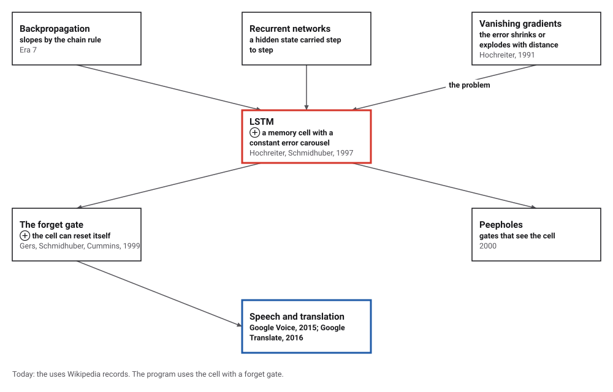
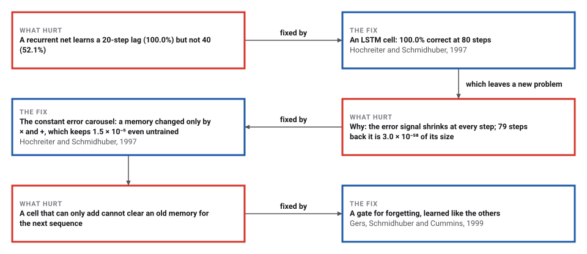
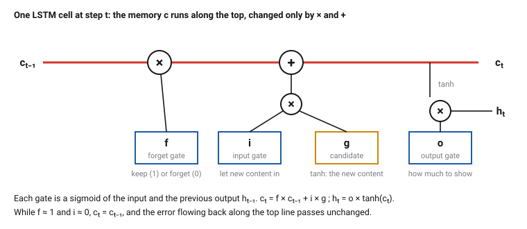
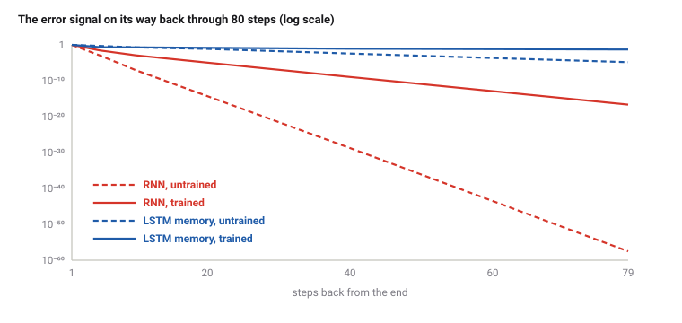

# Long Short-Term Memory

*Era 8 · topic 6 · 1997* · [Era 8 index](../README.md) · [← MinHash and Locality-Sensitive Hashing](../05-minhash/README.md) · [PageRank →](../07-pagerank/README.md) · [Interactive edition](lstm.html) · [Program](../../../code/era-08-the-web-the-genome-and-the-ledger/06-lstm/)

> **Field note from the visiting historian.** I showed two small networks a sign and then nothing but noise. After 20 steps both remembered it. After 40 the plain one had forgotten (it was right 52.1% of the time); the LSTM was still right 100.0% of the time after 80. On the way back through 79 steps the plain network's error signal had shrunk to 3.0 × 10⁻⁵⁸ of its size.

| | |
|---|---|
| **When** | Thesis 1991; report 1995; journal 1997; forget gate 1999 |
| **Where** | Technische Universität München; IDSIA, Lugano |
| **What hurt** | The error signal vanishes over long gaps |
| **The fix** | A gated memory cell with a constant error carousel |
| **Checked** | RNN 52.1% at 40 steps; LSTM 100.0% at 80 |

## How ideas combined

A new algorithm is usually an older idea combined with a new one. Backpropagation (Era 7) gives every weight its slope; run backwards through a recurrent network's steps, it trains networks that read sequences. Hochreiter's 1991 thesis showed why such training fails over long gaps: the error signal shrinks or explodes exponentially. Hochreiter and Schmidhuber's answer was a memory that the error can cross unchanged, guarded by gates that learn. Each box names the idea that was added.

<picture>
  <source media="(prefers-color-scheme: dark)" srcset="assets/family-dark.svg">
  
</picture>
*Red: LSTM. Blue: where it was used.*

## Carry one sign through thirty steps of noise

The program trained this small LSTM (4 memory cells) on sequences of 30 steps: at step 1 one input carries a sign, +1 or −1; after that it is 0, while a second input carries random noise at every step. At the last step the network must say which sign it saw; it was right on 100.0% of 1,000 new sequences. The lines are its four memory cells over the 30 steps. Flip the first sign and watch the memories take the other path; try new noise and watch them hold. The widget runs the program's weights.

| Step | Cell 1 | Cell 2 | Cell 3 | Cell 4 |
|---|---|---|---|---|
| 1 | 0.669 | -0.195 | -0.107 | -0.532 |
| 5 | -0.367 | 1.289 | -0.295 | -1.895 |
| 10 | -2.423 | 2.592 | -1.524 | -3.244 |
| 15 | -3.680 | 3.688 | -2.692 | -3.909 |
| 20 | -4.484 | 4.537 | -3.719 | -4.443 |
| 25 | -4.973 | 5.281 | -4.655 | -4.852 |
| 30 | -5.431 | 6.020 | -5.562 | -5.058 |
*In the interactive edition you can flip the first sign and change the noise. In the program's example (sign −1) the output was -7.8412.*

## Era 8, the Web, the genome and the ledger

<picture>
  <source media="(prefers-color-scheme: dark)" srcset="assets/era-timeline-dark.svg">
  
</picture>

## Each fix leaves a new pain

<picture>
  <source media="(prefers-color-scheme: dark)" srcset="assets/chain-dark.svg">
  
</picture>
*Read it as a snake: each new problem sits directly under the fix that exposed it.*

## A memory the error can cross

**A recurrent network** reads a sequence one step at a time: hₜ = tanh(W [xₜ, hₜ₋₁] + b). To train it, backpropagation runs backwards through the steps, and at every step the error is multiplied by W and by the slope of tanh. Multiply by something smaller than 1 eighty times and almost nothing is left; larger than 1, and it explodes.

**The LSTM cell** keeps a separate memory c that is changed only by multiplying and adding: cₜ = f × cₜ₋₁ + i × g. The gates f (forget), i (input) and o (output) are numbers between 0 and 1 computed from the input and the previous output; g is the proposed new content. The output is hₜ = o × tanh(cₜ). While f stays near 1 and i near 0, the memory, and the error flowing back through it, pass unchanged: the "constant error carousel". (In the 1997 cell f was always 1; the forget gate came in 1999.)

<picture>
  <source media="(prefers-color-scheme: dark)" srcset="assets/cell-dark.svg">
  
</picture>

<picture>
  <source media="(prefers-color-scheme: dark)" srcset="assets/decay-dark.svg">
  
</picture>

> **Key idea.** Do not make the network learn to preserve a memory through repeated multiplications; give it a path where preserving is the default, and let it learn when to write and when to read.

## Twenty steps, forty, eighty

**Slopes checked.** On a 12-step sequence, backpropagation through time against central differences for every one of the RNN's 33 weights and the LSTM's 117: the whole gradients differ by 7.0 × 10⁻¹¹ and 8.7 × 10⁻¹¹ of their size.

**The long-lag task.** A plain recurrent network and an LSTM, each with 4 hidden units, trained by 1,500 steps of Adam and tested on 1,000 new sequences. "First input moves the output by" is half the change in the output when only the first sign is flipped: zero means the network has forgotten it.

| Steps T | RNN correct | First input moves the RNN by | LSTM correct | First input moves the LSTM by |
|---|---|---|---|---|
| 5 | 100.0% | 7.761 | 100.0% | 7.798 |
| 10 | 100.0% | 7.897 | 100.0% | 7.747 |
| 20 | 100.0% | 7.352 | 100.0% | 7.478 |
| **40** | **52.1%** | **0.000** | **100.0%** | **7.338** |
| 80 | 48.8% | 0.000 | 100.0% | 7.261 |

**The error signal on its way back**, on one 80-step sequence, relative to its size one step back:

| Steps back | RNN, untrained | LSTM memory, untrained | RNN, trained (T = 80) | LSTM memory, trained |
|---|---|---|---|---|
| 1 | 1.0 | 1.0 | 1.0 | 1.0 |
| 5 | 9.9 × 10⁻⁴ | 4.9 × 10⁻¹ | 2.6 × 10⁻² | 2.3 × 10⁻¹ |
| 10 | 8.5 × 10⁻⁸ | 2.0 × 10⁻¹ | 1.2 × 10⁻³ | 2.0 × 10⁻¹ |
| 20 | 5.2 × 10⁻¹⁵ | 7.5 × 10⁻² | 1.1 × 10⁻⁵ | 1.5 × 10⁻¹ |
| 40 | 1.8 × 10⁻²⁹ | 3.8 × 10⁻³ | 1.1 × 10⁻⁹ | 8.3 × 10⁻² |
| 79 | 3.0 × 10⁻⁵⁸ | 1.5 × 10⁻⁵ | 2.3 × 10⁻¹⁷ | 4.9 × 10⁻² |

Training the RNN did not save it: its error signal 79 steps back is still far too small to learn from. The trained LSTM's memory still carries a few percent.

## A thousand steps in Munich and Lugano

Hochreiter (Technische Universität München) and Schmidhuber (IDSIA, Lugano), *Neural Computation* 9(8), 1997: LSTM can learn to "bridge minimal time lags in excess of 1000 discrete time steps" by enforcing constant error flow through "constant error carrousels"; "Multiplicative gate units learn to open and close access to the constant error flow"; "LSTM is local in space and time; its computational complexity per time step and weight is O(1)". With backpropagation through time, error signals tend "to either (1) blow up or (2) vanish". On the hardest noise-free task, "LSTM solves it, while BPTT and RTRL already fail in case of 10-step minimal time lags".

Wikipedia: "Sepp Hochreiter's 1991 German diploma thesis analyzed the vanishing gradient problem"; an early version appeared in a 1995 technical report; the forget gate (Gers, Schmidhuber and Cummins, 1999) is "the most commonly used version today"; Google used an LSTM for speech recognition on Google Voice in 2015 and in its neural machine translation system in 2016. *Dive into Deep Learning* gives the gates as now written: Cₜ = Fₜ ⊙ Cₜ₋₁ + Iₜ ⊙ C̃ₜ and Hₜ = Oₜ ⊙ tanh(Cₜ).

## Backpropagation, kept alive

Era 7's backpropagation worked for networks a few layers deep. Read through time, a recurrent network is as deep as its sequence is long, and the same chain rule that made backpropagation work made its error signal vanish. LSTM did not change the chain rule; it changed the network so that the chain contains a link of exactly 1.

> **Full circle.** At 40 steps the plain network was right 52.1% of the time, a coin; its first input moved its answer by 0.000. The LSTM, with the same four hidden units, was right 100.0% of the time at 80.

## Before you read on

<details>
<summary><b>1.</b> An error signal is multiplied by 0.9 at every step. How much is left after 80 steps?</summary>

0.9⁸⁰ ≈ 0.0002.
</details>

<details>
<summary><b>2.</b> In the cell, f = 1 and i = 0 for ten steps. What happens to the memory c?</summary>

Nothing: cₜ = 1 × cₜ₋₁ + 0, so it is carried unchanged.
</details>

<details>
<summary><b>3.</b> Why does the output gate matter if the memory is kept anyway?</summary>

It decides when the memory affects the output; otherwise a stored sign would disturb every step's answer.
</details>

<details>
<summary><b>4.</b> The plain RNN got 100% at 20 steps and about 50% at 40. What does 50% mean here?</summary>

Guessing: with two signs equally likely, a network that has forgotten the first input is right half the time.
</details>

<details>
<summary><b>5.</b> Why might a cell need to forget?</summary>

To clear one sequence's memory before the next; without it the memory could only grow, as Gers, Schmidhuber and Cummins found.
</details>


## Where the evidence lives

| | Object | Where to see it | Licence |
|---|---|---|---|
| — | **Hochreiter and Schmidhuber's paper (1997)**. *Neural Computation* 9(8), 1735–1780. | [The paper (PDF)](https://papers.baulab.info/papers/Hochreiter-1997.pdf) | Drawn placeholder. |

## Every link was opened before it was listed

| Level | Link | Why |
|---|---|---|
| Start | [Long Short-Term Memory (LSTM)](https://d2l.ai/chapter_recurrent-modern/lstm.html) — *Dive into Deep Learning*, section 10.1 | The gates, with equations and code |
| Deeper | [Long short-term memory](https://en.wikipedia.org/wiki/Long_short-term_memory) — Wikipedia | From the 1991 thesis to the forget gate and wide use |
| Scholar | [Long Short-Term Memory](https://papers.baulab.info/papers/Hochreiter-1997.pdf) — S. Hochreiter, J. Schmidhuber, *Neural Computation* (1997) | The constant error carousel and the long-lag experiments |

More, with certainty labels and the gaps we could not fill: [Era 8 reference catalog](https://github.com/vij658/AlgorithmEvolutionAtlas/blob/main/book/era-08-the-web-the-genome-and-the-ledger/reference-catalog.md).

## The program behind every number here

[LongShortTermMemory.java](https://github.com/vij658/AlgorithmEvolutionAtlas/blob/main/code/era-08-the-web-the-genome-and-the-ledger/06-lstm/LongShortTermMemory.java) makes **159 checks**: every weight's slope against central differences for both networks, the accuracy at each lag, the error signal's decay, and the widget's trained network. Run it with `java LongShortTermMemory.java` (JDK 17 or newer). The heart of it:

```java
    abstract double logit(double[][] x, boolean keep);
    abstract void backward(double dLogit, double[] grad);
}

// RNN layout: W[H][Z], b[H], v[H], c
static final class Rnn extends Net {
```

