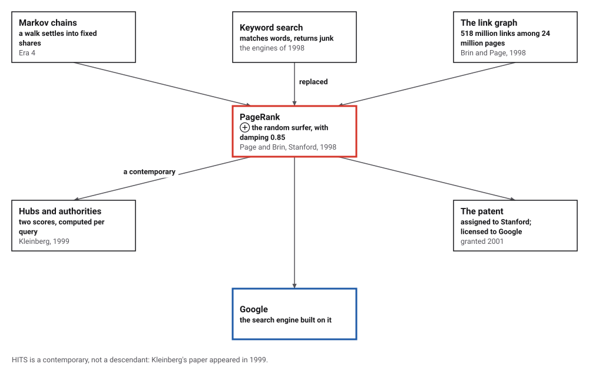
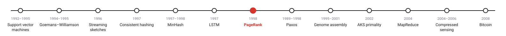
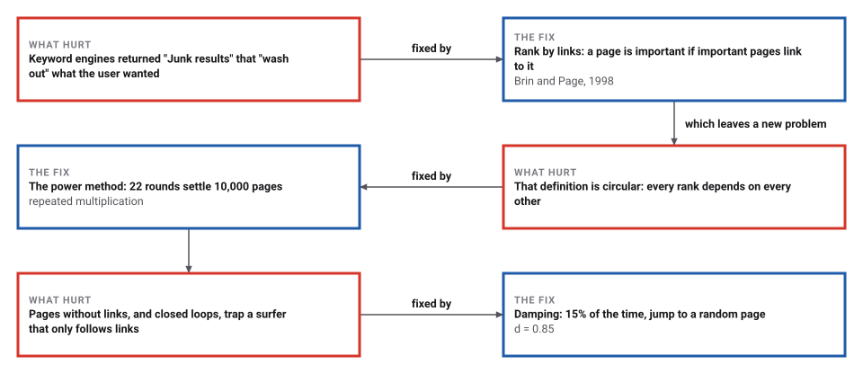
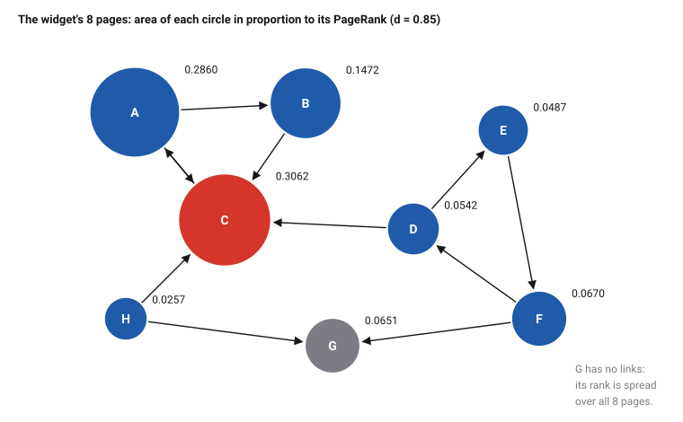

# PageRank

*Era 8 · topic 7 · 1998* · [Era 8 index](../README.md) · [← Long Short-Term Memory](../06-lstm/README.md) · [Paxos →](../08-paxos/README.md) · [Interactive edition](pagerank.html) · [Program](../../../code/era-08-the-web-the-genome-and-the-ledger/07-pagerank/)

> **Field note from the visiting historian.** I grew a web of 10,000 pages and let the ranks pass along its links. They settled in 22 rounds. Then I sent a surfer clicking at random through a smaller web, 4,000,000 times; its visits matched the ranks to within 0.00019. A hundred pages that did nothing but link to one obscure page lifted it to place 7.

| | |
|---|---|
| **When** | Project 1996; paper April 1998 |
| **Where** | Stanford University |
| **What hurt** | Keyword search returned junk |
| **The fix** | Rank by links: a damped random surfer, by the power method |
| **Checked** | Power method = Gaussian elimination to 2.1 × 10⁻¹⁵ |

## How ideas combined

A new algorithm is usually an older idea combined with a new one. Markov chains (Era 4) settle into fixed long-run shares. The search engines of 1998 matched keywords and drowned the good pages in junk. Page and Brin treated the Web's links as a Markov chain, a random surfer clicking forever, and ranked each page by the share of time the surfer spends there. Each box names the idea that was added.

<picture>
  <source media="(prefers-color-scheme: dark)" srcset="assets/family-dark.svg">
  
</picture>
*Red: PageRank. Blue: the search engine built on it.*

## Pass the rank along the links

Eight pages, A to H, with their links. Every page starts with rank 1/8. Each round, every page passes 85% of its rank, split equally, along its links; G has no links, so its rank is spread over all pages; and every page gets an equal share of the remaining 15%. The circles grow and shrink and settle. The rounds are exactly the program's. Or let a random surfer click around and count its visits.

| Round | A | B | C | D | E | F | G | H |
|---|---|---|---|---|---|---|---|---|
| 1 | 0.1383 | 0.0852 | 0.2977 | 0.0852 | 0.0852 | 0.1383 | 0.1383 | 0.0320 |
| 2 | 0.2865 | 0.0922 | 0.2144 | 0.0922 | 0.0696 | 0.1058 | 0.1058 | 0.0334 |
| 3 | 0.2122 | 0.1517 | 0.2835 | 0.0750 | 0.0692 | 0.0892 | 0.0892 | 0.0300 |
| 4 | 0.2692 | 0.1184 | 0.2920 | 0.0661 | 0.0601 | 0.0870 | 0.0789 | 0.0282 |
| 5 | 0.2753 | 0.1415 | 0.2823 | 0.0641 | 0.0552 | 0.0782 | 0.0761 | 0.0271 |
| 6 | 0.2668 | 0.1439 | 0.3030 | 0.0601 | 0.0541 | 0.0738 | 0.0716 | 0.0268 |
| 7 | 0.2839 | 0.1397 | 0.2990 | 0.0577 | 0.0519 | 0.0723 | 0.0691 | 0.0264 |
| 8 | 0.2802 | 0.1467 | 0.3013 | 0.0568 | 0.0506 | 0.0702 | 0.0680 | 0.0261 |
| 9 | 0.2820 | 0.1451 | 0.3050 | 0.0558 | 0.0501 | 0.0690 | 0.0669 | 0.0260 |
| 10 | 0.2851 | 0.1457 | 0.3038 | 0.0552 | 0.0496 | 0.0685 | 0.0662 | 0.0259 |
| exact | 0.2860 | 0.1472 | 0.3062 | 0.0542 | 0.0487 | 0.0670 | 0.0651 | 0.0257 |
*In the interactive edition you can run the rounds one at a time and send a random surfer around the pages.*

## Era 8, the Web, the genome and the ledger

<picture>
  <source media="(prefers-color-scheme: dark)" srcset="assets/era-timeline-dark.svg">
  
</picture>

## Each fix leaves a new pain

<picture>
  <source media="(prefers-color-scheme: dark)" srcset="assets/chain-dark.svg">
  
</picture>
*Read it as a snake: each new problem sits directly under the fix that exposed it.*

## A surfer who never stops

**The equation.** With N pages and damping d = 0.85, page u's rank is PR(u) = (1 − d)/N + d × Σ PR(v)/L(v), summed over the pages v that link to u, where L(v) is the number of links on v. One equation per page, all at once.

**The surfer.** Read the equation as a random surfer: at each step, with probability d, click a random link on the current page; otherwise jump to a page chosen at random. PR(u) is the long-run share of time spent on u. A page with no links sends the surfer to a random page. The random jumps also stop the surfer from being trapped in a closed loop, so the shares exist and are unique.

**The power method.** Start with every page at 1/N and apply the right-hand side again and again. Each round shrinks the remaining error by a factor of at most d, whatever the size of the Web, and each round costs one pass over the links. Brin and Page wrote the formula as PR(A) = (1 − d) + d Σ …, which gives the same ranking multiplied by N.

<picture>
  <source media="(prefers-color-scheme: dark)" srcset="assets/web8-dark.svg">
  
</picture>

> **Key idea.** Let the pages vote with their links, and weigh each vote by the voter's own rank. The circularity is not a problem: it is an eigenvector, and repeated multiplication finds it.

## Ten thousand pages, one surfer

**A made-up web** of 10,000 pages and 63,354 links, grown so that new pages tend to link to pages that are already well linked; 948 pages have no links. From 1/N, the power method needed 22 rounds to change by less than 10⁻¹⁰; each round shrank the change by a factor of at most 0.3380, well under d. The top pages are the oldest and most linked:

| Page | Rank | Links in |
|---|---|---|
| 0 | 0.06991 | 2,580 |
| 1 | 0.05710 | 2,314 |
| 3 | 0.05176 | 2,207 |
| 2 | 0.04456 | 2,168 |
| 4 | 0.02380 | 1,742 |

**Checked three ways** on a web of 500 pages: the power method agrees with Gaussian elimination on the 500 equations to 2.1 × 10⁻¹⁵; a random surfer taking 4,000,000 steps visits each page in proportion to its rank (largest difference 0.00019, and 10 of the top 10 the same); and N times the ranks satisfies Brin and Page's form to 2 × 10⁻¹³.

**The damping factor**: rounds to a change below 10⁻¹⁰ on the 10,000-page web, against the worst-case bound log(10⁻¹⁰/2)/log d:

| d | Rounds | Bound |
|---|---|---|
| 0.50 | 15 | 36 |
| **0.85** | **22** | **147** |
| 0.95 | 24 | 464 |
| 0.99 | 25 | 2362 |

On this well-connected web the rounds barely depend on d; the bound is for the worst case. Wikipedia reports 52 rounds for a 322-million-link network in the original work, and the AMS Feature Column "50 – 100".

**A link farm.** Page 353 sits in the middle of the 500-page web. New pages that link only to it lift it:

| Farm pages | Rank | Place |
|---|---|---|
| none | 0.00060 | 251 of 500 |
| 1 | 0.00105 | 100 of 501 |
| 10 | 0.00500 | 31 of 510 |
| **100** | **0.03682** | **7 of 600** |

**Hubs and authorities** (HITS) on the same 500 pages settled in 18 rounds; 7 of the 10 best authorities are among PageRank's top 10.

## Twenty-four million pages at Stanford

Brin and Page (Computer Science Department, Stanford University), *Computer Networks and ISDN Systems* 30 (1998): PR(A) = (1 − d) + d (PR(T₁)/C(T₁) + … + PR(Tₙ)/C(Tₙ)); "We usually set d to 0.85"; the PageRanks "form a probability distribution over Web pages"; at least 24 million pages and link maps with "as many as 518 million of these hyperlinks"; PageRank "can be calculated using a simple iterative algorithm", for 26 million pages "in a few hours on a medium size workstation". Keyword engines gave "Junk results" that "often wash out any results that a user is interested in".

Wikipedia: PageRank was developed at Stanford "as a research project" from 1996; Robin Li's RankDex (1996) used a related ranking; the patent, assigned to Stanford and granted in 2001, earned Stanford 1.8 million Google shares, sold in 2005 for $336 million; the normalized form sums to one, which the original paper confused with a variant that sums to N. The AMS Feature Column (Austin, 2006) explains the Google matrix, the power method and why d near 0.85 is a compromise. Kleinberg's HITS (*Journal of the ACM*, 1999) scores hubs and authorities per query.

## Markov's chains, on the Web

Markov (Era 4) counted vowels and consonants in a poem and showed that a chain of dependent steps still settles into fixed shares. PageRank is those shares, for a chain whose states are Web pages and whose steps are clicks. MapReduce (topic 11) was built partly to run computations like this one on thousands of machines.

> **Full circle.** A surfer clicking 4,000,000 times visited every page of a 500-page web within 0.00019 of its rank. The equations and the random walk are the same thing, seen two ways.

## Before you read on

<details>
<summary><b>1.</b> Two pages link only to each other, and nothing else exists. With d = 0.85, what are their ranks?</summary>

By symmetry, ½ each: (0.15)/2 + 0.85 × ½ = ½.
</details>

<details>
<summary><b>2.</b> A page with rank 0.2 has 4 links. How much does it pass along each, before damping?</summary>

0.2/4 = 0.05; with damping, 0.85 × 0.05 = 0.0425.
</details>

<details>
<summary><b>3.</b> Why do the random jumps matter?</summary>

Without them a surfer can be trapped in a loop or on a page with no links, and the long-run shares need not be unique.
</details>

<details>
<summary><b>4.</b> Why does the change shrink by at least a factor of d each round?</summary>

The 15% that is spread evenly is the same every round; only the 85% that follows links carries the error forward.
</details>

<details>
<summary><b>5.</b> Can a page raise its own rank by linking to more pages?</summary>

No: its outgoing links pass its rank on and do not bring any back; incoming links do.
</details>


## Where the evidence lives

| | Object | Where to see it | Licence |
|---|---|---|---|
| — | **The Anatomy of a Large-Scale Hypertextual Web Search Engine (1998)**. Brin and Page's paper on the Google prototype, with the PageRank formula. | [The paper (PDF, on a UC Irvine course page)](https://www.ics.uci.edu/~djp3/classes/2008_01_01_INF141/Materials/brin1998.pdf) | Drawn placeholder. |

## Every link was opened before it was listed

| Level | Link | Why |
|---|---|---|
| Start | [How Google Finds Your Needle in the Web's Haystack](https://www.ams.org/featurecolumn/archive/pagerank.html) — D. Austin, AMS Feature Column (2006) | The random surfer and the power method, from first principles |
| Deeper | [PageRank](https://en.wikipedia.org/wiki/PageRank) — Wikipedia | History, the normalized formula, dangling pages and convergence |
| Deeper | [HITS algorithm](https://en.wikipedia.org/wiki/HITS_algorithm) — Wikipedia | Hubs and authorities, the query-time alternative |
| Scholar | [The Anatomy of a Large-Scale Hypertextual Web Search Engine](https://www.ics.uci.edu/~djp3/classes/2008_01_01_INF141/Materials/brin1998.pdf) — S. Brin, L. Page (1998), on a UC Irvine course page | The formula, d = 0.85, and the prototype of Google |

More, with certainty labels and the gaps we could not fill: [Era 8 reference catalog](https://github.com/vij658/AlgorithmEvolutionAtlas/blob/main/book/era-08-the-web-the-genome-and-the-ledger/reference-catalog.md).

## The program behind every number here

[PageRank.java](https://github.com/vij658/AlgorithmEvolutionAtlas/blob/main/code/era-08-the-web-the-genome-and-the-ledger/07-pagerank/PageRank.java) makes **10,513 checks**: the ranks against the equations, Gaussian elimination and a random surfer, every page's share of random jumps, the link farm, and the widget's ten rounds. Run it with `java PageRank.java` (JDK 17 or newer). The heart of it:

```java
/** One round: next(u) = (1 - d)/N + d (sum of PR(v)/L(v) over v -> u + dangling mass / N). */
static double[] round(int[][] g, double[] pr, double d) {
    int n = g.length;
    double[] nx = new double[n];
    double dangling = 0;
    for (int v = 0; v < n; v++) {
        if (g[v].length == 0) { dangling += pr[v]; continue; }
        double share = pr[v] / g[v].length;
        for (int u : g[v]) nx[u] += share;
    }
    for (int u = 0; u < n; u++) nx[u] = (1 - d) / n + d * (nx[u] + dangling / n);
    return nx;
}
```

