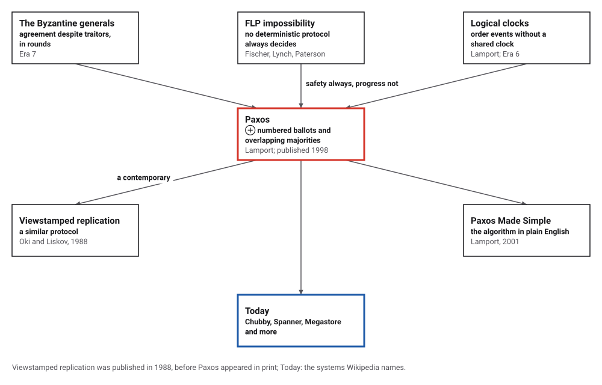
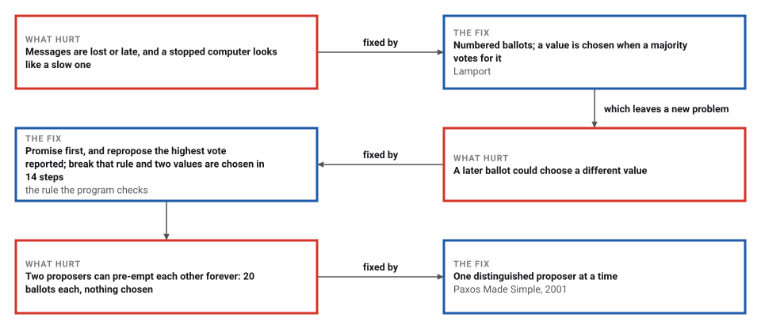
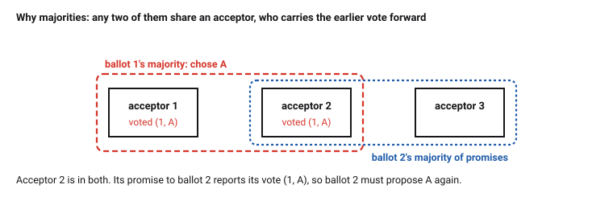

# Paxos

*Era 8 · topic 8 · 1989–1998* · [Era 8 index](../README.md) · [← PageRank](../07-pagerank/README.md) · [Genome Assembly with de Bruijn Graphs →](../09-genome-assembly/README.md) · [Interactive edition](paxos.html) · [Program](../../../code/era-08-the-web-the-genome-and-the-ledger/08-paxos/)

> **Field note from the visiting historian.** I let a small Paxos run every way it could: 192,441 states, messages delivered late, early, twice or never. Not once were two values chosen. Then I took away one rule, that a proposer must repropose the highest vote it is told of, and the same search found a disagreement in 14 steps.

| | |
|---|---|
| **When** | Written and submitted 1989 or 1990; published May 1998 |
| **Where** | Lamport, at the Systems Research Center (SRC) |
| **What hurt** | Replicas must agree through lost messages and stopped computers |
| **The fix** | Numbered ballots, promise then accept, overlapping majorities |
| **Checked** | 192,441 states, never two values |

## How ideas combined

A new algorithm is usually an older idea combined with a new one. The Byzantine generals (Era 7) agreed in lockstep rounds. Fischer, Lynch and Paterson had shown that without timing assumptions no deterministic protocol can promise to decide. Lamport's Paxos gives up the promise to decide, and keeps the promise never to decide two different things: numbered ballots and majorities that must overlap. Each box names the idea that was added.

<picture>
  <source media="(prefers-color-scheme: dark)" srcset="assets/family-dark.svg">
  
</picture>
*Red: Paxos. Blue: the systems that use it.*

## One rule between agreement and chaos

Two proposers, P1 (wanting A) and P2 (wanting B), and three acceptors, following a run the program checked step by step. P1 gets promises from acceptors 1 and 2 and sends accept(1, A); only acceptor 1 votes before P2 starts ballot 2. Acceptor 1's promise to P2 reports that vote. With the rule kept, P2 must propose A; switch to the broken rule and P2 proposes its own B, and two different values end up chosen.

| Step | Rule kept | Rule broken |
|---|---|---|
| 1 | P1 sends prepare(1) | P1 sends prepare(1) |
| 2 | acceptor 1 promises ballot 1, no vote yet | acceptor 1 promises ballot 1, no vote yet |
| 3 | acceptor 2 promises ballot 1, no vote yet | acceptor 2 promises ballot 1, no vote yet |
| 4 | P1 receives acceptor 1's promise for ballot 1 | P1 receives acceptor 1's promise for ballot 1 |
| 5 | P1 receives acceptor 2's promise for ballot 1 and sends accept(1, A) | P1 receives acceptor 2's promise for ballot 1 and sends accept(1, A) |
| 6 | acceptor 1 votes (1, A) | acceptor 1 votes (1, A) |
| 7 | P2 sends prepare(2) | P2 sends prepare(2) |
| 8 | acceptor 1 promises ballot 2, reporting its vote (1, A) | acceptor 1 promises ballot 2, reporting its vote (1, A) |
| 9 | acceptor 3 promises ballot 2, no vote yet | acceptor 3 promises ballot 2, no vote yet |
| 10 | P2 receives acceptor 1's promise for ballot 2 | P2 receives acceptor 1's promise for ballot 2 |
| 11 | P2 receives acceptor 3's promise for ballot 2 and sends accept(2, A) | P2 receives acceptor 3's promise for ballot 2 and sends accept(2, B) |
| 12 | acceptor 3 votes (2, A) | acceptor 3 votes (2, B) |
| 13 | acceptor 2 votes (1, A) | acceptor 2 votes (1, A) |
| 14 | acceptor 1 votes (2, A) | acceptor 1 votes (2, B) |
| chosen | A | A, B |
*In the interactive edition you can step through both runs and watch the acceptors' promises and votes.*

## Era 8, the Web, the genome and the ledger

<picture>
  <source media="(prefers-color-scheme: dark)" srcset="assets/era-timeline-dark.svg">
  
</picture>

## Each fix leaves a new pain

<picture>
  <source media="(prefers-color-scheme: dark)" srcset="assets/chain-dark.svg">
  
</picture>
*Read it as a snake: each new problem sits directly under the fix that exposed it.*

## Promise, then accept

**Roles.** Proposers suggest values; acceptors vote; a value is *chosen* once a majority of acceptors have voted for it in the same numbered ballot. Messages may be delayed, repeated or lost; computers may stop; nothing is assumed about timing.

**Phase 1.** The proposer of ballot n sends prepare(n). An acceptor that has not promised anything higher promises to ignore every ballot below n, and reports the last vote it cast, if any.

**Phase 2.** With promises from a majority, the proposer sends accept(n, v), and here is the rule: v must be the value of the highest-numbered vote reported to it. Only if nobody reported a vote may it use its own value. An acceptor votes for (n, v) unless it has promised a higher ballot.

<picture>
  <source media="(prefers-color-scheme: dark)" srcset="assets/overlap-dark.svg">
  
</picture>

**Why it is safe.** If v was chosen in ballot m, a majority voted for it. Any later ballot's majority of promises overlaps that majority in at least one acceptor, which reports a vote of ballot m or later; by induction that vote is for v, so the later ballot proposes v again. **Why it may not finish.** Two proposers can keep pre-empting each other with higher ballots; in practice one proposer at a time acts as leader.

> **Key idea.** Separate safety from progress. Safety (never two values) holds whatever the timing, because majorities overlap and each ballot inherits the highest earlier vote. Progress needs only a period in which one leader can talk to a majority.

## Every state, checked

**Exhaustive search.** Two proposers (P1 with ballots 1 and 3 and value A, P2 with ballot 2 and value B) and three acceptors. Every message stays in the network and may be delivered at any moment, again and again, which covers delay, repetition and loss. The search visited all 192,441 reachable states and the 512,390 steps between them; a value is chosen in 142,896 of the states, and in none are two different values chosen.

**The rule broken.** If a proposer always uses its own value, the same search finds two values chosen after 14 steps (the shortest such run, among 44,691 states):

| Step | What happens |
|---|---|
| 1 | P1 sends prepare(1) |
| 2 | P2 sends prepare(2) |
| 3 | acceptor 1 promises ballot 1, no vote yet |
| 4 | acceptor 2 promises ballot 1, no vote yet |
| 5 | acceptor 1 promises ballot 2, no vote yet |
| 6 | P1 receives acceptor 1's promise for ballot 1 |
| 7 | P1 receives acceptor 2's promise for ballot 1 and sends accept(1, A) |
| 8 | P2 receives acceptor 1's promise for ballot 2 |
| 9 | acceptor 2 votes (1, A) |
| 10 | acceptor 2 promises ballot 2, reporting its vote (1, A) |
| 11 | P2 receives acceptor 2's promise for ballot 2 and sends accept(2, B) |
| 12 | acceptor 3 votes (1, A) |
| 13 | acceptor 1 votes (2, B) |
| 14 | acceptor 2 votes (2, B) |

**Quorums that need not overlap.** With the rule kept but a "majority" of 1 acceptor, two values are chosen after 8 steps.

**Random runs.** 20,000 runs with 5 acceptors and 3 proposers with up to 4 ballots each, 10% of messages lost, messages delivered in random order and sometimes twice, and 2 acceptors crashing in 10,000 of the runs: two values were never chosen; a value was chosen in 19,975 runs (99.9%), after 55 steps on average.

**Duelling proposers.** If each prepare arrives just before the other proposer's accept, every accept is refused: after 20 ballots each nothing is chosen, and the schedule can go on forever. With P1 alone as leader, its first ballot is chosen, with 3 of 3 acceptors voting.

## A parliament on a Greek island

Lamport's commentary: the paper was "first submitted in 1990, setting a personal record for publication delay"; "All three referees said that the paper was mildly interesting, though not very important"; it appeared in *ACM Transactions on Computer Systems* 16(2), May 1998, with notes by Keith Marzullo; Leo Guibas suggested the name; it won an ACM SIGOPS Hall of Fame Award in 2012. Wikipedia says it was "first submitted in 1989": the year is **disputed**. The published paper begins "Recent archaeological discoveries on the island of Paxos", and Marzullo's note says it "was recently discovered behind a filing cabinet in the TOCS editorial office".

"Paxos Made Simple" (1 November 2001): "The Paxos algorithm, when presented in plain English, is very simple"; "Because any two majorities have at least one acceptor in common, this works if an acceptor can accept at most one value"; a prepare request brings "a promise not to accept any more proposals numbered less than n", and the accept request carries "the value of the highest-numbered proposal among the responses". Two proposers can keep issuing higher numbers, so "a distinguished proposer must be selected", and by Fischer, Lynch and Paterson that choice "must use either randomness or real time". Wikipedia: "Paxos guarantees safety (consistency)" but "is not guaranteed to terminate"; it runs in Google's Chubby, Spanner and Megastore, among others.

## The generals, without the drumbeat

The Byzantine generals (Era 7) tolerated liars but needed rounds. Paxos tolerates only crashes, not lies, but needs no rounds at all. Bitcoin (topic 13) will tolerate liars without rounds, among strangers, by a different trade: it gives up certainty for a probability that shrinks block by block.

> **Full circle.** 192,441 states, every interleaving of every message, and never two values. Change one rule, repropose the highest vote, and the same search finds a disagreement in 14 steps.

## Before you read on

<details>
<summary><b>1.</b> With 5 acceptors, how many must vote for a value to choose it, and how many can crash without stopping progress?</summary>

A majority, 3; up to 2 can crash, since 2f + 1 = 5 tolerates f = 2.
</details>

<details>
<summary><b>2.</b> An acceptor promised ballot 7. It receives accept(5, A). What does it do?</summary>

Ignores it: it promised not to accept anything numbered below 7.
</details>

<details>
<summary><b>3.</b> A proposer gets promises reporting votes (2, A) and (4, B). What must it propose?</summary>

B, the value of the highest-numbered vote.
</details>

<details>
<summary><b>4.</b> Why can a value never be 'unchosen' by a later ballot?</summary>

Any later majority of promises includes an acceptor that voted in the choosing majority, and the reported highest vote carries the chosen value forward.
</details>

<details>
<summary><b>5.</b> Why does Paxos not promise to decide?</summary>

Fischer, Lynch and Paterson proved no deterministic protocol can in a fully asynchronous network; duelling proposers are the concrete way it fails.
</details>


## Where the evidence lives

| | Object | Where to see it | Licence |
|---|---|---|---|
| — | **The Part-Time Parliament (1998)**. *ACM Transactions on Computer Systems* 16(2): the parliament of Paxos and its proofs. | [The paper (PDF, on a Princeton course page)](https://www.cs.princeton.edu/courses/archive/spring13/cos598C/lamport-paxos.pdf) | Drawn placeholder. |

## Every link was opened before it was listed

| Level | Link | Why |
|---|---|---|
| Start | [The Part-Time Parliament, with Lamport's commentary](https://www.microsoft.com/en-us/research/publication/part-time-parliament/) — Microsoft Research | Why the paper took eight years, in the author's words |
| Deeper | [Paxos Made Simple](https://pdos.csail.mit.edu/archive/6.824-2012/papers/paxos-simple.pdf) — L. Lamport (2001), on an MIT course page | The algorithm in plain English, in eleven pages |
| Deeper | [Paxos (computer science)](https://en.wikipedia.org/wiki/Paxos_(computer_science) — Wikipedia | Variants, guarantees and where it runs |
| Scholar | [The Part-Time Parliament](https://www.cs.princeton.edu/courses/archive/spring13/cos598C/lamport-paxos.pdf) — L. Lamport, *ACM TOCS* (1998), on a Princeton course page | The parliament of Paxos and its proofs |

More, with certainty labels and the gaps we could not fill: [Era 8 reference catalog](https://github.com/vij658/AlgorithmEvolutionAtlas/blob/main/book/era-08-the-web-the-genome-and-the-ledger/reference-catalog.md).

## The program behind every number here

[Paxos.java](https://github.com/vij658/AlgorithmEvolutionAtlas/blob/main/code/era-08-the-web-the-genome-and-the-ledger/08-paxos/Paxos.java) makes **20,054 checks**: every reachable state of the small system, the shortest violations with the rule broken, 20,000 random runs with losses and crashes, and the widget's two scripted runs. Run it with `java Paxos.java` (JDK 17 or newer). The heart of it:

```java
/** All states reachable in one step, with a description of the step. */
static List<Object[]> successors(S s, boolean keepRule, int quorum) {
    List<Object[]> out = new ArrayList<>();
    for (int p = 0; p < 2; p++) if (s.pIdx[p] < MAX_TRIES[p]) { // start the next ballot
        S t = s.copy();
        t.pIdx[p]++; t.pMask[p] = 0; t.pHighB[p] = 0; t.pHighV[p] = 0; t.pSent[p] = false;
        int b = ballotOf(p, t.pIdx[p]);
        t.prepares |= 1 << b;
        out.add(new Object[]{t, "P" + (p + 1) + " sends prepare(" + b + ")"});
    }
    for (int b = 1; b <= BALLOTS; b++) if ((s.prepares >> b & 1) == 1) for (int a = 0; a < ACC; a++) if (b > s.promised[a]) {
        S t = s.copy();
        t.promised[a] = b;
        t.promises |= 1 << (b * ACC + a);
        t.promB[b][a] = s.voteB[a]; t.promV[b][a] = s.voteV[a];
        out.add(new Object[]{t, "acceptor " + (a + 1) + " promises ballot " + b + (s.voteB[a] > 0 ? ", reporting its vote (" + s.voteB[a] + ", " + VAL.charAt(s.voteV[a]) + ")" : ", no vote yet")});
    }
    for (int b = 1; b <= BALLOTS; b++) for (int a = 0; a < ACC; a++) if ((s.promises >> (b * ACC + a) & 1) == 1) {
        int p = (b - 1) % 2;
        if (s.pIdx[p] == 0 || ballotOf(p, s.pIdx[p]) != b || (s.pMask[p] >> a & 1) == 1 || s.pSent[p]) continue;
        S t = s.copy();
        t.pMask[p] |= 1 << a;
        if (s.promB[b][a] > t.pHighB[p]) { t.pHighB[p] = s.promB[b][a]; t.pHighV[p] = s.promV[b][a]; }
        String d = "P" + (p + 1) + " receives acceptor " + (a + 1) + "'s promise for ballot " + b;
        if (Integer.bitCount(t.pMask[p]) >= quorum) {
            int v = keepRule && t.pHighB[p] > 0 ? t.pHighV[p] : p; // proposer p's own value is VAL[p]
            t.pSent[p] = true; t.accepts |= 1 << b; t.acceptV[b] = v;
            d += " and sends accept(" + b + ", " + VAL.charAt(v) + ")";
        }
        out.add(new Object[]{t, d});
    }
    for (int b = 1; b <= BALLOTS; b++) if ((s.accepts >> b & 1) == 1) for (int a = 0; a < ACC; a++)
        if (b >= s.promised[a] && (s.votes[a] >> b & 1) == 0) {
            S t = s.copy();
            t.promised[a] = b; t.voteB[a] = b; t.voteV[a] = s.acceptV[b]; t.votes[a] |= 1 << b;
            out.add(new Object[]{t, "acceptor " + (a + 1) + " votes (" + b + ", " + VAL.charAt(s.acceptV[b]) + ")"});
        }
    return out;
}
```

