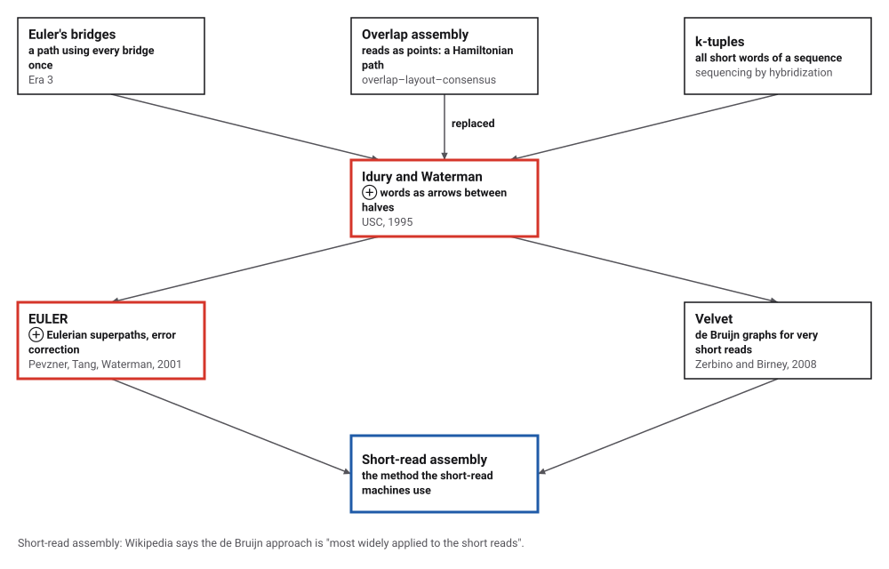
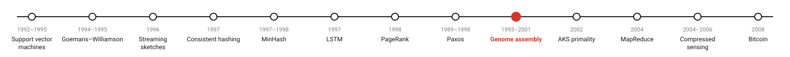
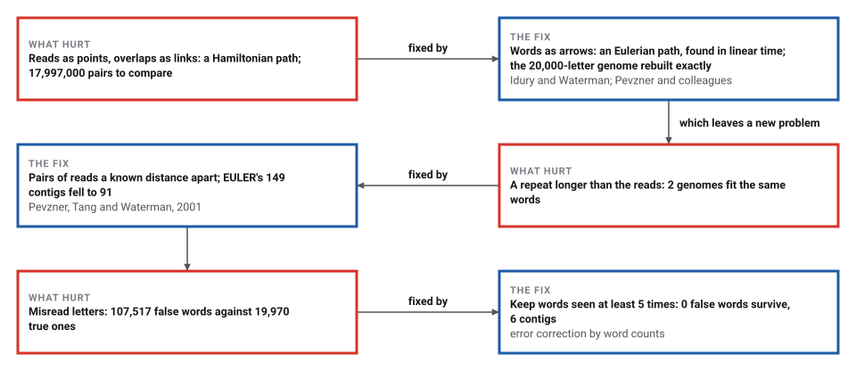
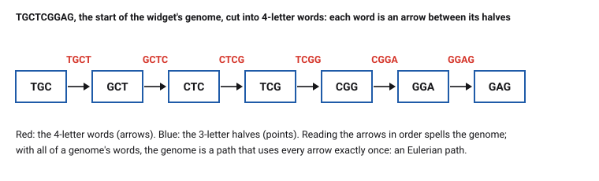

# Genome Assembly with de Bruijn Graphs

*Era 8 · topic 9 · 1995–2001* · [Era 8 index](../README.md) · [← Paxos](../08-paxos/README.md) · [PRIMES is in P →](../10-primes-is-in-p/README.md) · [Interactive edition](genome-assembly.html) · [Program](../../../code/era-08-the-web-the-genome-and-the-ledger/09-genome-assembly/)

> **Field note from the visiting historian.** I shredded a 20,000-letter genome into 6,000 reads and cut them into words of 31 letters. One walk across every word, the kind Euler described for the bridges of Königsberg, gave the genome back exactly. Then I hid a 300-letter repeat in another genome three times, and found 2 genomes that fit the same words, with nothing in the reads to choose between them.

| | |
|---|---|
| **When** | Idury and Waterman 1995; EULER 2001 |
| **Where** | University of Southern California; UC San Diego |
| **What hurt** | Overlap assembly is a Hamiltonian path problem, broken by repeats |
| **The fix** | Words as arrows: an Eulerian path in a de Bruijn graph |
| **Checked** | 20,000 letters rebuilt exactly from 6,000 reads |

## How ideas combined

A new algorithm is usually an older idea combined with a new one. Euler (Era 3) settled when a walk can cross every bridge exactly once. The first genome assemblers joined reads by their overlaps, which asks for a walk through every read once, a much harder problem. Idury and Waterman cut the reads into short words and made each word an arrow; Pevzner, Tang and Waterman turned that into an Eulerian path problem with error correction. Each box names the idea that was added.

<picture>
  <source media="(prefers-color-scheme: dark)" srcset="assets/family-dark.svg">
  
</picture>
*Red: the de Bruijn method's two steps. Blue: what it became.*

## How long must the words be?

A genome of 32 letters, TGCTCGGAGCCGCACGGGGACGTGTACCCTCC, cut into all its words of k letters. Each word is an arrow from its first k − 1 letters to its last k − 1 letters (the points around the circle). Walk the genome and watch it cross every arrow once. Then count how many different 32-letter genomes use exactly the same words: with short words, repeated short stretches create crossroads and many genomes fit; long enough words leave only one. The widget counts by trying every walk, as the program does, and gets the same numbers.

| k | Points | Arrows | Genomes that fit |
|---|---|---|---|
| 3 | 13 | 30 | 23,112 |
| 4 | 25 | 29 | 4 |
| 5 | 29 | 28 | 1 |
| 6 | 28 | 27 | 1 |
| 7 | 27 | 26 | 1 |
| 8 | 26 | 25 | 1 |
*In the interactive edition you can change k and walk the genome through its graph.*

## Era 8, the Web, the genome and the ledger

<picture>
  <source media="(prefers-color-scheme: dark)" srcset="assets/era-timeline-dark.svg">
  
</picture>

## Each fix leaves a new pain

<picture>
  <source media="(prefers-color-scheme: dark)" srcset="assets/chain-dark.svg">
  
</picture>
*Read it as a snake: each new problem sits directly under the fix that exposed it.*

## Every word once

**Reads.** A sequencer reads short pieces of many copies of a genome, cut at random places. The genome must be put back together from the pieces, like a book from many shredded copies.

**Overlaps (the old way).** Make each read a point and link two reads if the end of one overlaps the start of the other. The genome is then a path through every point once, a Hamiltonian path, for which no fast method is known; and every pair of reads must be compared.

**Words (the new way).** Cut every read into all its words of k letters. Make the points the words of k − 1 letters, and draw one arrow for each k-letter word, from its first k − 1 letters to its last. The genome crosses every arrow exactly once: an Eulerian path. Euler's rule says such a path exists when every point has as many arrows in as out, except the two ends, and Hierholzer's method walks it in time proportional to the number of arrows.

<picture>
  <source media="(prefers-color-scheme: dark)" srcset="assets/words-dark.svg">
  
</picture>

**What goes wrong.** A stretch no read covered breaks the path into pieces (contigs). A repeat longer than the words creates crossroads where the path can go more than one way. A misread letter creates up to k false words, but each is seen once or twice while true words are seen many times, so rare words can be discarded first.

> **Key idea.** Change what the points are. Reads as points ask for a Hamiltonian path; words as arrows ask for an Eulerian one. The same data, rearranged, turns a problem with no known fast method into one Euler solved.

## Twenty thousand letters from six thousand reads

**Perfect reads.** A random genome of 20,000 letters and 6,000 error-free reads of 100 letters (coverage 30). With k = 31: 19,970 different words (arrows) and 19,971 points; Euler's rule holds, with 19,969 balanced points, one start and one end; Hierholzer's walk spells the genome exactly. An overlap graph would have compared 17,997,000 pairs of reads.

**Fewer reads.** The same genome with lower coverage: gaps break the path into contigs, every one of them a true piece of the genome.

| Coverage | Contigs | Longest (letters) | Words read |
|---|---|---|---|
| 1 | 101 | 249 | 49.7% |
| 2 | 102 | 582 | 76.8% |
| 3 | 73 | 949 | 88.1% |
| 5 | 32 | 2,294 | 96.3% |
| 8 | 6 | 7,458 | 99.8% |
| **12** | **1** | **20,000** | **100.0%** |

**A repeat.** A genome X R Y R Z R W (8,900 letters) with the same 300 letters R three times. Even with every word and its exact count, 2 genomes fit: the true one and X R Z R Y R W. The graph stores R once, among 7 contigs. A repeat longer than the reads cannot be crossed by any method; the reads would have to be longer, or come in pairs a known distance apart.

**Misread letters.** The same 6,000 reads with 1% of their letters misread: 127,487 different 31-letter words, 19,970 true and 107,517 false. Using every word gives 9,829 contigs. How often each kind of word was seen:

|  | Once | Twice | 3 times | 4 times | 5 or more |
|---|---|---|---|---|---|
| true words | 1 | 16 | 17 | 17 | 19919 |
| false words | 105,064 | 2,406 | 44 | 3 | 0 |

Keeping only words seen at least 5 times keeps 19,919 of the 19,970 true words and 0 false ones: 6 contigs, the longest 12,021 letters, every one a true piece of the genome. (A false word seen twice is two reads misread the same way at the same place.)

## From hybridization to EULER

Idury and Waterman (University of Southern California), *Journal of Computational Biology* 2(2), 1995: reads and their reverse complements are cut into k-tuples; the vertices are the distinct (k − 1)-tuples, and each k-tuple is an edge from its prefix to its suffix; the reconstruction is "not an exact Eulerian tour, but a variation of it"; with k = 15 on simulated data with 0.5% to 3% errors, more than 99.8% of bases were called correctly.

Pevzner, Tang (UC San Diego) and Waterman (USC), *PNAS*, 14 August 2001: assembly traditionally followed the "overlap–layout–consensus" paradigm, and "there is still no polynomial algorithm for the solution of the notorious 'repeat problem'"; in the de Bruijn graph it becomes an Eulerian path problem, solvable in linear time; correcting reads by the spectrum of solid words reduced errors "by a factor of 35–50"; on *Neisseria meningitidis* EULER gave 149 contigs with none misassembled, against 160 (17 misassembled) for Phrap, and mate pairs reduced them to 91. Wikipedia: "It is impossible to assemble through a perfect repeat that is longer than the maximum read length".

## Königsberg's bridges, in DNA

Euler answered a question about seven bridges in 1736 (Era 3) and proved that a walk crossing every bridge once exists exactly when the odd places number zero or two. Two and a half centuries later the same theorem, applied to millions of short words, became the standard way to read genomes from short reads. MinHash (topic 5) cuts documents into overlapping words in just the same way.

> **Full circle.** 6,000 reads, 19,970 words, one walk: the 20,000-letter genome, exactly. No pair of reads was ever compared.

## Before you read on

<details>
<summary><b>1.</b> Write the 3-letter words of ACGTAC and the arrows they make between 2-letter points.</summary>

ACG, CGT, GTA, TAC: arrows AC→CG, CG→GT, GT→TA, TA→AC; the walk AC CG GT TA AC spells ACGTAC.
</details>

<details>
<summary><b>2.</b> In a de Bruijn graph of one genome, which points have one more arrow out than in?</summary>

Only the start (the first k − 1 letters); the end has one more in than out; every other point is balanced.
</details>

<details>
<summary><b>3.</b> Why do longer words make fewer genomes fit?</summary>

A crossroads needs a repeated stretch of k − 1 letters; the longer k is, the rarer such repeats are.
</details>

<details>
<summary><b>4.</b> A misread letter sits in the middle of a 100-letter read, with k = 31. How many false words can it create?</summary>

Up to 31: every word that covers the misread position.
</details>

<details>
<summary><b>5.</b> Why can't any method resolve a 300-letter repeat from 100-letter reads?</summary>

No read reaches from the unique sequence before the repeat to the unique sequence after it, so nothing records which copy connects where.
</details>


## Where the evidence lives

| | Object | Where to see it | Licence |
|---|---|---|---|
| — | **An Eulerian path approach to DNA fragment assembly (2001)**. Pevzner, Tang and Waterman, *PNAS* 98(17). | [The paper (PubMed Central)](https://pmc.ncbi.nlm.nih.gov/articles/PMC55524) | Drawn placeholder. |

## Every link was opened before it was listed

| Level | Link | Why |
|---|---|---|
| Start | [Sequence assembly](https://en.wikipedia.org/wiki/Sequence_assembly) — Wikipedia | Shotgun reads, the two approaches, and the repeat limit |
| Start | [Constructing a De Bruijn Graph](https://rosalind.info/problems/dbru) — Rosalind | Build one yourself |
| Scholar | [A New Algorithm for DNA Sequence Assembly](https://cs.brown.edu/courses/csci1820/spring-2022/resources/Idury_Waterman_1995.pdf) — R. Idury, M. Waterman, *J. Comput. Biol.* (1995), on a Brown course page | The k-tuple graph and its walk |
| Scholar | [An Eulerian path approach to DNA fragment assembly](https://pmc.ncbi.nlm.nih.gov/articles/PMC55524) — P. Pevzner, H. Tang, M. Waterman, *PNAS* (2001) | Hamiltonian against Eulerian, and EULER's results |
| Scholar | [Velvet: Algorithms for de novo short read assembly using de Bruijn graphs](https://genome.cshlp.org/content/18/5/821) — D. Zerbino, E. Birney, *Genome Research* (2008) | The de Bruijn method for short reads |

More, with certainty labels and the gaps we could not fill: [Era 8 reference catalog](https://github.com/vij658/AlgorithmEvolutionAtlas/blob/main/book/era-08-the-web-the-genome-and-the-ledger/reference-catalog.md).

## The program behind every number here

[GenomeAssembly.java](https://github.com/vij658/AlgorithmEvolutionAtlas/blob/main/code/era-08-the-web-the-genome-and-the-ledger/09-genome-assembly/GenomeAssembly.java) makes **20,305 checks**: Euler's rule at every point, the genome rebuilt exactly, every contig a true piece at every coverage, the two genomes that fit the repeat, the word counts with misread letters, and the widget's counts. Run it with `java GenomeAssembly.java` (JDK 17 or newer). The heart of it:

```java
/** Hierholzer's method for an Eulerian path, spelled as a string. */
static String euler(Map<String, List<String>> g) {
    Map<String, Integer> in = inDegrees(g);
    String start = null;
    for (String v : g.keySet()) if (g.get(v).size() == in.get(v) + 1) start = v;
    if (start == null) start = g.keySet().iterator().next();
    Map<String, Deque<String>> rest = new HashMap<>();
    for (Map.Entry<String, List<String>> e : g.entrySet()) rest.put(e.getKey(), new ArrayDeque<>(e.getValue()));
    Deque<String> stack = new ArrayDeque<>();
    List<String> path = new ArrayList<>();
    stack.push(start);
    while (!stack.isEmpty()) {
        String v = stack.peek();
        Deque<String> outs = rest.get(v);
        if (outs != null && !outs.isEmpty()) stack.push(outs.poll()); else path.add(stack.pop());
    }
    Collections.reverse(path);
    StringBuilder b = new StringBuilder(path.get(0));
    for (int i = 1; i < path.size(); i++) b.append(path.get(i).charAt(path.get(i).length() - 1));
    return b.toString();
}
```

