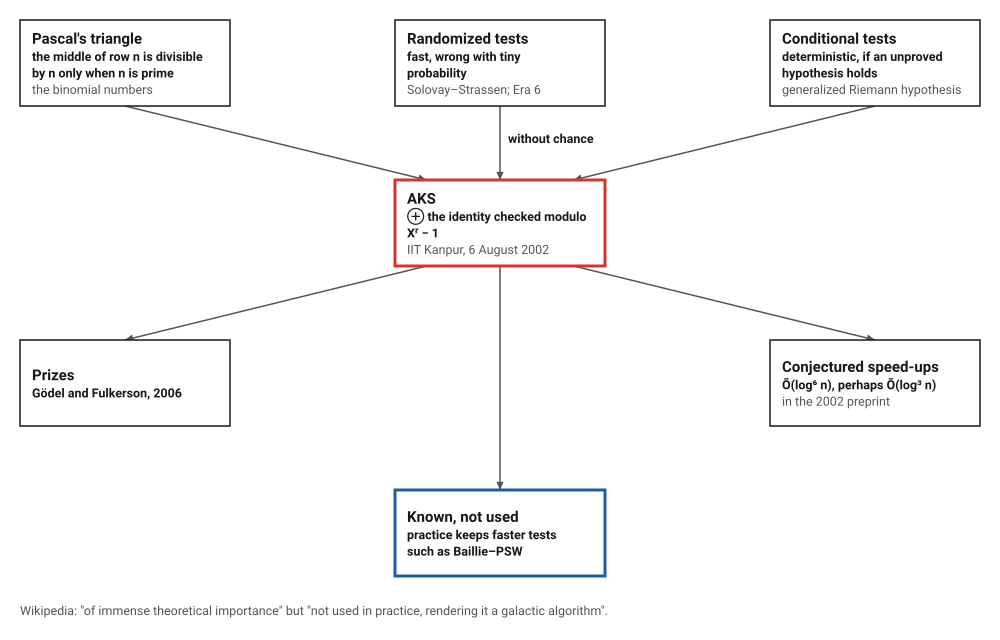
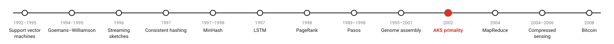
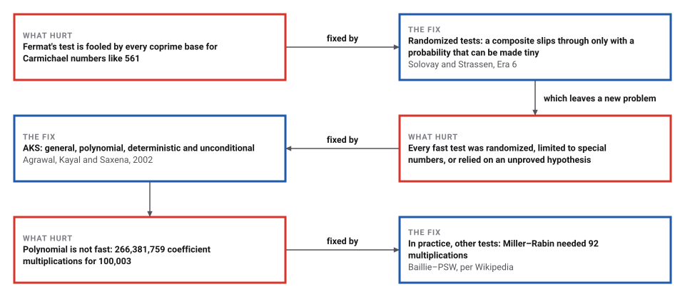
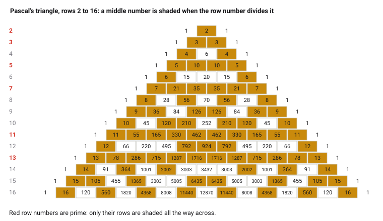

# PRIMES is in P

*Era 8 · topic 10 · 2002* · [Era 8 index](../README.md) · [← Genome Assembly with de Bruijn Graphs](../09-genome-assembly/README.md) · [MapReduce →](../11-mapreduce/README.md) · [Interactive edition](primes-is-in-p.html) · [Program](../../../code/era-08-the-web-the-genome-and-the-ledger/10-primes-is-in-p/)

> **Field note from the visiting historian.** I ran the Kanpur test on every number up to 3,000 and it never disagreed with a sieve. It caught the Carmichael numbers that fool Fermat's test for every base. But for the prime 100,003 it needed 266,381,759 multiplications where Miller–Rabin needed 92: the species proved it could do without chance, and kept its faster tests.

| | |
|---|---|
| **When** | Preprint 6 August 2002; Annals of Mathematics 2004 |
| **Where** | Indian Institute of Technology Kanpur |
| **What hurt** | Fast tests were randomized, special or conditional |
| **The fix** | (X + a)ⁿ = Xⁿ + a modulo (Xʳ − 1, n) for a few a |
| **Checked** | Every n up to 3,000 against a sieve |

## How ideas combined

A new algorithm is usually an older idea combined with a new one. Row n of Pascal's triangle is divisible by n, apart from its two 1s, exactly when n is prime. The fast primality tests of Era 6 flipped coins; others were deterministic only if an unproved hypothesis is true. Agrawal, Kayal and Saxena checked the Pascal identity in a much smaller world, polynomials modulo Xʳ − 1, and proved that a few checks there are enough. Each box names the idea that was added.

<picture>
  <source media="(prefers-color-scheme: dark)" srcset="assets/family-dark.svg">
  
</picture>
*Red: AKS. Blue: its place today.*

## Run AKS on a number

Type a number up to 20,000 and run the test step by step: the perfect-power check, the choice of r, the common-factor check, and the polynomial checks. On the right, row n of Pascal's triangle modulo n: for a prime every middle number is 0. The buttons are the numbers the program traced; for them the widget reaches the same verdict at the same step with the same r.

| n | Verdict | Step | r | a up to | Why |
|---|---|---|---|---|---|
| 7 | prime | 4 | 11 | 0 | n <= r |
| 9 | composite | 1 | 0 | 0 | a perfect power |
| 31 | prime | 6 | 29 | 26 | passes every a |
| 97 | prime | 6 | 59 | 50 | passes every a |
| 341 | composite | 3 | 89 | 0 | gcd(11, n) = 11 |
| 561 | composite | 3 | 89 | 0 | gcd(3, n) = 3 |
| 1009 | prime | 6 | 107 | 102 | passes every a |
*In the interactive edition you can run the test on any number up to 20,000.*

## Era 8, the Web, the genome and the ledger

<picture>
  <source media="(prefers-color-scheme: dark)" srcset="assets/era-timeline-dark.svg">
  
</picture>

## Each fix leaves a new pain

<picture>
  <source media="(prefers-color-scheme: dark)" srcset="assets/chain-dark.svg">
  
</picture>
*Read it as a snake: each new problem sits directly under the fix that exposed it.*

## Pascal's triangle, in a smaller world

**The identity.** For n > 1 and any a with no factor in common with n: n is prime exactly when (X + a)ⁿ = Xⁿ + a, with every coefficient taken modulo n. The middle coefficients of (X + a)ⁿ are the numbers of row n of Pascal's triangle times powers of a, and all of them are divisible by n exactly when n is prime.

<picture>
  <source media="(prefers-color-scheme: dark)" srcset="assets/pascal-dark.svg">
  
</picture>

**The trouble.** (X + a)ⁿ has n + 1 coefficients, so checking them all is no faster than trying divisors.

**The idea.** Compute (X + a)ⁿ modulo Xʳ − 1 as well, so every polynomial has fewer than r coefficients, by repeated squaring. The steps: (1) if n is a perfect power, it is composite; (2) find the smallest r whose powers of n take more than (log₂ n)² steps to return to 1 modulo r; (3) if some a ≤ r shares a factor with n, n is composite; (4) if n ≤ r, n is prime; (5) for a = 1 to ⌊√φ(r) log₂ n⌋, if (X + a)ⁿ ≠ X^(n mod r) + a modulo (Xʳ − 1, n), n is composite; (6) otherwise n is prime. The proof shows that r stays small, so every step takes time polynomial in the number of digits.

> **Key idea.** A test that is exact but too big can become small without becoming wrong, if you can prove that every composite fails it even in the small version. The proof is the algorithm.

## Every number up to 3,000

**The identity in full**: for every n from 2 to 300, the middle numbers of row n of Pascal's triangle are all divisible by n exactly when n is prime.

**AKS against a sieve**, n = 2 to 3,000: they agree on all 2,999. Which step decided each number (largest r: 211; most values of a checked: 153):

| Decided at step | Numbers |
|---|---|
| 1: a perfect power | 69 |
| 3: a common factor with some a ≤ r | 2,500 |
| 4: n ≤ r, so prime | 11 |
| 5: a polynomial check fails | 0 |
| 6: every polynomial check passes, so prime | 419 |

For numbers this small, every composite that is not a perfect power has a factor no larger than r, so step 3 finds it: the polynomial check never rejected a number here, it only confirmed primes. **Numbers that fool quick tests**:

| n | Fermat fooled by every coprime base | Miller–Rabin base 2 fooled | AKS |
|---|---|---|---|
| 561 | yes | no | step 3: gcd(3, n) = 3 |
| 1105 | yes | no | step 3: gcd(5, n) = 5 |
| 1729 | yes | no | step 3: gcd(7, n) = 7 |
| 2465 | yes | no | step 3: gcd(5, n) = 5 |
| 2821 | yes | no | step 3: gcd(7, n) = 7 |
| 6601 | yes | no | step 3: gcd(7, n) = 7 |
| 8911 | yes | no | step 3: gcd(7, n) = 7 |
| 2047 | no | yes | step 3: gcd(23, n) = 23 |

**Composites only the polynomial check can catch**: products of two primes larger than r:

| n | Factors | r | Step 5 |
|---|---|---|---|
| 1,022,117 | 1,009 × 1,013 | 409 | fails for a = 1 |
| 1,065,023 | 1,031 × 1,033 | 419 | fails for a = 1 |
| 2,052,509 | 1,201 × 1,709 | 449 | fails for a = 1 |

**The cost** for primes, counted in multiplications of polynomial coefficients, against Miller–Rabin with four bases:

| Prime n | r | a up to | AKS multiplications | Miller–Rabin multiplications |
|---|---|---|---|---|
| 1,009 | 107 | 102 | 8,072,615 | 55 |
| 10,007 | 179 | 177 | 54,934,384 | 80 |
| 100,003 | 277 | 275 | 266,381,759 | 92 |

## Three computer scientists at Kanpur

Agrawal, Kayal and Saxena (Department of Computer Science and Engineering, IIT Kanpur), 6 August 2002: "We present a deterministic polynomial-time algorithm that determines whether an input number n is prime or composite"; the preprint's version checks the congruence modulo (x^r − 1, n) for a up to 2√r log n and runs in time Õ(log¹² n). *Annals of Mathematics* 160(2), 781–793 (2004). The 2006 Gödel Prize citation: earlier polynomial-time tests "were based on probabilistic methods or they relied on an unproven assumption", and "the arguments come in a brilliantly simple manner; they remain completely elementary".

Wikipedia: the first test "simultaneously general, polynomial-time, deterministic, and unconditionally correct"; earlier methods "achieved three of these properties at most"; the authors received the Gödel and Fulkerson Prizes in 2006; the version now usually presented, which the program follows, takes the smallest r whose order exceeds (log₂ n)²; AKS is "of immense theoretical importance" but "not used in practice, rendering it a galactic algorithm". Granville's survey in the *Bulletin of the AMS* (2005) opens with Gauss on the problem of telling primes from composites.

## Chance, removed

Era 6's public-key cryptography needed large primes, and Rivest, Shamir and Adleman recommended Solovay and Strassen's "probabilistic" test to find them, accepting a tiny chance of error. AKS shows the chance is not necessary in principle. Compressed sensing (topic 12) makes the opposite move: it measures at random on purpose.

> **Full circle.** The Carmichael number 561 fools Fermat's test for every base it could choose. AKS rejected it at step 3, without tossing a coin.

## Before you read on

<details>
<summary><b>1.</b> Write row 6 of Pascal's triangle. Which middle numbers are divisible by 6?</summary>

1 6 15 20 15 6 1: only the two 6s; 15 and 20 are not, so 6 is composite.
</details>

<details>
<summary><b>2.</b> Why must perfect powers like 9 = 3² be removed first?</summary>

The proof ends by showing that a number passing every polynomial check is a power of a prime; step 1 is what rules out the powers, leaving only the prime itself.
</details>

<details>
<summary><b>3.</b> Why is it enough, for small n, that step 3 checks a up to r?</summary>

Every composite n has a factor at most √n, and when r ≥ √n that factor is found by the gcd check.
</details>

<details>
<summary><b>4.</b> Why is checking (X + a)ⁿ modulo Xʳ − 1 fast?</summary>

Every polynomial has fewer than r coefficients, and repeated squaring needs about log₂ n multiplications of such polynomials.
</details>

<details>
<summary><b>5.</b> If AKS is polynomial, why is it not used?</summary>

Its polynomial has a large exponent and big constants: for 100,003 it needed hundreds of millions of multiplications against under a hundred for Miller–Rabin.
</details>


## Where the evidence lives

| | Object | Where to see it | Licence |
|---|---|---|---|
| — | **PRIMES is in P (preprint, 6 August 2002)**. The version that was announced, from IIT Kanpur. | [The preprint (PDF, IIT Kanpur)](https://www.cse.iitk.ac.in/users/nitin/papers/aug02.pdf) | Drawn placeholder. |

## Every link was opened before it was listed

| Level | Link | Why |
|---|---|---|
| Start | [AKS primality test](https://en.wikipedia.org/wiki/AKS_primality_test) — Wikipedia | The four properties, the algorithm and a worked example |
| Deeper | [It is easy to determine whether a given integer is prime](https://www.ams.org/bull/2005-42-01/S0273-0979-04-01037-7/) — A. Granville, *Bulletin of the AMS* (2005) | A mathematician's account of the proof and its background |
| Scholar | [PRIMES is in P (preprint, 6 August 2002)](https://www.cse.iitk.ac.in/users/nitin/papers/aug02.pdf) — M. Agrawal, N. Kayal, N. Saxena, IIT Kanpur | The version that was announced |
| Scholar | [PRIMES is in P](https://annals.math.princeton.edu/2004/160-2/p12) — *Annals of Mathematics* 160 (2004) | The published version |

More, with certainty labels and the gaps we could not fill: [Era 8 reference catalog](https://github.com/vij658/AlgorithmEvolutionAtlas/blob/main/book/era-08-the-web-the-genome-and-the-ledger/reference-catalog.md).

## The program behind every number here

[AksPrimality.java](https://github.com/vij658/AlgorithmEvolutionAtlas/blob/main/code/era-08-the-web-the-genome-and-the-ledger/10-primes-is-in-p/AksPrimality.java) makes **3,333 checks**: the Pascal identity for every n up to 300, AKS against a sieve for every n up to 3,000, the numbers that fool quick tests, and composites that only the polynomial check can catch. Run it with `java AksPrimality.java` (JDK 17 or newer). The heart of it:

```java
static Verdict aks(long n) {
    if (n < 2) return new Verdict(false, 0, 0, 0, "below 2");
    if (perfectPower(n)) return new Verdict(false, 1, 0, 0, "a perfect power");
    double l = log2(n);
    int r = 2;
    while (true) {
        if (gcd(n, r) == 1) { int o = order(n, r); if (o > l * l) break; }
        r++;
    }
    for (long a = 2; a <= Math.min(r, n - 1); a++) { long g = gcd(a, n); if (g > 1 && g < n) return new Verdict(false, 3, r, 0, "gcd(" + a + ", n) = " + g); }
    if (n <= r) return new Verdict(true, 4, r, 0, "n <= r");
    long aMax = (long) Math.floor(Math.sqrt(phi(r)) * l);
    for (long a = 1; a <= aMax; a++) {
        long[] p = powXa(a, n, r);
        long[] want = new long[r];
        want[(int) (n % r)] = 1;
        want[0] = (want[0] + a) % n;
        if (!Arrays.equals(p, want)) return new Verdict(false, 5, r, aMax, "fails for a = " + a);
    }
    return new Verdict(true, 6, r, aMax, "passes every a");
}
```

