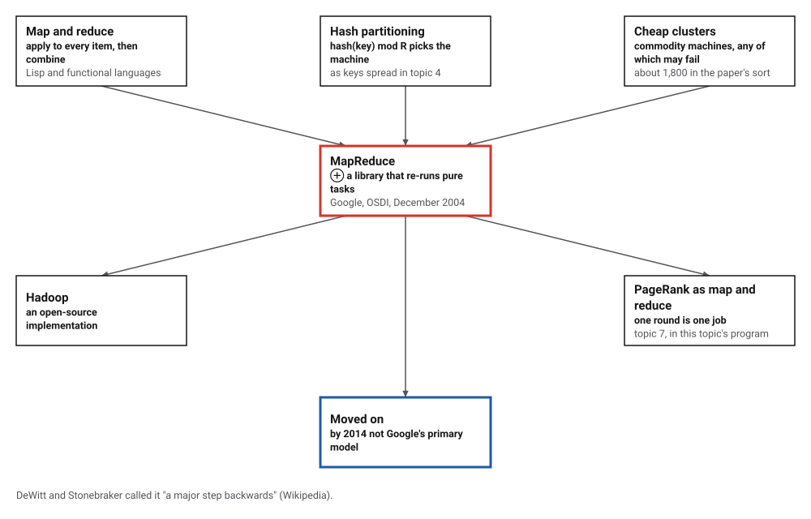
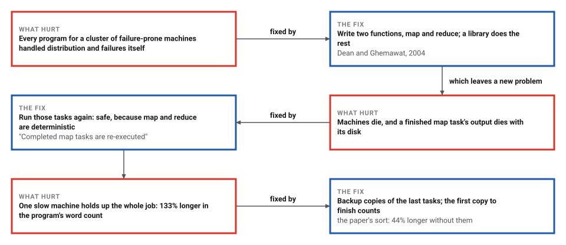
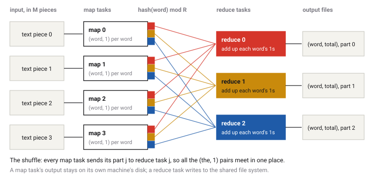

# MapReduce

*Era 8 · topic 11 · 2004* · [Era 8 index](../README.md) · [← PRIMES is in P](../10-primes-is-in-p/README.md) · [Compressed Sensing →](../12-compressed-sensing/README.md) · [Interactive edition](mapreduce.html) · [Program](../../../code/era-08-the-web-the-genome-and-the-ledger/11-mapreduce/)

> **Field note from the visiting historian.** I simulated 10 of the species' machines counting the words of my own field notes. When one machine died, the library ran its finished pieces again and the counts came out identical. When one machine ran five times slower, the job took 133% longer than when backup copies were allowed.

| | |
|---|---|
| **When** | OSDI, San Francisco, December 2004 |
| **Where** | Google |
| **What hurt** | Every cluster program handled failures itself |
| **The fix** | Map and reduce; lost tasks simply run again |
| **Checked** | Identical counts in all four runs |

## How ideas combined

A new algorithm is usually an older idea combined with a new one. Map and reduce came from Lisp and other functional languages: apply a function to every item, then combine the results. Hashing a key to choose a machine was already how data was spread (topic 4). Dean and Ghemawat at Google added a library that runs these two functions over a cluster of cheap machines and simply runs a task again when its machine fails. Each box names the idea that was added.

<picture>
  <source media="(prefers-color-scheme: dark)" srcset="assets/family-dark.svg">
  
</picture>
*Red: MapReduce. Blue: where it stands today.*

## Kill a machine, slow one down

A small word-count job: 12 map tasks of 100, 150 or 200 words, 3 reduce tasks, 6 machines. Each bar is one task copy on one machine: blue for map, yellow for reduce, dashed for a copy that was lost or stopped; ✗ marks a finished map task whose output died with its machine. Make machine 0 die, slow machine 4 down, or allow backup copies, and the widget runs the program's own scheduler. For the four named cases it prints the same schedule as the program, entry by entry.

| Case | Finished at |
|---|---|
| normal | 7.00 |
| failure | 7.00 |
| straggler | 9.00 |
| backups | 7.00 |
*In the interactive edition you can choose when machine 0 dies, how slow machine 4 is, and whether backups run.*

## Era 8, the Web, the genome and the ledger

<picture>
  <source media="(prefers-color-scheme: dark)" srcset="assets/era-timeline-dark.svg">
  
</picture>

## Each fix leaves a new pain

<picture>
  <source media="(prefers-color-scheme: dark)" srcset="assets/chain-dark.svg">
  
</picture>
*Read it as a snake: each new problem sits directly under the fix that exposed it.*

## Two functions, and a library

**What the programmer writes.** For counting words, map takes a piece of text and emits the pair (word, 1) for each word in it; reduce takes one word and all its 1s and adds them up. Nothing else.

**What the library does.** It cuts the input into M pieces and runs a map task on each, on whichever machine is free. Each map task sorts its pairs into R parts by hash(word) mod R and keeps them on its own disk. Then R reduce tasks each fetch their part from every map task, group the pairs by word, and write the totals to a shared file system.

<picture>
  <source media="(prefers-color-scheme: dark)" srcset="assets/flow-dark.svg">
  
</picture>

**When things go wrong.** Because map and reduce are deterministic and change nothing else, any task can be run again with the same result. When a machine dies, the master runs its tasks again elsewhere, including its finished map tasks, whose output was on the dead machine's disk. When the job is nearly done, idle machines start backup copies of the tasks still running; whichever copy finishes first counts.

> **Key idea.** Restrict what the programmer may write, pure functions over key–value pairs, and the library can do everything else, including doing work twice.

## Counting the words of this book

**Word count** on this book's field notes: 3,337 words, 1,038 different; 40 map tasks, 8 reduce tasks, 10 simulated machines. Time is simulated: a task takes its amount of data divided by its machine's speed. In every case the counts were checked equal to a plain count.

| Case | Finished at | Map runs | Reduce runs | Backup copies | Copies stopped |
|---|---|---|---|---|---|
| Normal | 5.45 | 40 | 8 | 0 | 0 |
| Machine 0 dies at time 2.0 | 6.26 | 42 | 8 | 0 | 0 |
| Machine 3 runs at 1/5 speed, no backups | 14.60 | 40 | 8 | 0 | 0 |
| Machine 3 runs at 1/5 speed, with backups | 6.26 | 40 | 8 | 1 | 1 |

When machine 0 died at 2.0, 2 of its finished map tasks ran again: 42 map runs for 40 tasks. Without backups, the slow machine made the job **133% longer** than with them; Dean and Ghemawat measured 44% for their sort. The commonest words: *the* 187, *a* 162, *and* 102, *of* 67, *in* 57.

**PageRank as MapReduce**: topic 7's 8-page web, 10 rounds, each round one map (each page sends its rank divided by its number of links along each link) and one reduce (each page adds what it received). Largest difference from the direct computation: 0e+00.

| Page | Rank after 10 rounds |
|---|---|
| 0 | 0.2851 |
| 1 | 0.1457 |
| 2 | 0.3038 |
| 3 | 0.0552 |
| 4 | 0.0496 |
| 5 | 0.0685 |
| 6 | 0.0662 |
| 7 | 0.0259 |

## Google, December 2004

Dean and Ghemawat, OSDI 2004: MapReduce is "a programming model and an associated implementation for processing and generating large data sets"; programs are "automatically parallelized and executed on a large cluster of commodity machines"; the keys are split into R pieces "(e.g., hash(key) mod R)"; "Completed map tasks are re-executed on a failure"; "the sort program described in Section 5.3 takes 44% longer to complete when the backup task mechanism is disabled"; the sort ran on "approximately 1800 machines"; "upwards of one thousand MapReduce jobs are executed on Google's clusters every day".

Wikipedia: "Our abstraction is inspired by the map and reduce primitives present in Lisp and many other functional languages" (quoting the paper); Apache Hadoop is a popular open-source implementation; by 2014 Google no longer used MapReduce as its primary model ("We don't really use MapReduce anymore", Urs Hölzle); DeWitt and Stonebraker called it "a major step backwards". MIT's distributed-systems course (6.5840, 2026): "MR manages, and hides, all aspects of distribution!", "Coordinator re-runs just the failed Map()s and Reduce()s", and "Map and Reduce should be pure deterministic functions".

## An old pair of functions

Map and reduce are ideas from programming languages, about functions with no side effects. MapReduce put that purity to a new use: a function with no side effects can be run twice, on another machine, after a failure, and nobody can tell.

> **Full circle.** Topic 7's PageRank, written as one map and one reduce per round, gave the same ranks as the direct computation: largest difference 0e+00.

## Before you read on

<details>
<summary><b>1.</b> Why is it safe to run a map task twice?</summary>

It is deterministic and changes nothing else: the second run produces exactly the same pairs.
</details>

<details>
<summary><b>2.</b> Why are finished map tasks run again when their machine dies, but not finished reduce tasks?</summary>

A map task's output is on its own machine's disk, which is gone; a reduce task's output is already in the shared file system.
</details>

<details>
<summary><b>3.</b> Which reduce task receives the word "the"?</summary>

The one numbered hash("the") mod R. Every map task sends its (the, 1) pairs to that same task.
</details>

<details>
<summary><b>4.</b> Why do backup copies help only near the end?</summary>

Earlier, a free machine has new tasks to start. At the end, one slow task leaves every other machine idle.
</details>

<details>
<summary><b>5.</b> Write one round of PageRank as a map and a reduce.</summary>

Map: each page emits (linked page, its rank ÷ its number of links). Reduce: each page adds what it received, times d, plus (1 − d)/N.
</details>


## Where the evidence lives

| | Object | Where to see it | Licence |
|---|---|---|---|
| — | **MapReduce: Simplified Data Processing on Large Clusters (OSDI 2004)**. The model, the implementation and the measurements. | [The paper (PDF, on a Cornell course page)](https://courses.cs.cornell.edu/cs5410/2008fa/Readings/mapreduce-osdi04.pdf) | Drawn placeholder. |

## Every link was opened before it was listed

| Level | Link | Why |
|---|---|---|
| Start | [MIT 6.5840, Lecture 1: Introduction](https://pdos.csail.mit.edu/6.824/notes/l01.txt) — F. Kaashoek, R. Morris (2026), lecture notes | MapReduce as the first example of a distributed system |
| Deeper | [MapReduce](https://en.wikipedia.org/wiki/MapReduce) — Wikipedia | Origins, Hadoop, criticism and decline |
| Scholar | [MapReduce: Simplified Data Processing on Large Clusters](https://courses.cs.cornell.edu/cs5410/2008fa/Readings/mapreduce-osdi04.pdf) — J. Dean, S. Ghemawat, OSDI (2004), on a Cornell course page | The model, the implementation and the measurements |

More, with certainty labels and the gaps we could not fill: [Era 8 reference catalog](https://github.com/vij658/AlgorithmEvolutionAtlas/blob/main/book/era-08-the-web-the-genome-and-the-ledger/reference-catalog.md).

## The program behind every number here

[MapReduce.java](https://github.com/vij658/AlgorithmEvolutionAtlas/blob/main/code/era-08-the-web-the-genome-and-the-ledger/11-mapreduce/MapReduce.java) makes **206 checks**: that word counts are identical to a plain count whether machines die, run slowly or run backups, that no machine runs two tasks at once, and that PageRank by map and reduce equals PageRank computed directly. Run it with `java MapReduce.java` (JDK 17 or newer). The heart of it:

```java
/**
 * Simulate word count. speeds[w] = work per unit time of machine w; failAt = time machine 0 dies (or infinity);
 * backups = start backup copies of running tasks when nothing else is left to start.
 */
static Run simulate(List<List<String>> splits, int R, double[] speeds, double failAt, boolean backups) {
    int M = splits.size(), W = speeds.length;
    Run run = new Run();
    // the map function and the reduce function: the only code a MapReduce user writes
    Function<List<String>, List<Map.Entry<String, Long>>> map = words -> {
        List<Map.Entry<String, Long>> out = new ArrayList<>();
        for (String w : words) out.add(Map.entry(w, 1L));
        return out;
    };
    BiFunction<String, List<Long>, Long> reduce = (k, vs) -> { long s = 0; for (long v : vs) s += v; return s; };

    List<List<List<Map.Entry<String, Long>>>> mapOut = new ArrayList<>(); // [map task][partition] -> pairs
    for (int m = 0; m < M; m++) mapOut.add(null);
    int[] mapWhere = new int[M];
    boolean[] mapDone = new boolean[M], reduceDone = new boolean[R];
    boolean dead = false;
    // running copies: {task id (map m, or M + r for reduce r), machine, start, end}
    List<double[]> running = new ArrayList<>();
    double now = 0;
    Deque<Integer> pending = new ArrayDeque<>();
    for (int m = 0; m < M; m++) pending.add(m);
    long totalPairs = 0;
    for (List<String> s : splits) totalPairs += s.size();
    while (true) {
        boolean allMaps = true;
        for (boolean d : mapDone) allMaps &= d;
        boolean allReduces = true;
        for (boolean d : reduceDone) allReduces &= d;
        if (allMaps && allReduces) break;
        if (allMaps && pending.isEmpty() && running.isEmpty()) for (int r = 0; r < R; r++) if (!reduceDone[r]) pending.add(M + r);
        // give work to idle machines
        for (int w = 0; w < W; w++) {
            if (w == 0 && dead) continue;
            final int ww = w;
            boolean busy = running.stream().anyMatch(c -> c[1] == ww);
            if (busy) continue;
            Integer task = pending.poll();
            boolean backup = false;
            if (task == null && backups && !running.isEmpty()) { // a backup copy of the running task that will end last,
                double[] latest = null;                              // if a fresh copy here would finish sooner
                for (double[] c : running) {
                    int t = (int) c[0];
                    long copies = running.stream().filter(x -> x[0] == t).count();
                    double w0 = t < M ? splits.get(t).size() / 100.0 : (double) totalPairs / R / 200.0;
                    if (copies == 1 && now + w0 / speeds[w] < c[3] && (latest == null || c[3] > latest[3])) latest = c;
                }
                if (latest != null) { task = (int) latest[0]; backup = true; }
            }
            if (task == null) continue;
            if (task >= M && !allMaps) { pending.addFirst(task); continue; }
            double work = task < M ? splits.get(task).size() / 100.0 : (double) totalPairs / R / 200.0;
            running.add(new double[]{task, w, now, now + work / speeds[w]});
            if (backup) run.backups++;
        }
        // the next event: a task copy finishes, or machine 0 dies
        double next = Double.POSITIVE_INFINITY;
        double[] first = null;
        for (double[] c : running) if (c[3] < next) { next = c[3]; first = c; }
        if (!dead && failAt < next) {
            now = failAt; dead = true;
            Iterator<double[]> it = running.iterator();
            while (it.hasNext()) { double[] c = it.next(); if (c[1] == 0) { run.schedule.add(sched(c, now, "lost", M)); it.remove(); if (running.stream().noneMatch(x -> x[0] == c[0])) pending.addFirst((int) c[0]); } }
            for (int m = 0; m < M; m++) if (mapDone[m] && mapWhere[m] == 0) { // finished map output lived on the dead disk
                mapDone[m] = false; mapOut.set(m, null); pending.add(m);
                run.schedule.add("machine 0's finished map " + m + " must run again");
            }
            continue;
        }
        if (first == null) throw new IllegalStateException("stuck");
        now = next;
        running.remove(first);
        int t = (int) first[0], w = (int) first[1];
        run.schedule.add(sched(first, now, "done", M));
        // the first copy to finish counts; other copies of the same task are stopped
        Iterator<double[]> it = running.iterator();
        while (it.hasNext()) { double[] c = it.next(); if (c[0] == t) { run.schedule.add(sched(c, now, "stopped", M)); it.remove(); run.killed++; } }
        if (t < M) {
            run.mapRuns++;
            List<List<Map.Entry<String, Long>>> parts = new ArrayList<>();
            for (int r = 0; r < R; r++) parts.add(new ArrayList<>());
            for (Map.Entry<String, Long> e : map.apply(splits.get(t))) parts.get(partition(e.getKey(), R)).add(e);
            mapOut.set(t, parts); mapDone[t] = true; mapWhere[t] = w;
        } else {
            run.reduceRuns++;
            int r = t - M;
            TreeMap<String, List<Long>> grouped = new TreeMap<>();
            for (int m = 0; m < M; m++) for (Map.Entry<String, Long> e : mapOut.get(m).get(r)) grouped.computeIfAbsent(e.getKey(), x -> new ArrayList<>()).add(e.getValue());
            for (Map.Entry<String, List<Long>> g : grouped.entrySet()) run.result.put(g.getKey(), reduce.apply(g.getKey(), g.getValue()));
            reduceDone[r] = true;
        }
    }
    run.finish = now;
    // no machine ever ran two task copies at once
    for (int w = 0; w < W; w++) {
        List<double[]> iv = new ArrayList<>();
        for (String e : run.schedule) {
            if (!e.contains("@")) continue;
            String[] f = e.split("[@:-]");
            if (Integer.parseInt(f[1]) == w) iv.add(new double[]{Double.parseDouble(f[2]), Double.parseDouble(f[3])});
        }
        iv.sort((x, y) -> Double.compare(x[0], y[0]));
        for (int i = 1; i < iv.size(); i++) check(iv.get(i)[0] >= iv.get(i - 1)[1] - 1e-9, "a machine runs one task at a time");
    }
    return run;
}
```

