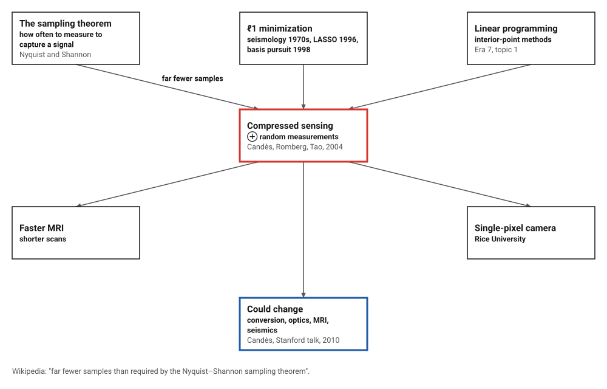
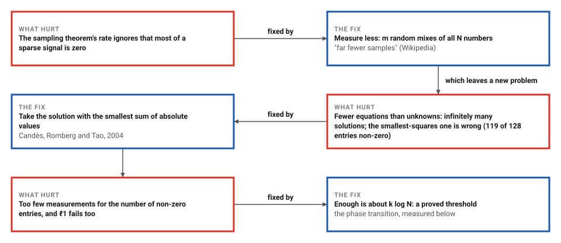
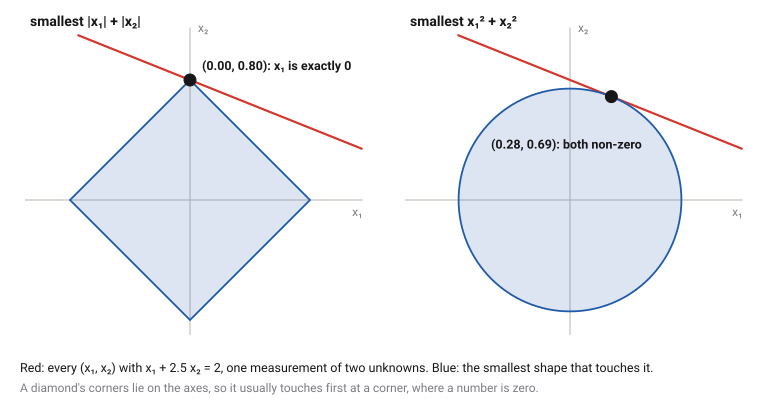
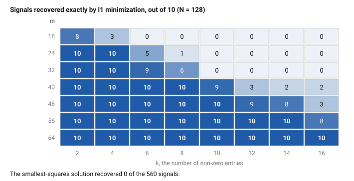

# Compressed Sensing

*Era 8 · topic 12 · 2004–2006* · [Era 8 index](../README.md) · [← MapReduce](../11-mapreduce/README.md) · [Bitcoin's Proof-of-Work Ledger →](../13-bitcoin/README.md) · [Interactive edition](compressed-sensing.html) · [Program](../../../code/era-08-the-web-the-genome-and-the-ledger/12-compressed-sensing/)

> **Field note from the visiting historian.** I hid 5 numbers among 128 and took only 40 random measurements. The answer with the smallest sum of squares was spread over 119 of the 128 positions and right in none of them. The answer with the smallest sum of absolute values was right everywhere, to 3.9e-10.

| | |
|---|---|
| **When** | Preprint 10 June 2004; journal 2006 |
| **Where** | Caltech and UCLA |
| **What hurt** | Fewer equations than unknowns: infinitely many solutions |
| **The fix** | Random measurements; minimize the sum of absolute values |
| **Checked** | Recovery counts for 560 random signals |

## How ideas combined

A new algorithm is usually an older idea combined with a new one. The sampling theorem said how often to measure a signal. Minimizing a sum of absolute values had been used in seismology since the 1970s, and in the LASSO and basis pursuit in the 1990s. Linear programming (Era 7) could do the minimizing. Candès, Romberg and Tao added random measurements and a proof that, for sparse signals, far fewer of them are enough. Each box names the idea that was added.

<picture>
  <source media="(prefers-color-scheme: dark)" srcset="assets/family-dark.svg">
  
</picture>
*Red: compressed sensing. Blue: what Candès said it could change.*

## Recover a signal from too few measurements

A signal of 32 numbers, 3 of them not zero. Slide the number of measurements m, from 4 to 20: each measurement is a random mix of all 32 numbers, the first m rows of one 20-by-32 random matrix. Every reconstruction shown fits all m measurements. They are the program's own solutions.

| m | ℓ1 | Smallest squares: non-zero entries |
|---|---|---|
| 4 | wrong | 31 |
| 6 | wrong | 32 |
| 8 | wrong | 32 |
| 10 | wrong | 32 |
| 12 | exact | 31 |
| 16 | exact | 32 |
| 20 | exact | 31 |
*In the interactive edition you can slide m and watch the two reconstructions.*

## Era 8, the Web, the genome and the ledger

<picture>
  <source media="(prefers-color-scheme: dark)" srcset="assets/era-timeline-dark.svg">
  
</picture>

## Each fix leaves a new pain

<picture>
  <source media="(prefers-color-scheme: dark)" srcset="assets/chain-dark.svg">
  
</picture>
*Read it as a snake: each new problem sits directly under the fix that exposed it.*

## The diamond and the circle

**The setting.** A signal x has N numbers, only k of them not zero, and we do not know which. Each measurement is a fixed random combination of all N numbers, so m measurements give m equations y = A x. With m smaller than N there are infinitely many solutions.

**Which solution?** The usual choice, the one with the smallest sum of squares, spreads the signal thinly over every position. The one with the smallest sum of absolute values, the ℓ1 norm, picks out sparse solutions. In two dimensions you can see why:

<picture>
  <source media="(prefers-color-scheme: dark)" srcset="assets/diamond-dark.svg">
  
</picture>

**The theorem.** Candès, Romberg and Tao proved that with high probability the ℓ1 solution is exactly the sparse signal, once the number of measurements is a modest multiple of k log N. **The computation.** Minimizing |x₁| + … + |x_N| subject to A x = y is a linear program: write x = u − v with u and v not negative, and minimize the sum of all their entries. The program solves it with an interior-point method, as in Era 7.

> **Key idea.** When most of a signal is zero, measure random mixtures of it and ask for the simplest explanation, in the sense of the smallest sum of absolute values. The proof is about random measurements.

## Where ℓ1 succeeds, and where it stops

**One signal**: N = 128, k = 5 non-zero entries, m = 40 random measurements. ℓ1 minimization took 7 interior-point iterations (duality gap 1.2e-08) and recovered the signal with largest error 3.9e-10. The smallest-squares solution had largest error 1.316, with 119 of the 128 entries above 0.01 in size. The five non-zero positions:

| Position | True value | ℓ1 solution | Smallest squares |
|---|---|---|---|
| 8 | -1.0766 | -1.0766 | -0.1478 |
| 27 | 1.8174 | 1.8174 | 0.5009 |
| 44 | -1.1928 | -1.1928 | -0.3474 |
| 48 | 1.2922 | 1.2922 | 0.3939 |
| 96 | -1.1904 | -1.1904 | -0.3162 |

**The phase transition**: for each m and k, 10 random signals and matrices. With m = 40 measurements, ℓ1 recovered every signal up to k = 8 and 2 of 10 at k = 16.

<picture>
  <source media="(prefers-color-scheme: dark)" srcset="assets/transition-dark.svg">
  
</picture>

In the widget's small signal (N = 32, k = 3), ℓ1 was wrong up to m = 10 and exact from m = 12.

## Caltech and UCLA, June 2004

Candès and Romberg (Caltech) and Tao (UCLA), preprint dated 10 June 2004: "exact recovery may be obtained by solving a convex optimization problem", minimizing the ℓ1 norm subject to the observed Fourier coefficients; recovery holds with probability at least 1 − O(N^−M) when the number of non-zero entries is below about |Ω|/(29.6(M + 1) log N); the Logan–Shepp phantom, with "512 samples along each of 22 radial lines", is recovered exactly. Published in *IEEE Transactions on Information Theory* 52(2), 489–509, February 2006.

Wikipedia: compressed sensing recovers signals from "far fewer samples than required by the Nyquist–Shannon sampling theorem"; "around 2004" Candès, Romberg, Tao and Donoho showed this; earlier ℓ1 work includes seismology in the 1970s, matching pursuit (1993), the LASSO (1996) and basis pursuit (1998); it speeds up MRI and made single-pixel cameras possible. MAA's summary of Jordan Ellenberg's *Wired* article (2010): Candès found the effect by chance in 2004, using ℓ1 minimization on a blurry image, with a result "remarkably clear". The abstract of Candès's Stanford talk of 20 October 2010: the theory could change analog-to-digital conversion, digital optics, MRI and seismics.

## A linear program, again

Era 7's interior-point methods were invented to solve linear programs in polynomial time. Here the same method finds a sparse signal: the absolute values become a linear program once each number is split into a positive and a negative part. And where AKS (topic 10) removed randomness from primality testing, compressed sensing puts it in on purpose: the measurements are random.

> **Full circle.** With m = 40 measurements of 128 numbers, the linear program recovered all 5 non-zero entries with largest error 3.9e-10.

## Before you read on

<details>
<summary><b>1.</b> With one equation x₁ + x₂ = 2, which solution has the smallest x₁² + x₂²? The smallest |x₁| + |x₂|?</summary>

Smallest squares: (1, 1), not sparse. Smallest absolute values: every point from (2, 0) to (0, 2) ties at 2, including the two sparse corners.
</details>

<details>
<summary><b>2.</b> Why does the smallest-squares solution spread the signal over every position?</summary>

Squares punish large entries far more than small ones, so it prefers many small numbers to a few large ones.
</details>

<details>
<summary><b>3.</b> Why must the measurements mix all N numbers, rather than read N/4 of them directly?</summary>

Reading a few entries directly would miss the non-zero ones; a random mix records a little of every entry.
</details>

<details>
<summary><b>4.</b> How is minimizing |x₁| + … + |x_N| a linear program?</summary>

Write each xᵢ = uᵢ − vᵢ with uᵢ, vᵢ ≥ 0 and minimize the sum of all u and v, subject to A(u − v) = y.
</details>

<details>
<summary><b>5.</b> In the grid, why does recovery fail at m = 16 for k = 6 but succeed at m = 40?</summary>

The theorem needs a modest multiple of k log N measurements; 16 is too few for 6 non-zero entries out of 128.
</details>


## Where the evidence lives

| | Object | Where to see it | Licence |
|---|---|---|---|
| — | **Robust uncertainty principles (preprint, 2004)**. The theorem and the 22-line phantom. | [The preprint (arXiv)](https://arxiv.org/pdf/math/0409186) | Drawn placeholder. |

## Every link was opened before it was listed

| Level | Link | Why |
|---|---|---|
| Start | [Fill in the Blanks: Using Math to Turn Lo-Res Datasets Into Hi-Res Samples](https://maa.org/news/math-news/fill-in-the-blanks-using-math-to-turn-lo-res-datasets-into-hi-res-samples) — MAA Math News (2010), on J. Ellenberg's *Wired* article | How the discovery happened |
| Deeper | [Compressed sensing](https://en.wikipedia.org/wiki/Compressed_sensing) — Wikipedia | Sparsity, incoherence, ℓ1 and applications |
| Scholar | [Robust Uncertainty Principles](https://arxiv.org/pdf/math/0409186) — E. Candès, J. Romberg, T. Tao (2004; journal 2006) | The theorem and the 22-line phantom |

More, with certainty labels and the gaps we could not fill: [Era 8 reference catalog](https://github.com/vij658/AlgorithmEvolutionAtlas/blob/main/book/era-08-the-web-the-genome-and-the-ledger/reference-catalog.md).

## The program behind every number here

[CompressedSensing.java](https://github.com/vij658/AlgorithmEvolutionAtlas/blob/main/code/era-08-the-web-the-genome-and-the-ledger/12-compressed-sensing/CompressedSensing.java) makes **589 checks**: that every solution fits its measurements, that ℓ1 minimization recovers the sparse signal where the smallest-squares solution never does, and where the recovery stops. Run it with `java CompressedSensing.java` (JDK 17 or newer). The heart of it:

```java
/**
 * Basis pursuit: minimize sum |x_j| subject to A x = y, as the linear program min 1.(u + v), A u - A v = y,
 * u, v >= 0, by a primal-dual interior-point method with Mehrotra's predictor-corrector.
 */
static double[] basisPursuit(double[][] A, double[] y) {
    int m = A.length, N = A[0].length, n = 2 * N;
    // B = [A, -A]; B z for z = (u, v); B^T l
    java.util.function.Function<double[], double[]> Bz = z -> { double[] r = new double[m]; for (int i = 0; i < m; i++) for (int j = 0; j < N; j++) r[i] += A[i][j] * (z[j] - z[N + j]); return r; };
    java.util.function.Function<double[], double[]> BTl = l -> { double[] r = new double[n]; for (int j = 0; j < N; j++) { double s = 0; for (int i = 0; i < m; i++) s += A[i][j] * l[i]; r[j] = s; r[N + j] = -s; } return r; };
    java.util.function.Function<double[], double[][]> normal = d -> { // B diag(d) B^T = A diag(d_u + d_v) A^T
        double[][] M = new double[m][m];
        for (int j = 0; j < N; j++) { double dj = d[j] + d[N + j]; for (int i = 0; i < m; i++) { double a = A[i][j] * dj; for (int k = 0; k <= i; k++) M[i][k] += a * A[k][j]; } }
        for (int i = 0; i < m; i++) for (int k = 0; k < i; k++) M[k][i] = M[i][k];
        double mx = 0;
        for (int i = 0; i < m; i++) mx = Math.max(mx, M[i][i]);
        for (int i = 0; i < m; i++) M[i][i] += 1e-14 * mx; // a tiny regularization keeps the factorization stable near the end
        return M;
    };
    double[] c = new double[n];
    Arrays.fill(c, 1);
    // Mehrotra's starting point
    double[] ones = new double[n];
    Arrays.fill(ones, 1);
    double[][] L0 = cholesky(normal.apply(ones));
    double[] z = BTl.apply(cholSolve(L0, y));
    double[] lam = cholSolve(L0, Bz.apply(c));
    double[] s = new double[n];
    double[] bl = BTl.apply(lam);
    for (int j = 0; j < n; j++) s[j] = c[j] - bl[j];
    double mz = 0, ms = 0;
    for (int j = 0; j < n; j++) { mz = Math.min(mz, z[j]); ms = Math.min(ms, s[j]); }
    for (int j = 0; j < n; j++) { z[j] += Math.max(-1.5 * mz, 0); s[j] += Math.max(-1.5 * ms, 0); }
    double zs = 0, sz = 0, ss = 0;
    for (int j = 0; j < n; j++) { zs += z[j] * s[j]; sz += z[j]; ss += s[j]; }
    for (int j = 0; j < n; j++) { z[j] += 0.5 * zs / ss; s[j] += 0.5 * zs / sz; }
    int it = 0;
    double bestScore = Double.POSITIVE_INFINITY;
    double[] best = z.clone(), bestLam = lam.clone();
    for (; it < 100; it++) {
        double[] bz = Bz.apply(z), btl = BTl.apply(lam);
        double[] rp = new double[m], rd = new double[n];
        for (int i = 0; i < m; i++) rp[i] = y[i] - bz[i];
        double mu = 0, nrp = 0, nrd = 0;
        for (int j = 0; j < n; j++) { rd[j] = c[j] - btl[j] - s[j]; mu += z[j] * s[j]; nrd = Math.max(nrd, Math.abs(rd[j])); }
        for (double v : rp) nrp = Math.max(nrp, Math.abs(v));
        mu /= n;
        double score = Math.max(nrp, Math.max(nrd, mu));
        if (!(score >= bestScore)) { bestScore = score; best = z.clone(); bestLam = lam.clone(); }
        if (nrp < 1e-9 && nrd < 1e-9 && mu < 1e-10) break; // stop before the last steps lose accuracy
        double[] d = new double[n];
        for (int j = 0; j < n; j++) d[j] = z[j] / s[j];
        double[][] L = cholesky(normal.apply(d));
        double[][] aff = direction(L, rp, rd, negProd(z, s), z, s, d, Bz, BTl, m, n);
        double ap = stepTo(z, aff[0], 1), ad = stepTo(s, aff[2], 1);
        double muAff = 0;
        for (int j = 0; j < n; j++) muAff += (z[j] + ap * aff[0][j]) * (s[j] + ad * aff[2][j]);
        muAff /= n;
        double sigma = Math.pow(muAff / mu, 3);
        double[] rc = new double[n];
        for (int j = 0; j < n; j++) rc[j] = -z[j] * s[j] - aff[0][j] * aff[2][j] + sigma * mu;
        double[][] dir = direction(L, rp, rd, rc, z, s, d, Bz, BTl, m, n);
        ap = stepTo(z, dir[0], 0.99); ad = stepTo(s, dir[2], 0.99);
        for (int j = 0; j < n; j++) { z[j] += ap * dir[0][j]; s[j] += ad * dir[2][j]; }
        for (int i = 0; i < m; i++) lam[i] += ad * dir[1][i];
    }
    lastIterations = it;
    z = best; lam = bestLam; // the most accurate iterate seen (normally the last)
    double primal = 0, dual = 0;
    for (int j = 0; j < n; j++) primal += z[j];
    for (int i = 0; i < m; i++) dual += y[i] * lam[i];
    lastGap = primal - dual;
    double[] x = new double[N];
    for (int j = 0; j < N; j++) x[j] = z[j] - z[N + j];
    return x;
}
```

