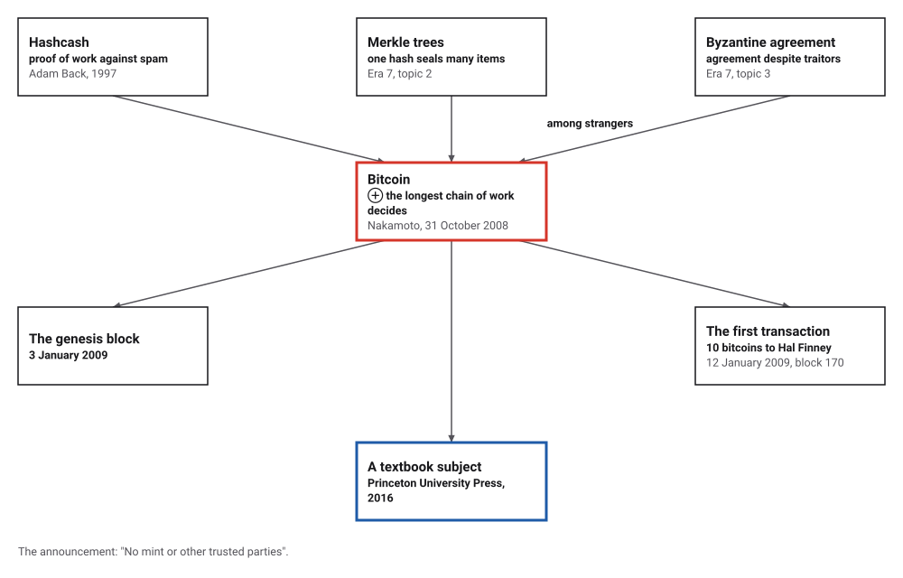
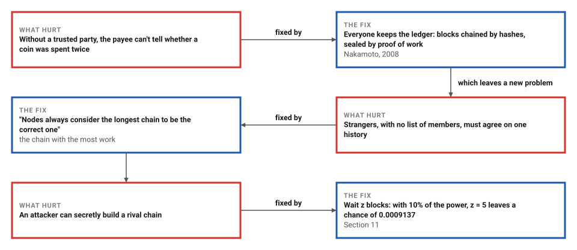
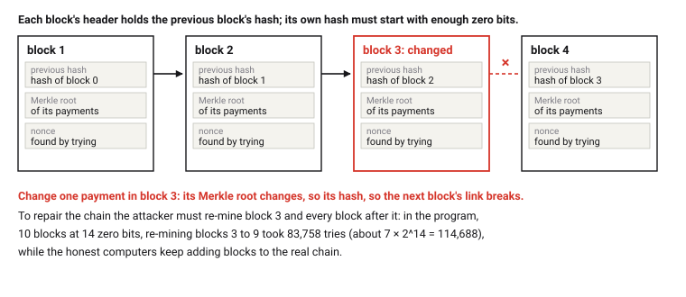
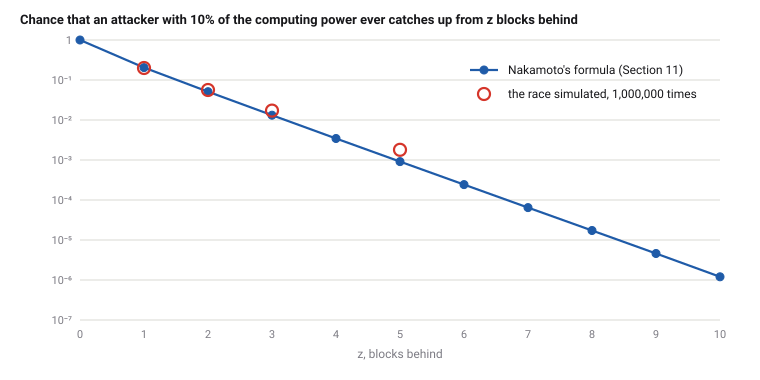

# Bitcoin's Proof-of-Work Ledger

*Era 8 · topic 13 · 2008* · [Era 8 index](../README.md) · [← Compressed Sensing](../12-compressed-sensing/README.md) · [Interactive edition](bitcoin.html) · [Program](../../../code/era-08-the-web-the-genome-and-the-ledger/13-bitcoin/)

> **Field note from the visiting historian.** I hashed the ledger's first block, 80 bytes from 3 January 2009, and got its published hash, 43 zero bits long. Nakamoto's table of an attacker's chances matched his formula to seven decimals. But when I ran the race itself 1,000,000 times, an attacker 5 blocks behind won 2.0 times as often as the formula says.

| | |
|---|---|
| **When** | 31 October 2008; genesis block 3 January 2009 |
| **Where** | The Cryptography Mailing List |
| **What hurt** | Without a trusted party, coins could be spent twice |
| **The fix** | A hash-chained ledger sealed by proof of work |
| **Checked** | The genesis header hashes to the published hash |

## How ideas combined

A new algorithm is usually an older idea combined with a new one. Hashcash (1997) made a computer prove it had done work, against spam. Merkle's trees (Era 7) sealed many items under one hash. The Byzantine generals (Era 7) showed how to agree despite traitors, among a known list of participants. Nakamoto chained blocks of payments by their hashes, sealed each with a proof of work, and let the chain with the most work decide. Each box names the idea that was added.

<picture>
  <source media="(prefers-color-scheme: dark)" srcset="assets/family-dark.svg">
  
</picture>
*Red: Bitcoin. Blue: where it stands today.*

## Mine a block, then break it

The block here is just a line of text. Mining means trying nonce after nonce until the SHA-256 hash of "text|nonce:N" starts with enough zero bits; the yellow digits are the zeros. Each extra zero bit doubles the expected work. With the program's text, "alice pays bob 10", the widget finds the same nonces the program did: 21 for 4 bits, 117 for 8 bits, 8334 for 12 bits, 34965 for 16 bits. Then change one letter.

| Zero bits | Nonce | Hash |
|---|---|---|
| 4 | 21 | 0d99876aeea3c6c55915c8fc… |
| 8 | 117 | 004ec52c5fba93ad24b53a38… |
| 12 | 8334 | 0004c10c0f906247b27315a7… |
| 16 | 34965 | 00008ded14ee7b728da66f42… |
*In the interactive edition you can mine your own text and watch the seal break when you change it.*

## Era 8, the Web, the genome and the ledger

<picture>
  <source media="(prefers-color-scheme: dark)" srcset="assets/era-timeline-dark.svg">
  
</picture>

## Each fix leaves a new pain

<picture>
  <source media="(prefers-color-scheme: dark)" srcset="assets/chain-dark.svg">
  
</picture>
*Read it as a snake: each new problem sits directly under the fix that exposed it.*

## A chain of sealed blocks

**A block.** Each block holds a batch of payments, summarized by the root of a Merkle tree of their hashes; the hash of the block before it; and a number called the nonce. It counts only if the SHA-256 hash of its header, read as a number, is below a target: it starts with enough zero bits. Nobody knows how to find such a nonce except by trying, about 2^d tries for d zero bits. Checking takes one hash.

<picture>
  <source media="(prefers-color-scheme: dark)" srcset="assets/blocks-dark.svg">
  
</picture>

**The longest chain.** Every node keeps a copy and always extends the chain with the most work. To rewrite an old payment an attacker must redo that block and every block after it, and then overtake the honest computers, which keep adding blocks. **Section 11.** Nakamoto computed the attacker's chance. While the honest side finds z blocks, he counts the attacker's blocks with a Poisson distribution of mean z q/p, where q is the attacker's share of the computing power and p = 1 − q; from k blocks behind, the attacker ever draws level with probability (q/p)^k.

> **Key idea.** Make each vote cost computation, and let the history with the most computation behind it win. Then rewriting history means out-computing everyone else.

## The first block, and the attacker's chances

**The genesis block** of 3 January 2009: its 80-byte header, hashed twice with SHA-256 and read with its bytes reversed, gives `000000000019d6689c085ae165831e934ff763ae46a2a6c172b3f1b60a8ce26f`, the published hash, with 43 leading zero bits. The target encoded in the header is 0x00ffff x 256^26 = 2^223 × 1.999969, so about 2^32 = 4,294,967,296 tries were expected.

| Field | Bytes (hex) | Value |
|---|---|---|
| version | 01000000 | 1 |
| previous block's hash | 0000000000000000… | zero: there is none |
| Merkle root | 3ba3edfd7a7b12b2… | of its one transaction |
| time | 29ab5f49 | 1231006505 seconds since 1970 |
| bits (the target) | ffff001d | 0x1d00ffff |
| nonce | 1dac2b7c | 2083236893 |

**Mining a toy chain**, blocks of 4 payments, at 4 to 16 zero bits:

| Zero bits | Blocks | Tries per block | 2^d |
|---|---|---|---|
| 4 | 200 | 15 | 16 |
| 8 | 200 | 243 | 256 |
| 12 | 200 | 4,497 | 4,096 |
| 16 | 60 | 71,308 | 65,536 |

**Tampering**: in a chain of 10 blocks at 14 zero bits, one payment in block 3 was changed. Its Merkle root and hash changed, the old nonce no longer gives 14 zero bits, and block 4's link broke. Re-mining blocks 3 to 9 took 83,758 tries.

**Section 11, recomputed** from Nakamoto's formula: every value equals the paper's to 7 decimals.

| z (q = 0.1) | P | z (q = 0.3) | P |
|---|---|---|---|
| 0 | 1.0000000 | 0 | 1.0000000 |
| 1 | 0.2045873 | 5 | 0.1773523 |
| 2 | 0.0509779 | 10 | 0.0416605 |
| 3 | 0.0131722 | 15 | 0.0101008 |
| 4 | 0.0034552 | 20 | 0.0024804 |
| 5 | 0.0009137 | 25 | 0.0006132 |
| 6 | 0.0002428 | 30 | 0.0001522 |
| 7 | 0.0000647 | 35 | 0.0000379 |
| 8 | 0.0000173 | 40 | 0.0000095 |
| 9 | 0.0000046 | 45 | 0.0000024 |
| 10 | 0.0000012 | 50 | 0.0000006 |

The smallest z with P below 0.1%, as in the paper:

| Attacker's share q | Blocks to wait |
|---|---|
| 0.10 | 5 |
| 0.15 | 8 |
| 0.20 | 11 |
| 0.25 | 15 |
| 0.30 | 24 |
| 0.35 | 41 |
| 0.40 | 89 |
| 0.45 | 340 |

**The race itself**, simulated 1,000,000 times for each z with q = 0.1, block by block: first the attacker's blocks while the honest side finds z, then the race until the attacker draws level. The simulation came out above the formula for z = 2, 3, 5; at z = 5 it was 2.0 times the formula. The formula's Poisson count is an approximation: counted block by block, the attacker's blocks follow a different distribution with the same mean.

| z | Simulated | Formula |
|---|---|---|
| 1 | 0.20008 | 0.20459 |
| 2 | 0.05621 | 0.05098 |
| 3 | 0.01717 | 0.01317 |
| 5 | 0.00180 | 0.00091 |

<picture>
  <source media="(prefers-color-scheme: dark)" srcset="assets/race-dark.svg">
  
</picture>

## A paper on a mailing list

Nakamoto's paper: "A purely peer-to-peer version of electronic cash would allow online payments to be sent directly"; "The problem of course is the payee can't verify that one of the owners did not double-spend the coin"; the block's hash must begin with a number of zero bits, "similar to Adam Back's Hashcash"; transactions are "hashed in a Merkle Tree"; "Nodes always consider the longest chain to be the correct one"; the system is secure "As long as a majority of CPU power is controlled by nodes that are not cooperating to attack the network"; Section 11 gives the attacker's chance with tables for q = 0.1 and 0.3. The announcement to the Cryptography Mailing List, Friday 31 October 2008: "No mint or other trusted parties".

Wikipedia's history: bitcoin.org was registered on 18 August 2008; the genesis block of 3 January 2009 carries the text "The Times 03/Jan/2009 Chancellor on brink of second bailout for banks"; the first client was released on 9 January 2009; Hal Finney received 10 bitcoins in the first transaction, on 12 January 2009 (block 170); hashcash was "a proof-of-work scheme for spam control in 1997". The Bitcoin Wiki lists the genesis header's fields and hash; its 50-bitcoin reward cannot be spent. Narayanan, Bonneau, Felten, Miller and Goldfeder's *Bitcoin and Cryptocurrency Technologies* (Princeton, 2016) is a textbook on "decentralization, mining, the politics of bitcoin".

## Agreement, paid for in work

Paxos (topic 8) agrees on one history among a known set of machines, by majorities of votes. Bitcoin agrees among strangers who may join or leave at any time, so it counts work instead of votes. Each block seals its payments with a Merkle root, Era 7's idea, and the first block's 80 bytes can still be checked by anyone.

> **Full circle.** The genesis block's header still hashes to 000000000019d6689c08…, with 43 zero bits: one hash to check work that was expected to take about 4,294,967,296 tries.

## Before you read on

<details>
<summary><b>1.</b> Why does each extra zero bit double the work?</summary>

Each bit of a good hash is 0 with probability ½, independently of the others, so d zero bits need about 2^d tries.
</details>

<details>
<summary><b>2.</b> How much work does it take to check a proof of work?</summary>

One hash of the header (in Bitcoin, SHA-256 applied twice), and a count of its zero bits.
</details>

<details>
<summary><b>3.</b> If a payment in block 3 changes, why must every later block be mined again?</summary>

Each block holds the previous block's hash. The changed block gets a new hash, which breaks the next block's link, and so on to the end.
</details>

<details>
<summary><b>4.</b> With 30% of the computing power against you, how many blocks should you wait for a chance below 0.1%?</summary>

24, from Section 11's table.
</details>

<details>
<summary><b>5.</b> Why is a Poisson count only an approximation here?</summary>

The number of attacker blocks found while the honest side finds exactly z is counted block by block; the Poisson distribution with the same mean is close, but not the same.
</details>


## Where the evidence lives

| | Object | Where to see it | Licence |
|---|---|---|---|
| — | **Bitcoin: A Peer-to-Peer Electronic Cash System (2008)**. The design and the Section 11 calculations. | [The paper (PDF, on an MIT course page)](https://courses.csail.mit.edu/6.857/2015/files/L07-nakamoto-bitcoin-a-peer-to-peer-electronic-cash-system.pdf) | Drawn placeholder. |
| — | **The announcement (31 October 2008)**. Posted to the Cryptography Mailing List. | [The mailing-list archive](https://www.metzdowd.com/pipermail/cryptography/2008-October/014810.html) | Drawn placeholder. |

## Every link was opened before it was listed

| Level | Link | Why |
|---|---|---|
| Start | [History of bitcoin](https://en.wikipedia.org/wiki/History_of_bitcoin) — Wikipedia | From the domain name to the first transaction |
| Start | [Bitcoin and Cryptocurrency Technologies](https://discovery.princeton.edu/2016/11/15/bitcoin-and-cryptocurrency-technologies-a-comprehensive-introduction) — Princeton University (2016) | A textbook for the whole subject |
| Deeper | [Genesis block](https://www.utwente.nl/en/ces/sal/exams/Blockchain-and-Distributed-Ledger-Technology-test/1-Bitcoin/genesis-block-bitcoin-wiki.pdf) — Bitcoin Wiki, printed for a University of Twente course | The first block, field by field |
| Scholar | [Bitcoin: A Peer-to-Peer Electronic Cash System](https://courses.csail.mit.edu/6.857/2015/files/L07-nakamoto-bitcoin-a-peer-to-peer-electronic-cash-system.pdf) — S. Nakamoto (2008), on an MIT course page | The design and the Section 11 calculations |
| Scholar | [Bitcoin P2P e-cash paper](https://www.metzdowd.com/pipermail/cryptography/2008-October/014810.html) — S. Nakamoto, Cryptography Mailing List (31 October 2008) | The announcement |

More, with certainty labels and the gaps we could not fill: [Era 8 reference catalog](https://github.com/vij658/AlgorithmEvolutionAtlas/blob/main/book/era-08-the-web-the-genome-and-the-ledger/reference-catalog.md).

## The program behind every number here

[Bitcoin.java](https://github.com/vij658/AlgorithmEvolutionAtlas/blob/main/code/era-08-the-web-the-genome-and-the-ledger/13-bitcoin/Bitcoin.java) makes **699 checks**: that the genesis header hashes to the published hash and lies below its target, that mined blocks need about 2^d tries, that tampering breaks the chain, and that Section 11's tables match the paper to 7 decimals. Run it with `java Bitcoin.java` (JDK 17 or newer). The heart of it:

```java
static long mine(byte[] prev, byte[] root, int bits) {
    for (long nonce = 0; ; nonce++) if (leadingZeroBits(dsha(header(prev, root, nonce))) >= bits) return nonce;
}

/** Nakamoto's Section 11 formula. */
static double attackerSuccess(double q, int z) {
    double p = 1 - q, lambda = z * (q / p), sum = 1;
    for (int k = 0; k <= z; k++) {
        double poisson = Math.exp(-lambda);
        for (int i = 1; i <= k; i++) poisson *= lambda / i;
        sum -= poisson * (1 - Math.pow(q / p, z - k));
    }
    return sum;
}
```

