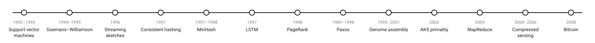
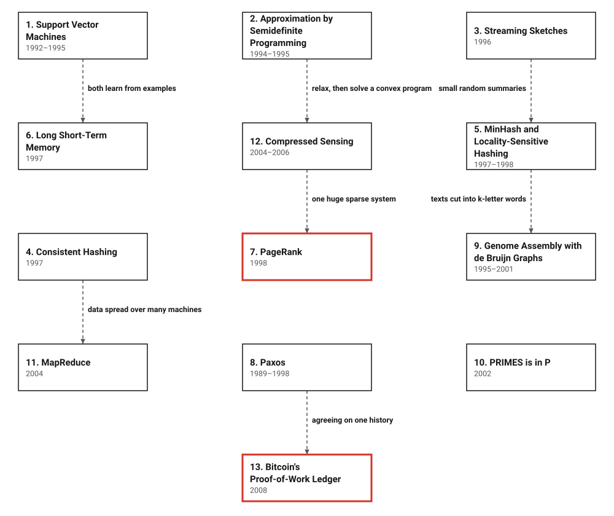

# Era 8 — The Web, the Genome and the Ledger

*1995 to 2008* · [Book contents](../README.md) · [Interactive edition](index.html) · [Reference catalog](reference-catalog.md) · [Programs](../../code/era-08-the-web-the-genome-and-the-ledger/README.md)

> **Field note from the visiting historian.** In the seventh era, the species learned to use chance, to keep networks working and to make machines that learn. In this one its network becomes a Web of tens of millions of pages, its laboratories read its own genome in fragments, and its data arrives faster than it can be kept, so it learns to rank, sketch, split and agree at a scale no earlier method was built for.

## When

<picture>
  <source media="(prefers-color-scheme: dark)" srcset="assets/era-timeline-dark.svg">
  
</picture>

## How the ideas combined

<picture>
  <source media="(prefers-color-scheme: dark)" srcset="assets/era-map-dark.svg">
  
</picture>

*Dashed lines join related developments; none of them is a claim that one inventor learned from the other. Most boxes build on earlier eras: support vector machines and LSTM on the perceptron and backpropagation (Eras 5 and 7); Goemans and Williamson on NP-completeness (Era 6) and linear programming (Era 7); sketches, consistent hashing and MinHash on hashing (Era 5) and fingerprints (Era 7); PageRank on Markov chains (Era 4); Paxos on the Byzantine generals and logical clocks (Eras 6 and 7); genome assembly on Euler's bridges (Era 3); PRIMES in P on the randomized primality tests of Era 6; compressed sensing on linear programming (Era 7); Bitcoin on Merkle's trees and Byzantine agreement (Era 7).*

## The topics

| # | Topic | When | What hurt | Read |
|---|---|---|---|---|
| 1 | **Support Vector Machines** | 1964; kernels 1992; soft margin 1995 | A perceptron's line could pass close to the examples | [page](01-support-vector-machines/README.md) · [interactive](01-support-vector-machines/support-vector-machines.html) · [program](../../code/era-08-the-web-the-genome-and-the-ledger/01-support-vector-machines/README.md) |
| 2 | **Approximation by Semidefinite Programming** | STOC 1994; journal 1995 | MAX CUT is NP-hard; the best guarantee was 1/2 | [page](02-max-cut/README.md) · [interactive](02-max-cut/max-cut.html) · [program](../../code/era-08-the-web-the-genome-and-the-ledger/02-max-cut/README.md) |
| 3 | **Streaming Sketches** | 1983–1985; 1996; 2005; 2007 | Exact counts need memory for every item | [page](03-streaming-sketches/README.md) · [interactive](03-streaming-sketches/streaming-sketches.html) · [program](../../code/era-08-the-web-the-genome-and-the-ledger/03-streaming-sketches/README.md) |
| 4 | **Consistent Hashing** | 1997; Chord 2001 | Hash-mod-n moves nearly every key when servers change | [page](04-consistent-hashing/README.md) · [interactive](04-consistent-hashing/consistent-hashing.html) · [program](../../code/era-08-the-web-the-genome-and-the-ledger/04-consistent-hashing/README.md) |
| 5 | **MinHash and Locality-Sensitive Hashing** | 1997; 1998 | Near-duplicates among millions of pages | [page](05-minhash/README.md) · [interactive](05-minhash/minhash.html) · [program](../../code/era-08-the-web-the-genome-and-the-ledger/05-minhash/README.md) |
| 6 | **Long Short-Term Memory** | 1991; 1995; 1997; forget gate 1999 | Recurrent networks forgot after a few steps | [page](06-lstm/README.md) · [interactive](06-lstm/lstm.html) · [program](../../code/era-08-the-web-the-genome-and-the-ledger/06-lstm/README.md) |
| 7 | **PageRank** | 1996; April 1998 | Keyword search returned junk | [page](07-pagerank/README.md) · [interactive](07-pagerank/pagerank.html) · [program](../../code/era-08-the-web-the-genome-and-the-ledger/07-pagerank/README.md) |
| 8 | **Paxos** | Submitted 1989 or 1990; published 1998 | Replicas must agree despite lost messages and stopped computers | [page](08-paxos/README.md) · [interactive](08-paxos/paxos.html) · [program](../../code/era-08-the-web-the-genome-and-the-ledger/08-paxos/README.md) |
| 9 | **Genome Assembly with de Bruijn Graphs** | 1995; 2001 | Overlap assembly is a Hamiltonian path problem | [page](09-genome-assembly/README.md) · [interactive](09-genome-assembly/genome-assembly.html) · [program](../../code/era-08-the-web-the-genome-and-the-ledger/09-genome-assembly/README.md) |
| 10 | **PRIMES is in P** | 6 August 2002; journal 2004 | Fast primality tests used chance or unproved hypotheses | [page](10-primes-is-in-p/README.md) · [interactive](10-primes-is-in-p/primes-is-in-p.html) · [program](../../code/era-08-the-web-the-genome-and-the-ledger/10-primes-is-in-p/README.md) |
| 11 | **MapReduce** | December 2004 | Every big-data program handled failures its own way | [page](11-mapreduce/README.md) · [interactive](11-mapreduce/mapreduce.html) · [program](../../code/era-08-the-web-the-genome-and-the-ledger/11-mapreduce/README.md) |
| 12 | **Compressed Sensing** | Preprint 2004; journal 2006 | Full-rate sampling wastes measurements on sparse signals | [page](12-compressed-sensing/README.md) · [interactive](12-compressed-sensing/compressed-sensing.html) · [program](../../code/era-08-the-web-the-genome-and-the-ledger/12-compressed-sensing/README.md) |
| 13 | **Bitcoin's Proof-of-Work Ledger** | 31 October 2008; 3 January 2009 | Electronic cash could be spent twice without a bank | [page](13-bitcoin/README.md) · [interactive](13-bitcoin/bitcoin.html) · [program](../../code/era-08-the-web-the-genome-and-the-ledger/13-bitcoin/README.md) |

The interactive edition is a single HTML file per topic: download it and open it in a browser, or use the published copy linked from the [book contents](../README.md).
