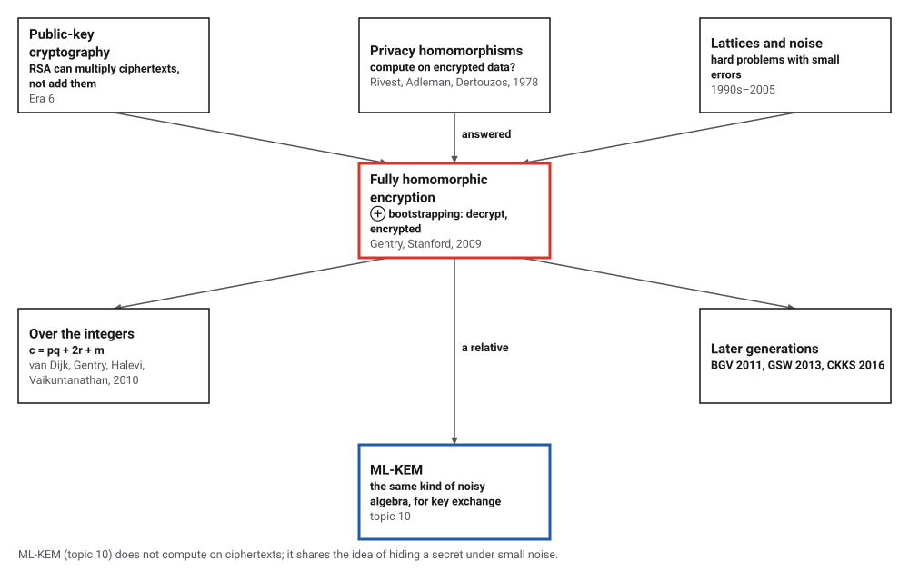
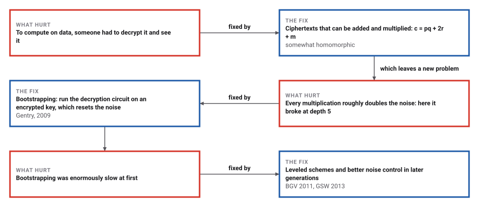
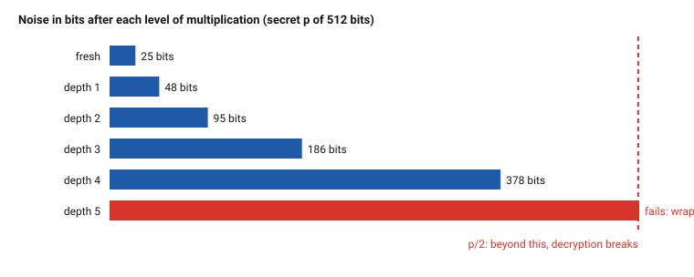

# Fully Homomorphic Encryption

*Era 9 · topic 1 · 2009–2010* · [Era 9 index](../README.md) · [Deep Convolutional Networks →](../02-deep-convolutional-networks/README.md) · [Interactive edition](homomorphic-encryption.html) · [Program](../../../code/era-09-learning-at-scale/01-homomorphic-encryption/)

> **Field note from the visiting historian.** I hid single bits under a 512-bit key and asked a stranger's arithmetic to add and multiply them. It never saw a bit, and every answer was right, until the fifth level of multiplication, when the noise passed half the key and the answers turned to nonsense. Then I removed the noise from two ciphertexts, and Euclid's algorithm handed me the key.

| | |
|---|---|
| **When** | 2009 (Gentry); 2010 (over the integers) |
| **Where** | Stanford University |
| **What hurt** | Computing on data meant decrypting it |
| **The fix** | Noisy ciphertexts that add and multiply; bootstrapping refreshes the noise |
| **Checked** | An encrypted 4-bit adder, all 256 pairs correct |

## How ideas combined

A new algorithm is usually an older idea combined with a new one. RSA (Era 6) already let anyone multiply ciphertexts, but never add them. In 1978 Rivest, Adleman and Dertouzos asked for a scheme that does both, without limit. Gentry's answer in 2009 hid each message under a little noise, and added one new idea: when the noise grows too large, decrypt the ciphertext, encrypted, to start again with small noise.

<picture>
  <source media="(prefers-color-scheme: dark)" srcset="assets/family-dark.svg">
  
</picture>
*Red: Gentry's step. Blue: a relative in this era.*

## Add and multiply what you cannot read

The secret key here is p = 1009. Encrypt a bit, then keep adding and multiplying encrypted bits. The computer that does the arithmetic never needs p. The bar shows the noise against p/2: additions barely move it, but each multiplication multiplies it, and after a couple of products it passes p/2 and decryption fails.

| Step | Ciphertext | Noise | Decrypts to |
|---|---|---|---|
| a = 1009*4321 + 2*(3) + 1 | 4359896 | 7 | 1 |
| b = 1009*7777 + 2*(-2) + 1 | 7846990 | −3 | 1 |
| a + b | 12206886 | 4 | 0 |
| a × b | 34212060313040 | −21 | 1 |
*In the interactive edition you can keep adding and multiplying until the noise breaks through.*

## Era 9, learning at scale

<picture>
  <source media="(prefers-color-scheme: dark)" srcset="assets/era-timeline-dark.svg">
  
</picture>

## Each fix leaves a new pain

<picture>
  <source media="(prefers-color-scheme: dark)" srcset="assets/chain-dark.svg">
  
</picture>
*Read it as a snake: each new problem sits directly under the fix that exposed it.*

## A message hidden under a little noise

**Encrypt.** The secret key is a large odd number p. To encrypt a bit m, choose a large random q and a small random r and send c = p·q + 2r + m. To decrypt, take c modulo p, as a number between −p/2 and p/2: what is left is the noise 2r + m, and its last bit is m.

**Compute.** Add two ciphertexts and the noises add: (2r₁ + m₁) + (2r₂ + m₂) is odd exactly when m₁ XOR m₂ is 1. Multiply them and the noises multiply: the product is odd exactly when m₁ AND m₂ is 1. XOR and AND are enough to build any circuit, so any computation can run on ciphertexts.

**The limit.** As long as the noise stays below p/2, reduction modulo p gives it back exactly. Additions add a bit or so; each multiplication roughly doubles the number of noise bits. Past p/2 the reduction wraps around and the answer is garbage. The scheme is *somewhat* homomorphic.

**Bootstrapping.** Gentry's step: give the computer an encryption of the secret key, and let it run the decryption circuit on a noisy ciphertext, homomorphically. The output encrypts the same bit with fresh noise, as long as decryption itself is shallow enough to fit in the noise budget. Then any depth is possible.

<picture>
  <source media="(prefers-color-scheme: dark)" srcset="assets/noise-dark.svg">
  
</picture>

> **Key idea.** Noise is what makes the scheme secure, and noise is what limits it. Bootstrapping turns the limit into a refresh: decrypt, but encrypted.

## Five hundred bits of key, four levels of products

**The scheme** with a secret p of 512 bits, q of 1024 bits and noise r of 24 bits: ciphertexts of about 1534 bits. 800 XOR, AND and NOT combinations of encrypted bits all decrypted correctly.

**The noise** when ciphertexts of 1 are multiplied in a balanced tree:

| Level | Noise (bits) | Decrypts |
|---|---|---|
| fresh | 25 | yes |
| 1 | 48 | yes |
| 2 | 95 | yes |
| 3 | 186 | yes |
| 4 | 378 | yes |
| **5** | **more than 511** | **no** |

The deepest working level was 4; a rough estimate that doubles the noise bits each level says 5. Additions are cheap: one addition left 24 bits, and a chain of 1,000 additions only 30.

**A 4-bit adder** built from XOR and AND gates (ripple carry), run on encrypted inputs: all 256 pairs of 4-bit numbers gave the right sum, with at most 126 bits of noise in the last carry, well under 512.

**A public key**: 30 encryptions of 0. Anyone can encrypt by adding a random subset of them to m plus a small even number; 400 such encryptions all decrypted correctly.

**Why the noise is essential.** Two noise-free multiples of p give away p at once: their gcd had 513 bits, and removing 1 small factor left exactly p. With the noise, the gcd of two encryptions of 0 was 1. Finding p from noisy multiples is the approximate-gcd problem, on which the scheme's security rests.

## A dissertation, and a paper with only integers

Wikipedia: the problem "was first proposed in 1978, within a year of publishing of the RSA scheme"; Gentry "described the first plausible construction for a fully homomorphic encryption scheme in 2009"; the noise "grows as one adds and multiplies ciphertexts" until it "makes the resulting ciphertext indecipherable"; bootstrapping "effectively 'refreshes' the ciphertext by applying to it the decryption procedure homomorphically". Gentry's dissertation (Stanford, September 2009, adviser Dan Boneh): "We propose the first fully homomorphic encryption scheme, solving a central open problem in cryptography."

van Dijk, Gentry, Halevi and Vaikuntanathan (Cryptology ePrint 2009/616; Eurocrypt 2010): "a very simple 'somewhat homomorphic' encryption scheme using only elementary modular arithmetic", made fully homomorphic with Gentry's techniques, and secure if it is hard to find "a hidden integer" from "a list of integers that are near-multiples" of it. This program follows their scheme, with a secret-key encryption and toy sizes.

## Euclid's algorithm, defeated by noise

Euclid's algorithm (Era 1) finds the greatest common divisor of two numbers in a few steps. Applied to two noise-free ciphertexts of 0, it returns the secret key. A little noise, a few bits out of hundreds, is enough to make the gcd useless. Lattice cryptography (topic 10) protects its secrets the same way: linear algebra that would be easy without small errors.

> **Full circle.** The gcd of two noise-free multiples of the key gave the key back; with noise, the gcd was 1.

## Before you read on

<details>
<summary><b>1.</b> With p = 1009, decrypt c = 4359896.</summary>

4359896 mod 1009 = 7, which is odd: the bit is 1.
</details>

<details>
<summary><b>2.</b> Why must the noise be even plus the message, 2r + m, and not just r + m?</summary>

So that its last bit is the message: an even number plus m is odd exactly when m is 1.
</details>

<details>
<summary><b>3.</b> Two ciphertexts have noise 5 and −3. What noise does their product have, and what does it decrypt to?</summary>

−15, which is odd: 1 AND 1 = 1.
</details>

<details>
<summary><b>4.</b> Why does a multiplication cost so much more noise than an addition?</summary>

Adding noises of b bits gives at most b + 1 bits; multiplying them gives about 2b bits.
</details>

<details>
<summary><b>5.</b> Why can't the computer doing the arithmetic just read the message?</summary>

It would need p to reduce c; without p, c is a huge number with no visible pattern, and finding p from many ciphertexts is the approximate-gcd problem.
</details>


## Where the evidence lives

| | Object | Where to see it | Licence |
|---|---|---|---|
| — | **A Fully Homomorphic Encryption Scheme (2009)**. Craig Gentry's Stanford dissertation. | [The dissertation (PDF, Stanford Applied Cryptography Group)](https://crypto.stanford.edu/craig/craig-thesis.pdf) | Drawn placeholder. |

## Every link was opened before it was listed

| Level | Link | Why |
|---|---|---|
| Start | [How To Compute With Encrypted Data](https://www.youtube.com/watch?v=fLjPGhCDzKY) — TechTechPotato (Ian Cutress) | An introduction for a general audience |
| Deeper | [Introduction to FHE (Fully Homomorphic Encryption) - Pascal Paillier, FHE.org Meetup](https://www.youtube.com/watch?v=aruz58RarVA) — Zama | A talk by the inventor of the Paillier cryptosystem |
| Deeper | [Homomorphic encryption](https://en.wikipedia.org/wiki/Homomorphic_encryption) — Wikipedia | The 1978 question, the noise, bootstrapping and the generations of schemes |
| Scholar | [A Decade (or so) of fully homomorphic encryption, by Craig Gentry](https://www.youtube.com/watch?v=487AjvFW1lk) — IACR | The inventor, on the channel of the International Association for Cryptologic Research |
| Scholar | [A Fully Homomorphic Encryption Scheme](https://crypto.stanford.edu/craig/craig-thesis.pdf) — C. Gentry (2009), dissertation, Stanford | The first construction, and bootstrapping |
| Scholar | [Fully Homomorphic Encryption over the Integers](https://eprint.iacr.org/2009/616) — M. van Dijk, C. Gentry, S. Halevi, V. Vaikuntanathan (2009–2010) | The same idea with integers only; the scheme the program follows |

More, with certainty labels and the gaps we could not fill: [Era 9 reference catalog](https://github.com/vij658/AlgorithmEvolutionAtlas/blob/main/book/era-09-learning-at-scale/reference-catalog.md).

## The program behind every number here

[FullyHomomorphic.java](https://github.com/vij658/AlgorithmEvolutionAtlas/blob/main/code/era-09-learning-at-scale/01-homomorphic-encryption/FullyHomomorphic.java) makes **3,864 checks**: every XOR, AND and NOT on encrypted bits, the noise limit, an encrypted adder on all 256 pairs, public-key encryption, and the gcd attack with and without noise. Run it with `java FullyHomomorphic.java` (JDK 17 or newer). The heart of it:

```java
/** c = p*q + 2r + m, with q of qBits bits and r of rBits bits (r may be negative). */
static BigInteger enc(BigInteger p, int m, int qBits, int rBits) {
    BigInteger q = new BigInteger(qBits, RND);
    BigInteger r = new BigInteger(rBits, RND);
    if (RND.nextBoolean()) r = r.negate();
    return p.multiply(q).add(r.shiftLeft(1)).add(BigInteger.valueOf(m));
}

/** c reduced into (-p/2, p/2]: the noise. */
static BigInteger noise(BigInteger p, BigInteger c) {
    BigInteger r = c.mod(p);
    if (r.compareTo(p.shiftRight(1)) > 0) r = r.subtract(p);
    return r;
}
```

