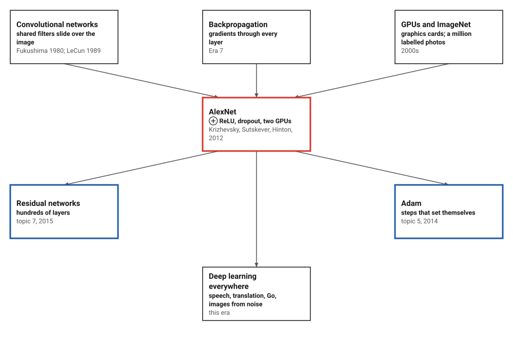
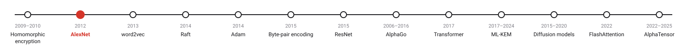
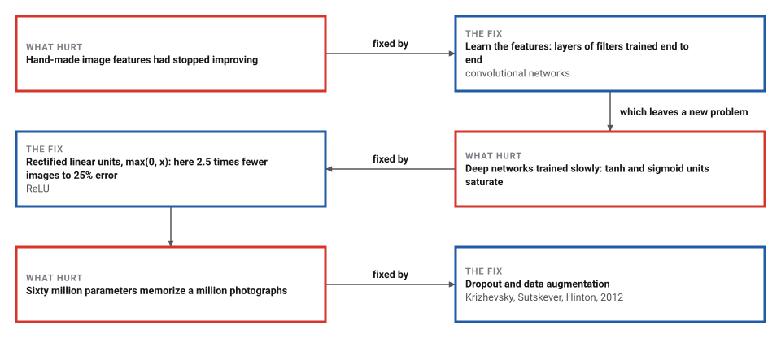
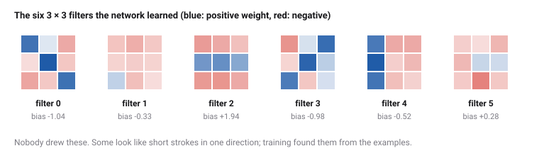

# Deep Convolutional Networks

*Era 9 · topic 2 · 2012* · [Era 9 index](../README.md) · [← Fully Homomorphic Encryption](../01-homomorphic-encryption/README.md) · [Word Embeddings →](../03-word-embeddings/README.md) · [Interactive edition](deep-convolutional-networks.html) · [Program](../../../code/era-09-learning-at-scale/02-deep-convolutional-networks/)

> **Field note from the visiting historian.** I taught two small networks to tell four kinds of stroke apart, showing them only the left half of the picture. The one with 2,388 numbers learned the left half perfectly and guessed on the right. The one with 88, whose filters slide over every position, recognized the strokes on the right as if it had always seen them there.

| | |
|---|---|
| **When** | Submitted 30 September 2012 |
| **Where** | University of Toronto |
| **What hurt** | Hand-made features had stalled; deep nets trained slowly |
| **The fix** | Convolutions on GPUs, ReLU, dropout |
| **Checked** | Right-half error 6.3% (convolutional) against 77.8% (fully connected) |

## How ideas combined

A new algorithm is usually an older idea combined with a new one. Convolutional networks were old (Fukushima's neocognitron of 1980, LeCun's networks from 1989), and so was backpropagation (Era 7). What was new in 2012 was the scale, a million labelled photographs and two graphics cards, and three changes that made the scale trainable: rectified linear units, dropout and data augmentation.

<picture>
  <source media="(prefers-color-scheme: dark)" srcset="assets/family-dark.svg">
  
</picture>
*Red: AlexNet. Blue: steps in this era that made deeper networks trainable.*

## Draw a stroke

This is the program's trained network, all 88 of its numbers. Draw a short stroke on the grid (click or drag): across, down, or diagonal. Six filters slide over your drawing; each keeps only its strongest response, wherever it is; four weighted sums of those six numbers give the probabilities. The network was trained only on strokes in the left half. Press *Shift right* and watch it still recognize them.

| Clean 5-pixel stroke in the middle | Probability of the right class |
|---|---|
| horizontal | 1.000 |
| vertical | 1.000 |
| diagonal down | 1.000 |
| diagonal up | 1.000 |
*In the interactive edition you can draw strokes and watch each filter respond.*

## Era 9, learning at scale

<picture>
  <source media="(prefers-color-scheme: dark)" srcset="assets/era-timeline-dark.svg">
  
</picture>

## Each fix leaves a new pain

<picture>
  <source media="(prefers-color-scheme: dark)" srcset="assets/chain-dark.svg">
  
</picture>
*Read it as a snake: each new problem sits directly under the fix that exposed it.*

## One filter, every position

**Convolution.** A filter is a small grid of numbers, here 3 × 3. Place it over a patch of the image, multiply each number by the pixel under it, and add: the sum is large where the patch looks like the filter. Slide it to every position and you get a map of where the pattern occurs. The same nine numbers are used everywhere, so a pattern learned in one place is found in any other, and the layer has very few numbers to learn.

**Rectified linear units.** Each sum passes through max(0, x). The older tanh and sigmoid flatten out for large inputs, so their slope, and with it the error signal that backpropagation passes back, nearly vanishes. ReLU's slope is 1 wherever it is on. Krizhevsky and colleagues found it reached 25% training error on CIFAR-10 six times faster than tanh.

**Pooling and the output.** AlexNet pooled small neighbourhoods; this program keeps only each filter's maximum over the whole image (global max pooling), which makes the answer the same wherever the stroke is. A last layer turns the six maxima into four probabilities (softmax), and the whole network is trained by backpropagation.

**Dropout.** During training, switch off each unit of a layer with probability 0.5 at every step, and double the survivors. No unit can count on another being there, so the network cannot build fragile, memorized combinations. At test time every unit is used.

<picture>
  <source media="(prefers-color-scheme: dark)" srcset="assets/filters-dark.svg">
  
</picture>

> **Key idea.** Share the weights across positions, and the network learns a pattern once and finds it everywhere. Use units that do not saturate, and the gradient survives the trip back.

## Trained on the left, tested on the right

**The data**: 12 × 12 images of four kinds of stroke, with noise and three stray dots each. All 800 training images have their stroke in the left half; the tests are 400 new left-half images and 400 right-half images, a half the networks never saw.

| Network | Numbers to learn | Training error | New left-half | Right half (never seen) |
|---|---|---|---|---|
| **Convolutional (6 filters, global max)** | **88** | **0.0%** | **0.3%** | **6.3%** |
| Fully connected (16 hidden units) | 2,388 | 0.0% | 6.3% | 77.8% |

The fully connected network, with 2,388 numbers against 88, fits the training images and does no better than chance (75% error) on the right half: to it, a stroke on the right is a different set of pixels. The convolutional network's errors on the right half are mostly  vertical strokes (75 of 100 right). Its gradient was checked against finite differences: largest difference 8.5 × 10⁻¹⁰.

**ReLU against tanh**, with the same starting weights and the same sequence of images, counting images until the training error first falls below 25%:

| Start | ReLU | tanh |
|---|---|---|
| 1 | 200 | 560 |
| 2 | 80 | 320 |
| 3 | 200 | 420 |
| 4 | 320 | 660 |
| 5 | 220 | 760 |
| 6 | 220 | 280 |
| 7 | 180 | 420 |
| 8 | 220 | 700 |
| **total** | **1,640** | **4,120** |

ReLU was faster in 8 of 8 starts; tanh needed 2.5 times as many images in total. The paper's factor was six, for a much deeper network on photographs.

**Dropout** on a fully connected network with 64 hidden units, trained on only 240 images: without dropout, training error 0.0% and error on new images 27.9%; with dropout, 0.0% and 24.3%. Dropout was better in 5 of 5 starts.

## Two graphics cards, six days

Krizhevsky, Sutskever and Hinton (University of Toronto): on ILSVRC-2012, "a winning top-5 test error rate of 15.3%" against 26.2% for the second-best entry; the network "has 60 million parameters and 650,000 neurons"; "non-saturating neurons" and "dropout"; ReLU reached "a 25% training error rate on CIFAR-10 six times faster" than tanh; "Our network takes between five and six days to train on two GTX 580 3GB GPUs."

Wikipedia: AlexNet was submitted to the challenge on 30 September 2012 and won by "more than 10.8% points"; the neocognitron (1980) and LeNet (1989) came first; by early 2025 the paper had been cited over 198,000 times.

## Rosenblatt's perceptron, stacked and shared

Each unit in this network is Rosenblatt's perceptron (Era 5): a weighted sum and a threshold, here a soft one. Backpropagation (Era 7) trains many of them in layers. A convolutional layer is many copies of one small perceptron, one at each position, sharing its weights. Residual networks (topic 7) will stack a hundred such layers.

> **Full circle.** 88 shared numbers recognized strokes in a half of the image they had never seen, with 6.3% error; 2,388 unshared numbers did no better than guessing.

## Before you read on

<details>
<summary><b>1.</b> A 3 × 3 filter slides over a 12 × 12 image without going past the edges. How many positions does it visit?</summary>

10 × 10 = 100.
</details>

<details>
<summary><b>2.</b> Why does sharing one filter across all positions help a network trained only on the left half?</summary>

The same filter, with the same numbers, also slides over the right half; a stroke there produces the same responses, just in a different place.
</details>

<details>
<summary><b>3.</b> What is the slope of tanh at x = 3, roughly, and of ReLU?</summary>

1 − tanh²(3) ≈ 0.01; ReLU's slope is 1. A gradient passing back through tanh at 3 shrinks a hundredfold.
</details>

<details>
<summary><b>4.</b> With dropout 0.5, why double the surviving units during training?</summary>

So that the expected input to the next layer is the same as at test time, when every unit is on.
</details>

<details>
<summary><b>5.</b> Why did AlexNet need graphics cards?</summary>

Convolutions are millions of independent multiply-adds, which a GPU does in parallel; on the CPUs of 2012 the training would have taken weeks or months.
</details>


## Where the evidence lives

| | Object | Where to see it | Licence |
|---|---|---|---|
| — | **ImageNet Classification with Deep Convolutional Neural Networks (2012)**. Krizhevsky, Sutskever and Hinton's paper. | [The paper (PDF, on a Duke course page)](https://courses.cs.duke.edu/fall16/compsci527/papers/Krizhevsky%20et%20al%20DNN%20ImageNet%202012.pdf) | Drawn placeholder. |

## Every link was opened before it was listed

| Level | Link | Why |
|---|---|---|
| Start | [Neural Networks Part 8: Image Classification with Convolutional Neural Networks (CNNs)](https://www.youtube.com/watch?v=HGwBXDKFk9I) — StatQuest with Josh Starmer | Filters, pooling and classification, step by step |
| Start | [AlexNet](https://en.wikipedia.org/wiki/AlexNet) — Wikipedia | The network, the contest and what came before |
| Deeper | [[Classic] ImageNet Classification with Deep Convolutional Neural Networks (Paper Explained)](https://www.youtube.com/watch?v=Nq3auVtvd9Q) — Yannic Kilcher | A walk through the 2012 paper |
| Scholar | [ImageNet Classification with Deep Convolutional Neural Networks](https://courses.cs.duke.edu/fall16/compsci527/papers/Krizhevsky%20et%20al%20DNN%20ImageNet%202012.pdf) — A. Krizhevsky, I. Sutskever, G. Hinton (2012), on a Duke course page | The paper, with its ReLU and dropout experiments |

More, with certainty labels and the gaps we could not fill: [Era 9 reference catalog](https://github.com/vij658/AlgorithmEvolutionAtlas/blob/main/book/era-09-learning-at-scale/reference-catalog.md).

## The program behind every number here

[ConvNet.java](https://github.com/vij658/AlgorithmEvolutionAtlas/blob/main/code/era-09-learning-at-scale/02-deep-convolutional-networks/ConvNet.java) makes **26 checks**: backpropagation against finite differences, both networks on both halves, ReLU against tanh from eight starts, dropout from five, and the widget's rounded network against the trained one. Run it with `java ConvNet.java` (JDK 17 or newer). The heart of it:

```java
/** Filter f applied at map position (i, j): the pre-activation sum. */
static double conv(double[] img, int f, int i, int j) {
    double s = B[f];
    for (int a = 0; a < 3; a++) for (int b = 0; b < 3; b++) s += W[f][a * 3 + b] * img[(i + a) * S + j + b];
    return s;
}

static void backward(double[] img, int y) {
    double[] p = forward(img);
    for (double[] row : gW) Arrays.fill(row, 0);
    for (double[] row : gV) Arrays.fill(row, 0);
    Arrays.fill(gB, 0); Arrays.fill(gC, 0);
    double[] dfeat = new double[F];
    for (int k = 0; k < K; k++) {
        double dl = p[k] - (k == y ? 1 : 0);
        gC[k] = dl;
        for (int f = 0; f < F; f++) { gV[k][f] = dl * feat[f]; dfeat[f] += dl * V[k][f]; }
    }
    for (int f = 0; f < F; f++) { // max pooling passes the gradient to the winning position only
        int i = argmax[f] / M, j = argmax[f] % M;
        double dz = dfeat[f] * dact(pre[f]);
        gB[f] = dz;
        for (int a = 0; a < 3; a++) for (int b = 0; b < 3; b++) gW[f][a * 3 + b] = dz * img[(i + a) * S + j + b];
    }
}
```

