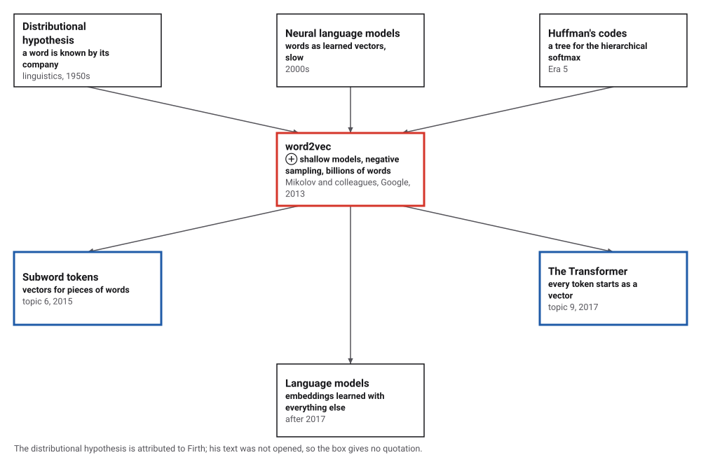
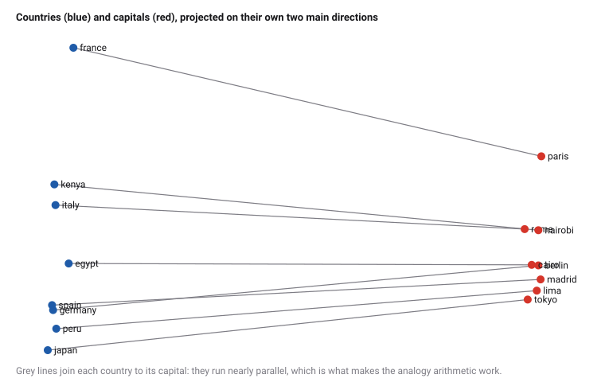
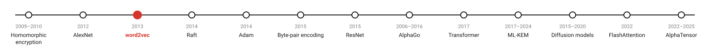
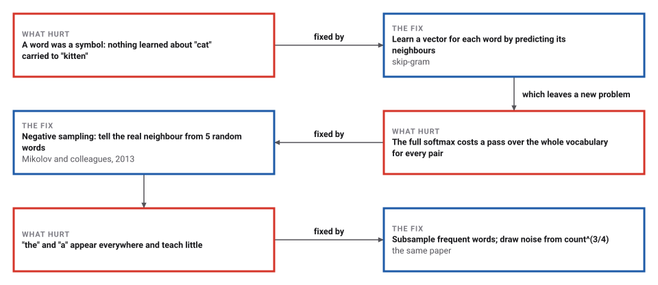

# Word Embeddings

*Era 9 · topic 3 · 2013* · [Era 9 index](../README.md) · [← Deep Convolutional Networks](../02-deep-convolutional-networks/README.md) · [Raft →](../04-raft/README.md) · [Interactive edition](word-embeddings.html) · [Program](../../../code/era-09-learning-at-scale/03-word-embeddings/)

> **Field note from the visiting historian.** I wrote the program a little world in 30,000 sentences and let it predict neighbours. I never told it what a capital is. Afterwards, Paris minus France plus Italy was rome, and king minus man plus woman was queen. Countries and their languages, it understood much less well.

| | |
|---|---|
| **When** | January and October 2013 |
| **Where** | Google |
| **What hurt** | Words were symbols with nothing in common |
| **The fix** | Vectors trained to predict neighbours, with negative sampling |
| **Checked** | 94 of 142 analogies, against 5 for random vectors |

## How ideas combined

A new algorithm is usually an older idea combined with a new one. Linguists had long held that a word is known by the company it keeps, and neural language models of the 2000s already learned a vector for each word, slowly. Mikolov and his colleagues at Google made the model shallow, replaced the expensive softmax by a cheap guessing game against random words, and trained on billions of words in a day.

<picture>
  <source media="(prefers-color-scheme: dark)" srcset="assets/family-dark.svg">
  
</picture>
*Red: word2vec. Blue: later topics in this era where every token is a vector.*

## Arithmetic with words

These are the program's 42 trained word vectors, 32 numbers each, drawn on two dimensions. Choose an analogy, *a is to b as c is to ?*; the page computes v(b) − v(a) + v(c) with all 32 numbers and shows the nearest words by cosine. Country to capital and male to female work well; try country to language, which this small model learned badly.

<picture>
  <source media="(prefers-color-scheme: dark)" srcset="assets/map-dark.svg">
  
</picture>
*In the interactive edition you can pick any analogy and see the nearest words.*

## Era 9, learning at scale

<picture>
  <source media="(prefers-color-scheme: dark)" srcset="assets/era-timeline-dark.svg">
  
</picture>

## Each fix leaves a new pain

<picture>
  <source media="(prefers-color-scheme: dark)" srcset="assets/chain-dark.svg">
  
</picture>
*Read it as a snake: each new problem sits directly under the fix that exposed it.*

## Predict the neighbours

**Two vectors per word.** Every word w gets a vector v_w for when it is in the centre and a vector u_c for when it is a neighbour. The skip-gram model reads the text and, for every centre word, looks at the words within a small window around it.

**Negative sampling.** For each real pair (w, c), push σ(v_w · u_c) towards 1, where σ(x) = 1/(1 + e^−x). Then draw k random noise words n and push σ(v_w · u_n) towards 0. One step of gradient descent per pair adjusts v_w, u_c and the u_n. The noise words are drawn in proportion to count^(3/4), which gives rarer words a little more chance than their counts would.

**Subsampling.** Words like "the" and "is" are thrown away at random each time they appear, more often the more frequent they are, so the window reaches past them to words that say something.

**Why analogies work.** Words used in similar company end up with similar vectors. If capitals share some company ("city", "capital") and each capital shares its country's own company (the language, the sentence with its country), then v(paris) is roughly *capital* + *france-ness*, v(france) is *nation* + *france-ness*, and the difference v(paris) − v(france) is about the same for every pair. Add it to v(italy) and you land near v(rome).

> **Key idea.** Do not tell the model what words mean; make it predict their neighbours. Meaning ends up as geometry: similar words close together, consistent relations as consistent directions.

## Sixty words, two million pairs

**The corpus**: 30,000 sentences written from patterns about 8 countries, their capitals and languages, and 6 pairs of words that differ by gender, each pair with a context word of its own: 160,808 words, a vocabulary of 60. Most frequent: is 15,112, the 14,839, a 11,325, of 11,278, speak 7,594. A real corpus would be ordinary text, billions of words long; this one is small so that the program can check what the vectors learn.

**Training**: d = 32, window 3, k = 5 noise words, 5 passes. Subsampling skipped 278,038 of 804,040 word occurrences; 2,103,862 centre-neighbour pairs were trained. Raising counts to the 3/4 power cut "the"'s share of the noise draws from 0.092 to 0.065. The gradient of the loss agreed with finite differences to 3.2 × 10⁻¹⁰.

**Nearest words** (cosine of the angle between vectors), among the 42 content words:

| Word | Nearest | Second | Third |
|---|---|---|---|
| paris | berlin 0.93 | madrid 0.92 | lima 0.91 |
| france | kenya 0.70 | egypt 0.63 | italy 0.62 |
| king | brother 0.69 | prince 0.64 | father 0.64 |
| sister | girl 0.68 | princess 0.66 | queen 0.63 |
| swahili | italian 0.61 | quechua 0.61 | japanese 0.61 |

**Analogies**: every pair of pairs within a relation ("a is to b as c is to ?"), answered by the word nearest to v(b) − v(a) + v(c), excluding a, b and c:

| Relation | Right | Asked | Share |
|---|---|---|---|
| country → capital | 56 | 56 | 100% |
| country → language | 8 | 56 | 14% |
| male → female | 30 | 30 | 100% |
| **all** | **94** | **142** | **66%** |
| random vectors | 5 | 142 | 4% |

v(paris) − v(france) + v(italy) is nearest to **rome**; v(king) − v(man) + v(woman) is nearest to **queen**. Not every relation is learned equally: country to language was answered 8 times of 56.

**The cost per training pair**: a full softmax over these 60 words needs 1,920 multiply-adds; negative sampling with k = 5 needs 192. For a vocabulary of a million words and d = 300: 300,000,000 against 1,800.

## Two papers from Google, 2013

Mikolov, Chen, Corrado and Dean (submitted 16 January 2013): "it takes less than a day to learn high quality word vectors from a 1.6 billion words data set", with "state-of-the-art performance on our test set for measuring syntactic and semantic word similarities". Mikolov, Sutskever, Chen, Corrado and Dean (October 2013): negative sampling with 5 to 20 noise words for small datasets and 2 to 5 for large ones, noise from the unigram distribution to the 3/4 power, subsampling of frequent words, phrases learned as tokens, and vectors that add ("Russian" + "river" near "Volga River").

Wikipedia: in skip-gram "the model uses the current word to predict the surrounding window of context words"; continuous bag-of-words is "a 'fill in the blank' task"; hierarchical softmax "uses a Huffman tree"; the second paper "received the 2023 NeurIPS Test of Time Award".

## Huffman's tree, in a language model

Word2vec's other speed trick, the hierarchical softmax, puts the vocabulary at the leaves of a Huffman tree (Era 5, topic 3), so frequent words sit near the root and a prediction costs a few steps down the tree instead of a pass over the whole vocabulary. The code meant to compress telegrams ended up organizing a neural network's output.

> **Full circle.** Nothing told the program that Paris is a capital. v(paris) − v(france) + v(italy) landed on rome.

## Before you read on

<details>
<summary><b>1.</b> In "in paris they speak french", with a window of 2, which neighbours does "paris" have?</summary>

in, they, speak (one word to its left, two to its right within the sentence); "french" is three away.
</details>

<details>
<summary><b>2.</b> Why train against random noise words instead of the whole vocabulary?</summary>

The whole vocabulary costs a dot product per word for every pair; k noise words cost k + 1. The model only has to tell real neighbours from random ones.
</details>

<details>
<summary><b>3.</b> Counts 10,000 and 100. What are their noise weights with the 3/4 power, and how does the ratio change?</summary>

1,000 and about 31.6: the ratio falls from 100 to about 32, so rare words are drawn more often than their counts alone would give.
</details>

<details>
<summary><b>4.</b> Why exclude a, b and c when answering an analogy?</summary>

v(b) − v(a) + v(c) is often closest to b or c themselves; the question asks for a fourth word.
</details>

<details>
<summary><b>5.</b> If two words never appear near each other but always appear near the same words, will their vectors be close?</summary>

Yes: their vectors are both pulled towards the same neighbour vectors. This is the distributional idea.
</details>


## Where the evidence lives

| | Object | Where to see it | Licence |
|---|---|---|---|
| — | **Efficient Estimation of Word Representations in Vector Space (2013)**. Mikolov, Chen, Corrado and Dean. | [arXiv:1301.3781](https://arxiv.org/abs/1301.3781) | Drawn placeholder. |

## Every link was opened before it was listed

| Level | Link | Why |
|---|---|---|
| Start | [Word Embedding and Word2Vec, Clearly Explained!!!](https://www.youtube.com/watch?v=viZrOnJclY0) — StatQuest with Josh Starmer | Words to vectors, slowly and with pictures |
| Start | [Word2vec](https://en.wikipedia.org/wiki/Word2vec) — Wikipedia | The two models and the two training tricks |
| Deeper | [Stanford CS224N: NLP with Deep Learning \| Winter 2021 \| Lecture 1 - Intro & Word Vectors](https://www.youtube.com/watch?v=rmVRLeJRkl4) — Stanford Online | The first lecture of Stanford's course, on word vectors |
| Scholar | [Efficient Estimation of Word Representations in Vector Space](https://arxiv.org/abs/1301.3781) — T. Mikolov, K. Chen, G. Corrado, J. Dean (2013) | The two architectures |
| Scholar | [Distributed Representations of Words and Phrases and their Compositionality](https://ar5iv.arxiv.org/html/1310.4546) — T. Mikolov, I. Sutskever, K. Chen, G. Corrado, J. Dean (2013) | Negative sampling and subsampling |

More, with certainty labels and the gaps we could not fill: [Era 9 reference catalog](https://github.com/vij658/AlgorithmEvolutionAtlas/blob/main/book/era-09-learning-at-scale/reference-catalog.md).

## The program behind every number here

[WordEmbeddings.java](https://github.com/vij658/AlgorithmEvolutionAtlas/blob/main/code/era-09-learning-at-scale/03-word-embeddings/WordEmbeddings.java) makes **7 checks**: the gradient against finite differences, the noise distribution, the analogies against random vectors, and the two famous examples. Run it with `java WordEmbeddings.java` (JDK 17 or newer). The heart of it:

```java
/** One SGD step on the pair (w, c); returns the gradient with respect to vIn[w] (for the gradient check). */
static double[] pairStep(int w, int c, int[] neg, double lr) {
    double[] gv = new double[D];
    int[] all = new int[neg.length + 1];
    all[0] = c;
    System.arraycopy(neg, 0, all, 1, neg.length);
    for (int t = 0; t < all.length; t++) {
        int o = all[t];
        double label = t == 0 ? 1 : 0;
        double g = sigma(dot(vIn[w], uOut[o])) - label; // d loss / d (v . u_o)
        for (int i = 0; i < D; i++) { gv[i] += g * uOut[o][i]; uOut[o][i] -= lr * g * vIn[w][i]; }
    }
    for (int i = 0; i < D; i++) vIn[w][i] -= lr * gv[i];
    return gv;
}
```

