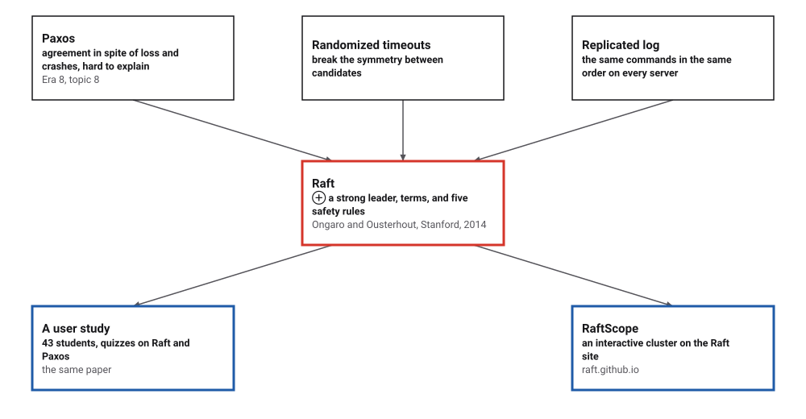
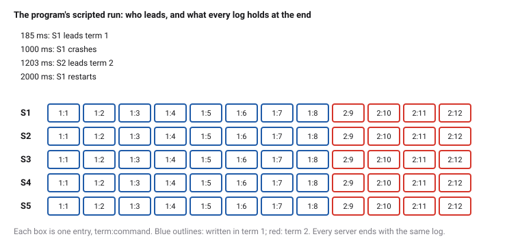
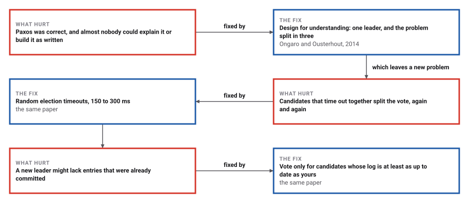

# Raft

*Era 9 · topic 4 · 2014* · [Era 9 index](../README.md) · [← Word Embeddings](../03-word-embeddings/README.md) · [Adam →](../05-adam/README.md) · [Interactive edition](raft.html) · [Program](../../../code/era-09-learning-at-scale/04-raft/)

> **Field note from the visiting historian.** I ran five servers through 300 storms of lost messages, crashes and broken links. Leaders came and went 1,622 times and the logs never disagreed. Then I removed one rule about voting, and in 198 of the storms the cluster forgot something it had promised to keep.

| | |
|---|---|
| **When** | June 2014 |
| **Where** | Stanford University |
| **What hurt** | Paxos was hard to understand and to build |
| **The fix** | A strong leader, terms, random timeouts, one-way logs |
| **Checked** | 0 safety violations in 300 chaotic runs; 198 without the voting rule |

## How ideas combined

A new algorithm is usually an older idea combined with a new one. Paxos (Era 8) let a group of computers agree on one history in spite of lost messages and crashes. Diego Ongaro and John Ousterhout kept the goal and changed the design: one strong leader per numbered term, elections broken up by random timeouts, and a log that flows only from the leader outwards.

<picture>
  <source media="(prefers-color-scheme: dark)" srcset="assets/family-dark.svg">
  
</picture>
*Red: Raft. Blue: how its authors tested and taught it.*

## A cluster to break

Five servers run the same rules as the program, 25 times slower than real time. Send client commands, crash the leader and watch an election; click any server to crash or restart it. Tick the box to give every server the same fixed timeout and watch candidates split the vote.

<picture>
  <source media="(prefers-color-scheme: dark)" srcset="assets/story-dark.svg">
  
</picture>
*In the interactive edition the cluster runs in your browser, and you can crash servers yourself.*

## Era 9, learning at scale

<picture>
  <source media="(prefers-color-scheme: dark)" srcset="assets/era-timeline-dark.svg">
  
</picture>

## Each fix leaves a new pain

<picture>
  <source media="(prefers-color-scheme: dark)" srcset="assets/chain-dark.svg">
  
</picture>
*Read it as a snake: each new problem sits directly under the fix that exposed it.*

## Terms, votes and one log

**Terms.** Time is divided into numbered terms. Each server stores the latest term it has seen; any message carrying a higher term makes the receiver adopt it and become a follower. In each term at most one leader is elected.

**Elections.** A follower that hears nothing from a leader for its election timeout, chosen at random between 150 and 300 ms, becomes a candidate: it moves to the next term, votes for itself and asks the others. A server gives one vote per term, and only to a candidate whose log is at least as up to date as its own: the last entry has a later term, or the same term and the log is at least as long. Votes from a majority (3 of 5) make a leader.

**Replication.** The leader appends each client command to its log and sends it to the followers in AppendEntries messages, which double as heartbeats. Each message names the index and term of the entry just before the new ones; a follower whose log does not have that entry refuses, and the leader tries one entry earlier until the logs meet, then overwrites the follower's disagreeing tail.

**Commitment.** Once a majority stores an entry from the leader's current term, it and everything before it are committed, and each server applies committed entries to its state machine in order. Older-term entries are committed only by counting a newer entry after them.

> **Key idea.** Any two majorities of five share a server. A committed entry is on a majority, a new leader needs votes from a majority, and no one votes for a log that is behind, so every new leader already holds every committed entry.

## Three hundred runs of chaos

**Chaos**: 300 runs of 10,000 simulated milliseconds, 5 servers, 5% of messages lost, every message delayed 5 to 25 ms (so they arrive out of order), servers crashing and restarting, the network cut into two groups for up to a second, and a client command every 20 ms. There were 5,105 elections and 1,622 leaders; 1,314 elections ended in a timeout without a winner; 104,246 entries were committed. The cluster had no leader 10.0% of the time. Safety violations: **0**: the program checked all five properties throughout.

| Property (the paper's words, shortened) | How the program checks it |
|---|---|
| Election Safety: at most one leader in a term | records the leader of every term |
| Leader Append-Only: a leader never overwrites or deletes its entries | compares each leader's log with its log a millisecond before |
| Log Matching: same index and term means identical up to there | compares every pair of logs every 50 ms |
| Leader Completeness: committed entries are in every later leader's log | checks each new leader against all committed entries |
| State Machine Safety: no two servers apply different commands at one index | records the command applied at every index |

**Random against fixed timeouts**: in a calm cluster, crash the leader and time how long until a new one is elected, 200 trials each:

| Election timeout | Median | Slowest | No leader after 100 s | Elections without a winner |
|---|---|---|---|---|
| **random, 150 to 300 ms** | **220 ms** | **828 ms** | **0** | **23** |
| fixed, 150 ms | 9328 ms | over 100 s | 47 | 173,681 |

With one fixed timeout, the four survivors often time out together, each votes for itself, nobody wins, and they time out together again. Only the small spread of message delays ever breaks the tie, and in 47 of 200 trials it never did.

**Break one rule**: let servers vote for any candidate, without checking that its log is up to date. In the same 300 runs the checker found a violation in **198**. The first, in run 0: "Leader Completeness: leader of term 12 lacks committed entry 236": a server with a short log won an election and the committed entry was lost.

## Stanford, 2014

Ongaro and Ousterhout, USENIX ATC '14, Philadelphia, June 2014 (Best Paper): Raft is "a consensus algorithm for managing a replicated log"; "It produces a result equivalent to (multi-)Paxos, and it is as efficient as Paxos". The paper begins from a complaint: "Unfortunately, Paxos is quite difficult to understand, in spite of numerous attempts to make it more approachable."

It names the five properties (Election Safety: "at most one leader can be elected in a given term"), and says that "election timeouts are chosen randomly from a fixed interval (e.g., 150–300ms)". In the user study, 43 students at Stanford and Berkeley took a quiz on each algorithm: the mean was 25.7 on Raft and 20.8 on Paxos, out of 60, and 33 of the 43 scored higher on Raft.

## Testing an algorithm on people

Algorithms are usually judged by time, space and correctness. Raft's authors added a fourth measure, how well people understand it, and tested it the way a teaching method is tested: lectures, a quiz, and a comparison. The rules that make Raft easy to explain are the same ones this program checks: one leader, one direction for the log, one vote per term.

> **Full circle.** Take away one rule, the up-to-date check on votes, and 198 of 300 runs lose something that was already committed.

## Before you read on

<details>
<summary><b>1.</b> A cluster has 5 servers. How many can crash while it keeps working?</summary>

2: the other 3 still form a majority, which is enough to elect a leader and commit entries.
</details>

<details>
<summary><b>2.</b> S1 has log 1:a 1:b 2:c and S2 has 1:a 1:b 1:d 1:e. Whose log is more up to date?</summary>

S1's: its last entry has term 2, later than S2's term 1. Length only matters when the last terms are equal.
</details>

<details>
<summary><b>3.</b> Why can two leaders never exist in the same term?</summary>

Each needs votes from a majority, any two majorities share a server, and a server votes once per term.
</details>

<details>
<summary><b>4.</b> A leader of term 3 crashes before a term-3 entry reaches a majority. Is the entry lost?</summary>

It may be: it was never committed, and a new leader without it will overwrite it on the followers. The client did not get a reply and will retry.
</details>

<details>
<summary><b>5.</b> Why must a crashed server keep its term, its vote and its log on disk?</summary>

Otherwise it could vote twice in one term after a restart, or forget entries it helped commit.
</details>


## Where the evidence lives

| | Object | Where to see it | Licence |
|---|---|---|---|
| — | **In Search of an Understandable Consensus Algorithm (2014)**. Ongaro and Ousterhout, USENIX ATC '14. | [USENIX conference page](https://usenix.org/node/184041) | Drawn placeholder. |

## Every link was opened before it was listed

| Level | Link | Why |
|---|---|---|
| Start | [The Raft Consensus Algorithm](https://raft.github.io/) — raft.github.io | An interactive cluster to break |
| Deeper | [Distributed Systems 6.2: Raft](https://www.youtube.com/watch?v=uXEYuDwm7e4) — Martin Kleppmann | A lecture from Kleppmann's Cambridge course |
| Scholar | [Raft lecture (Raft user study)](https://www.youtube.com/watch?v=YbZ3zDzDnrw) — Diego Ongaro | The lecture recorded for the user study, by Raft's designer |
| Scholar | [In Search of an Understandable Consensus Algorithm](https://www.cs.princeton.edu/courses/archive/spring22/cos418/papers/raft.pdf) — D. Ongaro, J. Ousterhout (2014), on a Princeton course page | The algorithm, the safety properties and the user study |
| Scholar | [USENIX ATC '14 paper page](https://usenix.org/node/184041) — USENIX | Venue, pages and award |

More, with certainty labels and the gaps we could not fill: [Era 9 reference catalog](https://github.com/vij658/AlgorithmEvolutionAtlas/blob/main/book/era-09-learning-at-scale/reference-catalog.md).

## The program behind every number here

[Raft.java](https://github.com/vij658/AlgorithmEvolutionAtlas/blob/main/code/era-09-learning-at-scale/04-raft/Raft.java) makes **361,006 checks**: the five safety properties in every run, that random timeouts elect a leader where fixed ones can stall, and that removing the voting rule breaks safety. Run it with `java Raft.java` (JDK 17 or newer). The heart of it:

```java
static void deliver(Msg m) {
    Server s = S[m.to];
    if (!s.up || cut[m.from][m.to]) return;
    if (m.term > s.term) becomeFollower(s, m.term);
    switch (m.kind) {
        case RV -> {
            boolean upToDate = m.b > s.lastTerm() || (m.b == s.lastTerm() && m.a >= s.log.size());
            boolean grant = m.term == s.term && (s.votedFor == -1 || s.votedFor == m.from) && (upToDate || !VOTE_RESTRICTION);
            if (grant) { s.votedFor = m.from; s.deadline = now + timeout(); }
            Msg r = new Msg(); r.kind = RV_REPLY; r.from = s.id; r.to = m.from; r.term = s.term; r.a = grant ? 1 : 0;
            send(r);
        }
        case RV_REPLY -> {
            if (s.role == CANDIDATE && m.term == s.term && m.a == 1) {
                s.votes.add(m.from);
                if (s.votes.size() > N / 2) becomeLeader(s);
            }
        }
        case AE -> {
            Msg r = new Msg(); r.kind = AE_REPLY; r.from = s.id; r.to = m.from; r.term = s.term;
            if (m.term < s.term) { r.a = 0; send(r); return; }
            if (s.role == LEADER) violation("Election Safety: leader " + s.id + " got AppendEntries from another leader of term " + m.term);
            s.role = FOLLOWER;
            s.deadline = now + timeout();
            if (m.a > s.log.size() || s.termAt(m.a) != m.b) { r.a = 0; send(r); return; }
            for (int k = 0; k < m.entries.size(); k++) {
                int idx = m.a + 1 + k;
                if (idx <= s.log.size() && s.log.get(idx - 1).term != m.entries.get(k).term) {
                    if (idx <= s.commit) violation("a committed entry was overwritten at index " + idx);
                    while (s.log.size() >= idx) s.log.remove(s.log.size() - 1);
                }
                if (idx > s.log.size()) s.log.add(m.entries.get(k));
            }
            int lastNew = m.a + m.entries.size();
            if (m.commit > s.commit) s.commit = Math.min(m.commit, lastNew);
            apply(s);
            r.a = 1; r.b = lastNew;
            send(r);
        }
        case AE_REPLY -> {
            if (s.role != LEADER || m.term != s.term) return;
            if (m.a == 1) {
                s.matchIndex[m.from] = Math.max(s.matchIndex[m.from], m.b);
                s.nextIndex[m.from] = s.matchIndex[m.from] + 1;
                for (int n = s.log.size(); n > s.commit; n--) {
                    if (s.log.get(n - 1).term != s.term) break; // only entries of the current term are committed by counting
                    int count = 1;
                    for (int j = 0; j < N; j++) if (j != s.id && s.matchIndex[j] >= n) count++;
                    if (count > N / 2) {
                        for (int i = s.commit + 1; i <= n; i++) {
                            Entry e = s.log.get(i - 1);
                            Entry before = committedAt.putIfAbsent(i, e);
                            if (before != null && !before.equals(e)) violation("two different entries committed at index " + i);
                            commandsCommitted++;
                        }
                        s.commit = n;
                        apply(s);
                        break;
                    }
                }
            } else {
                s.nextIndex[m.from] = Math.max(1, s.nextIndex[m.from] - 1);
            }
        }
    }
}

/** Log Matching: if two logs hold an entry with the same index and term, they agree on everything up to it. */
static void checkLogMatching() {
    for (int i = 0; i < N; i++) for (int j = i + 1; j < N; j++) {
        List<Entry> a = S[i].log, b = S[j].log;
        int n = Math.min(a.size(), b.size());
        int lastSame = -1;
        for (int k = n - 1; k >= 0; k--) if (a.get(k).term == b.get(k).term) { lastSame = k; break; }
        for (int k = 0; k <= lastSame; k++) if (!a.get(k).equals(b.get(k))) { violation("Log Matching between servers " + i + " and " + j); return; }
    }
}
```

